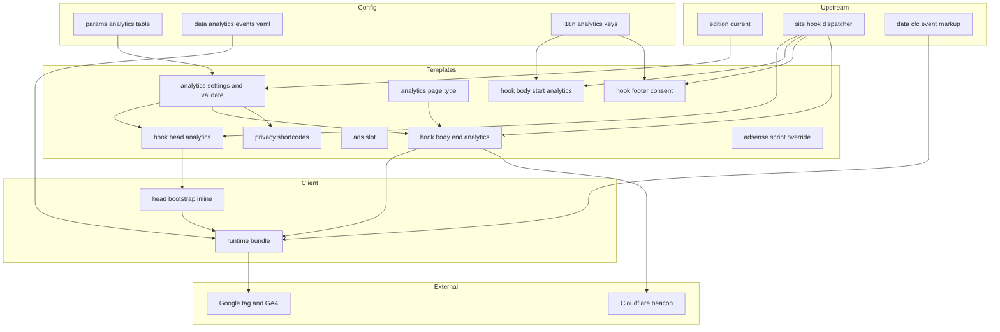
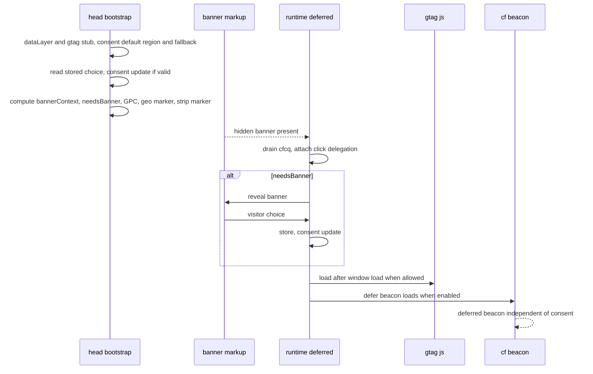
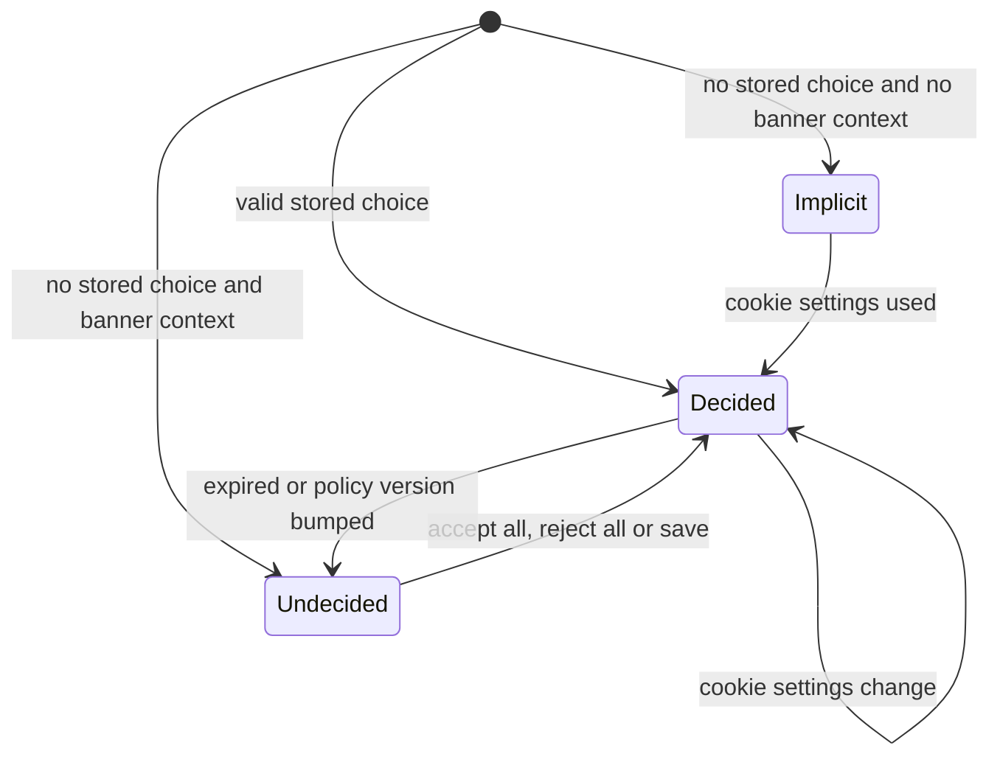
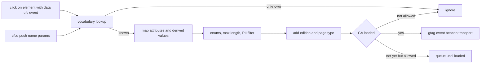

# Design Document: analytics-consent

## Overview
**Purpose**: This feature delivers compliant, lightweight measurement and privacy governance for CardápioFC: one correctly configured GA4 property behind Google Consent Mode v2, a localised consent banner with region-aware defaults, a cookieless Cloudflare Web Analytics baseline, a shared product-event vocabulary, and a privacy policy per edition. The website contains zero advertisements (no AdSense, no ad slots, no ads.txt).

**Users**: Visitors in six editions (asked for consent where required, able to change it anywhere); the site operator (sets identifiers in one config table, reads GA4/Cloudflare reports); downstream implementers (app-deeplinks, data-pages) who mark interactions using event contracts defined here.

**Impact**: Removes the GA4-ID-in-GTM misconfiguration and the legacy AdSense loader that the theme's reused `essentials/script.html` renders from `params.google_adsense`; fills the analytics hook slots that site-foundation reserved; adds privacy pages, i18n keys and an analytics verification script. No file under `themes/hugoplate/` or `_vendor/` changes.

### Goals
- Consent defaults precede every Google tag on every page; EEA/UK/CH visitors default to denied on any edition.
- Banner context ⇒ nothing from Google loads before an explicit grant; everywhere else Google tags load only after `load`.
- Every page view and event carries `edition` and `page_type`; product interactions measured through one shared vocabulary.
- Zero ads across the entire site: no ad scripts, no ad slots, no ads.txt.
- Added first-party code ≤ 6 KB gzip per page; LCP within 100 ms of baseline; CLS ≤ 0.1.
- `node scripts/check-analytics.mjs` verifies the invariants on production output.

### Non-Goals
- Advertisements / Ad networks (explicit non-goal; zero ads on site).
- Google Tag Manager container, server-side tagging, mobile app analytics.
- Response headers / CSP, geo-redirect rules (edge-delivery); `head-seo` (seo-social); `*-app` hooks (app-deeplinks).

## Boundary Commitments

### This Spec Owns
- Values of `params.google_tag_manager`, `params.google_adsense`, `params.cookies.*`, `services.googleAnalytics.ID` and the new `[analytics]` table in `config/_default/params.toml` (disabling legacy ad parameters).
- Hook files `layouts/_partials/hooks/{head-analytics,body-start-analytics,footer-consent,body-end-analytics}.html`.
- Partials `layouts/_partials/analytics/*`, the empty override `layouts/_partials/adsense-script.html`; shortcodes `layouts/_shortcodes/{privacy-services,cookie-settings}.html`.
- Client code `assets/js/analytics/*`; event vocabulary `data/analytics/events.yaml` (**the event taxonomy contract**).
- Consent state model, stored-choice format, consent-region list, banner, footer cookie-settings control.
- Privacy pages `content/<edition>/privacy.md`; analytics i18n keys (appended); `scripts/check-analytics.mjs`; `docs/analytics.md`; dev-only fixture `content/en/analytics-fixture/` + `layouts/analytics-fixture.html`.

### Out of Boundary
- `site/hook.html`, `baseof.html`, `site/*`, `cfc/*`, `edition/*`, `time/*`, `scripts/check-site.mjs`, `package.json`, `assets/css/custom.css`, `config/production/hugo.toml`, `[[params.plugins.*]]`, the edition registry schema (site-foundation).
- `head-seo`, canonical/hreflang, robots, sitemaps (seo-social); `head-app`, `body-start-app`, `footer-app`, `body-end-app`, search page, app landing pages, smart banner (app-deeplinks).
- Entity templates and where ad slots appear on them (data-pages); share-control markup on entity pages (owner of that markup).
- `_headers`/CSP, Redirect Rules incl. the geo marker mechanics, Cloudflare zone settings (edge-delivery).
- `themes/hugoplate/**`, `_vendor/**`, `go.mod`/`go.sum`, module imports (no module is added or removed).

### Allowed Dependencies
- site-foundation contracts: Hook Slot Contract, `partial "edition/current.html"`, `data-cfc-*` Tracking Data Attribute Contract, Menu Contract (`footer` menu via front matter), i18n mount chain, edition-choice marker `?edition=en`.
- Hugo 0.165.0 built-ins: `js.Build`, `fingerprint`, `jsonify`/`safeJS`, `T`, `partialCached`, `errorf`/`warnf`, `hugo.IsProduction`, `site.Data`, shortcodes, front matter menus.
- External services: Google tag (`gtag.js`), Cloudflare Web Analytics beacon. No advertising services. No npm dependencies; Node ≥ 20 built-ins for the check script.
- Dependency direction: **config + vocabulary → `analytics/settings` (+ validate) → hooks/partials/shortcodes → client runtime**. Client code never reads Hugo params directly (only the emitted JSON and `@params`). Hooks call only `analytics/*`, `edition/current.html` and `T`.

### Revalidation Triggers
- Event vocabulary changes (names, marker attributes, enums, parameter names) → app-deeplinks, data-pages, operator GA4 custom dimensions.
- `page_type` values or the front matter override key → data-pages, app-deeplinks.
- Geo-landing marker name/format (`cfc_geo`) or reliance on `?edition=` → edge-delivery.
- Third-party origin list (GA, Cloudflare) or new inline scripts → edge-delivery CSP.
- Switching to a certified CMP or adding GTM → this spec's banner/loader components, privacy pages, edge-delivery CSP.
- Foundation changes to slot positions, `edition/current.html` keys (`code`, `country`, `isGlobal`), `data-cfc-*` names, CheckScript check (e) or the first-party JS budget → this spec.

## Architecture

### Existing Architecture Analysis
- Foundation `site/head.html` emits charset, viewport, then `head-analytics` before any other script; `baseof` renders `body-start-analytics` first in `<body>`, the footer renders `footer-consent` in the bottom bar, and `body-end-analytics` is last in `<body>` after the theme script bundle.
- Theme `essentials/script.html` (reused) still calls `partialCached "adsense-script.html"` (renders when `params.google_adsense` set) and `partialCached "cookie-consent.html"` (renders when `params.cookies.enable`). `essentials/head.html` (GA internal template, GTM) is no longer used by foundation.
- Foundation CheckScript (e) asserts absence of tracking strings "while no hooks exist"; its first-party JS budget is ≤ 10 KB gzip for the whole page.

### Architecture Pattern & Boundary Map
Selected pattern: **inline consent bootstrap + deferred vanilla runtime**, with server-rendered localised UI and data-driven event vocabulary (Option A in `research.md`).



**Architecture Integration**:
- Domain boundaries: Configuration (params, vocabulary, validation) · Consent (head bootstrap, store, banner, controls) · Measurement (GA loader, event dispatcher, Cloudflare beacon) · Zero-Ads Invariant (empty legacy override) · Legal content (privacy pages, shortcodes) · Tooling (check script, docs). Each maps to disjoint files (File Structure Plan) so core tasks run in parallel.
- Existing patterns preserved: foundation hook slots, edition contract, i18n append seam, footer menu via front matter, theme script bundle untouched.
- New components rationale: head bootstrap (defaults must precede tags), runtime (banner, loaders, events in one deferred file), vocabulary (one contract for all emitters), validator (prevents the GA4-in-GTM class of errors), check script (verifiable 12.4).

### Technology Stack

| Layer | Choice / Version | Role in Feature | Notes |
|-------|------------------|-----------------|-------|
| Site generator | Hugo 0.165.0 extended | Hooks, partials, i18n, `js.Build`, validation | New template system paths |
| Client | Vanilla ES2019 via `js.Build` (esbuild, `format: iife`, `minify`) | Head bootstrap (inline), runtime (deferred, fingerprinted + SRI) | No libraries |
| Styling | Tailwind v4 utilities in markup (via `hugo_stats.json`) | Banner, controls, ad slots | No new CSS file |
| Consent signalling | Google Consent Mode v2 (`gtag` consent API) | Defaults, updates, region rules | `region` = 32 codes |
| Measurement | GA4 via `gtag.js`; Cloudflare Web Analytics beacon | Page views + events; cookieless baseline | GA4 ID = one config value |
| Ads | None | The site contains zero advertisements | Explicit non-goal |
| Storage | `localStorage` key `cfc_consent` | Stored choice (strictly necessary) | Per origin → all editions |
| Tooling | Node ≥ 20 built-ins | `scripts/check-analytics.mjs` | Run as `node scripts/check-analytics.mjs` after `pnpm build` |

## File Structure Plan

### Directory Structure
```
config/_default/params.toml                 # MODIFY (owned keys only): google_tag_manager = "", google_adsense = "", keep [cookies] enable = false, ADD [analytics] table
hugo.toml                                   # MODIFY (owned value only): [services.googleAnalytics] ID = "" + comment pointing to params.analytics.ga4_id
data/analytics/events.yaml                  # CREATE: event vocabulary (taxonomy contract)
layouts/
├── _partials/
│   ├── adsense-script.html                 # CREATE: empty override — neutralises the theme/module ungated AdSense loader
│   ├── analytics/
│   │   ├── settings.html                   # returning partial: Settings view-model per edition (calls validate)
│   │   ├── validate.html                   # build-time assertions (errorf/warnf)
│   │   ├── page-type.html                  # returning partial: PageType for a page
│   │   ├── head-inline.html                # inline <script> = HeadConfig JSON + minified head bootstrap
│   │   ├── banner.html                     # hidden localised banner + customise panel
│   │   ├── settings-button.html            # "cookie settings" control (footer, privacy page)
│   │   ├── runtime.html                    # RuntimeConfig JSON + deferred runtime <script>
│   │   └── beacon.html                     # Cloudflare Web Analytics beacon (production + token)
│   └── hooks/
│       ├── head-analytics.html             # → analytics/head-inline.html
│       ├── body-start-analytics.html       # → analytics/banner.html
│       ├── footer-consent.html             # → analytics/settings-button.html
│       └── body-end-analytics.html         # → analytics/runtime.html + analytics/beacon.html
└── _shortcodes/
    ├── privacy-services.html               # services table + controller/contact/authority from config + i18n
    └── cookie-settings.html                # inline cookie-settings control
assets/js/analytics/
├── shared.js                               # constants, consent-type list, stored-choice parse/validate, region/time-zone helpers
├── head.js                                 # HeadBootstrap (inlined)
├── store.js                                # ConsentStore: write, withdraw, cookie cleanup
├── banner.js                               # BannerController
├── loaders.js                              # TagLoader: gtag, debug stubs
├── events.js                               # EventDispatcher + sanitiser (uses @params vocabulary)
└── index.js                                # runtime entry: wires store, banner, loaders, events, queue
content/
├── en/privacy.md, en-gb/privacy.md, en-ie/privacy.md   # CREATE: English policies (regional authority via i18n)
├── pt-br/privacy.md, pt-pt/privacy.md                  # CREATE: Portuguese policies (BR/PT wording)
├── es-ar/privacy.md                                    # CREATE: Spanish (AR) policy
└── en/analytics-fixture/                               # CREATE: dev-only AnalyticsFixture (never rendered in production)
    ├── _index.md                                       # build render/list never + cascade (target environment production → render/list never)
    └── demo.md                                         # layout analytics-fixture
layouts/analytics-fixture.html              # CREATE: AnalyticsFixture layout — sample app_open/store_click/share markup, cfcq search button
i18n/en.yaml, pt.yaml, es.yaml              # MODIFY (append): analytics keys (identical key sets)
i18n/en-gb.yaml, en-ie.yaml, pt-pt.yaml, es-ar.yaml   # MODIFY (append): regional overrides (authority, wording)
scripts/check-analytics.mjs                 # CREATE: AnalyticsCheck
docs/analytics.md                           # CREATE: operator documentation
```

### Modified Files (detail)
- `config/_default/params.toml` — append:
```toml
# analytics-consent (all measurement/consent settings; ads completely disabled)
[analytics]
ga4_id = ""                 # OPEN DECISION: "G-667SFTMKPH" or "G-4PSY14GVNT" (single value for all editions)
cf_web_analytics = "embedded"   # "embedded" (beacon with token) | "zone" (automatic injection at Cloudflare) | "off"
cf_beacon_token = ""        # Cloudflare Web Analytics site token, required when cf_web_analytics = "embedded"
[analytics.consent]
policy_version = 1
retention_days = 180
outside_region_default = "granted"   # "granted" | "denied" (OPEN DECISION for BR/AR legal review)
wait_for_update_ms = 500
region = ["AT","BE","BG","HR","CY","CZ","DK","EE","FI","FR","DE","GR","HU","IE","IT","LV","LT","LU","MT","NL","PL","PT","RO","SK","SI","ES","SE","IS","LI","NO","GB","CH"]
timezones = ["Europe/","Atlantic/Canary","Atlantic/Madeira","Atlantic/Azores","Atlantic/Reykjavik","Atlantic/Faroe","Arctic/Longyearbyen"]
[analytics.privacy]
controller = ""             # OPEN DECISION (required in production)
contact_email = ""          # OPEN DECISION (required in production)
```
  and set `google_tag_manager = ""`, `google_adsense = ""` (comment: "must stay empty; CardápioFC contains zero ads").
- `hugo.toml` — `[services.googleAnalytics] ID = ""` (Hugo's embedded GA template is not rendered by the site).

## System Flows

### Page load

- Head bootstrap runs synchronously before any other script (slot position guaranteed by foundation). Runtime and beacon are `defer`.
- "Allowed" is defined by the Consent Decision Table below.

### Consent state


### Consent decision table
| State | GA4 library | GA cookies |
|---|---|---|
| Undecided (banner shown) | not loaded | none |
| Decided, analytics granted | loaded after `load` | allowed |
| Decided, analytics denied | not loaded | deleted on withdrawal |
| Implicit | loaded after `load` | per Google region default |
- In every state, non-production environments replace network loads with `console.info` debug output (1.7).
- No advertising network scripts are ever loaded.

### Event dispatch


## Requirements Traceability

| Requirement | Summary | Components | Interfaces | Flows |
|-------------|---------|------------|------------|-------|
| 1.1 | Single GA4 ID | AnalyticsConfig, AnalyticsSettings | `params.analytics.ga4_id` | — |
| 1.2, 1.3 | ID format / empty | AnalyticsValidator | `analytics/validate.html` | — |
| 1.4, 1.5 | No GTM; GA4-in-GTM guard | AnalyticsValidator, AnalyticsConfig | `google_tag_manager` rule | — |
| 1.6 | Legacy paths silent | LegacyNeutraliser, AnalyticsConfig, AnalyticsCheck | empty `adsense-script.html`, blank keys | — |
| 1.7 | No data outside production | TagLoader, RuntimeHook, CloudflareBeacon | `env` in RuntimeConfig | Page load |
| 2.1, 2.2, 2.3 | Defaults before tags, region | HeadBootstrap | HeadConfig `region`/`outside` | Page load |
| 2.4 | Stored choice first | HeadBootstrap, shared | StoredChoice | Page load |
| 2.5 | GPC | HeadBootstrap | `navigator.globalPrivacyControl` | Consent state |
| 2.6 | Region list in config | AnalyticsConfig | `[analytics.consent]` | — |
| 3.1, 3.2 | Banner visibility | HeadBootstrap, BannerController | `bannerContext` rule | Consent state |
| 3.3, 3.4, 3.5 | Actions, customise, text/link | ConsentBanner, BannerController | banner markup contract | — |
| 3.6 | Accessibility | ConsentBanner | ARIA/keyboard rules | — |
| 3.7 | No CLS, not LCP | ConsentBanner | fixed sheet, copy limits | — |
| 3.8, 3.10 | No implied consent; non-blocking | BannerController | — | Consent state |
| 3.9 | No-JS | ConsentBanner, TagLoader | `hidden` default | — |
| 4.1, 4.2, 4.3 | Store, all editions, expiry/version | ConsentStore, shared | StoredChoice | Consent state |
| 4.4 | Footer control | FooterConsentHook, SettingsControl | `data-cfc-consent-open` | — |
| 4.5, 4.6 | Withdrawal | ConsentStore, TagLoader | cookie cleanup list | Consent state |
| 4.7 | Storage failure | ConsentStore | try/catch policy | — |
| 5.1, 5.2 | Page view + params | TagLoader, PageType | `gtag config` params | Page load |
| 5.3, 5.4, 5.5 | Gated/after-load loading | TagLoader | decision table | Page load |
| 5.6 | Blocked GA | TagLoader, EventDispatcher | error policy | — |
| 6.1, 6.2, 6.5 | Beacon | CloudflareBeacon | `cf_beacon_token` | Page load |
| 6.3, 6.4 | Automatic vs embedded | CloudflareBeacon, OperatorDocs | docs | — |
| 7.1, 7.2, 7.3 | Taxonomy + delegation | EventVocabulary, EventDispatcher | `events.yaml`, `data-cfc-*` | Event dispatch |
| 7.4 | Early reports | HeadBootstrap, EventDispatcher | `window.cfcq` | Event dispatch |
| 7.5, 7.6 | Search sanitising, no PII | EventDispatcher | sanitiser rules | Event dispatch |
| 7.7 | Consent-bound events | EventDispatcher, TagLoader | gate | Event dispatch |
| 7.8 | Non-blocking navigation | EventDispatcher | `transport_type: beacon` | Event dispatch |
| 8.1, 8.2, 8.4 | Geo landing | HeadBootstrap, EventDispatcher | `cfc_geo` marker | Page load |
| 8.3 | Manual choice | HeadBootstrap, TagLoader | `edition_source` | Page load |
| 9.1–9.5 | Zero ads invariant, legacy AdSense neutraliser | LegacyNeutraliser, AnalyticsCheck | empty `adsense-script.html`, blank keys | — |
| 11.1, 11.2, 11.3, 11.4, 11.5 | Privacy pages | PrivacyPages, PrivacyShortcodes | shortcodes, i18n | — |
| 11.6 | Links | PrivacyPages (footer menu), ConsentBanner | front matter `menus.footer` | — |
| 11.7 | Missing controller | AnalyticsValidator | production rule | — |
| 12.1, 12.3 | No early third-party, LCP/CLS | TagLoader, ConsentBanner | decision table | Page load |
| 12.2 | ≤ 6 KB | HeadBootstrap, Runtime, AnalyticsCheck | budget check | — |
| 12.4 | Automated check | AnalyticsCheck | `scripts/check-analytics.mjs` | — |
| 12.5 | Operator docs | OperatorDocs | `docs/analytics.md` | — |

## Components and Interfaces

| Component | Domain/Layer | Intent | Req Coverage | Key Dependencies | Contracts |
|-----------|--------------|--------|--------------|------------------|-----------|
| AnalyticsConfig | Config | All feature settings; legacy keys blanked | 1.1, 1.4, 1.6, 2.6 | Hugo params (P0) | State |
| EventVocabulary | Config | Event taxonomy contract | 7.2, 7.3 | — | State |
| LegacyNeutraliser | Config/Templates | Empty `adsense-script.html` override | 1.6, 9.2 | theme `essentials/script.html` (P0) | — |
| AnalyticsSettings | Templates | Settings view-model per edition | 1.1, 2.6, 3.1 | edition/current (P0), validate (P0) | Service |
| AnalyticsValidator | Templates | Build-time assertions | 1.2, 1.3, 1.5, 11.7 | params (P0) | Service |
| PageType | Templates | Page type for a page | 5.2 | page front matter/section (P0) | Service |
| HeadAnalyticsHook + HeadBootstrap | Consent | Defaults, stored choice, banner context, markers, queue | 2.1–2.5, 3.1, 3.2, 7.4, 8.1–8.4 | settings (P0) | Service, State |
| ConsentBanner (BodyStartHook) | Consent | Hidden localised banner markup | 3.3–3.7, 3.9, 3.10, 11.6 | i18n (P0) | — |
| SettingsControl + FooterConsentHook | Consent | Cookie settings control | 4.4, 11.3 | i18n (P0) | — |
| BannerController | Consent (client) | Show/hide, actions, focus | 3.1–3.4, 3.8, 3.10 | ConsentStore (P0) | State |
| ConsentStore | Consent (client) | Persist, expire, withdraw | 4.1–4.3, 4.5–4.7 | shared (P0) | State |
| TagLoader | Measurement (client) | Load gtag per decision table; debug mode | 1.7, 5.1, 5.3–5.6, 8.3, 12.1 | gtag.js (P0) | Service |
| EventDispatcher | Measurement (client) | Delegation, API queue, mapping, sanitising | 7.1–7.8, 8.1 | vocabulary (P0), TagLoader (P0) | Event |
| RuntimeHook (BodyEndHook) | Measurement | RuntimeConfig JSON + runtime script | 1.7, 5.2 | settings, page-type (P0) | — |
| CloudflareBeacon | Measurement | Cookieless beacon | 6.1–6.5 | Cloudflare (P1) | — |
| PrivacyPages + PrivacyShortcodes | Legal content | Six localised policies | 11.1–11.6 | settings, i18n, footer menu (P0) | — |
| AnalyticsI18n | Legal/Consent | Strings in all bases + regional overrides | 3.5, 11.1, 11.4 | foundation mount chain (P0) | State |
| AnalyticsCheck | Tooling | Verifies invariants on `public/` (zero ads, no ads.txt) | 1.6, 9.5, 12.2, 12.4 | Node built-ins (P0) | Batch |
| AnalyticsFixture | Tooling | Dev-only page exercising downstream markup, API queue | 7.1, 7.2, 7.4 | vocabulary (P1) | — |
| OperatorDocs | Tooling | Setup and decisions | 6.3, 6.4, 12.5 | — | — |

### Event Taxonomy (contract consumed by downstream specs)

Common parameters on **every** page view and event: `edition` (edition code, from page settings — never from markup), `page_type` (see PageType), also sent as GA4 `content_group`. Page views additionally carry `edition_source` = `geo` | `manual` when a marker was present.

| Event (`data-cfc-event` value = GA4 event name) | Trigger | Marker attributes → GA4 parameters | Derived parameters | Emitted by |
|---|---|---|---|---|
| `match_open` | click | `data-cfc-match` → `match_slug` (≤ 100) | — | site-foundation (match card) |
| `channel_click` | click | `data-cfc-channel` → `channel_id` (≤ 60); `data-cfc-channel-type` → `channel_type` ∈ {tv, streaming, free_tv}; `data-cfc-match` → `match_slug` | `link_domain` (host of `href`) | site-foundation (channel badge) |
| `edition_switch` | click | `data-cfc-target-edition` → `to_edition` (edition code) | `from_edition` = page edition | site-foundation (switcher) |
| `app_open` | click or API | `data-cfc-app-target` → `app_target` ∈ {scheme, universal_link}; `data-cfc-placement` → `placement` ∈ {smart_banner, app_landing, entity, footer}; `data-cfc-app-path` → `app_path` (path only, ≤ 100) | `platform` ∈ {ios, android, other} | app-deeplinks |
| `store_click` | click | `data-cfc-store` → `store` ∈ {app_store, play_store}; `data-cfc-placement` → `placement` | `platform` | app-deeplinks |
| `share` (GA4 recommended) | click | `data-cfc-share-method` → `method` ∈ {native, whatsapp, x, facebook, telegram, email, copy_link}; `data-cfc-content-type` → `content_type` ∈ {match, team, league, page}; `data-cfc-item` → `item_id` (≤ 100) | — | owner of share markup (data-pages / app-deeplinks) |
| `search` (GA4 recommended) | API only | `search_term` (trim, lower-case, ≤ 100; dropped if it matches an email or ≥ 7-digit phone pattern); `results_count` (integer ≥ 0) | — | app-deeplinks (on submit, or after 1 s typing pause with ≥ 2 chars; at most once per distinct term per page) |
| `geo_landing` | page load | marker `cfc_geo` → `geo_country` (`^[A-Z]{2}$`, else omitted) | `landing_path` (path only) | analytics-consent (marker appended by edge-delivery) |

Rules:
- Enum violations map to `other`; over-length values are truncated; unknown event names and unknown attributes are ignored (7.3).
- The marker element is found with `event.target.closest('[data-cfc-event]')`; one delegated `click` listener in capture phase on `document`; modified clicks (ctrl/meta/middle) are also measured.
- **app-deeplinks note**: app-deeplinks emits store-click and app-open markup with exactly these `data-cfc-*` attributes (and `cfcq.push(['app_open', {app_target, placement, app_path}])` for automatic open attempts on landing pages, `cfcq.push(['search', {search_term, results_count}])` for search). It sets `page_type` via front matter where Section mapping is insufficient.

#### Vocabulary data schema (`data/analytics/events.yaml`)
```typescript
type ParamSpec =
  | { attr?: string; max: number }                          // free string
  | { attr?: string; enum: string[] }                       // enum, fallback "other"
  | { attr?: string; type: "int"; min?: number }
  | { attr?: string; sanitize: "query"; max: number };      // search term rules
interface EventSpec {
  trigger: "click" | "api" | "click_or_api" | "load";
  params: Record<string /* GA4 param name */, ParamSpec>;
  derived?: Array<"link_domain" | "platform" | "from_edition" | "landing_path">;
}
type EventVocabulary = Record<string /* event name, snake_case ≤ 40 */, EventSpec>;
```
- Passed to the runtime with `js.Build` `params` (`import vocab from "@params"`), read by AnalyticsCheck, and rendered as a table in `docs/analytics.md`.

### Configuration & Templates

#### AnalyticsSettings / AnalyticsValidator
| Field | Detail |
|-------|--------|
| Intent | Single read path for feature configuration plus fail-fast validation |
| Requirements | 1.1, 1.2, 1.3, 1.5, 2.6, 3.1, 11.7 |

**Contracts**: Service [x]
```typescript
interface Settings {
  env: "production" | "development";        // hugo.IsProduction
  ga4: string;                              // "" when disabled
  cf: { mode: "embedded" | "zone" | "off"; token: string };
  consent: { region: string[]; outside: "granted" | "denied"; timezones: string[];
             policyVersion: number; retentionDays: number; waitMs: number };
  ads: { client: string; npaOnDeny: boolean; slots: Record<Placement, string> };
  privacy: { controller: string; contactEmail: string };
  edition: { code: string; country: string; isGlobal: boolean };   // from edition/current.html
  editionInRegion: boolean;                 // edition.country ∈ consent.region
}
type Placement = "home_feed" | "match_after_channels" | "team_after_fixtures" | "league_after_fixtures" | "search_after_results";
// partialCached "analytics/settings.html" . site.Language.Lang -> Settings
// partialCached "analytics/validate.html" . site.Language.Lang -> "" (side effects only)
```
Validation rules (message prefix `analytics-consent:`):

| Check | Response |
|---|---|
| `ga4_id` non-empty and not `^G-[A-Z0-9]{4,16}$` | `errorf` naming value (1.2) |
| `ga4_id` empty | `warnf` "GA4 disabled" (1.3) |
| `google_tag_manager` matches `^G-` | `errorf` "GA4 measurement ID in GTM field" (1.5) |
| `google_tag_manager` other non-empty / `google_adsense` non-empty | `warnf` "ignored; legacy keys disabled" (1.4, 1.6, 9.2) |
| `cf_web_analytics` ∉ {embedded, zone, off}; mode `embedded` with token not `^[a-f0-9]{32}$` | `errorf` (6.1, 6.4) |
| mode `embedded` with empty token | `warnf` "beacon not emitted; set token or use zone" (6.3) |
| region code not `^[A-Z]{2}$`; `outside_region_default` ∉ {granted, denied}; `retention_days` ∉ 1..395; `policy_version` < 1 | `errorf` |
| production and (`privacy.controller` or `privacy.contact_email` empty) | `errorf` naming key (11.7) |

#### PageType
```typescript
type PageType = "home" | "match" | "team" | "league" | "search" | "app_landing" | "legal" | "other";
// partial "analytics/page-type.html" Page -> PageType
// order: .Params.page_type (if valid) → .IsHome ⇒ home → .Section in {match, team, league, search} ⇒ same → .Section in {favourites, my_agenda, settings} ⇒ app_landing → other
```
- Privacy pages set `page_type: legal` in front matter; lineup pages (under `match`) are `match`.

#### HeadAnalyticsHook → `analytics/head-inline.html`
- Emits exactly one `<script data-cfc-consent-defaults>`: `window.__cfcCfg = {{ $headCfg | jsonify | safeJS }};` followed by the minified bootstrap (`resources.Get "js/analytics/head.js" | js.Build (dict "minify" true "target" "es2019" "format" "iife")` → `.Content | safeJS`). Emitted in every environment (consent logic is testable in development); no external `src`.
```typescript
interface HeadConfig { region: string[]; outside: "granted" | "denied"; tz: string[]; pv: number; days: number;
                       wait: number; inRegion: boolean; global: boolean; }
```

#### HeadBootstrap (`assets/js/analytics/head.js`)
| Field | Detail |
|-------|--------|
| Intent | Establish consent before any tag; compute shared boot state; start the API queue |
| Requirements | 2.1–2.5, 3.1, 3.2, 7.4, 8.1–8.4 |

**Contracts**: Service [x] / State [x]
```typescript
type CV = "granted" | "denied";
interface ConsentState { analytics_storage: CV; ad_storage: CV; ad_user_data: CV; ad_personalization: CV; }
interface StoredChoice { v: 1; pv: number; t: number /* epoch ms */; a: 0 | 1; m: 0 | 1 /* marketing/ads */ }
interface BootState {
  stored: StoredChoice | null;              // null when absent, unparsable, expired or old pv
  bannerContext: boolean;                   // inRegion || device time zone matches tz prefixes
  needsBanner: boolean;                     // bannerContext && stored === null
  gpc: boolean;
  source: "geo" | "manual" | null;
  geoCountry: string | null;
}
// window.__cfc: BootState ; window.cfcq: Array<[string, Record<string, string | number>]>
```
Order of operations (all synchronous, wrapped in try/catch so failures never break the page):
1. `window.dataLayer ||= []`; `window.gtag = function(){dataLayer.push(arguments)}`.
2. `gtag('consent','default', {all four: 'denied', region: cfg.region, wait_for_update: cfg.wait})`; `gtag('consent','default', {all four: cfg.outside, wait_for_update: cfg.wait})`; if `gpc` → `ad_user_data`/`ad_personalization` `denied` in the fallback default; `gtag('set','ads_data_redaction', true)`.
3. Read `localStorage.cfc_consent` via `shared.parseChoice(raw, cfg.pv, cfg.days, Date.now())`; if valid → `gtag('consent','update', toState(stored))`.
4. `bannerContext = cfg.inRegion || shared.tzMatches(Intl.DateTimeFormat().resolvedOptions().timeZone, cfg.tz)`.
5. Markers: if URL has `cfc_geo` → `source = "geo"`, `geoCountry` if `^[A-Z]{2}$`, remove the parameter with `history.replaceState` (8.2); else if `cfg.global` and URL has `edition` → `source = "manual"` (parameter left intact; owned by foundation/edge-delivery).
6. `window.cfcq = window.cfcq || []` (callers push before the runtime loads).

#### ConsentBanner (`analytics/banner.html`, via `body-start-analytics`)
- `<section id="cfc-consent" role="region" aria-labelledby="cfc-consent-title" hidden>`; fixed bottom sheet (`fixed inset-x-0 bottom-0 z-50`, max height 50vh, scrollable), `text-sm` body ≤ 160 characters, title ≤ 40 characters at base size so the page heading remains the LCP element.
- Layer 1: title, text with link to `relLangURL "privacy/"`, buttons in one row: **Reject all**, **Accept all** (same component class, size and colour weight), **Customise** (text button).
- Layer 2 (`hidden` until Customise): two checkboxes (`analytics`, `ads`) unchecked by default with label + one-line description, **Save choices** button.
- Keyboard: native buttons/checkboxes; banner is first in DOM so it is first in tab order; on reopen from cookie settings, focus moves to the banner title (`tabindex="-1"`) and returns to the invoking control on close; `Escape` does not dismiss without a choice (3.8). Focus ring from foundation `cfc/base.css`; colours use theme tokens meeting contrast rules.
- Strings: `T "consent_title"`, `consent_text`, `consent_accept_all`, `consent_reject_all`, `consent_customise`, `consent_save`, `consent_analytics_label`, `consent_analytics_desc`, `consent_ads_label`, `consent_ads_desc`, `consent_privacy_link`.

#### SettingsControl (`analytics/settings-button.html`) and FooterConsentHook
- `<button type="button" data-cfc-consent-open hidden class="…">{{ T "cookie_settings" }}</button>`; the runtime removes `hidden` (no inert control without JS, 3.9). Rendered by `footer-consent` and by the `cookie-settings` shortcode.

#### RuntimeHook (`analytics/runtime.html`, via `body-end-analytics`)
```typescript
interface RuntimeConfig { env: "production" | "development"; ga4: string; ads: { client: string; npaOnDeny: boolean };
                          edition: string; pageType: PageType; }
```
- `<script type="application/json" id="cfc-analytics-config">{{ $rc | jsonify | safeJS }}</script>` then `<script defer src integrity crossorigin="anonymous">` for `resources.Get "js/analytics/index.js" | js.Build (dict "minify" true "target" "es2019" "format" "iife" "params" site.Data.analytics.events "targetPath" "js/cfc-analytics.js") | fingerprint` (one shared file for all editions).

#### CloudflareBeacon (`analytics/beacon.html`)
- Only when `hugo.IsProduction`, `cf.mode = "embedded"` and the token is set: `<script defer src="https://static.cloudflareinsights.com/beacon.min.js" data-cf-beacon='{"token":"…"}'></script>`. Independent of consent (no cookies/storage, 6.2). Mode `zone` emits nothing (zone automatic injection must be on); mode `embedded` requires zone automatic injection to be off — never both (6.4, documented in OperatorDocs).

#### LegacyNeutraliser
- `layouts/_partials/adsense-script.html` containing only a Go template comment, so theme `essentials/script.html` renders nothing for AdSense even if `google_adsense` is set again. `cookie-consent.html` stays inert through `params.cookies.enable = false`; GTM partials are not called by foundation.

#### PrivacyPages and PrivacyShortcodes
- `content/<code>/privacy.md` (same file name ⇒ Hugo translations): front matter `title`, `description`, `page_type: legal`, `menus: { footer: { identifier: "privacy", weight: 90 } }`; body localised (purposes, legal bases, retention, rights, transfers, how to change consent) with `` and ``.
- `privacy-services` renders a table of **enabled** services from Settings (GA4 when `ga4` set; Cloudflare Web Analytics when `cf.mode` ≠ `off`), with columns service / purpose / storage / consent (strings `privacy_*`), then controller, contact (`mailto:`) and supervisory authority (`T "privacy_authority"`: en "your local data-protection authority", en-gb ICO, en-ie Data Protection Commission, pt base ANPD, pt-pt CNPD, es base AAIP).
- English base text for en/en-gb/en-ie with UK/IE regional references via i18n; pt-br vs pt-pt wording differs (e.g. "configurações" vs "definições"); es-ar uses voseo.

#### AnalyticsI18n
Keys appended to `en.yaml`, `pt.yaml`, `es.yaml` (identical sets, preserves foundation parity check): the banner keys above, `cookie_settings`, `menu_privacy`, `privacy_authority`, `privacy_col_service`, `privacy_col_purpose`, `privacy_col_storage`, `privacy_col_consent`, `privacy_ga_purpose`, `privacy_cf_purpose`, `privacy_storage_cookies`, `privacy_storage_none`, `privacy_consent_required`, `privacy_consent_not_required`, `privacy_controller`, `privacy_contact`. Regional files override `privacy_authority` and wording only.

### Client Runtime

#### ConsentStore (`store.js`)
**Contracts**: State [x]
```typescript
interface ConsentStore {
  current(): { state: ConsentState; decided: boolean };
  save(choice: { analytics: boolean }): void;   // writes StoredChoice, gtag consent update
  // withdrawal = save() with a previously granted category now false
}
const GA_COOKIES: RegExp = /^(_ga|_ga_[A-Z0-9]+|_gid|_gcl_au|_gcl_aw|_gcl_dc)$/;
```
- `save` computes the new ConsentState (`analytics_storage` driven by choice; `ad_storage` and `ad_personalization` permanently denied), calls `gtag('consent','update', state)`, writes `{v:1, pv, t: Date.now(), a: choice.analytics}`; storage exceptions are swallowed (4.7).
- Withdrawal of analytics deletes matching cookies for the current host and `.` + registrable domain (path `/`, `max-age=0`) (4.5).

#### BannerController (`banner.js`)
- On init: if `__cfc.needsBanner` → remove `hidden`. Buttons: accept → `save({analytics:true})`; reject → `save({analytics:false})`; customise → reveal layer 2; save → checkbox values. After any choice → hide banner, notify TagLoader. `[data-cfc-consent-open]` controls: unhide, open layer 2 pre-filled with current state. No choice is recorded on scroll/navigation (3.8).

#### TagLoader (`loaders.js`)
**Contracts**: Service [x]
```typescript
interface TagLoader {
  evaluate(): void;               // apply decision table; idempotent; called at init and after every choice
  gaReady(): boolean;
  onGaReady(cb: () => void): void;
}
```
- GA: inject `https://www.googletagmanager.com/gtag/js?id=<ga4>` (`async`) after `window` `load` (+ `requestIdleCallback` with 2 s timeout); then `gtag('js', new Date())`, `gtag('config', ga4, { edition, page_type, content_group: page_type, edition_source? })`. When loaded after a grant on an already-loaded page, the same `config` call records the current page view (5.4).
- No advertising network scripts are ever loaded.
- `env !== "production"` → log intended actions with `console.info('[cfc-analytics]', …)` and load nothing (1.7).
- Script `error` events mark the loader failed; queued events are discarded silently (5.6).

#### EventDispatcher (`events.js`)
**Contracts**: Event [x]
- Published: GA4 events per Event Taxonomy via `gtag('event', name, {...params, edition, page_type, transport_type: 'beacon'})`.
- Subscribed: `click` (capture, delegated), `window.cfcq` (existing items drained; `push` replaced with immediate dispatch), boot `source === "geo"` ⇒ `geo_landing` once.
- Ordering: events before GA ready are buffered (max 20, current page only) when the decision table allows GA; otherwise dropped (7.7). Never calls `preventDefault` (7.8).
- Sanitiser: trim; collapse whitespace; enums; `max` truncation; `search_term` lower-cased, dropped if `/\S+@\S+/` or `/\d[\d\s().+-]{6,}/` matches (7.5, 7.6); `app_path`/`landing_path` strip query and fragment.

#### Runtime entry (`index.js`)
- Reads `#cfc-analytics-config` and `window.__cfc`; initialises ConsentStore, BannerController, TagLoader, EventDispatcher; unhides `[data-cfc-consent-open]`; if `__cfc` missing (head script failed) → treat as Undecided with banner context (fail safe).

### Tooling

#### AnalyticsCheck (`scripts/check-analytics.mjs`)
**Contracts**: Batch [x]
- Trigger: `node scripts/check-analytics.mjs` after `pnpm build` (reads `public/`, `config/_default/params.toml`, `data/analytics/events.yaml`).
- Checks: (a) every HTML page: the `data-cfc-consent-defaults` script is the first `<script>` in `<head>` (12.4, 2.1); (b) no `googletagmanager.com/gtm.js`, `googletagmanager.com/ns.html`, `adsbygoogle.js`, `.cfc-ad`, or `cookie-box` in any HTML (1.4, 1.6, 9.1); (c) `ga4` in each page's `#cfc-analytics-config` equals `ga4_id` in params (minimal line parser for the `[analytics]` table) (1.1); (d) no `public/ads.txt` or `public/<edition>/ads.txt` exists (zero-ads invariant) (9.3); (e) `privacy/index.html` exists for all six editions and every HTML page has `data-cfc-consent-open` and a footer link to its edition's privacy page (11.1, 11.6, 4.4); (f) gzip(inline head script) + gzip(`cfc-analytics*.js`) ≤ 6144 bytes (12.2); (g) every `data-cfc-event` value in HTML exists in the vocabulary (warning list) (7.3); (h) no `analytics-fixture` output in `public/`.
- Output: failure list; exit 1 on any failure. Read-only, idempotent.

#### OperatorDocs (`docs/analytics.md`)
- Where each setting lives; the GA4 ID decision; registering `edition`, `page_type`, `edition_source`, `match_slug`, `channel_id`, `store`, `placement`, `method`, `geo_country` as event-scoped custom dimensions; disabling Enhanced Measurement "site search"; Cloudflare WA embedded vs automatic (never both); vocabulary table; CSP origin list for edge-delivery; open decisions.

## Data Models

### Domain Model
- **ConsentChoice** (value object, device-local): `{v, pv, t, a, m}`. Invariants: `pv` equals configured policy version, `now − t ≤ retention_days`, otherwise treated as absent.
- **ConsentState** (Consent Mode signals): derived from defaults (region/fallback/GPC) then from ConsentChoice; ads choice drives three ad signals together.
- **Edition consent context**: `editionInRegion` = edition `country` ∈ region list (Global has no country ⇒ false); new editions inherit behaviour from their country with no code change.
- **Event** (value object): name ∈ vocabulary, params sanitised, plus `edition`, `page_type`.

### Data Contracts & Integration
- `localStorage["cfc_consent"]` JSON (≤ 80 bytes), shared by all editions (same origin).
- Geo marker (edge-delivery → this spec): query parameter `cfc_geo` with value ISO 3166-1 alpha-2 country or `1`, present only on the redirect target URL. Absent marker ⇒ no `geo_landing` (8.4).
- Edition-choice marker (foundation → this spec, read-only): `?edition=<code>` on Global.
- CSP origins needed (for edge-delivery): script `www.googletagmanager.com`, `static.cloudflareinsights.com`, inline scripts (hash or `unsafe-inline`); connect `*.google-analytics.com`, `*.analytics.google.com`, `www.googletagmanager.com`, `cloudflareinsights.com`; img `*.google-analytics.com`.

## Error Handling

### Error Strategy
Fail fast at build time for configuration errors; degrade silently at runtime (measurement must never break the page).

| Category | Condition | Response |
|---|---|---|
| Config | invalid GA4/token/region values; GA4 ID in GTM field | `errorf` with key and value |
| Config | GA4 empty; legacy keys set | `warnf`; feature partially disabled |
| Config | production without privacy controller/contact | `errorf` (11.7) |
| Runtime | storage unavailable | choice applied for current page only |
| Runtime | head bootstrap missing/failed | runtime assumes Undecided + banner context |
| Runtime | gtag blocked or failing | loader marked failed, events dropped, no visible error |
| Runtime | unknown event/attribute/enum | ignored / mapped to `other` |

### Monitoring
Hugo `ERROR`/`WARN` lines and `node scripts/check-analytics.mjs` exit status (surfaced by edge-delivery CI); GA4 DebugView and Realtime for event verification; Cloudflare WA dashboard for baseline totals.

## Testing Strategy

### Build-time assertions
- Set `ga4_id = "GTM-ABC"` → build fails naming value (1.2); empty → build passes with warning, no `gtag/js` reference in runtime config (1.3).
- Set `google_tag_manager = "G-4PSY14GVNT"` → build fails with GTM message (1.5).
- Set `google_adsense = "ca-pub-…"` → build passes, `public/` contains no `adsbygoogle.js` (1.6, LegacyNeutraliser).
- Production build with empty `privacy.controller` → fails naming key (11.7).

### Integration (AnalyticsCheck on production output)
- Consent-defaults script first in `<head>` on all six edition homes and a privacy page (2.1, 12.4).
- No GTM/AdSense/cookie-box strings; GA4 ID equals config (1.1, 1.4, 1.6).
- Zero ads invariant: no `/ads.txt` in output; no `.cfc-ad` elements in HTML (9.1, 9.3).
- Six privacy pages; cookie-settings control and privacy link on every page (4.4, 11.1, 11.6).
- Added code ≤ 6 KB gzip (12.2); vocabulary conformance (7.3).

### E2E / manual matrix (`pnpm preview`, production env; DevTools Sensors to override time zone; VPN for IP region)
- pt-pt home, new profile: banner visible; Network shows no `googletagmanager` request; Reject → still none; reload → no banner (3.1, 5.3, 4.1).
- Global, `Europe/Berlin` time zone: banner visible (3.2); Accept → `gtag/js` loads, page view in GA4 DebugView with `edition=en`, `page_type=home` without reload (5.2, 5.4).
- pt-br, `America/Sao_Paulo`, BR IP: no banner; `gtag/js` loads after `load` event; consent defaults granted (2.3, 5.5).
- Global, DE IP (VPN), `America/New_York`: no banner; GA hits carry `gcs=G100` (denied) (2.2).
- Footer "cookie settings" → withdraw analytics → `_ga*` cookies removed, subsequent hits denied (4.4, 4.5); switch edition → no banner (4.2); bump `policy_version` → banner returns (4.3).
- `pnpm dev`, fixture page: click the sample app_open/store_click/share markup and foundation match card/channel badge/switcher → console debug lines show the mapped event names and parameters (incl. `edition`, `page_type`); ctrl-click measured; navigation not delayed (7.1, 7.2, 7.8). After deployment, GA4 DebugView confirms the same events from real pages.
- `cfcq.push(['search', {search_term: ' Flamengo ', results_count: 3}])` before runtime loads → one `search` event `flamengo`; email-like term dropped (7.4, 7.5).
- Open `/en-gb/?cfc_geo=GB` → `geo_landing` with `geo_country=GB`, URL bar loses the marker; `/?edition=en` → page view `edition_source=manual`, no `geo_landing` (8.1–8.4).
- Keyboard-only: Tab reaches banner first, all controls operable, focus visible; screen reader announces region name (3.6).
- `pnpm dev`: banner and events work, console shows `[cfc-analytics]` debug lines, no third-party requests (1.7).
- JavaScript disabled: no banner, no third-party requests (3.9).

### Performance
- Lighthouse mobile, 5 runs median, Global and pt-pt homes, feature on vs. hooks removed: ΔLCP ≤ 100 ms, CLS ≤ 0.1, LCP element is not `#cfc-consent` (3.7, 12.1, 12.3).

#### AnalyticsFixture
- `content/en/analytics-fixture/_index.md` sets `build: {render: never, list: never}` and a `cascade` entry whose target environment is `production` with `build: {render: never, list: never}` (key name verified against gohugo.io front matter `cascade`/`target` docs at implementation); child `demo.md` uses `layout: analytics-fixture` and is reachable only in development (`/analytics-fixture/demo/`). AnalyticsCheck asserts it is absent from `public/`.

## Security Considerations
- Config values are emitted through `jsonify` (HTML-escapes `<`, `>`, `&`) before `safeJS`; no visitor input is reflected server-side.
- Event parameters exclude PII by construction (enums, path-only URLs, query sanitiser).
- `localStorage` choice is strictly necessary storage (records consent) and contains no identifier.
- Inline scripts (head bootstrap, config JSON) are a CSP revalidation trigger for edge-delivery.
- Runtime bundle uses SRI (`integrity` + `crossorigin="anonymous"`).

## Performance & Scalability
- Budgets: head inline ≤ 1.5 KB gzip; runtime ≤ 4.5 KB gzip; total ≤ 6 KB (12.2), leaving foundation's 10 KB first-party budget intact.
- No render-blocking third-party request; no Google request before `load` (Cloudflare beacon is `defer`); GA not loaded for refusers.
- One runtime file shared by all editions (long-lived cache via fingerprint).

## Integration Prerequisites
- site-foundation implemented (hook dispatcher, edition contract, i18n base files, footer menu, `data-cfc-*` markup).
- Foundation CheckScript check (e) must apply only while analytics hooks are absent (as its design states); if implemented unconditionally it will fail once this feature lands — report to the foundation owner; this spec does not edit `scripts/check-site.mjs`.

## Open Decisions (operator input required)
1. **Canonical GA4 measurement ID**: `G-667SFTMKPH` (currently collecting via gtag) or `G-4PSY14GVNT` (misused in GTM). Set `params.analytics.ga4_id`; until set GA4 is off (warning).
2. **Outside-region default for Brazil/Argentina** (`granted` vs `denied`) — legal review under LGPD / Ley 25.326.
3. **Data controller name and contact email** — required for production builds (11.7).
4. **Cloudflare Web Analytics mode** — embedded token (recommended) or zone automatic injection (never both).
5. **GTM container** — not delivered; request explicitly if wanted (revalidation trigger).
6. **Privacy policy text** — drafted per edition; legal review recommended before launch.
