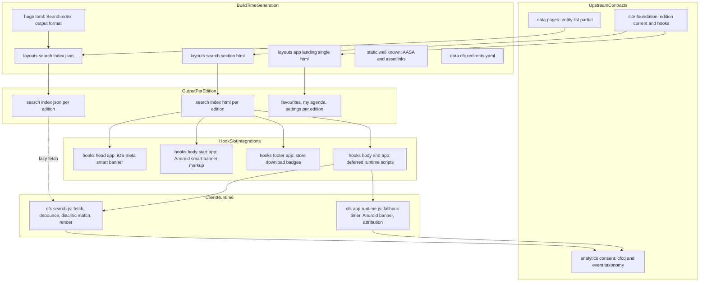
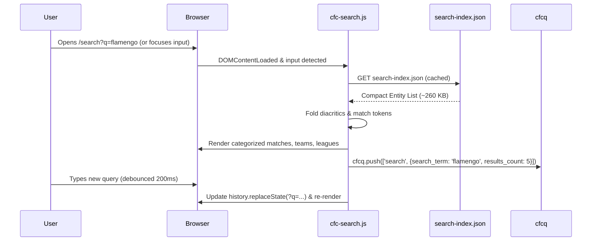
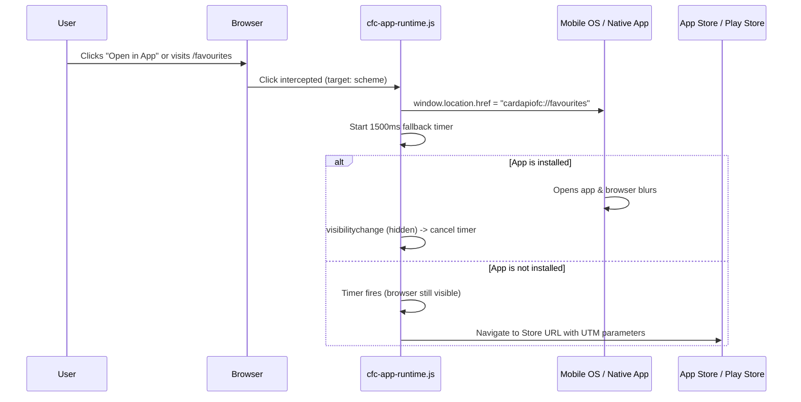
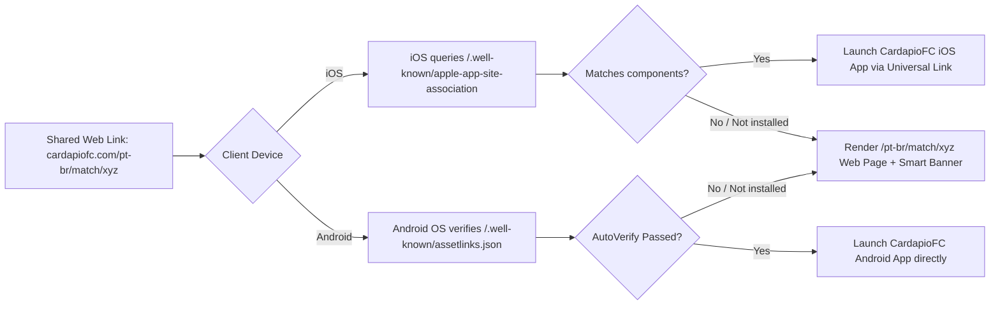

# Design Document: app-deeplinks

## Overview

**Purpose**: This feature delivers an end-to-end deep-linking and web search capability for CardápioFC across all six regional editions. It ensures links shared from mobile apps open seamlessly in native apps when installed or render an intuitive, localized web page otherwise. It provides a lightweight client search (< 1 MB index, < 15 KB JS), localized app landing pages (`/favourites`, `/my_agenda`, `/settings`), store fallback mechanisms with marketing attribution, canonical alias specifications (`/favorites`, `/reminder`), Apple Universal Links (AASA) and Android App Links (`assetlinks.json`) association files covering both unprefixed and edition-prefixed routes, and smart app banners.

**Users**: Mobile app users sharing links to matches, lineups, teams, leagues, search queries, favourites, agenda, or settings; web visitors searching for broadcast fixtures or viewing app feature landings; marketing and analytics teams tracking app installs and deep link traffic.

**Impact**: Extends the static Hugo site with custom output formats for search indexes, client-side search and deep-link runtime scripts, localized app landing pages, mobile association configurations in `static/.well-known/`, and implementations for all reserved app hook slots (`head-app`, `body-start-app`, `footer-app`, `body-end-app`). Touches no foundation-owned templates or vendor directories.

### Goals
- Fully functional `/search` interface for every edition with instant query execution via `?q=`, diacritic-insensitive filtering, and keyboard navigation.
- Search index generated per edition via Hugo custom output formats, strictly under 1 MB uncompressed (target ~260 KB) and under 60 KB compressed.
- Localized app landing pages for `/favourites`, `/my_agenda`, and `/settings` providing direct native app invocation and store fallbacks with UTM attribution.
- Canonical redirect specifications for legacy aliases (`/favorites` -> `/favourites`, `/reminder` -> `/my_agenda`) with query string preservation.
- Production-ready `apple-app-site-association` and `assetlinks.json` files covering unprefixed and edition-prefixed routes.
- Native iOS Smart App Banner (`<meta name="apple-itunes-app">`) with route-specific deep-link arguments and a lightweight, dismissible Android banner.
- Zero new framework dependencies, adhering to performance budgets (total added client JS < 18 KB gzip).

### Non-Goals
- Modifying native mobile application codebases or mobile entitlements (owned by mobile app teams).
- CDN-level HTTP response headers (`Content-Type: application/json`) and edge redirect implementations (defined here, implemented by `edge-delivery`).
- Generating core match, lineup, team, and league entity pages (owned by `data-pages`).
- Core analytics consent management and tag loaders (owned by `analytics-consent`).

## Boundary Commitments

### This Spec Owns
- **Search output format & routes**: `[outputFormats.SearchIndex]` in `hugo.toml`, `layouts/search/index.json` (or `section.searchindex.json`), `layouts/search/section.html`, and `content/en/search/_index.md`.
- **Search client runtime**: `assets/js/cfc-search.js` (vanilla ES2020 module, debounced search, diacritic folding, DOM rendering, keyboard accessibility).
- **App landing pages**: `content/en/{favourites,my_agenda,settings}/_index.md` (or `index.md`), layout `layouts/app-landing/single.html` (or `section.html`), and visual components.
- **Deep-link & store fallback runtime**: `assets/js/cfc-app-runtime.js` (scheme invocation, store fallback timer, banner dismissal persistence, Android banner controller).
- **Association files**: `static/.well-known/apple-app-site-association` and `static/.well-known/assetlinks.json`.
- **Redirect specifications**: Canonical mapping file `data/cfc/redirects.yaml` defining 301 alias rules for `/favorites` and `/reminder`.
- **Hook slot implementations**: `layouts/_partials/hooks/head-app.html`, `layouts/_partials/hooks/body-start-app.html`, `layouts/_partials/hooks/footer-app.html`, and `layouts/_partials/hooks/body-end-app.html`.
- **App deep-link helper partials**: `layouts/_partials/cfcapp/{scheme-url,store-url,route-argument}.html`.
- **App localization keys**: Appended strings in `i18n/*.yaml` (base and regional files).

### Out of Boundary
- Shared base templates (`baseof.html`, `site/*`, `cfc/*`, `edition/*`, `time/*`) owned by `site-foundation`.
- Entity data extraction, schema validation, and entity pages owned by `data-pages`.
- Edge routing rules, Cloudflare worker scripts, header configuration, and deployment pipelines owned by `edge-delivery`.
- Tag managers, Consent Mode v2, and third-party script loading owned by `analytics-consent`.

### Allowed Dependencies
- `site-foundation`: `partial "edition/current.html"`, `partial "edition/all.html"`, `site/hook.html` dispatcher, `cfc/page-header`, `cfc/empty-state`, `cfc/team-crest`, `cfc/icon`, and Tailwind v4 design tokens.
- `data-pages`: `partialCached "cfcdata/entity-list.html" . site.Language.Lang` for search index generation; entity URL conventions (`/match/{slug}`, `/team/{slug}`, `/league/{slug}`).
- `analytics-consent`: Event taxonomy contract (`data-cfc-event="app_open"`, `data-cfc-event="store_click"`, `cfcq.push(['search', ...])`).
- Hugo 0.165.0 extended built-ins: `js.Build`, `fingerprint`, `resources.Get`, `jsonify`, `T`, `sites.matrix`.

### Revalidation Triggers
- Changes to `cfcdata/entity-list.html` schema or parameters in `data-pages`.
- Changes to hook slot names or arguments in `site-foundation`.
- Renaming of custom mobile schemes (`cardapiofc://` or `cfc://`) or bundle IDs by the mobile team.
- Changes to the analytics event vocabulary in `analytics-consent`.

## Architecture

### Existing Architecture Analysis
- Hugo 0.165.0 extended in project-setup mode. Root templates override theme vendored files.
- The site supports six regional editions: Global (`en`, root `/`), UK (`en-gb`), Ireland (`en-ie`), Brazil (`pt-br`), Portugal (`pt-pt`), Argentina (`es-ar`).
- Upstream `site-foundation` defines 4 hook slots reserved for app integration: `head-app`, `body-start-app`, `footer-app`, and `body-end-app`.
- Upstream `data-pages` defines `cfcdata/entity-list.html`, supplying a flat list of all published leagues, teams, and matches.
- The legacy search index was 18.5 MB because it serialized full rendered HTML; this spec replaces it with a clean entity index built directly from `entity-list.html`.

### Architecture Pattern & Boundary Map



**Architecture Integration**:
- **Search Pipeline**: Hugo renders `/search/index.html` (UI) and `/search/search-index.json` (data) in each edition. On client focus or `?q=`, `cfc-search.js` fetches `search-index.json`, normalizes diacritics, performs in-memory token filtering, updates the URL parameter without page reload, and dispatches analytics events.
- **Deep-Link & Fallback Pipeline**: Mobile routes map strictly to either `cardapiofc://` or `cfc://`. On click, `cfc-app-runtime.js` invokes the scheme and sets a blur-detection timer; if the page remains focused after 1500ms, it navigates to the store URL with full UTM attribution.
- **Smart App Banners**: iOS Safari consumes `<meta name="apple-itunes-app">` rendered in `head-app.html` with route-specific arguments (`cardapiofc://match/...`, `cfc://search?q=...`). Android consumes a dismissible banner in `body-start-app.html` initialized by `cfc-app-runtime.js`.
- **Association Files**: Pre-configured static JSON files in `static/.well-known/` declare production and development app IDs and autoVerify fingerprints across unprefixed and edition-prefixed path patterns.

### Technology Stack

| Layer | Choice / Version | Role in Feature | Notes |
|-------|------------------|-----------------|-------|
| Site Generator | Hugo 0.165.0 extended | Custom output format, templates, `js.Build` | Pinned by `netlify.toml` |
| Client Scripts | Vanilla ES2020 (bundled by `js.Build`, minified) | Search client, store fallback, Android banner | Zero runtime dependencies |
| Search Index | JSON (compact schema, UTF-8) | Serialized entity feed per edition | < 1 MB uncompressed, ~50 KB gzip |
| Styling | Tailwind CSS v4 utilities + `cfc-*` classes | Search UI, Landing pages, Android banner | Defined in `assets/css/` |
| Platform Standards | Apple Universal Links, Android App Links | Mobile OS link interception | iOS 13+ components syntax |
| Analytics | `data-cfc-event` + `cfcq.push` | Tracking `search`, `app_open`, `store_click` | Conforms to `analytics-consent` |

## File Structure Plan

### Directory Structure
```
hugo.toml                                           # MODIFY: register [outputFormats.SearchIndex] and [outputs] search
content/en/
├── search/
│   └── _index.md                                   # CREATE: search page content, sites.matrix: ["**"], outputs: ["HTML","SearchIndex"]
├── favourites/
│   └── _index.md                                   # CREATE: favourites landing, sites.matrix: ["**"], layout: "app-landing"
├── my_agenda/
│   └── _index.md                                   # CREATE: my agenda landing, sites.matrix: ["**"], layout: "app-landing"
└── settings/
    └── _index.md                                   # CREATE: settings landing, sites.matrix: ["**"], layout: "app-landing"
data/cfc/
└── redirects.yaml                                  # CREATE: canonical redirect manifest (/favorites, /reminder)
static/.well-known/
├── apple-app-site-association                      # CREATE: modern components AASA (prod + dev)
└── assetlinks.json                                 # CREATE: Android Digital Asset Links (prod + debug fingerprints)
layouts/
├── search/
│   ├── section.html                                # CREATE: search page layout (input, loading, results container, empty state)
│   └── section.searchindex.json                    # CREATE: custom output format template rendering cfcdata/entity-list.html
├── app-landing/
│   └── section.html                                # CREATE: app landing page layout (hero, feature preview, CTAs, store badges)
└── _partials/
    ├── cfcapp/
    │   ├── scheme-url.html                         # CREATE: maps route/entity to custom scheme URI (cardapiofc:// or cfc://)
    │   ├── store-url.html                          # CREATE: builds App Store / Play Store URLs with campaign UTMs
    │   ├── app-argument.html                       # CREATE: resolves iOS smart banner app-argument per page
    │   └── store-badges.html                       # CREATE: reusable App Store & Google Play badge buttons with data-cfc-event
    └── hooks/
        ├── head-app.html                           # CREATE: iOS smart banner meta tag + preconnects
        ├── body-start-app.html                     # CREATE: Android smart app banner markup
        ├── footer-app.html                         # CREATE: footer app download promo section
        └── body-end-app.html                       # CREATE: loads bundled cfc-search.js and cfc-app-runtime.js
assets/js/
├── cfc-search.js                                   # CREATE: client search controller (vanilla ES2020 module)
└── cfc-app-runtime.js                              # CREATE: store fallback, Android banner controller, deep link invocation
i18n/
├── en.yaml, pt.yaml, es.yaml                       # MODIFY: append search, landing, and app banner keys
└── en-gb.yaml, en-ie.yaml, pt-pt.yaml, es-ar.yaml  # MODIFY: append regional overrides
scripts/
└── check-app-deeplinks.mjs                         # CREATE: verification script for search index, AASA, assetlinks, redirects
```

### Modified Files (detail)
- `hugo.toml`:
  Append output format and outputs configuration:
  ```toml
  [outputFormats.SearchIndex]
  mediaType = "application/json"
  baseName = "search-index"
  isPlainText = true
  notAlternative = true

  [outputs]
  # Existing foundation outputs retained; search section configured in front matter or:
  section = ["HTML", "SearchIndex"]
  ```
- `i18n/*.yaml`:
  Append localized strings for `search_*`, `app_landing_*`, `app_banner_*`, and `store_*` under `# app-deeplinks` marker.

## System Flows

### 1. Web Search Execution Flow


### 2. Mobile Deep-Link & Store Fallback Flow


### 3. iOS Universal Link & Android App Link Resolution


## Requirements Traceability

| Requirement | Summary | Components | Interfaces | Flows |
|-------------|---------|------------|------------|-------|
| 1.1–1.6 | Search page, `?q=` pre-fill, empty state, navigation | SearchPageLayout, SearchClientScript | `content/en/search/_index.md`, `layouts/search/section.html` | Web Search Flow |
| 2.1–2.5 | Search index output format, payload < 1 MB | SearchIndexGenerator | `layouts/search/section.searchindex.json`, `hugo.toml` | Build Generation |
| 3.1–3.8 | Client search interaction, diacritics, keyboard, budget ≤ 15 KB | SearchClientScript | `assets/js/cfc-search.js` | Web Search Flow |
| 4.1–4.5 | App landing pages (`/favourites`, `/my_agenda`, `/settings`), store badges | AppLandingPages, StoreBadges | `content/en/{favourites,my_agenda,settings}/`, `layouts/app-landing/` | Page Render |
| 5.1–5.5 | Custom schemes mapping, fallback timer, UTM parameters | AppSchemeResolver, StoreFallbackClient | `assets/js/cfc-app-runtime.js`, `cfcapp/scheme-url.html` | Fallback Flow |
| 6.1–6.4 | Redirect contracts (`/favorites`, `/reminder`), query preservation | RedirectManifestContract | `data/cfc/redirects.yaml` | Edge Handoff |
| 7.1–7.6 | Modern AASA components format, prod & dev appIDs, path coverage | MobileAssociationFiles | `static/.well-known/apple-app-site-association` | Association Flow |
| 8.1–8.5 | Android `assetlinks.json`, release & debug SHA-256 fingerprints | MobileAssociationFiles | `static/.well-known/assetlinks.json` | Association Flow |
| 9.1–9.6 | iOS smart banner meta tag, Android lightweight banner, dismissal | SmartAppBanner | `hooks/head-app.html`, `hooks/body-start-app.html`, `cfc-app-runtime.js` | Banner Flow |
| 10.1–10.5 | Hook slot implementations (`head-app`, `body-start-app`, `footer-app`, `body-end-app`) | HookSlotImplementations | `layouts/_partials/hooks/*-app.html` | Page Composition |
| 11.1–11.4 | Localization across base & regional tables | AppI18nTables | `i18n/*.yaml` | Page Render |
| 12.1–12.4 | Analytics tracking (`app_open`, `store_click`, `search`) | SearchClientScript, StoreFallbackClient | `data-cfc-event`, `cfcq.push` | Web Search & Fallback |

## Components and Interfaces

### Summary Reference Table
| Component | Domain/Layer | Intent | Req Coverage | Key Dependencies (P0/P1) | Contracts |
|-----------|--------------|--------|--------------|--------------------------|-----------|
| SearchIndexGenerator | Build / Output | Serializes per-edition entity index | 2.1–2.5 | `cfcdata/entity-list.html` (P0), Hugo (P0) | Batch, State |
| SearchPageLayout | UI / Template | Renders `/search` page shell | 1.1, 1.5, 1.6 | `site-foundation` chrome (P0) | Service |
| SearchClientScript | UI / Client | Interactive client search & filtering | 1.2–1.4, 3.1–3.8, 12.3 | `assets/js/cfc-search.js` (P0) | Service, Event |
| AppLandingPages | Content / UI | Renders landing pages for app features | 4.1–4.5, 10.5 | `cfcapp/store-badges.html` (P0) | Service |
| AppSchemeResolver | Shared / Template | Resolves route to custom scheme URI | 5.1, 9.2 | Route parameters (P0) | Service |
| StoreFallbackClient | Client Runtime | Handles scheme invocation & store timeout | 5.2–5.5, 12.1, 12.2 | `cfc-app-runtime.js` (P0) | Service, Event |
| SmartAppBanner | UI / Chrome | iOS meta tag & Android smart banner | 9.1–9.6, 10.1, 10.2 | `hooks/head-app`, `hooks/body-start-app` (P0) | Service, State |
| MobileAssociationFiles | Static Config | Serves AASA and `assetlinks.json` | 7.1–7.6, 8.1–8.5 | `static/.well-known/` (P0) | State |
| HookSlotImplementations | Integration | Fills site-foundation hook slots | 10.1–10.5 | `site/hook.html` (P0) | Service |
| RedirectManifestContract | Delivery Handoff| Defines 301 alias rules | 6.1–6.4 | `data/cfc/redirects.yaml` (P0) | State |

### Detailed Component Specifications

#### SearchIndexGenerator & SearchPageLayout
- **Intent**: Emits `/search/index.html` and `/search/search-index.json` for all editions.
- **Requirements**: 1.1, 1.5, 1.6, 2.1–2.5.
- **Output Template**: `layouts/search/section.searchindex.json`
  ```go
  {{ partialCached "cfcdata/entity-list.html" . site.Language.Lang | jsonify }}
  ```
- **Page Layout**: `layouts/search/section.html` wraps the standard page container, renders an accessible `<form role="search">` with `<input type="search" id="cfc-search-input" ...>`, a live results region (`<div id="cfc-search-results" aria-live="polite">`), and localized empty/initial states using `cfc/empty-state`.

#### SearchClientScript (`assets/js/cfc-search.js`)
- **Intent**: Handles debounced querying, diacritic-insensitive matching, DOM rendering, and keyboard accessibility.
- **Requirements**: 1.2–1.4, 3.1–3.8, 12.3.
- **Contract / Algorithm**:
  - Diacritic folding:
    ```javascript
    const normalize = (str) => str.normalize("NFD").replace(/[\u0300-\u036f]/g, "").toLowerCase().trim();
    ```
  - Matching criteria: An entity matches if every token in the query appears in either `normalize(entity.name)`, `normalize(entity.slug)`, or any element of `entity.altNames`.
  - Categories: Groups results into Leagues, Teams, and Matches. Limits matches to top 15 by kickoff.
  - Sanitization: All text insertions use `element.textContent = ...` or safely constructed elements. Never assigns raw `innerHTML` with query strings.
  - Analytics: Emits `window.cfcq = window.cfcq || []; window.cfcq.push(['search', { search_term: query, results_count: count }]);` debounced, tracked once per distinct query per session.

#### AppSchemeResolver (`layouts/_partials/cfcapp/scheme-url.html`)
- **Intent**: Maps web routes and page entities to exact mobile custom scheme URIs.
- **Requirements**: 5.1, 9.2.
- **Interface**:
  ```typescript
  // partial "cfcapp/scheme-url.html" (dict "route" string "slug"? string "query"? string) -> string
  ```
- **Mapping Table**:
  | Route / Context | Custom Scheme URI | Example |
  |---|---|---|
  | Home | `cardapiofc://home` | `cardapiofc://home` |
  | Match page | `cardapiofc://match/{slug}` | `cardapiofc://match/flamengo-vs-palmeiras-2026-11-08` |
  | Lineup page | `cardapiofc://match/{slug}/lineup` | `cardapiofc://match/.../lineup` |
  | Team page | `cardapiofc://team/{slug}` | `cardapiofc://team/flamengo` |
  | League page | `cardapiofc://league/{slug}` | `cardapiofc://league/brasileirao-serie-a` |
  | Favourites | `cardapiofc://favourites` | `cardapiofc://favourites` |
  | My Agenda | `cardapiofc://my_agenda` | `cardapiofc://my_agenda` |
  | Reminder (legacy) | `cfc://reminder` | `cfc://reminder` |
  | Search | `cfc://search?q={query}` | `cfc://search?q=flamengo` |
  | Settings | `cfc://settings` | `cfc://settings` |

#### StoreFallbackClient & AppRuntime (`assets/js/cfc-app-runtime.js`)
- **Intent**: Manages deep-link clicks, store fallback timeout, Android smart banner display, and dismissal persistence.
- **Requirements**: 4.4, 5.2–5.5, 9.3–9.5, 12.1, 12.2.
- **Implementation**:
  - Intercepts clicks on `[data-cfc-app-target="scheme"]`.
  - Detects platform via `navigator.userAgent`:
    - iOS: App Store link `https://apps.apple.com/app/id6745226833?pt=...&ct={campaign}&mt=8`.
    - Android: Google Play link `https://play.google.com/store/apps/details?id=br.com.cardapiofutebol&referrer=utm_source%3Dcardapiofc_web%26utm_medium%3Ddeeplink%26utm_campaign%3D{campaign}`.
  - Fallback logic: Sets `window.location.href = schemeUrl`. Sets a 1500ms timeout. If `document.visibilityState === 'visible'` when timer fires, redirects to the store URL.
  - Android banner: Checks `localStorage.getItem('cfc_banner_dismissed_until')`. If active and not expired, banner remains hidden. Otherwise unhides banner on Android devices. Clicking close sets dismissal timestamp + 14 days.

#### MobileAssociationFiles (`apple-app-site-association` & `assetlinks.json`)
- **Intent**: Mobile OS verification files for seamless link interception.
- **Requirements**: 7.1–7.6, 8.1–8.5.
- **Apple App Site Association (`static/.well-known/apple-app-site-association`)**:
  ```json
  {
    "applinks": {
      "details": [
        {
          "appIDs": [
            "G3QW878YXD.br.com.cardapiofutebol",
            "G3QW878YXD.br.com.cardapiofutebol.dev"
          ],
          "components": [
            { "/": "/assets/*", "exclude": true },
            { "/": "/css/*", "exclude": true },
            { "/": "/js/*", "exclude": true },
            { "/": "/.well-known/*", "exclude": true },
            { "/": "/*.ico", "exclude": true },
            { "/": "/*.json", "exclude": true },
            { "/": "/*.txt", "exclude": true },
            { "/": "/*.xml", "exclude": true },
            { "/": "/" },
            { "/": "/match/*" },
            { "/": "/team/*" },
            { "/": "/league/*" },
            { "/": "/favourites" },
            { "/": "/favorites" },
            { "/": "/my_agenda" },
            { "/": "/reminder" },
            { "/": "/settings" },
            { "/": "/search" },
            { "/": "/*/match/*" },
            { "/": "/*/team/*" },
            { "/": "/*/league/*" },
            { "/": "/*/favourites" },
            { "/": "/*/favorites" },
            { "/": "/*/my_agenda" },
            { "/": "/*/reminder" },
            { "/": "/*/settings" },
            { "/": "/*/search" }
          ]
        }
      ]
    }
  }
  ```
- **Android Digital Asset Links (`static/.well-known/assetlinks.json`)**:
  ```json
  [
    {
      "relation": ["delegate_permission/common.handle_all_urls"],
      "target": {
        "namespace": "android_app",
        "package_name": "br.com.cardapiofutebol",
        "sha256_cert_fingerprints": [
          "38:8F:72:42:F2:C0:EB:A5:A8:12:F3:D5:75:A0:68:57:4E:93:33:9A:89:15:37:D5:E8:2C:9D:C3:68:F1:C7:E2"
        ]
      }
    }
  ]
  ```

#### RedirectManifestContract (`data/cfc/redirects.yaml`)
- **Intent**: Canonical machine-readable specifications for edge redirect rules.
- **Requirements**: 6.1–6.4.
- **Schema**:
  ```yaml
  redirects:
    - from: "/favorites"
      to: "/favourites"
      status: 301
      preserve_query: true
      apply_to_all_editions: true
    - from: "/reminder"
      to: "/my_agenda"
      status: 301
      preserve_query: true
      apply_to_all_editions: true
  ```

#### Hook Slot Implementations
- **`layouts/_partials/hooks/head-app.html`**:
  Resolves active page argument using `partial "cfcapp/app-argument.html" .` and emits:
  ```html
  <meta name="apple-itunes-app" content="app-id=6745226833, app-argument={{ $appArgument }}">
  ```
- **`layouts/_partials/hooks/body-start-app.html`**:
  Emits localized Android smart banner markup with `id="cfc-android-banner" class="hidden ..."` including icon, title, rating, "Open" button with UTM attributes, and dismiss button.
- **`layouts/_partials/hooks/footer-app.html`**:
  Renders localized app download promo in the footer with App Store and Google Play badges linking to store URLs with UTM tags.
- **`layouts/_partials/hooks/body-end-app.html`**:
  Loads bundled `cfc-app-runtime.js` across all pages, and additionally loads `cfc-search.js` when `.Section == "search"`.

## Data Models

### SearchIndexEntry Schema (TypeScript definition matching `EntityListItem`)
```typescript
interface SearchIndexEntry {
  kind: "match" | "team" | "league"; // entity kind
  slug: string;                      // slug (e.g. "flamengo", "brasileirao-serie-a")
  name: string;                      // localized display name
  altNames: string[];                // alternative aliases (filtered, unique)
  url: string;                       // relative page URL (e.g. "/pt-br/match/xyz")
  appPath: string;                   // app deep link path (e.g. "/match/xyz")
  crest?: string;                    // crest or logo URL (optional)
  kickoff?: string;                  // kickoff RFC 3339 UTC timestamp (matches only)
  league?: string;                   // league name (matches only)
}
```

### StoreLinkParameters Schema
```typescript
interface StoreTrackingParams {
  utm_source: "cardapiofc_web";
  utm_medium: "deeplink" | "smart_banner" | "footer";
  utm_campaign: string;           // feature name or entity slug
  utm_content: string;            // edition code (e.g. "pt-br", "en")
}
```

## Error Handling

### Error Strategy
- **Build time**: If `cfcdata/entity-list.html` fails or is missing, Hugo build halts. Search index generator validates that entries contain non-empty slugs, names, and URLs.
- **Client Search**: Network failure fetching `search-index.json` displays an accessible error state (`T "search_load_error"`) with a "Retry" button. Empty results display `cfc/empty-state` with helpful hints.
- **Deep-Link Fallback**: If mobile scheme invocation fails or is unsupported, the browser fallback timer redirects safely to the official app store without popping broken system alerts.

### Monitoring
- `scripts/check-app-deeplinks.mjs` runs post-build:
  - Validates `search-index.json` existence and verifies size < 1 MB in every edition output.
  - Validates `apple-app-site-association` and `assetlinks.json` syntax, components array, and cert fingerprints.
  - Validates presence of all app landing pages and search pages across all 6 editions.

## Testing Strategy

### Unit / Build-Time Assertions
- Verification that Hugo builds `search-index.json` for all 6 editions.
- JSON schema check on `apple-app-site-association` and `assetlinks.json`.
- Verification that search index size remains strictly under 1 MB uncompressed.

### Integration Tests (`node scripts/check-app-deeplinks.mjs`)
- Assert `/search/index.html`, `/favourites/index.html`, `/my_agenda/index.html`, `/settings/index.html` exist in `public/` and in all edition subdirectories (`public/pt-br/...`).
- Assert `<meta name="apple-itunes-app">` exists in `<head>` on entity pages and home.
- Assert `data-cfc-event="app_open"` and `data-cfc-event="store_click"` attributes are present on store badges and landing CTAs.

### Client E2E & Browser Paths
- Visit `/search?q=flamengo`: search input auto-populates, results render immediately without user typing.
- Type in search input: verifies debounce (200ms) and diacritic matching ("São Paulo" matches "sao paulo").
- Keyboard navigation: Arrow Down moves selection, Enter navigates to entity URL.
- Visit `/favourites`: click "Open in App" verifies custom scheme invocation and store fallback URL.

### Performance Budgets
- Search Index size: ≤ 500 KB uncompressed (hard limit 1 MB).
- `cfc-search.js`: ≤ 15 KB gzip.
- `cfc-app-runtime.js`: ≤ 3 KB gzip.
- Cumulative Layout Shift (CLS) on Android banner: ≤ 0.05.

## Security Considerations
- **XSS Prevention**: `cfc-search.js` renders results using `textContent` and safe element property assignments. User query terms from `?q=` or input are never concatenated into raw `innerHTML`.
- **Deep Link Sanitization**: Scheme URLs and store URLs validate against strict URL prefix allowlists (`cardapiofc://`, `cfc://`, `https://apps.apple.com/`, `https://play.google.com/`).
- **AASA Exclusions**: System and asset directories are explicitly excluded to prevent hijacking critical browser requests.
