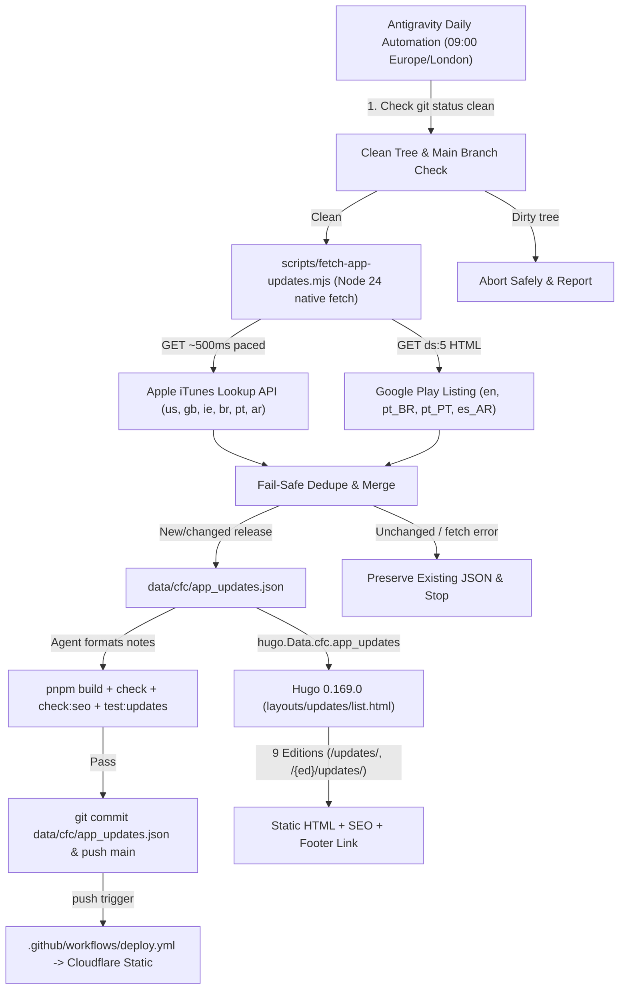

# Technical Design Document: app-updates

## Overview
The `app-updates` feature delivers a public, SEO-indexed, 9-edition app changelog hub at `/updates/` paired with a zero-secret Node 24 store extractor and a daily local Antigravity scheduled automation. The static site consumes a repository-tracked JSON dataset (`data/cfc/app_updates.json`), keeping builds deterministic, offline-safe, and free of runtime API calls or CI secrets while publishing new iOS and Android releases automatically via git push to `main`.



## Boundary Commitments
- **What This Spec Owns**:
  - `AppUpdatesData`: Schema, persistence, and seeded history in `data/cfc/app_updates.json`.
  - `StoreUpdateFetcher`: Zero-dependency store client, `ds:5` parser, note normalizer, cross-platform grouping, and fail-safe merger in `scripts/fetch-app-updates.mjs` + offline fixture unit tests in `scripts/test-app-updates.mjs`.
  - `UpdatesPageUI`: Multilingual section `content/en/updates/_index.md`, template `layouts/updates/list.html`, locale-fallback partial `layouts/_partials/cfcpage/updates-notes.html`, and sharp-corner CSS `assets/css/cfc/components/updates.css` (imported in `assets/css/custom.css`).
  - `NavigationSeoI18n`: Footer-only menu entry in `config/_default/menus.toml`, 7-table i18n parity keys across `i18n/*.yaml`, `"updates"` registration in `scripts/indexnow.mjs` & `scripts/check-seo-social.mjs`, and package script aliases in `package.json`.
  - `AntigravityDailyAutomation`: Local sidecar configuration `~/.gemini/config/sidecars/daily-app-updates/sidecar.json` with verified `agent_permissions`.
- **Out of Boundary**:
  - Editing `themes/hugoplate/*` or `_vendor/*`.
  - Adding `/updates/` to `[[main]]` header navigation (`config/_default/menus.toml`).
  - Adding `/updates/` to `static/.well-known/apple-app-site-association` or `static/.well-known/assetlinks.json`.
  - Modifying `data/cfc/settings.yaml` (`fixedPerEdition` must remain `5` for `scripts/test-cfc-settings.mjs`).
  - Modifying `.github/workflows/deploy.yml` or `cloudflare/redirect-rules.json`.
  - Mobile app code changes, Retool export pipeline changes, or store developer API credentials.
- **Allowed Dependencies**:
  - `site-foundation`: `edition/current.html`, `baseof.html`, `.cfc-*` design tokens, 7-table `i18n/` parity (`scripts/check-site.mjs`).
  - `app-deeplinks`: `cfc/app-links.html`, `cfc/store-badges.html`, `cfc/app-download.html`.
  - `seo-social`: `seo/context.html`, `seo/hreflang.html`, `seo/jsonld-breadcrumb.html`, `seo/og-image.html`, `sitemap.xml`, `scripts/indexnow.mjs`, `scripts/check-seo-social.mjs`.
  - `edge-delivery`: `.github/workflows/deploy.yml` (`push` to `main` trigger).
  - Node 24 standard built-ins (`fetch`, `node:fs`, `node:path`, `node:test`, `node:assert`, `node:crypto`).
- **Revalidation Triggers**:
  - Adding/removing site editions or changing the 7 parity-checked `i18n/` tables.
  - Breaking structural changes to Google Play `AF_initDataCallback` `ds:5` data indices.
  - Changes to `seo/context.html` hub key resolution or `scripts/indexnow.mjs` `<main>` fingerprinting.
  - Future Antigravity platform support for cloud-hosted scheduled automations (would only relocate `AntigravityDailyAutomation`, leaving repo files untouched).

## Requirements Traceability

| Requirement ID | Owning Component(s) | Concrete File(s) / Target |
| --- | --- | --- |
| 1.1 | `UpdatesPageUI` | `content/en/updates/_index.md`, `layouts/updates/list.html` |
| 1.2, 1.3 | `NavigationSeoI18n` | `config/_default/menus.toml` |
| 1.4 | `UpdatesPageUI`, `NavigationSeoI18n` | `content/en/updates/_index.md`, `scripts/indexnow.mjs`, `scripts/check-seo-social.mjs` |
| 1.5 | `UpdatesPageUI`, `NavigationSeoI18n` | `static/.well-known/*` (untouched), `scripts/check-app-deeplinks.mjs` |
| 2.1, 2.2, 2.3, 2.4, 2.5, 2.6 | `UpdatesPageUI`, `AppUpdatesData` | `layouts/updates/list.html`, `layouts/_partials/cfcpage/updates-notes.html`, `assets/css/cfc/components/updates.css`, `data/cfc/app_updates.json` |
| 3.1 | `NavigationSeoI18n` | `i18n/{en,pt,pt-pt,es,es-ar,zh-cn,ja}.yaml` |
| 3.2, 3.3, 3.4 | `UpdatesPageUI`, `AppUpdatesData` | `layouts/updates/list.html`, `layouts/_partials/cfcpage/updates-notes.html`, `data/cfc/app_updates.json` |
| 4.1, 4.2, 4.3, 4.4, 4.5 | `StoreUpdateFetcher` | `scripts/fetch-app-updates.mjs` |
| 5.1, 5.2, 5.3, 5.4 | `AppUpdatesData`, `StoreUpdateFetcher` | `data/cfc/app_updates.json`, `scripts/fetch-app-updates.mjs` |
| 6.1, 6.2, 6.3, 6.4, 6.5 | `AntigravityDailyAutomation` | `~/.gemini/config/sidecars/daily-app-updates/sidecar.json` |
| 7.1 | `UpdatesPageUI` | `assets/css/cfc/components/updates.css`, `assets/css/custom.css`, `layouts/updates/list.html` |
| 7.2 | `NavigationSeoI18n`, `UpdatesPageUI` | `scripts/check-site.mjs`, `scripts/check-seo-social.mjs`, `scripts/check-analytics.mjs`, `scripts/check-app-deeplinks.mjs`, `scripts/check-data-pages.mjs` |
| 7.3 | `StoreUpdateFetcher` | `scripts/test-app-updates.mjs`, `package.json` |

## Components & Contracts

### 1. `AppUpdatesData` (`data/cfc/app_updates.json`)
Must use an underscore filename (`app_updates.json`) so Hugo Go templates access `hugo.Data.cfc.app_updates` cleanly without hyphen parse errors. **Must NOT store a `fetchedAt` timestamp** so unchanged store checks produce zero git diff and zero `<main>` HTML churn.

```json
{
  "schemaVersion": 1,
  "app": {
    "iosId": "6745226833",
    "androidPackage": "br.com.cardapiofutebol"
  },
  "latest": {
    "ios": {
      "version": "1.60.0",
      "releaseDate": "2026-11-17"
    },
    "android": {
      "version": null,
      "releaseDate": "2026-11-17"
    }
  },
  "releases": [
    {
      "id": "2026-11-17-1.60.0",
      "version": "1.60.0",
      "releaseDate": "2026-11-17",
      "manual": false,
      "platforms": {
        "ios": {
          "version": "1.60.0",
          "releaseDate": "2026-11-17"
        },
        "android": {
          "version": null,
          "releaseDate": "2026-11-17"
        }
      },
      "notes": {
        "en": {
          "summary": "Bug fixes and improvements",
          "items": ["Bug fixes and improvements"]
        },
        "pt-br": {
          "summary": "Correções e melhorias",
          "items": ["Correções e melhorias"]
        },
        "pt-pt": {
          "summary": "Correções e melhorias",
          "items": ["Correções e melhorias"]
        },
        "es-ar": {
          "summary": "Corrección de errores y mejoras",
          "items": ["Corrección de errores y mejoras"]
        }
      }
    }
  ]
}
```

**Schema invariants**:
- `releases` is ordered newest-first (`releaseDate` descending, then semver descending).
- `platforms.ios` / `platforms.android` are either `null` (release did not apply to that platform) or `{ version: string | null, releaseDate: "YYYY-MM-DD" }`.
- `notes` keys use canonical site locale codes (`en`, `pt-br`, `pt-pt`, `es-ar`, optional `zh-cn`/`ja` if added manually). Each entry holds `{ summary: string, items: string[] }`.
- `manual: true` marks operator-curated or backfilled entries; automated runs never overwrite or delete `manual: true` notes or older history.

### 2. `StoreUpdateFetcher` (`scripts/fetch-app-updates.mjs`)
Zero-dependency Node 24 ESM module exporting testable pure functions plus a CLI entrypoint (`--dry-run`, `--write`, `--json`):
- **Active storefront matrices**:
  - iOS (`https://itunes.apple.com/lookup?id=6745226833&country=<cc>`): `[{ cc: "us", locale: "en" }, { cc: "gb", locale: "en" }, { cc: "ie", locale: "en" }, { cc: "br", locale: "pt-br" }, { cc: "pt", locale: "pt-pt" }, { cc: "ar", locale: "es-ar" }]` (excludes `cn`/`jp`, which return `resultCount: 0`; handles `resultCount === 0` gracefully if ever returned).
  - Android (`https://play.google.com/store/apps/details?id=br.com.cardapiofutebol&hl=<hl>&gl=<gl>`): `[{ hl: "en", gl: "US", locale: "en" }, { hl: "pt_BR", gl: "BR", locale: "pt-br" }, { hl: "pt_PT", gl: "PT", locale: "pt-pt" }, { hl: "es_AR", gl: "AR", locale: "es-ar" }]` (excludes `CN`/`JP`; tolerates missing/consent-blocked responses).
- **Resilience & Rate Pacing**:
  - `AbortSignal.timeout(10000)` per request; 500 ms delay between requests (`sleep(500)`).
  - `parseIosLookup(json)`: validates `results?.[0]`, extracts `version`, ISO `releaseDate` (`YYYY-MM-DD`), and `releaseNotes`.
  - `parsePlayHtml(html)`: locates `AF_initDataCallback({key: 'ds:5', ... data: ... , sideChannel:` safely, parses JSON, reads `data?.[1]?.[2]` -> `version = app?.[140]?.[0]?.[0]?.[0] ?? null`, `whatsNew = app?.[144]?.[1]?.[1] ?? null`, `updatedEpoch = app?.[145]?.[0]?.[1]?.[0] ?? null` (converts epoch seconds to `YYYY-MM-DD` UTC). Returns `{ ok: false, reason }` on mismatch without throwing.
  - `normalizeReleaseNotes(rawText)`: trims whitespace, splits multi-line/bulleted notes (`•`, `-`, `*`, `\n`) into `{ summary, items }`, deduplicating identical lines, and strips trailing store HTML entities.
- **Deduplication & Cross-Platform Grouping (`mergeAppUpdates(existing, fetched)`)**:
  - Detects whether fetched iOS state differs from `existing.latest.ios` (version changed OR normalized `en`/localized notes changed) and whether fetched Android state differs from `existing.latest.android` (`version` changed when non-null, OR `(releaseDate, normalizedNotes)` changed when `version === null`).
  - Note language preference when merging iOS + Android into one release entry: prefer iOS localized notes for `en`/`pt-br`/`pt-pt`/`es-ar` when Play returns Portuguese fallback on `hl=en` (or merge distinct items if Play has platform-specific notes).
  - Grouping rule: match a new Android update to an existing or same-run iOS release if `version` matches (when both non-null) OR if `Math.abs(daysBetween(ios.releaseDate, android.releaseDate)) <= 3` and that release's `platforms.android` is currently `null` (or represents the same update cycle). Otherwise create a platform-specific release entry (`platforms.ios: null` or `platforms.android: null`).
  - Returns `{ changed: boolean, data: AppUpdatesData, summary: { iosChanged, androidChanged, warnings } }`. When `changed === false`, `--write` leaves `data/cfc/app_updates.json` byte-for-byte untouched.

### 3. `UpdatesPageUI` (`content/en/updates/_index.md`, `layouts/updates/list.html`, `layouts/_partials/cfcpage/updates-notes.html`, `assets/css/cfc/components/updates.css`)
- **Content matrix (`content/en/updates/_index.md`)**:
  ```yaml
  ---
  title: "App Updates & Changelog"
  description: "Latest CardápioFC iOS and Android app updates, new features, and release history."
  sites:
    matrix:
      languages: ["**"]
  ---
  ```
  Generates `/updates/` and `/{ed}/updates/` across all 9 editions automatically with `.AllTranslations` wired for `hreflang` and edition switcher.
- **SEO & Breadcrumb Integration**:
  - Section name `"updates"` triggers `seo/context.html` (`seo_updates_title`, `seo_updates_desc`) and `seo/jsonld-breadcrumb.html` (`i18n "updates"`) automatically.
  - `seo/og-image.html` falls back to `static/og/editions/og-<edition>.png`.
  - No `noindex`, so `layouts/sitemap.xml` includes all 9 URLs with `xhtml:link` alternates.
- **Template Structure (`layouts/updates/list.html`)**:
  - Inherits `layouts/baseof.html` (`{{ define "main" }}`), preserving consent banner, analytics config, and footer privacy links (`scripts/check-analytics.mjs`).
  - Renders `cfc/breadcrumb.html` -> `cfc/page-hero.html` -> **Latest Releases summary** (`.cfc-updates-latest`: two sharp-corner cards for iOS and Android showing latest version or release-date state when Android version is `null`, plus `cfc/store-badges.html`) -> **Chronological Release History** (`.cfc-updates-timeline`: `<article class="cfc-card cfc-card--static cfc-updates-release">` ordered newest-first, showing release date formatted via Hugo `time.Format ":date_medium"` or locale-safe format, optional version badge, platform pill(s) with `cfc/icon.html` `apple`/`google-play`, and structured notes from `cfcpage/updates-notes.html`) -> `cfc/empty-state.html` if `releases` is empty -> final `cfc/app-download.html` CTA.
  - **Zero daily timestamp in `<main>`**: only `releaseDate` values from real app releases are rendered.
- **Locale Fallback Partial (`layouts/_partials/cfcpage/updates-notes.html`)**:
  - Given `(dict "notes" .notes "lang" site.Language.Lang)`:
    1. Exact match (`en`, `pt-br`, `pt-pt`, `es-ar`, `zh-cn`, `ja`).
    2. Regional fallbacks: `en-gb`/`en-ie`/`en-us` -> `en`; `pt-pt` -> `pt-br` -> `en`; `es-ar` -> `es` -> `en`; `zh-cn`/`ja` -> `en`.
    3. Final fallback: `en` -> first available note entry.
- **Styling (`assets/css/cfc/components/updates.css` imported in `assets/css/custom.css`)**:
  - Uses existing `--cfc-*` CSS variables, `border-radius: 0`, `.dark` mode contrast rules, responsive 2-column grid for Latest Releases (`@media (min-width: 768px)`), and clean list/badge spacing. Zero client-side JavaScript added.

### 4. `NavigationSeoI18n` (`config/_default/menus.toml`, 7 `i18n/*.yaml`, `scripts/indexnow.mjs`, `scripts/check-seo-social.mjs`, `package.json`)
- **`config/_default/menus.toml`**: Add ONLY under `[[footer]]` (never `[[main]]`). Uses `weight = 9` (moving from `8` to `9` alongside `editorial-blog`, which assigns `blog = 6`, `faq = 7`, `about = 8`):
  ```toml
  [[footer]]
  identifier = "updates"
  name = "App Updates"
  url = "/updates/"
  weight = 9
  ```
- **7-table i18n parity (`en.yaml`, `pt.yaml`, `pt-pt.yaml`, `es.yaml`, `es-ar.yaml`, `zh-cn.yaml`, `ja.yaml`)**:
  Add identical keys to all 7 files (verified by `pnpm check`):
  `updates`, `menu_updates`, `seo_updates_title`, `seo_updates_desc`, `updates_badge`, `updates_title`, `updates_intro`, `updates_latest_heading`, `updates_history_heading`, `updates_platform_ios`, `updates_platform_android`, `updates_version_label`, `updates_released_label`, `updates_latest_badge`, `updates_no_version_note`, `updates_empty_title`, `updates_empty_desc`, `updates_cta_title`, `updates_cta_subtitle`.
- **Indexing & SEO guards**:
  - `scripts/indexnow.mjs`: add `"updates"` to `HUB_SEGMENTS`.
  - `scripts/check-seo-social.mjs`: in `bucket(rel)`, add `"updates"` to the `top` allowlist (`if (["match", "team", "leagues", "faq", "updates", ""].includes(top) || norm === "index.html")`) so `bucket(rel)` returns `{ key, kind: "updates", bucketKey: `${key}|updates` }` (not a plain string `"updates"`).
- **`package.json`**: Add `"updates:fetch": "node scripts/fetch-app-updates.mjs --write"`, `"updates:check": "node scripts/fetch-app-updates.mjs --dry-run"`, `"test:updates": "node --test scripts/test-app-updates.mjs"`.

### 5. `AntigravityDailyAutomation` (`~/.gemini/config/sidecars/daily-app-updates/sidecar.json`)
- Follows `automation` skill specification:
  - `builtin`: `"schedule"`
  - `args`: `["CRON_TZ=Europe/London 0 9 * * *", "agentapi", "new-conversation", "--", "<self-contained prompt>"]`
  - `restart_policy`: `"always"`
  - `display_name`: `"Daily CardápioFC App Updates Check"`
  - `description`: `"Every day at 9:00 AM (Europe/London), checks Apple App Store and Google Play for CardápioFC updates, updates data/cfc/app_updates.json if changed, verifies the Hugo build, and pushes to main."`
  - `agent_permissions`: `workspace_uris: ["file:///Users/heliocosta/Documents/Sandbox/cardapiofccom"]` + exact verified `access_grants` recorded during the Task 4.2 dry-run (e.g., `command(git status --porcelain)`, `command(git rev-parse --abbrev-ref HEAD)`, `command(pnpm updates:fetch)`, `command(pnpm test:updates)`, `command(pnpm build)`, `command(pnpm check)`, `command(pnpm check:seo)`, `command(git add data/cfc/app_updates.json)`, `command(git commit)`, `command(git push origin main)` — never wildcard `command(*)`).
- **Never** modify `~/.gemini/config/config.json` to auto-enable the sidecar; point user to `[Open Automations Dashboard](sidecar://dashboard)` after dry-run permission verification.

## File Structure Plan

| File Path | Action | Owning Component | Responsibility |
| --- | --- | --- | --- |
| `data/cfc/app_updates.json` | Create | `AppUpdatesData` | Persistent, seeded release history dataset (underscore name, no `fetchedAt`) |
| `scripts/fetch-app-updates.mjs` | Create | `StoreUpdateFetcher` | Zero-dep multi-store fetcher, Play `ds:5` parser, normalizer, deduplicator, fail-safe merger |
| `scripts/test-app-updates.mjs` | Create | `StoreUpdateFetcher` | Offline unit tests (`node:test`) covering parsing, null Android version, locale fallback, unchanged no-op, error preservation |
| `content/en/updates/_index.md` | Create | `UpdatesPageUI` | Multilingual section matrix (`languages: ["**"]`) generating `/updates/` across all 9 editions |
| `layouts/updates/list.html` | Create | `UpdatesPageUI` | App Updates page template (Latest summary, chronological history, store badges, empty state, CTA) |
| `layouts/_partials/cfcpage/updates-notes.html` | Create | `UpdatesPageUI` | Edition-aware release note resolver with English fallback and structured list rendering |
| `assets/css/cfc/components/updates.css` | Create | `UpdatesPageUI` | Sharp-corner (`border-radius: 0`), dark-mode-ready styles for `.cfc-updates-*` |
| `assets/css/custom.css` | Modify | `UpdatesPageUI` | Import `./cfc/components/updates.css` |
| `config/_default/menus.toml` | Modify | `NavigationSeoI18n` | Add `updates` entry to `[[footer]]` only (keep `[[main]]` untouched) |
| `i18n/en.yaml`, `pt.yaml`, `pt-pt.yaml`, `es.yaml`, `es-ar.yaml`, `zh-cn.yaml`, `ja.yaml` | Modify | `NavigationSeoI18n` | Add all 19 localized `updates` / `menu_updates` / `seo_updates_*` keys with 100% parity |
| `scripts/indexnow.mjs` | Modify | `NavigationSeoI18n` | Add `"updates"` to `HUB_SEGMENTS` |
| `scripts/check-seo-social.mjs` | Modify | `NavigationSeoI18n` | Add `"updates"` bucket classification |
| `package.json` | Modify | `NavigationSeoI18n` | Add `updates:fetch`, `updates:check`, `test:updates` scripts |
| `~/.gemini/config/sidecars/daily-app-updates/sidecar.json` | Create | `AntigravityDailyAutomation` | Daily `09:00 Europe/London` Antigravity automation definition & verified `agent_permissions` |

## Error Handling & Failure Modes

| Failure Mode | Detection | Recovery / Safe Behavior |
| --- | --- | --- |
| Apple iTunes `resultCount: 0` or HTTP 403/5xx | Checked per storefront in `fetchStoreUpdates` | Log warning, skip that storefront, preserve prior data |
| Google Play HTML layout shift or consent gate (`NO_DS5`) | `parsePlayHtml` regex/index validation | Return `{ ok: false, reason }`, log warning, preserve prior Android data |
| Google Play omits web version (`version: null`) | Explicitly expected on AAB listings | Store `version: null`, deduplicate via `(releaseDate, normalizedNotes)`, hide missing version in UI |
| Storefront unsupported (`cn`/`jp`) | Excluded from active storefront fetch; edition renders via fallback | `cfcpage/updates-notes.html` automatically displays `en` notes |
| Empty `releases` array | `len $releases == 0` in template | Render localized `cfc/empty-state.html` + store badges without failing build |
| Dirty local git working tree at 09:00 run | `git status --porcelain` non-empty or branch != `main` | Automation aborts immediately before running `--write`, reports dirty tree to operator |
| Hugo build / `pnpm check` fails during automation | Non-zero exit code after `--write` | Automation does NOT commit/push, restores `data/cfc/app_updates.json` if needed, reports failure |
| Mac asleep at 09:00 `Europe/London` | Scheduled cron missed while machine slept | Next awake daily run catches up cleanly; operator can also trigger **Run Now** in Automations |

## Testing Strategy
1. **Offline Unit Tests (`pnpm test:updates` -> `scripts/test-app-updates.mjs`)**:
   - Parse representative Apple iTunes JSON (`us`, `br`, `ar`, and `resultCount: 0` for `cn`/`jp`) -> verifies `4.2`, `4.4`.
   - Parse representative Google Play `ds:5` HTML fixture with `version: null`, `updatedEpoch`, `whatsNew`, plus malformed/consent-wall HTML -> verifies `4.3`, `4.4`, `7.3`.
   - Test `mergeAppUpdates`: unchanged run (`changed: false`, byte-identical JSON) -> `5.2`; cross-platform ±3-day grouping -> `2.3`, `5.1`; Android-only deduplication by `(releaseDate, normalizedNotes)` -> `5.3`; `manual: true` backfill preservation -> `5.4`; partial fetch failure preservation -> `4.4`.
2. **Site Build & Guard Suite (`pnpm build && pnpm check && pnpm check:seo && pnpm check:deeplinks && pnpm check:analytics && pnpm check:data`)**:
   - Verifies all 9 `/updates/` HTML pages exist, `[[main]]` excludes `/updates/`, `[[footer]]` includes `/updates/`, 7-table i18n parity passes, canonical/`hreflang`/sitemap/`og:image`/JSON-LD pass, AASA/`assetlinks.json` remain unchanged, consent/analytics tags pass, and no `themes/` or `_vendor/` files were touched (`1.1`–`1.5`, `2.1`–`2.6`, `3.1`–`3.4`, `7.1`, `7.2`).
3. **Supervised Automation Dry-Run**:
   - Execute the self-contained automation steps in the current workspace without auto-enabling `config.json`, verifying exact `access_grants`, clean-tree guard behavior, `--dry-run` / `--write` safety, and build verification (`6.1`–`6.5`).
