# Technical Design: blog-automation

## Overview
The `blog-automation` feature operationalizes CardápioFC's weekly 9-edition editorial publishing workflow without custom LLM orchestration scripts or CI API keys. It combines a version-controlled editorial playbook (`docs/blog-editorial/playbook.md`), a machine-readable published-topic registry (`data/blog-topics.yaml`) seeded with `editorial-blog`'s launch article, and a weekly local Antigravity scheduled automation (`~/.gemini/config/sidecars/cardapiofc-weekly-blog/sidecar.json`) running every Monday at 10:30 AM `Europe/London`. Each run enforces clean git state on `main`, selects an uncovered topic and underrepresented pillar, verifies facts and official broadcasters, generates one copyright-safe 16:9 cover illustration, adapts all 9 localized editions, gates on full local build/SEO/contract/budget verification, updates the topic registry, and commits and pushes to `main` (aborting cleanly without pushing on any failure).

### Goals
- Sustain 1 SEO/GEO-optimized article per week across all 9 editions (~520–624 static files/year including processed images) well inside Cloudflare's 18,000/20,000 file budget.
- Guarantee factual accuracy, 100% official licensed broadcasters, zero ads, and copyright-safe original AI editorial artwork across every published post.
- Prevent duplicate topics, stale pillar concentration, and broken pushes to `main` through `data/blog-topics.yaml` deduplication and fail-closed local gating.
- Keep `sidecar.json` strictly scoped with exact verified `agent_permissions` (zero wildcards) and paused by default until explicitly enabled by the operator in the Antigravity Automations dashboard.

### Non-Goals
- Modifying Hugo layouts, CSS, JSON-LD builders, or validation script internals (owned by `editorial-blog`).
- Adding custom Node/Python LLM orchestration scripts, external CMS dashboards, or GitHub Actions LLM cron workflows.
- Cross-posting to social networks or modifying `.github/workflows/deploy.yml`.
- Auto-enabling the sidecar in `~/.gemini/config/user_config.json` or `config.json`.

---

## Boundary Commitments

### This Spec Owns
- **`EditorialPlaybook` (`docs/blog-editorial/playbook.md`)**: Authoritative editorial strategy defining the 4 pillars (`app-guides`, `watch-guides`, `rights-changes`, `market-analysis`), rotation policy, answer-first SEO/GEO article structure, factual/official-broadcaster verification rules, copyright-safe illustration prompt guidelines, 9-edition regional adaptation rules (`en`, `en-gb`, `en-ie`, `en-us`, `pt-br`, `pt-pt`, `es-ar`, `zh-cn`, `ja`), internal link patterns, and `editorial-blog` frontmatter/validation checklist.
- **`TopicRegistry` (`data/blog-topics.yaml`)**: Machine-readable YAML registry recording published slugs, publication dates, pillars, titles, covered angles/keywords, and pillar rotation metadata, seeded with `editorial-blog`'s launch post (`where-to-watch-live-football-official-channels-guide`) to prevent duplicate coverage.
- **`WeeklyScheduleSidecar` (`~/.gemini/config/sidecars/cardapiofc-weekly-blog/sidecar.json`)**: Antigravity `"builtin": "schedule"` sidecar (`CRON_TZ=Europe/London 30 10 * * 1`, `restart_policy: "always"`), self-contained execution prompt, scoped `workspace_uris`, and exact verified `access_grants` (kept paused until operator activation after a guided one-shot test run).

### Out of Boundary
- Hugo blog templates, partials, styles, media processing, i18n keys, geo-routing rules, and validation scripts (`editorial-blog`).
- Cloud CI deployment and IndexNow submission logic (`.github/workflows/deploy.yml`, `edge-delivery`).
- Broadcaster overlay curation (`data/cfc/broadcasters.yaml`, owned by `broadcaster-directory`).
- Daily app store monitoring (`data/cfc/app_updates.json`, `~/.gemini/config/sidecars/daily-app-updates/sidecar.json`, owned by `app-updates`).
- Modifying `~/.gemini/config/user_config.json` or `~/.gemini/config/config.json` to enable the automation automatically.

### Allowed Dependencies
- **Upstream `editorial-blog`**: `content/<ed>/blog/{slug}.md` and `assets/images/blog/{slug}.png` contract, `pnpm validate:blog` (`scripts/validate-blog.mjs`), `pnpm check` (`scripts/check-site.mjs`), `pnpm check:seo` (`scripts/check-seo-social.mjs`), and `pnpm check-file-count` (`scripts/check-file-count.mjs`).
- **Upstream `edge-delivery`**: `.github/workflows/deploy.yml` (`push` to `main` deployment & IndexNow submission, daily `05:00 UTC` cron avoided by weekly slot).
- **Adjacent `broadcaster-directory` / `data-pages`**: `data/cfc/broadcasters.yaml` and existing `/channels/`, `/leagues/`, `/teams/`, `/matches/` routes for factual grounding and internal links.
- **Adjacent `app-updates`**: Daily `09:00 Europe/London` sidecar slot avoided by scheduling at `10:30 Europe/London` on Mondays.
- **Platform Capabilities**: Antigravity `"builtin": "schedule"` sidecar runtime, `search_web` web research, `image-generator` subagent, `git`, `node`, `pnpm`, and `hugo`.

### Revalidation Triggers
Re-verification or design updates are required if:
1. `editorial-blog` changes required frontmatter keys, pillar enum values, image dimensions/byte limits, or validation script names.
2. Active site editions in `config/_default/languages.toml` change (adding/removing an edition requires updating `EditorialPlaybook` and the 9-edition prompt contract).
3. `.github/workflows/deploy.yml` or `app-updates` changes schedule windows so `10:30 Europe/London` Mondays could overlap.
4. Antigravity changes the `"builtin": "schedule"` `sidecar.json` schema or `access_grants` syntax.

---

## Architecture

### Existing Architecture Analysis
Production builds deploy automatically via `.github/workflows/deploy.yml` on every push to `main` (ignoring `docs/**`, `.kiro/**`, `cloudflare/**`), plus a daily `05:00 UTC` cron with `cancel-in-progress: true`. Because `deploy.yml` runs `pnpm build` and `pnpm check-file-count` but does **not** run `pnpm check`, `pnpm check:seo`, or `pnpm validate:blog`, local pre-push validation is mandatory. Meanwhile, `app-updates` runs daily at `09:00 Europe/London`. Scheduling `blog-automation` on Mondays at `10:30 Europe/London` avoids both windows cleanly.

### Architecture Pattern & Boundary Map
Execution flows linearly through five gated stages inside each self-contained scheduled conversation, failing closed before any registry update or remote push:

`Pre-Run Git Guard` → `Topic Selection & Research` → `Illustration & 9-Edition Authoring` → `Local Publishing Gate` → `Registry Update & Push to Main`

```mermaid
graph LR
    CronTrigger[Weekly Monday 1030 London] --> GitGuard[Clean Main Branch and Pull Guard]
    GitGuard --> TopicSelection[Read Playbook and Topic Registry]
    TopicSelection --> WebResearch[Live Web Research]
    TopicSelection --> BroadcasterRef[Broadcaster YAML Reference]
    WebResearch --> IllustrationGen[Copyright Safe Cover Illustration]
    BroadcasterRef --> IllustrationGen
    IllustrationGen --> NineEdAuthoring[Author Nine Edition Markdown Posts]
    NineEdAuthoring --> ValidationGate[Local Build Contract Site SEO Budget Gate]
    ValidationGate --> TopicRegistryUpdate[Append Entry to Topic Registry]
    TopicRegistryUpdate --> GitPublish[Conventional Commit and Push Main]
    GitPublish --> DeployWorkflow[Cloudflare Deploy and IndexNow]
```



**Key Decisions (not repeated from diagram):**
- **Deferred registry mutation**: `TopicRegistry` (`data/blog-topics.yaml`) is updated only after `ValidationGate` passes (or rolled back cleanly on failure alongside generated post/image files) so aborted runs never leave dirty files that block future `git status --porcelain` checks.
- **No wildcard permissions**: `WeeklyScheduleSidecar` grants only `workspace_uris` for the repository root plus exact `command(...)` grants verified during the guided one-shot test run.
- **Single-source cover strategy**: `IllustrationGen` creates one 16:9 editorial illustration (`assets/images/blog/{slug}.png`) referenced by all 9 editions, producing 5 processed assets total via `editorial-blog`'s Hugo Pipes pipeline.

### Technology Stack

| Layer | Technology & Version | Role in This Feature |
| --- | --- | --- |
| Scheduler Runtime | Antigravity `"builtin": "schedule"` (`sidecar.json`) | Weekly `CRON_TZ=Europe/London 30 10 * * 1` local trigger launching fresh `agentapi new-conversation` |
| Playbook & State | Markdown (`docs/blog-editorial/playbook.md`) + YAML (`data/blog-topics.yaml`) | Version-controlled editorial rules, 9-edition voice tables, and deduplication history |
| Research & Art | Antigravity `search_web` + `image-generator` subagent | Live official-broadcaster verification and original copyright-safe widescreen artwork |
| Validation Gate | Node `v26.x`, `pnpm@10.16.1`, Hugo Extended `0.169.0` | Runs `validate:blog`, `build`, `check`, `check:seo`, and `check-file-count` prior to push |
| Publishing | `git` (`2.51.x`) pushing to `origin main` | Triggers `.github/workflows/deploy.yml` → Cloudflare Static Assets + IndexNow |

---

## File Structure Plan

### Created Files

| File Path | Responsibility | Component |
| --- | --- | --- |
| `docs/blog-editorial/playbook.md` | Authoritative 4-pillar strategy, SEO/GEO article structure, factual & official-broadcaster rules, copyright-safe illustration brief rules, 9-edition adaptation matrix, and frontmatter/validation checklist | `EditorialPlaybook` |
| `data/blog-topics.yaml` | Machine-readable topic history & pillar rotation registry seeded with the `editorial-blog` launch post | `TopicRegistry` |
| `~/.gemini/config/sidecars/cardapiofc-weekly-blog/sidecar.json` | Weekly `CRON_TZ=Europe/London 30 10 * * 1` scheduled automation definition, self-contained prompt, `workspace_uris`, and exact verified `access_grants` (unenabled by default) | `WeeklyScheduleSidecar` |

### Modified Files
- None in the repository baseline during initial setup (`package.json`, `hugo.toml`, `deploy.yml`, and `user_config.json` remain untouched). Subsequent weekly automated runs create `assets/images/blog/{slug}.png`, `content/{en,en-gb,en-ie,en-us,pt-br,pt-pt,es-ar,zh-cn,ja}/blog/{slug}.md`, and append to `data/blog-topics.yaml`.

---

## Components & Interfaces

### Component Summary

| Component | Domain | Intent | Requirements | Dependencies (Inbound / Outbound / External) | Contracts |
| --- | --- | --- | --- | --- | --- |
| `EditorialPlaybook` | Editorial Strategy | Define 4 pillars, SEO/GEO template, compliance rules, and 9-edition regional voice guide | 1.1, 1.2, 1.3, 1.4, 1.5, 3.3, 3.4, 4.2 | Out: `WeeklyScheduleSidecar`; External: `editorial-blog` contract (P0) | Policy/Guide |
| `TopicRegistry` | Deduplication State | Persist published slugs, pillars, dates, and covered angles to avoid duplicates and balance pillars | 2.1, 2.2, 2.3, 2.4, 2.5 | In/Out: `WeeklyScheduleSidecar` (P0) | Schema |
| `WeeklyScheduleSidecar` | Automation Runtime | Execute weekly git hygiene, research, illustration, 9-edition drafting, fail-closed gating, and `main` push | 2.2–2.5, 3.1–3.4, 4.1–4.4, 5.1–5.5, 6.1–6.5 | In: `EditorialPlaybook`, `TopicRegistry`, `broadcasters.yaml`; Out: `editorial-blog` validators, `origin/main` (P0) | Batch/Schedule |

---

### 1. `EditorialPlaybook` (`docs/blog-editorial/playbook.md`)
- **Boundary**: Owns editorial policy, pillar definitions, SEO/GEO structure, regional tone/terminology matrix, and illustration prompt rules. Does not duplicate Hugo template code or validation script logic.
- **Required Sections**:
  1. **Four Editorial Pillars & Rotation**:
     - `app-guides`: CardápioFC mobile app workflows (favourites, match agenda reminders, lineup viewer, channel filtering, deep links).
     - `watch-guides`: Competition/tournament/derby viewing guides grounded in verified dates and official broadcasters.
     - `rights-changes`: Verified broadcast and streaming rights renewals, sublicenses, or platform transitions.
     - `market-analysis`: Sports broadcasting and streaming trends, cord-cutting, FTA vs pay-TV distribution, and kick-off scheduling economics.
     - **Rotation rule**: Avoid selecting the same `pillar` as the most recent published entry unless urgent major rights news justifies it; prioritize the least-recently published pillar over the last 4 entries.
  2. **SEO & GEO Article Blueprint**:
     - Answer-first opening paragraph (direct 2–3 sentence answer suitable for AI citation and featured snippets).
     - Scannable `##` / `###` headings, structured comparison/schedule tables or bullet lists, and 2–4 plain-text `faq` items matching article body facts when reader questions apply.
     - Natural CardápioFC mobile app CTA linking to `/favourites/`, `/my_agenda/`, or store download pages without spammy repetition, plus edition-relative internal links (`/channels/`, `/leagues/`, `/teams/`, `/matches/`).
  3. **Editorial & IP Compliance**:
     - Zero ads, zero sponsorships, zero unofficial/pirate stream mentions.
     - Official licensed broadcasters only, cross-checked against `data/cfc/broadcasters.yaml` (respecting its `denylist` placeholders) and live web sources; omit unverified regional claims or switch topics if verification is inconclusive.
     - Cover artwork: original copyright-safe widescreen (`16:9`) flat/editorial football illustration—zero scraped photos, club badges, competition trophies/logos, broadcaster logos, or broadcast stills. Keep visual noise restrained so `1200x630` JPEG `q80` stays `<= 300,000` bytes.
  4. **Nine-Edition Regional Adaptation Matrix**:
     - Defines tone, football vs. soccer phrasing (`en-us` uses soccer where natural; `en`/`en-gb`/`en-ie` use football), `pt-br` vs. `pt-pt` vocabulary (`transmissão`/`onde assistir` vs. `emissão`/`onde ver`), `es-ar` Rioplatense phrasing (`fútbol`/`por TV y streaming`), `zh-cn` Simplified Chinese, and `ja` Japanese, plus local time-zone labels matching `config/_default/languages.toml` and region-specific official broadcasters.
  5. **Frontmatter & Contract Checklist**: Mirrors `editorial-blog`'s exact fields (`title`, `description`, `date`, `lastmod`, `translationKey: "blog-{slug}"`, `pillar`, `image: "images/blog/{slug}.png"`, `image_alt`, optional `faq: [{ q, a }]`, `draft: false`) and forbidden syntax rules (no `/categories/`, `/tags/`, `/authors/`, no `fa-*` classes, no HTML inside `faq`).

---

### 2. `TopicRegistry` (`data/blog-topics.yaml`)
- **Boundary**: Owns published-topic history and pillar rotation metadata. Never read by Hugo templates; read and appended solely by `WeeklyScheduleSidecar` (or manual operator edits).
- **Schema (`YAML`)**:
  ```yaml
  schema_version: 1
  cadence: "weekly"
  pillars:
    - "app-guides"
    - "watch-guides"
    - "rights-changes"
    - "market-analysis"
  topics:
    - slug: "where-to-watch-live-football-official-channels-guide"
      published_at: "2026-11-24T00:00:00Z"
      pillar: "watch-guides"
      title: "Where to Watch Live Football on Official TV and Streaming Channels"
      angles:
        - "official football tv channels guide"
        - "legal live football streaming by country"
        - "cardapiofc match schedule and channel finder"
  ```
- **Invariants**:
  - `slug` values are unique lowercase ASCII kebab-case matching `^[a-z0-9]+(?:-[a-z0-9]+)*$` and `content/<ed>/blog/{slug}.md`.
  - `pillar` belongs to `["app-guides", "watch-guides", "rights-changes", "market-analysis"]`.
  - `topics` is ordered chronologically or newest-first consistently; seeded at setup with `editorial-blog`'s launch article so the first automated run rotates away from `watch-guides` and never duplicates the seed guide.
  - Modified only after all local validation gates pass (or restored cleanly via `git checkout -- data/blog-topics.yaml` if any gate fails).

---

### 3. `WeeklyScheduleSidecar` (`~/.gemini/config/sidecars/cardapiofc-weekly-blog/sidecar.json`)
- **Boundary**: Owns local cron scheduling, self-contained execution prompt, workspace binding, and scoped `agent_permissions`.
- **Configuration Schema (`snake_case` per `automation` skill)**:
  ```json
  {
    "builtin": "schedule",
    "args": [
      "CRON_TZ=Europe/London 30 10 * * 1",
      "agentapi",
      "new-conversation",
      "--",
      "<self-contained weekly blog prompt>"
    ],
    "restart_policy": "always",
    "display_name": "Weekly CardápioFC Editorial Blog",
    "description": "Every Monday at 10:30 AM (Europe/London), selects an uncovered football blog topic, verifies official broadcasters, generates a copyright-safe cover illustration, drafts all 9 localized editions, runs full local validation, and pushes to main.",
    "agent_permissions": {
      "workspace_uris": [
        "file:///Users/heliocosta/Documents/Sandbox/cardapiofccom"
      ],
      "access_grants": [
        "command(git rev-parse --abbrev-ref HEAD)",
        "command(git status --porcelain)",
        "command(git pull --rebase origin main)",
        "command(pnpm validate:blog)",
        "command(pnpm build)",
        "command(pnpm check)",
        "command(pnpm check:seo)",
        "command(pnpm check-file-count)",
        "command(git add)",
        "command(git commit)",
        "command(git push origin main)"
      ]
    }
  }
  ```
- **Self-Contained Prompt Execution Protocol** (`args[4]` after `"--"`):
  1. **Workspace & Git Hygiene**: Confirm working directory is `/Users/heliocosta/Documents/Sandbox/cardapiofccom`, current branch is `main` (`git rev-parse --abbrev-ref HEAD`), and `git status --porcelain` is empty. If dirty or not on `main`, abort immediately without editing anything. Run `git pull --rebase origin main`; abort on rebase error.
  2. **Playbook & Deduplication**: Read `docs/blog-editorial/playbook.md`, `data/blog-topics.yaml`, and `data/cfc/broadcasters.yaml`. Choose 1 uncovered topic, prioritizing underrepresented pillars (`topics` tail rotation) and current football calendar relevance. Ensure unique lowercase ASCII `slug`.
  3. **Factual & Broadcaster Verification**: Use `search_web` + `data/cfc/broadcasters.yaml` to verify dates, competition rules, and official licensed broadcasters per edition. If rights or facts are inconclusive, omit unverified claims or switch topics.
  4. **Cover Illustration**: Invoke `image-generator` to create one copyright-safe 16:9 widescreen flat/editorial football illustration (no photos, crests, competition logos, broadcaster marks, or broadcast stills) and save it to `assets/images/blog/{slug}.png`.
  5. **Nine-Edition Authoring**: Write `content/<ed>/blog/{slug}.md` for all 9 editions (`en`, `en-gb`, `en-ie`, `en-us`, `pt-br`, `pt-pt`, `es-ar`, `zh-cn`, `ja`) following `docs/blog-editorial/playbook.md` and `editorial-blog`'s exact frontmatter schema (`translationKey: "blog-{slug}"`, `image: "images/blog/{slug}.png"`, `draft: false`, localized `faq` plain text, zero ads, zero `/categories/`/`/tags/`/`/authors/` links, zero `fa-*` classes).
  6. **Fail-Closed Publishing Gate**: Run the five gate commands sequentially—`pnpm validate:blog` (pre-build contract and `>= 1200x630` source image check), `pnpm build`, `pnpm check`, `pnpm check:seo` (post-build SEO/OG and `OG_MAX = 300000` check), and `pnpm check-file-count`—stopping immediately on the first non-zero exit so each step matches its individual `command(...)` entry in baseline `access_grants` before Task 3.2 locks verified permissions.
     - **On any non-zero exit**: Do NOT update `data/blog-topics.yaml`, do NOT commit, and do NOT push. Remove the newly created `content/*/blog/{slug}.md` and `assets/images/blog/{slug}.png` files so the working tree returns clean, and report the exact failing gate and error output.
  7. **Registry Update & Push**: Append the new topic entry to `data/blog-topics.yaml`, re-verify `git status --porcelain` (matching `command(git status --porcelain)` in `access_grants`) shows only the new cover image, 9 Markdown files, and `data/blog-topics.yaml`, commit with `feat(blog): publish {slug}`, and run `git push origin main`.
- **Guided One-Shot Test Run & Activation Safety**:
  - During implementation (Task 3.2), execute a supervised one-shot test run to verify every command, tool call, and rollback/publish path, update `access_grants` in `sidecar.json` to match only the exact commands actually required (zero wildcards), never modify `~/.gemini/config/user_config.json` or `config.json`, and present `[Open Automations Dashboard](sidecar://dashboard)` with display name `"Weekly CardápioFC Editorial Blog"` so the operator enables it explicitly.

---

## Error Handling & Failure Modes

| Failure Mode | Detection | Safe Recovery Behavior |
| --- | --- | --- |
| Unrelated dirty git tree or non-`main` branch | `git status --porcelain` non-empty or `git rev-parse --abbrev-ref HEAD != main` | Abort before generating any files; report dirty/branch state |
| `git pull --rebase origin main` conflict or network failure | Non-zero exit code from `git pull --rebase` | Abort rebase if needed and exit without writing files |
| Official broadcasters unverified for candidate topic | `search_web` + `broadcasters.yaml` yield ambiguous or unconfirmed rights | Omit unverified regional broadcasters or pivot to a verifiable topic |
| Source cover image missing, unreadable, or `< 1200x630` | Caught pre-build by `pnpm validate:blog` (existence, readability, and `>= 1200x630` header dimensions) | Regenerate a valid `>= 1200x630` 16:9 PNG illustration or abort cleanly without pushing |
| Processed `1200x630` JPEG OG image exceeds `300,000` bytes | Caught post-`pnpm build` by `pnpm check:seo` (`OG_MAX = 300000`) | Regenerate simpler editorial illustration or abort cleanly without pushing |
| Any Publishing Gate script fails (`validate:blog`, `build`, `check`, `check:seo`, `check-file-count`) | Non-zero exit code in Publishing Gate | Abort push, clean up newly generated post/image files (and restore `data/blog-topics.yaml` if touched), report exact error |
| Mac asleep or Antigravity closed at Monday `10:30 Europe/London` | Host cron scheduler skips missed window | No duplicate catch-up queue; waits for next Monday slot or operator **Run Now** |

---

## Testing Strategy
1. **Playbook & Registry Integrity Verification**: Verify `docs/blog-editorial/playbook.md` covers all 4 pillars, 9 edition guidelines, SEO/GEO rules, official-broadcasters-only & IP rules, and `editorial-blog` frontmatter schema; parse `data/blog-topics.yaml` cleanly via Node/YAML/Hugo build check to verify valid YAML syntax, seed entry parity, and zero Hugo `site.Data` regressions (`Req 1.1`–`1.5`, `2.1`, `2.4`).
2. **Sidecar Schema & Permission Audit**: Validate `~/.gemini/config/sidecars/cardapiofc-weekly-blog/sidecar.json` parses as valid JSON with `builtin: "schedule"`, `restart_policy: "always"`, `CRON_TZ=Europe/London 30 10 * * 1` in `args[0]`, `"--"` separator before the self-contained prompt, non-colliding timing vs. `deploy.yml` (`05:00 UTC`) and `app-updates` (`09:00 Europe/London`), exact non-wildcard `access_grants`, and unenabled state in global user config (`Req 5.1`–`5.5`).
3. **Guided One-Shot End-to-End Verification Run**: Execute the self-contained workflow once under operator supervision (`git status --porcelain`, `git pull --rebase origin main`, topic selection from `data/blog-topics.yaml`, live research + `data/cfc/broadcasters.yaml`, `image-generator` cover art, 9-edition authoring, and sequential `pnpm validate:blog`, `pnpm build`, `pnpm check`, `pnpm check:seo`, `pnpm check-file-count`), lock exact verified `access_grants`, and verify fail-closed cleanup behavior if a gate fails (`Req 2.2`–`2.5`, `3.1`–`3.4`, `4.1`–`4.4`, `6.1`–`6.5`).

---

## Requirements Traceability

| Requirement | Summary | Components | Interfaces | Flows |
| --- | --- | --- | --- | --- |
| 1.1 | Define 4 editorial pillars and rotation policy | `EditorialPlaybook` | `docs/blog-editorial/playbook.md` | Topic Selection & Research |
| 1.2 | Enforce answer-first SEO/GEO structure, FAQs, CTAs, internal links | `EditorialPlaybook` | `docs/blog-editorial/playbook.md` | Nine-Edition Authoring |
| 1.3 | Zero ads, official licensed broadcasters only, pre-draft fact check | `EditorialPlaybook`, `WeeklyScheduleSidecar` | `playbook.md`, `broadcasters.yaml` | Topic Selection & Research |
| 1.4 | 9-edition regional adaptation rules (terminology, TZ, local broadcasters) | `EditorialPlaybook` | `docs/blog-editorial/playbook.md` | Nine-Edition Authoring |
| 1.5 | Document `editorial-blog` frontmatter, slug, image, and validation rules | `EditorialPlaybook` | `docs/blog-editorial/playbook.md` | Validation Gate |
| 2.1 | Machine-readable topic registry storing slug, date, pillar, title, angles | `TopicRegistry` | `data/blog-topics.yaml` | Topic Selection & Registry Update |
| 2.2 | Read registry first and exclude duplicate topics/angles/slugs | `TopicRegistry`, `WeeklyScheduleSidecar` | `data/blog-topics.yaml`, `sidecar.json` prompt | Topic Selection |
| 2.3 | Prioritize underrepresented pillars plus calendar/rights relevance | `TopicRegistry`, `WeeklyScheduleSidecar` | `data/blog-topics.yaml`, `playbook.md` | Topic Selection |
| 2.4 | Append new topic entry in the same commit once checks pass | `TopicRegistry`, `WeeklyScheduleSidecar` | `data/blog-topics.yaml` | Registry Update & Push |
| 2.5 | Leave topic registry unchanged on aborted/failed runs | `TopicRegistry`, `WeeklyScheduleSidecar` | Fail-closed rollback protocol | Validation Gate |
| 3.1 | Verify dates and official broadcasters via web research + `broadcasters.yaml` | `WeeklyScheduleSidecar` | `search_web`, `data/cfc/broadcasters.yaml` | Research |
| 3.2 | Omit unverified claims or switch topics when verification is inconclusive | `EditorialPlaybook`, `WeeklyScheduleSidecar` | `playbook.md`, `sidecar.json` prompt | Research |
| 3.3 | Generate 1 copyright-safe original illustration without third-party assets | `EditorialPlaybook`, `WeeklyScheduleSidecar` | `image-generator` → `assets/images/blog/{slug}.png` | Illustration |
| 3.4 | Maintain 16:9 aspect ratio & visual restraint for `<= 300 KB` JPEG OG output | `EditorialPlaybook`, `WeeklyScheduleSidecar` | `image-generator`, `pnpm validate:blog`, `pnpm check:seo` | Illustration & Validation Gate |
| 4.1 | Author all 9 editions sharing slug, `translationKey`, pillar, dates, alt, `draft: false` | `WeeklyScheduleSidecar` | `content/<ed>/blog/{slug}.md` | Nine-Edition Authoring |
| 4.2 | Regionally adapt examples, broadcasters, phrasing, time zones, internal links | `EditorialPlaybook`, `WeeklyScheduleSidecar` | `playbook.md`, `content/<ed>/blog/{slug}.md` | Nine-Edition Authoring |
| 4.3 | Write plain-text localized `faq` items without HTML or broken markup | `WeeklyScheduleSidecar` | Frontmatter `faq`, `pnpm validate:blog` | Nine-Edition Authoring |
| 4.4 | Enforce zero ads, zero unofficial streams, zero taxonomy links, zero `fa-*` | `EditorialPlaybook`, `WeeklyScheduleSidecar` | `pnpm validate:blog`, `pnpm check` | Validation Gate |
| 5.1 | Schedule weekly (`CRON_TZ=Europe/London 30 10 * * 1`) avoiding `05:00 UTC` & `09:00 London` | `WeeklyScheduleSidecar` | `sidecar.json` `args[0]` | Cron Trigger |
| 5.2 | Self-contained prompt referencing playbook, registry, broadcasters, validators | `WeeklyScheduleSidecar` | `sidecar.json` `args[4]` after `"--"` | Cron Trigger |
| 5.3 | Scoped `workspace_uris` and exact non-wildcard `access_grants` | `WeeklyScheduleSidecar` | `sidecar.json` `agent_permissions` | Automation Execution |
| 5.4 | Paused by default without auto-enabling global user config | `WeeklyScheduleSidecar` | Automations dashboard activation | Setup / Activation |
| 5.5 | Skip missed windows cleanly when Mac asleep or Antigravity closed | `WeeklyScheduleSidecar` | Antigravity `"builtin": "schedule"` | Cron Trigger |
| 6.1 | Verify clean `main` branch & `git pull --rebase` before generating files | `WeeklyScheduleSidecar` | `git status --porcelain`, `git rev-parse`, `git pull --rebase` | Git Guard |
| 6.2 | Run full local Publishing Gate before commit/push | `WeeklyScheduleSidecar` | `validate:blog`, `build`, `check`, `check:seo`, `check-file-count` | Validation Gate |
| 6.3 | Abort push, clean/restore working tree, and report error on any gate failure | `WeeklyScheduleSidecar` | Fail-closed cleanup & error reporting | Validation Gate |
| 6.4 | Stage only new image, 9 posts, and registry; conventional commit & push `main` | `WeeklyScheduleSidecar` | `git add`, `git commit`, `git push origin main` | Registry Update & Push |
| 6.5 | Conduct guided one-shot test run to verify workflow and lock permissions | `WeeklyScheduleSidecar` | Supervised one-shot run + `sidecar.json` update | Setup Verification |
