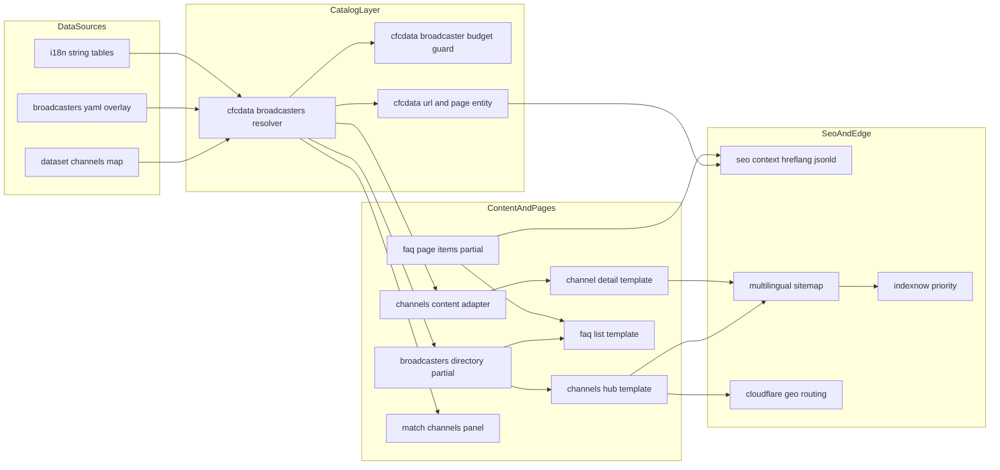
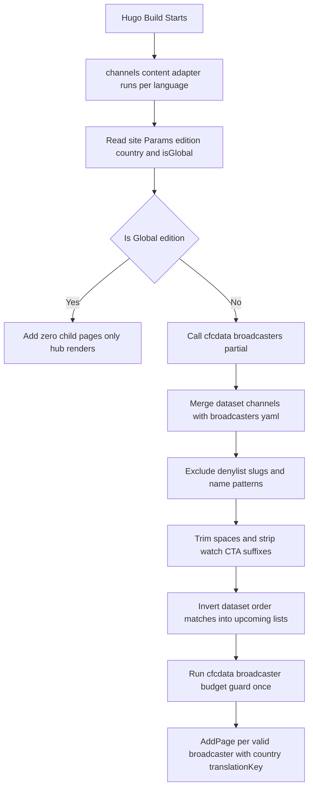
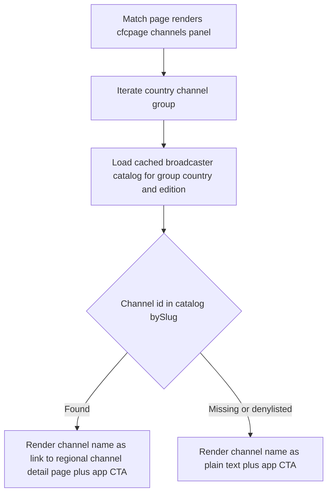

# Technical Design: broadcaster-directory

## Overview
The `broadcaster-directory` feature extends CardápioFC's Hugo 0.169.0 extended static site with official TV and streaming broadcaster discovery across all nine editions (`en` Global, `en-gb`, `en-ie`, `pt-br`, `pt-pt`, `es-ar`, `en-us`, `zh-cn`, `ja`). It merges existing per-country broadcast channel data already loaded by `data-pages` (`dataset.channels`) with a repository-maintained YAML overlay (`data/cfc/broadcasters.yaml`) through a single adapter-safe resolver (`layouts/_partials/cfcdata/broadcasters.html`), generating:

1. A broadcaster directory hub (`{edition prefix}channels/`) across all 9 editions.
2. Country-scoped broadcaster detail pages (`/{edition code}/channels/{slug}/`) on regional editions only (0 child pages on Global `/`).
3. An enriched "Included Broadcasters & Services" section and unified FAQ data source on every edition's `/faq/` page.
4. Internal broadcaster links from match-page channel listings and full SEO, structured data, sitemap, IndexNow, and edge geo-routing integration.

### Goals
- Capture high-intent broadcaster and channel search queries (`"included broadcasters and services"`, `"ge tv cardápiofc what is it globo"`, `"brazil football tv channel"`, network schedules) with 100% official licensed broadcasters and zero ads.
- Reuse existing Data Contract v1 (`channels/<CC>.json`) with zero Retool/export pipeline changes.
- Keep build output well under Cloudflare's 20,000-file limit (~189–210 net new HTML files, 0 new OG PNG files) while leaving `cfcdata/budget.html` and `data/cfc/settings.yaml` unmodified and passing all active verification suites (`check-site.mjs`, `check-seo-social.mjs`, `test-indexnow.mjs`, and `test-broadcaster-directory.mjs`).
- Prevent cross-country `hreflang` / `x-default` regressions when regional editions share channel slugs (`espn`, `apple-tv`, `disney-premium`).

### Non-Goals
- Modifying Retool workflows or Data Contract v1 (`contract/cfc-data-v1.schema.json`).
- Generating per-broadcaster Open Graph PNG images (`scripts/generate_og_images.py`).
- Registering `/channels/` routes in mobile app deep-link files (`apple-app-site-association`, `assetlinks.json`).
- Implementing legacy FAQ/About 301 redirects (`layouts/home.redirects`) or PT-BR homepage/matches copy tuning (`i18n/pt.yaml` home/matches keys), which are tracked separately as direct implementation candidates in `.kiro/steering/roadmap.md`.
- Adding cross-border editorial guides, off-season league/team persistence, or new country editions.

---

## Boundary Commitments

### This Spec Owns
- **Curated Broadcaster Overlay**: Schema and initial flagship broadcaster entries, placeholder denylist, and display-name normalization rules in `data/cfc/broadcasters.yaml`.
- **Broadcaster Data Resolution & Budget Guard**: Adapter-safe catalog merging, filtering, normalization, upcoming-match indexing (`layouts/_partials/cfcdata/broadcasters.html`), and additive combined file-budget validation (`layouts/_partials/cfcdata/broadcaster-budget.html`).
- **Broadcaster Routes & Layouts**: `content/en/channels/_index.md`, `content/en/channels/_content.gotmpl`, `layouts/channels/list.html`, `layouts/channels/page.html`, reusable `layouts/_partials/cfcpage/broadcasters-directory.html`, and dedicated styles (`assets/css/cfc/components/broadcaster.css`).
- **Unified FAQ Content & Broadcaster Directory Injection**: Shared `layouts/_partials/cfcpage/faq-page-items.html` driving both `layouts/faq/list.html` and `layouts/_partials/seo/jsonld.html`, plus the visible "Included Broadcasters & Services" section on `/faq/`.
- **Broadcaster Seam Integrations**: Channel entity kinds in `cfcdata/url.html` and `cfcdata/page-entity.html`; match-page channel-name linking in `cfcpage/channels.html`; edition-switcher fallback in `cfc/edition-switcher.html`; primary/footer menu entries in `config/_default/menus.toml`; broadcaster SEO metadata, JSON-LD builders (`jsonld-channel.html`, `jsonld-channels.html`), and country-scoped `hreflang`/sitemap isolation; exact `/channels` geo-route in `cloudflare/redirect-rules.json`; IndexNow channel priority; localization keys across all 7 base `i18n/*.yaml` files; and automated broadcaster verification tests.

### Out of Boundary
- Upstream Retool/Firebase dataset generation, `layouts/_partials/cfcdata/dataset.html` schema changes, and `layouts/_partials/cfcdata/budget.html` formula changes.
- Vendored theme and module directories (`themes/hugoplate/*`, `_vendor/*`).
- Social image pipeline (`scripts/generate_og_images.py`, `static/og/*`).
- Mobile app deep-link manifests (`static/.well-known/*`, `layouts/_partials/cfcapp/*`).
- Legacy 301 redirect rules (`layouts/home.redirects`) and non-broadcaster homepage/matches copy changes.
- Displaying channel badges inside match lists (`cfc-channel-badge` / `cfc-match-card__channels` remain strictly forbidden outside match pages per `data-pages` Req 5.6).

### Allowed Dependencies
- **Upstream `site-foundation`**: Edition registry parameters (`site.Params.edition`, `edition/current.html`, `edition/all.html` in non-adapter templates only), base layout shell (`layouts/baseof.html`), shared UI partials (`cfc/breadcrumb.html`, `cfc/page-hero.html`, `cfc/section-head.html`, `cfc/empty-state.html`, `cfc/app-download.html`, `cfc/scroller.html`, `cfc/icon.html`, `cfc/img-src.html`, `cfc/country-in.html`), time formatting (`time/*`), and `i18n/*.yaml` string tables.
- **Upstream `data-pages`**: `cfcdata/dataset.html`, `cfcdata/budget.html`, `cfcdata/url.html`, `cfcdata/page-entity.html`, `cfcdata/channels.html`, `cfcpage/match-days.html`, `cfcpage/freshness.html`.
- **Upstream `seo-social`**: `seo/context.html`, `seo/canonical.html`, `seo/hreflang.html`, `seo/opengraph.html`, `seo/og-image.html`, `seo/jsonld.html`, `seo/jsonld-faq.html`, `seo/jsonld-breadcrumb.html`, `seo/jsonld-render.html`, `layouts/sitemap.xml`, `scripts/check-seo-social.mjs`.
- **Upstream `edge-delivery`**: `cloudflare/redirect-rules.json`, `scripts/indexnow.mjs`.

### Revalidation Triggers
Downstream verification or re-design is required if:
1. A future Data Contract v2 changes `channels/<CC>.json` object shape (`id`, `name`, `type`, `logo`, `url`, `matches`).
2. `en-us`, `zh-cn`, or `ja` begin exporting >150 channels each, approaching the 18,000-file budget.
3. Mobile apps introduce native `/channel/` or `/channels/` deep-link routes requiring AASA/assetlinks alignment.
4. `scripts/check-data-pages.mjs` or `scripts/test-cfc-dataset-budget.mjs` change their output invariants.

---

## Architecture

### Existing Architecture Analysis
CardápioFC is a zero-framework Hugo 0.169.0 extended static site using Tailwind CSS v4 (CSS-first via `assets/css/custom.css`) and nine configured languages/editions in `config/_default/languages.toml`. Dynamic entity pages (`leagues`, `team`, `match`) are generated by Hugo content adapters (`content/en/{section}/_content.gotmpl`) with `.EnableAllLanguages` consuming a single cached `dataset` map loaded by `cfcdata/dataset.html`. `seo-social` injects `<head>` tags and unified `@graph` JSON-LD via `hooks/head-seo.html` driven by `cfcdata/page-entity.html`.

### Architecture Pattern & Boundary Map
Dependency direction flows strictly left-to-right (no upward calls, and content adapters never touch `site.Home`-based edition partials):

`Data Sources` → `Catalog & Budget Layer` → `Content Adapter & Page Entities` → `Presentation Templates & SEO/Edge Integrations` → `Build Verification`



**Key Decisions (not repeated from diagram):**
- **Adapter safety**: `CatalogResolver` and `BudgetGuard` accept explicit `country`, `editionCode`, and `lang` inputs (defaulting from `site.Params.edition` and `site.Language.Lang`), never invoking `edition/current.html` or `edition/all.html`, so they execute safely inside `_content.gotmpl`.
- **Cross-country isolation**: `ChannelsAdapter` sets `"translationKey": printf "channel-%s-%s" (lower $country) $slug` on every regional channel page and emits 0 child pages on Global `en`, guaranteeing `len .AllTranslations == 1` even when countries share slugs like `espn` or `apple-tv`.
- **Match-list CSS isolation**: All broadcaster hub, detail, and FAQ markup uses `cfc-broadcaster-*` classes, keeping `cfc-channel-badge` and `cfc-match-card__channels` confined strictly to match pages (`check-data-pages.mjs` Check 6d).

### Technology Stack
No new external libraries or runtime dependencies are introduced.

| Layer | Technology & Version | Role in This Feature |
| --- | --- | --- |
| Static Generator | Hugo Extended `0.169.0` | Content adapter (`_content.gotmpl`), `site.Data` YAML overlay, `partialCached` catalog resolution, multilingual templates & sitemaps |
| Styling | Tailwind CSS v4 + custom CFC CSS (`assets/css/cfc/components/broadcaster.css`) | Zero-radius card/chip/directory styling using existing CFC design tokens |
| Structured Data & SEO | Schema.org JSON-LD (`BroadcastService`, `CollectionPage`/`ItemList`, `BreadcrumbList`, `FAQPage`), BCP 47 `hreflang` | Search & AI answer-engine discovery |
| Edge Delivery | Cloudflare Redirect Rules (`cloudflare/redirect-rules.json`) | Exact `/channels` and `/channels/` human visitor geo-routing |
| Verification | Node.js ESM scripts (`scripts/check-seo-social.mjs`, `scripts/check-site.mjs`, `scripts/test-broadcaster-directory.mjs`, `scripts/indexnow.mjs`) | Build-time SEO, i18n parity, image dimensions, file-budget, and catalog unit/integration assertions |

---

## File Structure Plan

### Created Files
| File Path | Responsibility | Component |
| --- | --- | --- |
| `data/cfc/broadcasters.yaml` | Curated overlay: placeholder denylist (`canal-a-confirmar`, `nao-confirmado`, `to-be-confirmed`, etc.), display-name normalization regexes (incl. `(Watch it live)`, `(Ver ao vivo)`, `(Ver en vivo)`, `(Ver en directo)`, `(Míralo en vivo)`), `persistent: true` entries aligned to exact live `ChannelId`s + `persistent: false` enrich-only entries for sample-only alternate slugs, localized descriptions & FAQs for BR/GB/IE/PT/AR | `BroadcasterOverlay` |
| `layouts/_partials/cfcdata/broadcasters.html` | Adapter-safe cached catalog resolver merging `dataset.channels` + `data/cfc/broadcasters.yaml`, filtering denylist, normalizing names, indexing upcoming matches chronologically, grouping by category (`free_tv`, `tv`, `streaming`) | `BroadcasterCatalogResolver` |
| `layouts/_partials/cfcdata/broadcaster-budget.html` | Additive combined file-budget guard (`budget.total + hubPages + regionalChannelPages <= fileBudget`) invoked once via `partialCached` without altering `budget.html` | `BroadcasterBudgetGuard` |
| `content/en/channels/_index.md` | Section branch bundle with `sites.matrix.languages: ["**"]` and `params.cfc.kind: "channels"` enabling `/channels/` across all 9 editions | `ChannelsSectionContent` |
| `content/en/channels/_content.gotmpl` | Content adapter (`.EnableAllLanguages`) generating country-scoped `/{ed}/channels/{slug}/` pages on regional editions only (0 child pages on Global) with country-scoped `translationKey` | `ChannelsContentAdapter` |
| `layouts/channels/list.html` | Broadcaster directory hub page template (Global country-grouped view & regional category-grouped view + empty state) | `ChannelsHubLayout` |
| `layouts/channels/page.html` | Country-scoped broadcaster detail page template (header, editorial overview, upcoming matches via `cfcpage/match-days.html`, empty schedule state, official link, app CTA, broadcaster FAQs, freshness) | `ChannelDetailLayout` |
| `layouts/_partials/cfcpage/broadcasters-directory.html` | Reusable broadcaster directory renderer (`compact: false` on `/channels/`, `compact: true` on `/faq/`) using `cfc-broadcaster-*` classes and explicit numeric `width`/`height` on logos | `BroadcastersDirectoryPartial` |
| `layouts/_partials/cfcpage/faq-page-items.html` | Single source of truth for `/faq/` Q&A items (Q1–Q12 incl. country-tailored "Included Broadcasters & Services" Q&A) shared by `layouts/faq/list.html` and `seo/jsonld.html` | `FaqPageItems` |
| `layouts/_partials/seo/jsonld-channel.html` | Dict builder emitting Schema.org `BroadcastService` JSON-LD for broadcaster detail pages | `ChannelJsonLdBuilders` |
| `layouts/_partials/seo/jsonld-channels.html` | Dict builder emitting Schema.org `CollectionPage` + `ItemList` JSON-LD for broadcaster hub pages | `ChannelJsonLdBuilders` |
| `assets/css/cfc/components/broadcaster.css` | Styling for `.cfc-broadcaster-*` grid, cards, category sections, compact FAQ pills, logos, and editorial panel | `BroadcasterStyles` |
| `scripts/test-broadcaster-directory.mjs` | Automated Node.js test suite verifying catalog merge/denylist/normalization, persistent broadcasters, empty US/CN/JP handling, FAQ 1:1 JSON-LD parity, match-page links, country-scoped `hreflang` isolation, and combined file budget | `BroadcasterTestSuite` |

### Modified Files
| File Path | Responsibility of Modification | Component |
| --- | --- | --- |
| `layouts/_partials/cfcdata/url.html` | Support `"channel"` (`{prefix}channels/{slug}/`) and `"channels"` (`{prefix}channels/`) entity kinds | `UrlAndEntitySeams` |
| `layouts/_partials/cfcdata/page-entity.html` | Resolve `"channel"` (single broadcaster record + country) and `"channels"` (catalog summary) for downstream SEO partials | `UrlAndEntitySeams` |
| `layouts/faq/list.html` | Render Q&As via `cfcpage/faq-page-items.html` and add the visible "Included Broadcasters & Services" section via `cfcpage/broadcasters-directory.html` (`compact: true`) | `FaqListLayout` |
| `layouts/_partials/cfcpage/channels.html` | Link confirmed channel names on regional and Global match pages to their generated regional `/{ed}/channels/{slug}/` detail page when present in `cfcdata/broadcasters.html`; keep plain text if excluded/absent; keep existing app-launcher CTA untouched | `MatchChannelsPanel` |
| `layouts/_partials/cfc/edition-switcher.html` | When current page has `cfc.kind == "channel"`, target `{ed.prefix}channels/` in each other edition instead of `{ed.prefix}` | `EditionSwitcher` |
| `config/_default/menus.toml` | Add `channels` menu entry (`url = "/channels/"`) to `[[main]]` and `[[footer]]` | `SiteMenus` |
| `layouts/_partials/seo/context.html` | Add `kind == "channel"` (`seo_channel_title`, `seo_channel_desc`) and `kind == "channels"` (`seo_channels_title`, `seo_channels_desc` with `(dict "In" $in)`) branches | `SeoContext` |
| `layouts/_partials/seo/hreflang.html` | Guard against emitting cross-edition alternates when `eq .ctx.kind "channel"` (defense-in-depth alongside `translationKey`) | `HreflangRenderer` |
| `layouts/_partials/seo/opengraph.html` | Include `"channel"` in `og:type = "article"` and skip `og:locale:alternate` when `eq $ctx.kind "channel"` | `OpenGraphRenderer` |
| `layouts/_partials/seo/jsonld.html` | Add `kind == "channel"` (`jsonld-channel.html` + optional `jsonld-faq.html`), `kind == "channels"` (`jsonld-channels.html`), and switch `/faq/` branch to `cfcpage/faq-page-items.html` | `JsonLdOrchestrator` |
| `layouts/_partials/seo/jsonld-breadcrumb.html` | Add `kind == "channel"` (`Home > Channels > {Broadcaster}`) and `kind == "channels"` (`Home > Channels`) | `BreadcrumbBuilder` |
| `layouts/sitemap.xml` | Skip `<xhtml:link>` alternates when `eq .Params.cfc.kind "channel"` | `SitemapTemplate` |
| `assets/css/custom.css` | Import `./cfc/components/broadcaster.css` | `BroadcasterStyles` |
| `i18n/{en,pt,pt-pt,es,es-ar,zh-cn,ja}.yaml` (preserving `pt-br.yaml -> pt.yaml` symlink) + regional overrides `en-gb.yaml`, `en-ie.yaml`, `en-us.yaml` | Add all broadcaster menu, hub, detail, empty-state, SEO title/desc (`en-gb`, `en-ie`, `en-us` regional overrides + US "Soccer" wording), and FAQ Q12 ("Included Broadcasters & Services") keys with strict 7-file base parity | `I18nStrings` |
| `cloudflare/redirect-rules.json` | Add `http.request.uri.path eq "/channels"` and `http.request.uri.path eq "/channels/"` to all 8 country geo-routing rules (never `starts_with` `/channels/`) | `EdgeGeoRouting` |
| `scripts/check-seo-social.mjs` | Sample `"channels"` hubs and detail pages; assert `BroadcastService` + `BreadcrumbList` (+ `FAQPage` if rendered) and 0 `hreflang` links on detail pages; assert `CollectionPage`/`ItemList` + `BreadcrumbList` + reciprocal `hreflang` + `x-default` on `/channels/` hubs | `SeoVerificationScript` |
| `scripts/indexnow.mjs` | Add `"channels"` to `HUB_SEGMENTS` (`priority 0`) and return priority `2` for `/{ed}/channels/{slug}/` in `urlPriority()` | `IndexNowClassifier` |
| `scripts/test-indexnow.mjs` | Add unit assertions for `/channels/` (priority `0`) and `/pt-br/channels/ge-tv/` (priority `2`) | `IndexNowClassifier` |

---

## System Flows

### Broadcaster Catalog Resolution & Page Generation Flow


### Match-to-Broadcaster Internal Link Resolution Flow


---

## Requirements Traceability

| Requirement | Summary | Components | Interfaces / Data | Flows |
| --- | --- | --- | --- | --- |
| 1.1, 1.2, 1.3, 1.4, 1.5, 1.6, 1.7 | Merge live channels + overlay, denylist placeholders, normalize names, persistent flagships, localized descriptions/FAQs, silent absent-country fallback, official-only/zero-ads | `BroadcasterOverlay`, `BroadcasterCatalogResolver` | `BroadcastersOverlaySchema`, `BroadcasterCatalog` | Catalog Resolution Flow |
| 2.1, 2.2, 2.3, 2.4, 2.5, 2.6 | `/channels/` hub in all 9 editions (category-grouped regional, empty state, country-grouped Global), nav links & breadcrumbs | `ChannelsSectionContent`, `ChannelsHubLayout`, `BroadcastersDirectoryPartial`, `SiteMenus` | `BroadcasterCatalog`, `BroadcastersDirectoryArgs` | Catalog Resolution Flow |
| 3.1, 3.2, 3.3, 3.4, 3.5, 3.6, 3.7, 3.8 | Country-scoped `/{ed}/channels/{slug}/` pages (0 on Global), header/editorial/FAQs/upcoming matches/empty schedule/external link/app CTA, edition-switcher fallback to hub | `ChannelsContentAdapter`, `ChannelDetailLayout`, `EditionSwitcher`, `BroadcasterStyles` | `BroadcasterRecord`, `PageEntity(channel)` | Catalog Resolution Flow |
| 4.1, 4.2, 4.3, 4.4 | Visible "Included Broadcasters & Services" section on `/faq/`, dedicated broadcaster FAQ Q&A, 1:1 visible↔`FAQPage` JSON-LD parity | `FaqPageItems`, `FaqListLayout`, `BroadcastersDirectoryPartial`, `JsonLdOrchestrator` | `FaqItem[]`, `BroadcastersDirectoryArgs` | — |
| 5.1, 5.2, 5.3, 5.4 | Link match-page channel names to regional detail pages (regional & Global), plain text for excluded/missing, preserve match-list channel hiding | `MatchChannelsPanel`, `ChannelDetailLayout` | `BroadcasterCatalog.bySlug` | Match-to-Broadcaster Flow |
| 6.1, 6.2, 6.3, 6.4, 6.5, 6.6, 6.7, 6.8 | Unique meta, edition OG reuse, reciprocal hub `hreflang`+`x-default`, zero cross-country `hreflang` on detail pages, `BroadcastService`+`CollectionPage`/`ItemList`+`BreadcrumbList`+`FAQPage` JSON-LD, sitemap, IndexNow priority, exact `/channels/` geo-route | `SeoContext`, `HreflangRenderer`, `OpenGraphRenderer`, `JsonLdOrchestrator`, `ChannelJsonLdBuilders`, `BreadcrumbBuilder`, `SitemapTemplate`, `IndexNowClassifier`, `EdgeGeoRouting` | `PageEntity`, `BroadcastServiceJsonLd`, `urlPriority` | Catalog Resolution Flow |
| 7.1, 7.2 | Complete 7-file i18n parity, edition-local timezone formatting on broadcaster schedules & freshness | `I18nStrings`, `ChannelDetailLayout` | `i18n/*.yaml`, `cfcpage/match-days.html`, `cfcpage/freshness.html` | — |
| 8.1, 8.2, 8.3 | Clean sample + production builds (incl. empty US/CN/JP), combined file-budget guard without breaking `test-cfc-dataset-budget.mjs`, automated verification coverage | `BroadcasterBudgetGuard`, `SeoVerificationScript`, `BroadcasterTestSuite` | `BroadcasterBudgetResult`, `check-seo-social.mjs`, `test-broadcaster-directory.mjs` | Catalog Resolution Flow |

---

## Components and Interfaces

### Component Summary

| Component | Domain / Layer | Intent | Requirements | Key Dependencies (Criticality) | Contracts |
| --- | --- | --- | --- | --- | --- |
| `BroadcasterOverlay` | Data / Config | Curated YAML rules, denylist, name normalization, flagship descriptions & FAQs | 1.1–1.5, 1.7 | None (Inbound: `BroadcasterCatalogResolver`, P0) | State/Schema |
| `BroadcasterCatalogResolver` | Data / Service | Adapter-safe cached per-country broadcaster catalog & upcoming-match index | 1.1–1.7, 2.2–2.5, 3.1, 5.1–5.3 | Outbound: `cfcdata/dataset.html` (P0), `BroadcasterOverlay` (P0), `cfcdata/url.html` (P0) | Service |
| `BroadcasterBudgetGuard` | Data / Guard | Additive build-time combined file-count guard preserving `budget.html` tests | 8.1, 8.2 | Outbound: `cfcdata/budget.html` (P0), `BroadcasterCatalogResolver` (P0) | Service |
| `UrlAndEntitySeams` | Data / Contract | Expose `channel` / `channels` URLs and `PageEntity` dicts | 2.1, 3.1, 6.1, 6.5, 6.6 | Outbound: `BroadcasterCatalogResolver` (P0) | Service |
| `ChannelsContentAdapter` | Content Generation | Emit country-scoped regional channel pages with `translationKey` (0 on Global) | 3.1, 3.2, 6.4, 8.1 | Outbound: `BroadcasterCatalogResolver` (P0), `BroadcasterBudgetGuard` (P0) | Batch/Build |
| `ChannelsSectionContent` | Content Generation | Enable `/channels/` hub across all 9 editions via `sites.matrix` | 2.1, 6.3 | Inbound: Hugo site builder (P0) | State |
| `BroadcastersDirectoryPartial` | UI / Presentation | Shared category-grouped (regional) & country-grouped (Global) broadcaster directory | 2.2–2.5, 4.1, 4.2 | Outbound: `BroadcasterCatalogResolver` (P0), `edition/all.html` (P1) | Service (UI) |
| `ChannelsHubLayout` | UI / Page | Render `/channels/` hub page with hero, breadcrumbs, directory, empty state | 2.1–2.6, 7.1 | Outbound: `BroadcastersDirectoryPartial` (P0), `cfc/*` (P1) | Summary-only |
| `ChannelDetailLayout` | UI / Page | Render `/{ed}/channels/{slug}/` detail page with overview, matches, CTA, FAQs | 3.1–3.7, 5.4, 7.1, 7.2 | Outbound: `BroadcasterCatalogResolver` (P0), `cfcpage/match-days.html` (P0) | Summary-only |
| `FaqPageItems` | Content / Service | Unified `/faq/` Q&A slice (Q1–Q12) consumed by HTML and `FAQPage` JSON-LD | 4.3, 4.4, 7.1 | Outbound: `i18n` (P0), `BroadcasterCatalogResolver` (P1) | Service |
| `FaqListLayout` | UI / Page | Render `/faq/` accordion from `FaqPageItems` + visible broadcasters directory | 4.1–4.4, 7.1 | Outbound: `FaqPageItems` (P0), `BroadcastersDirectoryPartial` (P0) | Summary-only |
| `MatchChannelsPanel` | UI / Extension | Link confirmed match channels to regional detail pages while keeping app CTA | 5.1–5.3 | Outbound: `BroadcasterCatalogResolver` (P0) | Summary-only |
| `EditionSwitcher` | UI / Extension | Route edition switch from channel detail page to target `/channels/` hub | 3.8 | Outbound: `edition/all.html` (P0) | Summary-only |
| `SiteMenus` | Config / Navigation | Add `/channels/` to primary and footer navigation | 2.6, 7.1 | Inbound: `cfc/menu.html` (P1) | State |
| `SeoContext`, `HreflangRenderer`, `OpenGraphRenderer`, `SitemapTemplate` | SEO / Head & Sitemap | Channel metadata, edition OG reuse, strict cross-country `hreflang` isolation | 6.1–6.4, 6.7 | Outbound: `UrlAndEntitySeams` (P0) | Service |
| `JsonLdOrchestrator`, `ChannelJsonLdBuilders`, `BreadcrumbBuilder` | SEO / Structured Data | Emit `BroadcastService`, `CollectionPage`/`ItemList`, `BreadcrumbList`, `FAQPage` | 4.4, 6.5, 6.6 | Outbound: `UrlAndEntitySeams` (P0), `FaqPageItems` (P0), `seo/jsonld-faq.html` (P0) | Service |
| `BroadcasterStyles` | UI / Styling | `.cfc-broadcaster-*` CSS tokens & responsive layout rules | 2.2, 2.3, 3.3, 4.1 | Inbound: `assets/css/custom.css` (P1) | Summary-only |
| `I18nStrings` | Localization | Complete localized keys across 7 base `i18n/*.yaml` + regional overrides | 4.3, 7.1 | Inbound: all templates (P0) | State |
| `EdgeGeoRouting` & `IndexNowClassifier` | Edge / Discovery | Exact `/channels` geo-route (bots excluded) + IndexNow URL priorities (`0`/`2`) | 6.7, 6.8 | External: Cloudflare Redirect Rules (P1), IndexNow API (P2) | Config/Service |
| `SeoVerificationScript` & `BroadcasterTestSuite` | Quality Gates | Automated post-build assertions on SEO, `hreflang`, logos, FAQ parity, links, budget | 8.1–8.3 | Inbound: CI & `pnpm build` (P0) | Batch/Check |

### Detailed Component Contracts

#### 1. `BroadcasterCatalogResolver` (`layouts/_partials/cfcdata/broadcasters.html`)
- **Contract Type**: Service (Hugo return partial, `partialCached` safe).
- **Signature**:
  ```go-html-template
  partialCached "cfcdata/broadcasters.html" (dict
    "country" $country         {{/* optional ISO-2 uppercase, e.g. "BR"; defaults from site.Params.edition.country */}}
    "editionCode" $edCode      {{/* optional edition code, e.g. "pt-br"; defaults from site.Language.Lang */}}
    "lang" $lang               {{/* optional display lang for editorial copy; defaults from site.Language.Lang */}}
    "dataset" $dataset         {{/* optional preloaded dataset; defaults to partialCached "cfcdata/dataset.html" */}}
  ) (printf "broadcasters|%s|%s|%s" $country $edCode $lang)
  ```
- **Preconditions**: Must never call `edition/current.html`, `edition/all.html`, or `site.Home`.
- **Return Contract (`BroadcasterCatalog`)**:
  - `country`: `string` (uppercase ISO-2, empty if Global)
  - `editionCode`: `string`
  - `bySlug`: `map[string]BroadcasterRecord`
  - `list`: `slice[BroadcasterRecord]` (sorted ascending by normalized `name`)
  - `groups`: `slice[{ type: "free_tv"|"tv"|"streaming", items: slice[BroadcasterRecord] }]` (only non-empty groups included, fixed order: `free_tv`, `tv`, `streaming`)
  - `totalBroadcasters`: `int`
  - `totalUpcoming`: `int`
- **Normalization & Exclusion Rules**:
  1. Look up live channel file in `dataset.channels` probing `$cc`, `upper $cc`, `channels/$cc.json`, `channels/<UPPER>.json`; if absent, treat as empty without calling `warnf`.
  2. Exclude any live channel whose `id` is in `broadcasters.yaml` `denylist.slugs` OR whose trimmed raw `name` matches any regex in `denylist.namePatterns`.
  3. Normalize display name: apply every regex in `normalization.stripSuffixes`, then `strings.TrimSpace`. If overlay provides an explicit `name` override, prefer it.
  4. Merge overlay `countries.<CC>` entries: enrich matching live channels with `description`, `faqs`, `name` override, fallback `url`/`logo`/`type`, and `persistent`; insert overlay-only entries only where `persistent: true` (even with 0 live matches), while entries with `persistent: false` (or omitted) enrich matching live channels without synthesizing extra pages when absent.
  5. Invert `dataset.order` (filtering statuses to `scheduled`, `live`, `halftime`, `postponed`, `suspended`) once into `upcomingMatchSlugs` per `ChannelId`.
  6. Resolve localized `description` and `faqs` using fallback order: exact `lang` (e.g. `pt-br`) → base lang prefix (`pt`) → `en` → empty.
- **Implementation Notes**: Validate `type` defaults to `"tv"` if unknown; build each broadcaster's URL via `cfcdata/url.html` (`kind: "channel"`, `slug`, `edition: $editionCode`).

#### 2. `BroadcasterBudgetGuard` (`layouts/_partials/cfcdata/broadcaster-budget.html`)
- **Contract Type**: Service (Hugo return partial, invoked once per build via `partialCached` key `"broadcaster-budget"`).
- **Inputs**: `dict "dataset" $dataset "settings" $settings`.
- **Behavior**:
  1. Calls `partialCached "cfcdata/budget.html" (dict "dataset" $dataset "settings" $settings) "budget"` to obtain `baseTotal` and `budget`.
  2. Counts `hubPages = len hugo.Sites` (1 `/channels/` hub per edition) and iterates `hugo.Sites` where `not (or .Params.edition.isGlobal .Params.edition.isglobal)`, summing `(partialCached "cfcdata/broadcasters.html" ... (printf "broadcasters|%s|%s|%s" $cc $edCode $edCode)).totalBroadcasters` into `detailPages`.
  3. Computes `combined = add $baseTotal (add $hubPages $detailPages)`.
  4. Emits `warnf "broadcaster-directory: estimated total files %d/%d (broadcasters %d: %d hubs + %d detail, base %d)"` and halts with `errorf` if `gt $combined $budget`.
- **Implementation Notes**: Leaves `cfcdata/budget.html` and `settings.yaml` untouched preserving `budget.html` formula compatibility while validating combined broadcaster budget and overflow rejection in `scripts/test-broadcaster-directory.mjs`.

#### 3. `ChannelsContentAdapter` (`content/en/channels/_content.gotmpl`)
- **Contract Type**: Hugo Build Content Adapter.
- **Behavior**:
  - Declares `{{ .EnableAllLanguages }}`.
  - Reads `$edParams := site.Params.edition`; if `$edParams.isGlobal` or `$edParams.isglobal` or empty `$country`, returns immediately (0 child pages on Global `/`).
  - Loads `$dataset := partialCached "cfcdata/dataset.html" . "dataset"`, runs `partialCached "cfcdata/broadcaster-budget.html" ... "broadcaster-budget"`, and fetches `$catalog := partialCached "cfcdata/broadcasters.html" ...`.
  - For each `$b` in `$catalog.list`, calls `$.AddPage` with:
    - `"kind": "page"`
    - `"path": $b.slug`
    - `"title": $b.name`
    - `"translationKey": printf "channel-%s-%s" (lower $country) $b.slug` (prevents Hugo from pairing same-slug channels across countries in `.AllTranslations`)
    - `"dates"`: `date`, `lastmod`, `publishDate` from `time.AsTime $dataset.generatedAt`
    - `"params"`: `dict "cfc" (dict "kind" "channel" "slug" $b.slug "country" $country)`

#### 4. `UrlAndEntitySeams` (`cfcdata/url.html`, `cfcdata/page-entity.html`)
- **`cfcdata/url.html`**:
  - Adds `kind == "channels"` → `printf "%schannels/" $prefix`
  - Adds `kind == "channel"` (requires non-empty `slug`) → `printf "%schannels/%s/" $prefix $slug`
- **`cfcdata/page-entity.html`**:
  - Adds `kind == "channel"` → resolves `$catalog` for current edition country, looks up `index $catalog.bySlug $slug`, returns `{ kind: "channel", edition, country, generatedAt, channel: $record }`.
  - Adds `kind == "channels"` → returns `{ kind: "channels", edition, country, generatedAt, catalog: $catalog }` (or country-list summary on Global).

#### 5. `FaqPageItems` (`layouts/_partials/cfcpage/faq-page-items.html`)
- **Contract Type**: Service (Hugo return partial).
- **Inputs**: Page context `.`.
- **Return Contract**: `slice[dict "q" string "a" string]` covering Q1–Q11 plus Q12 (broadcasters & services coverage for the edition, pulling localized `faq_q12` / `faq_a12` with regional overrides in `i18n/pt.yaml`, `en-gb.yaml`, `en-ie.yaml`, `pt-pt.yaml`, `es-ar.yaml`, `en-us.yaml`, `zh-cn.yaml`, `ja.yaml` — explicitly naming TV Globo, GE TV, SporTV, Premiere, CazéTV in Brazil).
- **Consumers**: `layouts/faq/list.html` (renders numbered accordion cards) and `layouts/_partials/seo/jsonld.html` (passes directly to `seo/jsonld-faq.html`), guaranteeing 1:1 verbatim parity.

#### 6. `BroadcastersDirectoryPartial` (`layouts/_partials/cfcpage/broadcasters-directory.html`)
- **Contract Type**: Reusable UI partial.
- **Inputs**: `dict "page" . "compact" (bool) "headingLevel" (int, default 2)`.
- **Behavior**:
  - **Regional edition**: Reads `cfcdata/broadcasters.html` for current edition; renders each non-empty category group (`free_tv`, `tv`, `streaming`) using `.cfc-broadcaster-group` and `.cfc-broadcaster-grid` (or compact `.cfc-broadcaster-chips` when `compact: true`). Each logo `` passes through `cfc/img-src.html` with explicit numeric `width="32" height="32"` (`onerror="this.hidden=true"`). If `totalBroadcasters == 0`, renders `cfc/empty-state.html` with localized message + app link.
  - **Global edition**: Iterates `edition/all.html` where `not .isGlobal`; for each country with `totalBroadcasters > 0`, renders country section heading, link to `/{ed.code}/channels/`, and broadcaster links pointing to `/{ed.code}/channels/{slug}/`.

#### 7. `SeoLayer` & `ChannelJsonLdBuilders`
- **`seo/context.html`**: When `kind == "channel"`, formats `seo_channel_title` (`{Channel}`, `{In}`) and `seo_channel_desc` (`{Channel}`, `{Type}`, `{In}`, `{Count}`, or curated description truncated cleanly). When `kind == "channels"` (hub), passes `(dict "In" $in)` to `seo_channels_title` and `seo_channels_desc` (and relies on `en-gb.yaml`, `en-ie.yaml`, `en-us.yaml` overrides so all 9 editions emit unique `<title>` and `<meta name="description">`).
- **`seo/hreflang.html` & `layouts/sitemap.xml`**: Add explicit guard `not (eq .Params.cfc.kind "channel")` (and `not (eq .ctx.kind "channel")`) so channel detail pages never emit cross-country `<link rel="alternate" hreflang=...>` or `<xhtml:link>` tags; `/channels/` hubs continue emitting all 9 reciprocal alternates + Global `x-default`.
- **`seo/jsonld-channel.html`**: Emits `{ "@type": "BroadcastService", "@id": "{Permalink}#broadcaster", "name": $b.name, "broadcastDisplayName": $b.name, "url": .page.Permalink, "areaServed": { "@type": "Country", "name": $countryName }, "additionalType": $typeLabel }` + optional `"sameAs": $b.officialUrl` (omitted when empty) and `"description": $b.description`.
- **`seo/jsonld-channels.html`**: Emits `{ "@type": "CollectionPage", "@id": "{Permalink}#channels", "name": .ctx.title, "url": .page.Permalink, "mainEntity": { "@type": "ItemList", "numberOfItems": len, "itemListElement": [...] } }` (capped at all listed regional broadcasters or country hubs on Global).
- **`seo/jsonld.html`**: On `kind == "channel"`, appends `jsonld-channel.html`, and where `$b.faqs` is non-empty, also appends `partial "seo/jsonld-faq.html" $b.faqs`. On `kind == "channels"`, appends `jsonld-channels.html`. On `.page.Section == "faq"`, uses `partial "cfcpage/faq-page-items.html" .page`.
- **`seo/jsonld-breadcrumb.html`**: On `kind == "channel"`, emits `Home > Channels ({prefix}channels/) > {Broadcaster}`; on `kind == "channels"`, emits `Home > Channels`.

#### 8. `EdgeGeoRouting` & `IndexNowClassifier`
- **`cloudflare/redirect-rules.json`**: Append `or http.request.uri.path eq "/channels" or http.request.uri.path eq "/channels/"` inside the path allowlist of all 8 regional geo-routing rules (preserving bot exclusion and never matching `/channels/*`).
- **`scripts/indexnow.mjs`**: Add `"channels"` to `HUB_SEGMENTS` (priority `0` for `/channels/` and `/{ed}/channels/`); add `if (section === "channels") return tailLen > 1 ? 2 : 0;` in `urlPriority()`.

---

## Data Models

### Curated Overlay Schema (`data/cfc/broadcasters.yaml`)
```yaml
denylist:
  slugs:
    - "canal-a-confirmar"
    - "nao-confirmado"
    - "to-be-confirmed"
    - "tba"
    - "unknown"
  namePatterns:
    - "(?i)^(canal a confirmar|não confirmado|nao confirmado|to be confirmed|tba|tbd)$"

normalization:
  stripSuffixes:
    - "\\s*\\((?:Watch it live|Ver ao vivo|Ver en vivo|Ver en directo|Míralo en vivo|Miralo en vivo|Live)\\)\\s*$"

countries:
  BR:
    ge-tv:
      name: "GE TV"
      type: "streaming"
      persistent: true
      url: "https://ge.globo.com/"
      descriptions:
        pt: "GE TV é o canal digital gratuito de esportes da Globo, com transmissões ao vivo de futebol, programas e cobertura esportiva oficial."
        en: "GE TV is Globo's official free digital sports channel in Brazil, featuring live football broadcasts and sports coverage."
      faqs:
        pt:
          - q: "O que é a GE TV da Globo?"
            a: "A GE TV é o canal esportivo digital gratuito do Grupo Globo, disponível no YouTube e nas plataformas digitais do ge, com transmissões oficiais de futebol."
          - q: "A GE TV é gratuita?"
            a: "Sim. A programação ao vivo da GE TV é transmitida oficialmente de forma gratuita nas plataformas digitais da Globo."
        en:
          - q: "What is GE TV by Globo?"
            a: "GE TV is Globo's free official digital sports channel in Brazil, streaming licensed football matches and coverage on YouTube and ge platforms."
    # Exact live persistent: true entries (no duplicate display-name collisions):
    # BR: ge-tv, tv-globo, sportv, premiere, cazetv (name override "CazéTV"), espn, disney-premium, hbo-max, amazon-prime-video
    # GB: sky-sports, tnt-sports, bbc-sport, itv, amazon-prime-video-watch-it-live (name override "Amazon Prime Video"), dazn-watch-it-live (name override "DAZN")
    # IE: sky-sports, tnt-sports, rte2, virgin-media-two, premier-sports-1-roi
    # PT: sport-tv-1, dazn-ver-ao-vivo (name override "DAZN"), canal-11, rtp1
    # AR: espn, espn-premium, tnt-sports-premium, tyc-sports, dsports-610-1610, disney-premium
    # Enrich-only (persistent: false) for sample-only alternate slugs:
    # disney-plus-br (BR), sky-sports-main-event, tnt-sports-1, bbc-one (GB), rte-two, premier-sports-1 (IE), dazn-1-pt, rtp-1 (PT), espn-argentina, disney-plus-ar (AR)
```

### Resolved Broadcaster Record (`BroadcasterRecord`)
| Field | Type | Required | Description |
| --- | --- | --- | --- |
| `slug` | `string` | Yes | Lowercase hyphenated channel ID matching `ChannelId` |
| `name` | `string` | Yes | Normalized (or overlay-overridden) display name |
| `type` | `"free_tv" \| "tv" \| "streaming"` | Yes | Broadcaster category |
| `logo` | `string` | No | Optional image URL (rendered via `cfc/img-src.html` with explicit `width`/`height`) |
| `url` | `string` | Yes | Internal regional detail page URL (`/{ed}/channels/{slug}/`) |
| `officialUrl` | `string` | No | Official broadcaster website URL (opened with `rel="noopener noreferrer"`) |
| `description` | `string` | No | Localized curated editorial overview |
| `faqs` | `slice[{ q, a }]` | No | Localized curated broadcaster-specific FAQs |
| `persistent` | `bool` | Yes | `true` if retained via overlay even with 0 matches |
| `upcomingMatchSlugs` | `slice[string]` | Yes | Chronologically ordered upcoming/live match slugs for this country |
| `matchCount` | `int` | Yes | `len upcomingMatchSlugs` |

---

## Error Handling

### Error Strategy
- **Fail fast on budget overflow**: `BroadcasterBudgetGuard` halts the build with `errorf` if `combined > fileBudget` (`18,000`), reporting base, hub, and detail page counts so deployments never silently breach Cloudflare's 20,000-file cap.
- **Graceful degradation on absent feeds**: Editions without a `channels/<CC>.json` file (`en-us`, `zh-cn`, `ja`) produce an empty live list without `warnf` noise and render a helpful localized empty state on `/{ed}/channels/`.
- **Graceful degradation on missing logos, URLs, or translations**: Missing logos hide cleanly (`onerror="this.hidden=true"` or omitted); missing `officialUrl` omits the external button while retaining the app CTA; missing overlay translations fall back `lang` → base lang → `en` → omitted.
- **Zero broken links from match pages**: Match-page channel linking checks `index $catalog.bySlug $chId`; denylisted or absent channels render as plain text without links.

---

## Testing Strategy

All verification runs against real Hugo builds (sample dataset and production/webhook build) with zero third-party Node test frameworks:

1. **Broadcaster Catalog & Feature Verification (`node scripts/test-broadcaster-directory.mjs`)**:
   - Verifies `/channels/` exists in all 9 editions, Global `/` generates 0 child pages under `public/channels/`, and regional editions generate `/{ed}/channels/{slug}/` pages.
   - Verifies placeholder denylist exclusion (`canal-a-confirmar`, `nao-confirmado` never generate pages or appear in hubs/FAQs) and display-name normalization (`(Watch it live)` / `(Ver ao vivo)` / trailing whitespace stripped).
   - Verifies persistent flagship broadcasters (including `ge-tv`, `tv-globo`, `sportv`, `sky-sports`) render with editorial overview and valid empty-schedule state when 0 matches exist.
   - Verifies editions without channel files (`en-us`, `zh-cn`, `ja`) build cleanly with localized empty states and zero build errors.
   - Verifies `/faq/` renders the "Included Broadcasters & Services" section AND that every visible `/faq/` Q&A matches `FAQPage.mainEntity` JSON-LD 1:1 in plain text.
   - Verifies match pages link valid channel names to regional detail pages while keeping the app-launcher CTA intact and leaving denylisted channels unlinked.
   - Verifies edition switcher on a broadcaster detail page targets `{ed.prefix}channels/`.
   - Verifies combined output file count stays below 20,000 and `static/og/` contains zero per-broadcaster PNGs.
2. **SEO & Social Verification (`node scripts/check-seo-social.mjs`)**:
   - Samples `/channels/` hubs (asserts `CollectionPage`/`ItemList` + `BreadcrumbList`, reciprocal `hreflang` across all 9 editions, `x-default` = Global `/channels/`, self-referencing canonical, edition OG image ≤ 300 KB).
   - Samples regional `/{ed}/channels/{slug}/` detail pages (asserts `BroadcastService` + `BreadcrumbList` + `FAQPage` when visible FAQs exist, self-referencing canonical, and **0** `hreflang` alternates even on shared slugs like `espn` or `apple-tv`).
   - Verifies `sitemap.xml` includes channel pages and omits `<xhtml:link>` alternates on channel detail URLs.
3. **Existing Regression Suites**:
   - `node scripts/check-site.mjs` (verifies 7-file i18n key parity and explicit numeric `width`/`height` on every broadcaster logo ``).
   - Verify `layouts/_partials/cfcdata/budget.html` and `data/cfc/settings.yaml` remain unmodified and verify combined file-budget accounting and overflow rejection (`HUGO_CFC_FILE_BUDGET`) in `scripts/test-broadcaster-directory.mjs`.
   - `node scripts/test-indexnow.mjs` (verifies `/channels/` priority `0` and `/{ed}/channels/{slug}/` priority `2`).
   - Verify no `cfc-channel-badge` or `cfc-match-card__channels` classes appear in `public/**/channels/**` or `public/**/faq/**`.

---

## Security & Privacy Considerations
- All external broadcaster links (`officialUrl`) render with `target="_blank" rel="noopener noreferrer"` (never passing referrer context).
- Only official, licensed broadcasters are listed; zero third-party ad scripts, iframes, or tracking pixels are introduced (preserving GDPR/UK-GDPR consent boundaries in `analytics-consent`).
- No user input or dynamic query parameters are interpolated into HTML or JSON-LD; all JSON-LD is serialized through Hugo's `jsonify` inside `seo/jsonld-render.html`.
