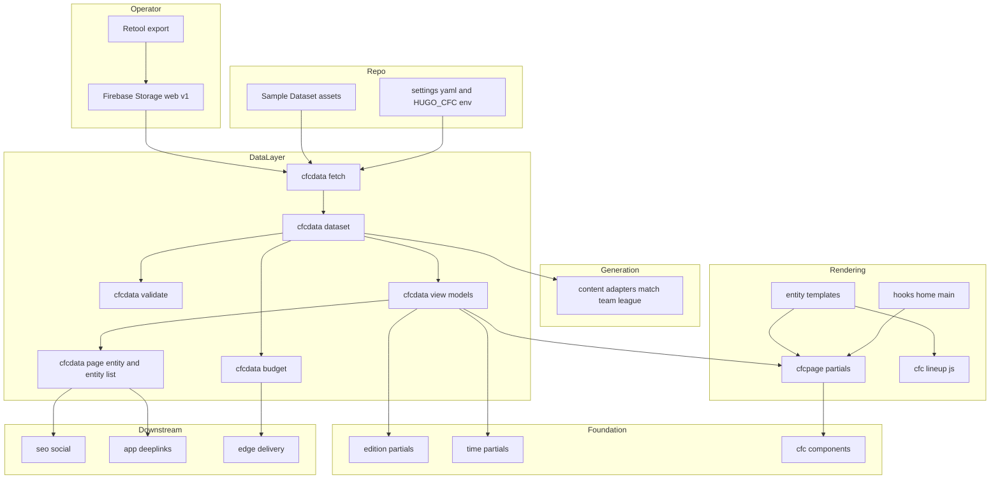
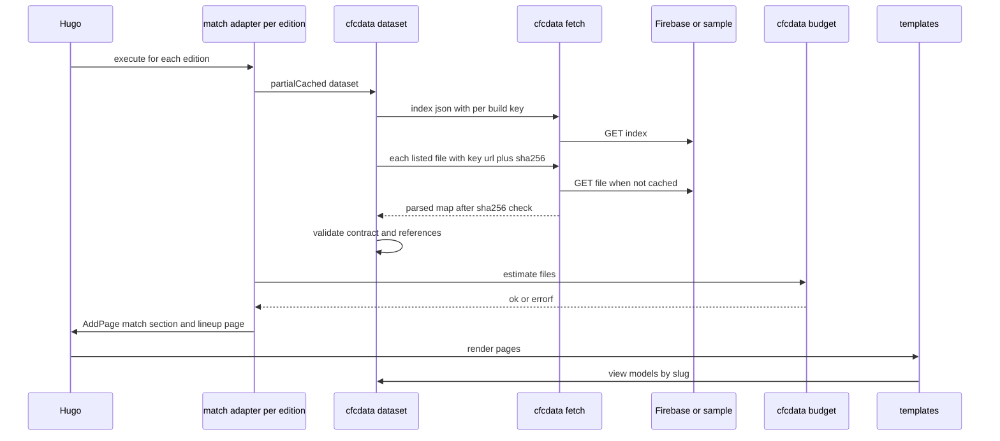
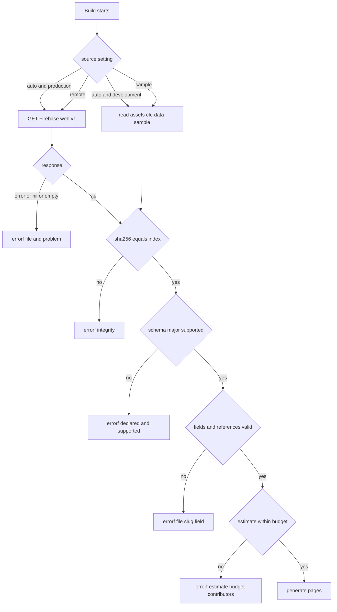
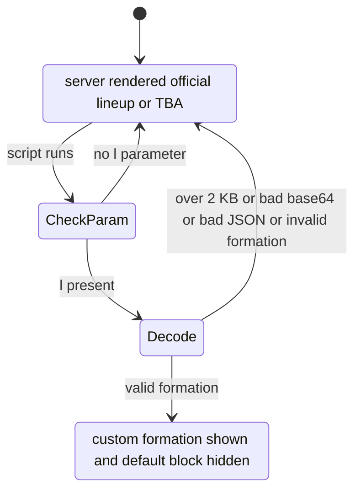
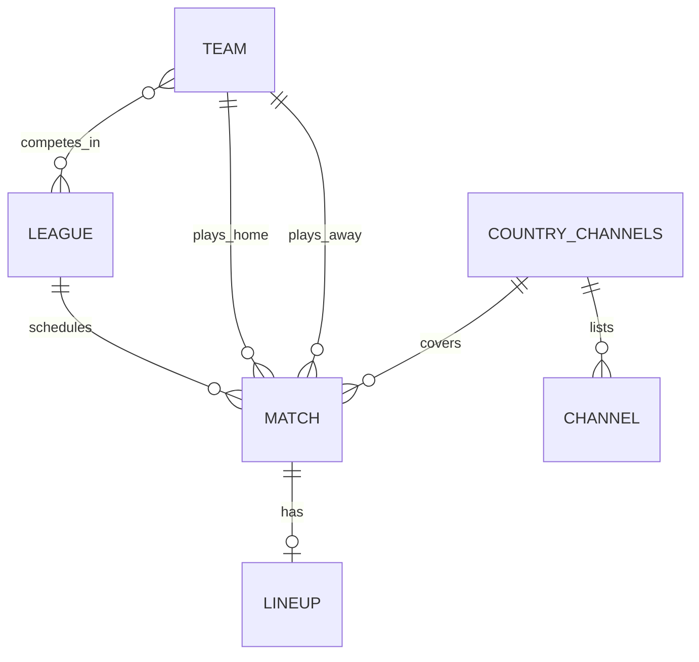
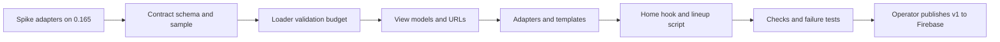

# Design Document: data-pages

## Overview
**Purpose**: This feature delivers the core content of CardápioFC — one page per match, lineup, team and league in every edition, plus the home page match listing — generated at build time from a small, versioned, pre-indexed JSON dataset that the operator's Retool workflow publishes to Firebase Storage.

**Users**: Visitors read match/team/league/lineup pages in their edition with local kick-off times and country channels. The site operator implements the Retool export against the [Data Contract v1](#data-contract-v1-hand-off-to-the-retool-export), runs `pnpm dev` against the committed Sample Dataset and `pnpm build` against Firebase. Downstream implementers (seo-social, app-deeplinks, edge-delivery) consume the [Downstream Contracts](#downstream-contracts).

**Impact**: Adds content adapters, entity templates, data-access partials, the `home-main` hook, one client script for lineup pages, a data settings file, a sample dataset and data checks. Appends to `[caches]` in `hugo.toml` and to the i18n string files. Touches no foundation-owned template, partial, stylesheet or config table, and nothing under `themes/` or `_vendor/`.

### Goals
- Every Entity in the Dataset has a page in all six editions at the app's addresses; same Entity across editions = Hugo translations.
- Broken, partial or incompatible data fails the build with a message naming file, slug and field.
- Build reads each remote file once; unchanged files are reused from the cache across builds.
- Output file count is estimated before rendering and kept ≤ 18,000 (cap 20,000).
- Production build ≤ 30 s on CI for a dataset within the budget (target ≤ 10 s).

### Non-Goals
- The Retool/SQL export job (operator), postponement/slug-change handling.
- JSON-LD, Open Graph, canonical, hreflang, sitemaps (seo-social); search page/index output, app banners, well-known files (app-deeplinks); hosting, redirects (incl. trailing slash, geo, legacy), deploy triggers, final `public/` file-count guard (edge-delivery).
- Pagination, per-edition league filtering, live updates after build.

## Boundary Commitments

### This Spec Owns
- **Data Contract v1** (this document's contract section + `contract/cfc-data-v1.schema.json`) and its versioning policy.
- **Sample Dataset** `assets/cfc-data/sample/**` and the dataset tooling scripts `scripts/cfc-data-index.mjs`, `scripts/check-data-pages.mjs`, `scripts/test-data-pages.mjs`.
- Data settings `data/cfc/settings.yaml` and the `HUGO_CFC_*` environment variables.
- Data-access partials `layouts/_partials/cfcdata/**` (loading, validation, budget, view-models, URLs, downstream contracts).
- Page generation: `content/en/{match,team,league}/{_index.md,_content.gotmpl}`.
- Entity templates `layouts/match/section.html`, `layouts/match/page.html`, `layouts/team/page.html`, `layouts/league/page.html`, `layouts/league/section.html`; page partials `layouts/_partials/cfcpage/**`.
- The hook file `layouts/_partials/hooks/home-main.html` (slot owner per foundation Hook Slot Contract).
- Lineup client script `assets/js/cfc-lineup.js`.
- The **URL/permalink scheme** for match, lineup, team, league and league directory pages (roadmap seam).
- Appended i18n keys listed in [i18n Keys Added](#i18n-keys-added) and the appended `[caches.getresource]` table.

### Out of Boundary
- Edition registry, `edition/*`, `time/*`, `cfc/*` components, `site/*` chrome, `baseof.html`, `home.html`, `list.html`, `single.html`, `404.html`, `custom.css` and component CSS, `config/_default/*`, `[permalinks]`, module mounts, `package.json` (site-foundation).
- Any other `hooks/*` file; meta/JSON-LD/OG; sitemap filtering (seo-social). Search index output format and route (app-deeplinks). `_redirects`, `_headers`, CI, Cloudflare config, the post-build file-count guard (edge-delivery).
- The export job, Firebase Storage rules and object upload (operator).

### Allowed Dependencies
- site-foundation contracts only through their documented interfaces: `partial "edition/current.html"`, `partial "edition/all.html"`, `time/*` partials, `cfc/kickoff-time`, `cfc/team-crest`, `cfc/channel-badge`, `cfc/match-card`, `cfc/date-group`, `cfc/page-header`, `cfc/breadcrumb` (via page-header), `cfc/empty-state`, `cfc/icon`, `site/hook.html` slot `home-main`, the `MatchStatus` enum and `Channel.type` enum, foundation page budgets. Never `site.Params.edition.*` directly.
- Hugo 0.165.0 extended built-ins: content adapters (`AddPage`, `EnableAllLanguages`), front matter `sites.matrix`, `resources.GetRemote` (with `try`, `key`, `headers`, `timeout`), `resources.Get`, `transform.Unmarshal`, `crypto.SHA256`, `hugo.Data`, `hugo.Sites`, `os.Getenv` (`^HUGO_` only), `partialCached`, `js.Build`, `fingerprint`, `T`.
- Remote: Firebase Storage download endpoint `https://firebasestorage.googleapis.com/v0/b/cardapiofutebol.appspot.com/o/…?alt=media` (data files, read-only) and crest/logo image URLs (hot-linked, never downloaded).
- Node ≥ 20 built-ins for scripts; no new npm dependencies.
- Dependency direction: **settings → `cfcdata/fetch` → `cfcdata/dataset` (+ `validate`, `budget`) → `cfcdata/name`, `url`, `window` → `cfcdata/{league,team,match,channels}` view-models → `cfcdata/{page-entity,entity-list}` → `cfcpage/*` → templates/adapters/hook**. `cfcdata/*` never renders HTML; `cfcpage/*` never fetches. Adapters call only `cfcdata/dataset`, `cfcdata/name`, `cfcdata/budget`.

### Revalidation Triggers
- Data Contract MAJOR bump, or renamed/removed fields → operator export, this spec's loader.
- Change of URL patterns, page kinds (match = section), trailing-slash form, or the `lineupPages` default → app-deeplinks (AASA paths), seo-social (canonicals, sitemaps), edge-delivery (redirects, `?l=` preservation, budget).
- Change of `PageEntity`, `MatchVM`, `ChannelGroup`, `EntityListItem` shapes or `.Params.cfc` keys → seo-social, app-deeplinks.
- File-count formula or default budget change → edge-delivery.
- site-foundation changes to `Match`/`Channel`/`MatchStatus`, `Edition` keys, `time/*` signatures or the `home-main` slot → this spec.
- Hugo upgrade changing content adapter/`sites.matrix` semantics → re-run spike task 1.1.

## Architecture

### Existing Architecture Analysis
- Project-setup mode, new template system (`layouts/_partials/`, `home.html`, top-level `baseof.html`). No data layer, adapters or entity templates exist (`layouts/` is absent until site-foundation lands).
- site-foundation (dependency) supplies: per-edition `contentDir = content/<code>`, Global = `en` unprefixed, `disableKinds = ["taxonomy","term","rss"]`, `outputs page/section = ["HTML"]`, edition/time/component contracts, `home-main` slot, CheckScript and page budgets.

### Architecture Pattern & Boundary Map
Selected pattern: **build-time data pipeline with a single loader and view-model layer** — one adapter set generates pages for all editions (`EnableAllLanguages`), templates resolve everything through slug-keyed view-model partials (no `where` scans, no `GetPage` loops).



**Key decisions** (details in `research.md`):
- One adapter set in the Global content directory with `.EnableAllLanguages`; section `_index.md` files carry `sites.matrix.languages: ["**"]` so the sections exist in every edition. Same logical path in every edition ⇒ translations (edition switcher works, Requirement 3.5). **Fallback** if spike 1.1 fails: thin per-edition adapters `content/<code>/{match,team,league}/_content.gotmpl` containing one `partial "cfcdata/adapter-<kind>.html" .` call each (same logic moved into partials). No other design element changes.
- Match pages are `section` kind, lineup pages are child `page` kind → `/match/{slug}/` and `/match/{slug}/lineup/` without `[permalinks]`.
- View-models are the single source for pages, cards and downstream contracts (Requirement 12.5).

### Technology Stack

| Layer | Choice / Version | Role in Feature | Notes |
|-------|------------------|-----------------|-------|
| Site generator | Hugo 0.165.0 extended | Adapters, GetRemote, templates, js.Build | Pinned by foundation |
| Data source | Firebase Storage (public read, optional token) | Hosts Dataset under `web/v1/` | Download endpoint, `alt=media` |
| Data format | JSON (UTF-8), JSON Schema 2020-12 for documentation | Contract | Hugo validates rendering-relevant rules |
| Client script | Vanilla ES2020 module, bundled by `js.Build`, minified, fingerprinted | Custom formation on lineup pages | ≤ 3 KB gzip |
| Tooling | Node ≥ 20 built-ins | Sample index/hash tool, output check, failure tests | No new deps |
| Styling | Existing `cfc-*` classes + Tailwind v4 utilities | Entity layouts | No new CSS files |

## File Structure Plan

### Directory Structure
```
content/en/
├── match/
│   ├── _index.md            # CREATE: section in all editions (sites.matrix **), build.render=never, list=always
│   └── _content.gotmpl      # CREATE: EnableAllLanguages; budget check; AddPage match (section) + lineup (page)
├── team/
│   ├── _index.md            # CREATE: as match/_index.md
│   └── _content.gotmpl      # CREATE: AddPage team pages
└── league/
    ├── _index.md            # CREATE: league directory (rendered), sites.matrix **, params.cfc.kind=leagues
    └── _content.gotmpl      # CREATE: AddPage league pages
content/en/cfc-debug.md      # CREATE (temporary): draft page (draft: true, layout cfc-debug) — only built with HUGO_BUILDDRAFTS=true, never in production
data/cfc/settings.yaml       # CREATE: data settings (source, URLs, windows, budget)
assets/
├── cfc-data/sample/         # CREATE: Sample Dataset (contract v1)
│   ├── index.json, leagues.json, teams.json, matches.json, lineups.json
│   └── channels/GB.json, IE.json, BR.json, PT.json, AR.json
└── js/cfc-lineup.js         # CREATE: decode ?l=, render custom formation (textContent only)
layouts/
├── match/
│   ├── section.html         # CREATE: match page
│   └── page.html            # CREATE: lineup page
├── team/page.html           # CREATE: team page
├── cfc-debug.html           # CREATE (temporary): debug layout rendering each existing cfcdebug/<name>.html via templates.Exists over a fixed name list
├── league/
│   ├── page.html            # CREATE: league page
│   └── section.html         # CREATE: league directory
└── _partials/
    ├── hooks/home-main.html # CREATE: home match listing (slot owner)
    ├── cfcdebug/            # CREATE (temporary, removed before completion): one debug partial per data-layer task, rendered by the debug page
    ├── cfcdata/
    │   ├── settings.html    # resolved Settings (data file + HUGO_CFC_* overrides)
    │   ├── fetch.html       # one contract file: remote (GetRemote+try, key, token, timeout) or sample (resources.Get); sha256 check; unmarshal
    │   ├── dataset.html     # Dataset aggregate (partialCached); calls validate
    │   ├── validate.html    # contract + referential validation, errorf
    │   ├── budget.html      # file-count estimate, log + errorf over budget
    │   ├── name.html        # LocalisedText → string for an edition code
    │   ├── url.html         # URL builder for all kinds/editions
    │   ├── window.html      # select slugs from kick-off-ordered list by time window/status/limit
    │   ├── league.html      # LeagueVM (current edition)
    │   ├── league-list.html # LeagueVM[] in directory order (popular first, then localised name) — shared by LeagueDirectory and PageEntity
    │   ├── team.html        # TeamVM (current edition)
    │   ├── match.html       # MatchVM (current edition), compatible with foundation Match
    │   ├── channels.html    # ChannelGroup[] for a match in the current edition
    │   ├── lineup.html      # LineupVM (official lineup or nil)
    │   ├── page-entity.html # PageEntity for a generated page (downstream contract)
    │   └── entity-list.html # EntityListItem[] for current edition (downstream contract)
    └── cfcpage/
        ├── match-days.html      # day-grouped match list (wraps time/group-by-day + cfc/date-group) + empty state
        ├── match-hero.html      # crests, names, kick-off/status/score, round, venue
        ├── channels.html        # channel list / Global country groups / no-broadcaster state
        ├── edition-links.html   # regional: same match in other editions with channels
        ├── lineup-official.html # official lineup markup (both teams)
        ├── lineup-tba.html      # lineup to be announced + build in app prompt
        ├── lineup-custom.html   # hidden container + template nodes for the client script
        └── freshness.html       # "Data updated …" line (edition zone)
i18n/en.yaml, pt.yaml, es.yaml              # MODIFY (append): keys in i18n Keys Added
i18n/en-gb.yaml, en-ie.yaml, pt-pt.yaml, es-ar.yaml   # MODIFY (append): regional overrides of added keys
hugo.toml                                    # MODIFY (append): [caches.getresource] maxAge = "720h"
scripts/
├── cfc-data-index.mjs       # CREATE: (re)write index.json hashes/counts for a dataset dir; --check validates schema subset; --synthesize N
├── check-data-pages.mjs     # CREATE: post-build assertions on public/ for the sample dataset
└── test-data-pages.mjs      # CREATE: mutate sample into temp datasets and assert build failure messages
.kiro/specs/data-pages/contract/cfc-data-v1.schema.json   # CREATE (spec artefact): machine-readable contract
```

### Modified Files (detail)
- `hugo.toml` — append only:
  ```toml
  [caches.getresource]
  dir = ":cacheDir/:project"
  maxAge = "720h"
  ```
- `i18n/*.yaml` — append keys at file end under a `# data-pages` comment; flat keys only (foundation CheckScript line-parser subset); every base file gets the full key set (parity).

## System Flows

### Build pipeline

- Index is always refetched (cache key contains the build start time); data files are refetched only when their `sha256` changes (cache key `url#sha256`) — Requirement 2.3/2.4.
- Each file is unmarshalled from `.Content` (robust to wrong Content-Type).
- Validation/budget errors abort before any page is written (adapters run before rendering).

### Source selection and failure handling


### Lineup page rendering


## Requirements Traceability

| Requirement | Summary | Components | Interfaces | Flows |
|-------------|---------|------------|------------|-------|
| 1.1–1.8 | Contract content, version, slugs, keyed collections, UTC, names, channels, index | DataContract, SchemaFile | Data Contract v1 | — |
| 1.9 | File estimate method | DataContract, BudgetEstimator | File-Count Estimate | — |
| 1.10 | Sample Dataset coverage | SampleDataset, DatasetTool | `assets/cfc-data/sample` | — |
| 2.1–2.2 | Remote in production, sample in development | Settings, Fetcher | `Settings.source` | Source selection |
| 2.3–2.4 | Read once, fresh | Fetcher, DatasetLoader | cache keys, `[caches.getresource]` | Build pipeline |
| 2.5–2.9 | Failure messages | Fetcher, Validator | error envelope | Source selection |
| 2.10 | Missing country file → warning | Validator, ChannelResolver | `warnf` | — |
| 2.11 | Credential | Settings, Fetcher | `HUGO_CFC_DATA_TOKEN` | — |
| 3.1–3.2 | Page addresses, directory | MatchAdapter, TeamAdapter, LeagueAdapter, UrlBuilder | URL Map | Build pipeline |
| 3.3 | No match/team listings, no legacy families | section `_index.md` build options, OutputCheck | — | — |
| 3.4 | Entity present ⇔ pages | Adapters | AddPage | Build pipeline |
| 3.5 | Translations across editions | Adapters (same logical path) | Hugo translations | — |
| 3.6 | Address collisions fail | Validator (counts vs keys), slug regex, OutputCheck `--printPathWarnings` | — | — |
| 3.7 | New edition without template changes | Adapters (`EnableAllLanguages`), ChannelResolver (registry countries) | Edition contract | — |
| 4.1–4.2 | Local time + zone, Global UTC | MatchHero, MatchDays | `cfc/kickoff-time`, `time/*` | — |
| 4.3–4.5 | Status, score, round, venue | MatchViewModel, MatchHero | `MatchVM` | — |
| 4.6 | Data generation time | Freshness | `Dataset.generatedAt` | — |
| 5.1–5.3 | Regional / Global channels, empty | ChannelResolver, ChannelsSection | `ChannelGroup[]` | — |
| 5.4 | Links to other editions | EditionLinks, UrlBuilder | `ChannelGroup.url` | — |
| 5.5 | External link rel | `cfc/channel-badge` (foundation) | `Channel.url` | — |
| 5.6 | No channel lists in lists | MatchDays (`showChannels=false`) | — | — |
| 6.1–6.2 | Official lineup / TBA | LineupViewModel, LineupOfficial, LineupTba | `LineupVM` | Lineup rendering |
| 6.3–6.6 | Custom formation, invalid, plain text, no-JS | LineupScript, LineupCustom | `CustomLineupParam` | Lineup rendering |
| 6.7 | Match ↔ lineup links | MatchPage, LineupPage, UrlBuilder | — | — |
| 7.1–7.4 | Team page | TeamPage, TeamViewModel, Window | `TeamVM`, `window` | — |
| 8.1–8.5 | League page | LeaguePage, LeagueViewModel, Window | `LeagueVM` | — |
| 8.6 | League directory order | LeagueDirectory | `LeagueVM.popular` | — |
| 9.1–9.5 | Home listing | HomeMainHook, Window, MatchDays | `home-main` slot | — |
| 10.1 | Localised names, never empty | NameResolver, Validator (`en` required) | `LocalisedText` | — |
| 10.2 | Labels from i18n | all cfcpage/templates | i18n Keys Added | — |
| 10.3–10.5 | Internal links, breadcrumbs, same edition | UrlBuilder, templates, `cfc/page-header` | URL Map | — |
| 11.1–11.2 | Page weight, no full lists | Windows/limits in Settings, OutputCheck | — | — |
| 11.3–11.5 | Estimate, fail, lineup option | BudgetEstimator, MatchAdapter | File-Count Estimate | Build pipeline |
| 11.6 | ≤ 30 s build | DatasetLoader (single pass), view-model caching, DatasetTool `--synthesize` | — | — |
| 11.7 | Script only on lineup pages | LineupPage, LineupScript, OutputCheck | — | — |
| 12.1 | Page entity data | PageEntityContract | `PageEntity`, `.Params.cfc` | — |
| 12.2 | Entity list | EntityListContract | `EntityListItem[]` | — |
| 12.3 | Channel groups | ChannelResolver | `ChannelGroup[]` | — |
| 12.4 | URL/app map + formula doc | this document | URL Map, File-Count Estimate | — |
| 12.5 | Same values | view-models shared by pages and contracts | — | — |

## Components and Interfaces

| Component | Domain/Layer | Intent | Req Coverage | Key Dependencies | Contracts |
|-----------|--------------|--------|--------------|------------------|-----------|
| DataContract / SchemaFile | Contract | Operator-facing file spec + JSON Schema | 1.1–1.9 | — | API |
| SampleDataset | Contract | Committed v1 dataset for dev/tests | 1.10, 2.2 | DataContract (P0) | State |
| DatasetTool | Tooling | Hashes/counts, schema-subset check, synthetic data | 1.8, 1.10, 11.6 | Node (P0) | Batch |
| Settings | Data | Resolve source, URLs, windows, budget | 2.1, 2.2, 2.11, 11.4, 11.5 | `hugo.Data`, `os.Getenv` (P0) | State |
| Fetcher | Data | Read one file, integrity, unmarshal | 2.1–2.5, 2.7, 2.11 | GetRemote, resources.Get (P0) | Service |
| DatasetLoader | Data | Aggregate + validate once per edition | 2.3, 2.6 | Fetcher, Validator (P0) | Service |
| Validator | Data | Contract and reference checks | 2.5–2.10, 3.6, 10.1 | — | Service |
| BudgetEstimator | Data | File-count estimate and guard | 1.9, 11.3–11.5 | DatasetLoader, `hugo.Sites` (P0) | Service |
| NameResolver | Data | Localised names | 10.1 | — | Service |
| UrlBuilder | Data | Addresses for all kinds/editions | 3.1, 5.4, 6.7, 10.3–10.5, 12.4 | Edition contract (P0) | Service |
| Window | Data | Time-window slug selection | 7.2, 8.2, 8.5, 9.1–9.3 | `time/*` (P0) | Service |
| League/Team/Match/Lineup ViewModels | Data | Edition-localised Entity views | 4.3–4.5, 6.1, 7.1, 7.3, 8.1, 8.3, 12.1 | NameResolver, UrlBuilder (P0) | Service |
| ChannelResolver | Data | Channel groups per edition | 2.10, 5.1–5.4, 12.3 | Edition contract (P0) | Service |
| PageEntityContract / EntityListContract | Data | Downstream read APIs | 12.1, 12.2, 12.5 | ViewModels (P0) | Service |
| MatchAdapter / TeamAdapter / LeagueAdapter | Generation | AddPage for every edition | 3.1–3.5, 3.7, 11.3–11.5 | DatasetLoader, BudgetEstimator (P0) | Batch |
| MatchPage / LineupPage / TeamPage / LeaguePage / LeagueDirectory | Rendering | Entity templates | 4.x–8.x, 10.x | cfcpage, foundation components (P0) | — |
| HomeMainHook | Rendering | Home listing in slot | 9.1–9.5 | Window, MatchDays (P0) | — |
| MatchDays, MatchHero, ChannelsSection, EditionLinks, LineupOfficial, LineupTba, LineupCustom, Freshness | Rendering | Page building blocks | 4.x–7.x, 9.x | foundation components (P0) | — |
| LineupScript | Client | Custom formation | 6.3–6.5, 11.7 | — | — |
| OutputCheck / FailureTests | Tooling | Verify build output and failures | 2.5–2.10, 3.3, 3.6, 11.1, 11.7 | Node (P0) | Batch |

### Data Layer

#### Settings
| Field | Detail |
|-------|--------|
| Intent | One resolved settings object for all data partials |
| Requirements | 2.1, 2.2, 2.11, 11.4, 11.5 |

**Contracts**: State [x]
```typescript
interface Settings {
  source: "sample" | "remote";          // data file "auto" → "sample" when hugo.IsDevelopment else "remote"; env HUGO_CFC_DATA_SOURCE wins
  baseURL: string;                       // default "https://firebasestorage.googleapis.com/v0/b/cardapiofutebol.appspot.com/o/"; env HUGO_CFC_DATA_BASEURL
  prefix: string;                        // default "web/v1/" (object path prefix, URL-encoded per file)
  sampleDir: string;                     // default "cfc-data/sample/" (assets path); env HUGO_CFC_DATA_SAMPLE overrides dir name
  token: string;                         // env HUGO_CFC_DATA_TOKEN only (never in the data file); "" when public
  timeout: string;                       // default "20s"
  supportedMajor: number;                // 1
  fileBudget: number;                    // default 18000; env HUGO_CFC_FILE_BUDGET
  staticFiles: number;                   // default 200 (non-page files in public/, calibrated by edge-delivery)
  fixedPerEdition: number;               // default 5 (home, 404, home output formats)
  lineupPages: "all" | "available";      // default "all"; env HUGO_CFC_LINEUP_PAGES
  home: { days: number; max: number };   // 7, 120
  league: { pastDays: number; futureDays: number; max: number }; // 7, 30, 100
  team: { upcoming: number; recent: number; liveGraceHours: number }; // 10, 5, 3
  asOfOverride?: GoTime;                 // env HUGO_CFC_NOW (RFC 3339); Dataset.asOf = override → else (sample) index.generatedAt → else build time
}
// partialCached "cfcdata/settings.html" . "settings" -> Settings
```
- `data/cfc/settings.yaml` holds the defaults above except `token` and `asOf`. Environment variables are read with `os.Getenv` (allowed by default `security.funcs.getenv = ^HUGO_`).

#### Fetcher
| Field | Detail |
|-------|--------|
| Intent | Read and verify one contract file |
| Requirements | 2.1–2.5, 2.7, 2.11 |

**Contracts**: Service [x]
```typescript
// partial "cfcdata/fetch.html" (dict "file" string /* e.g. "matches.json", "channels/BR.json" */ "sha256"? string /* absent only for index.json */ "settings" Settings) -> Record<string, unknown>
```
- Remote URL = `baseURL + urlquery(prefix + file) /* "/" → "%2F" */ + "?alt=media"` (+ `&token=` when set). Options: `timeout`, `key` = `file + "#" + sha256` (data files) or `file + "#" + <build start time, now.Unix>` (index; never derived from `asOf`, so `HUGO_CFC_NOW` cannot pin a stale index). Errors via `try`; `nil` (HTTP 404) and empty content are errors.
- Sample: `resources.Get (path.Join sampleDir file)`; missing → error.
- Integrity: when `sha256` given, `crypto.SHA256 .Content` must equal it (lowercase hex).
- Parse: `.Content | transform.Unmarshal` inside `try`.
- Error envelope (all `errorf`): `data-pages: <file>: <problem>`; URLs in messages have the token redacted (`token=***`).
- Postcondition: returns a map; never returns partial data.

#### DatasetLoader
**Contracts**: Service [x]
```typescript
interface Dataset {
  index: DatasetIndex;                                   // see Data Contract
  leagues: Record<Slug, LeagueRecord>;
  teams: Record<Slug, TeamRecord>;
  matches: Record<Slug, MatchRecord>;
  order: Slug[];                                         // matches by kickoff asc
  lineups: Record<Slug, LineupRecord>;
  channels: Record<CountryCode, ChannelFile>;            // only countries listed in index.files
  generatedAt: string;                                   // RFC 3339 Z
  asOf: GoTime;
  source: "sample" | "remote";
}
// partialCached "cfcdata/dataset.html" . "dataset" -> Dataset   (one execution per edition; fetches deduplicated by resource cache)
```
- Order: settings → index (major check before anything else, Requirement 2.6) → files listed in `index.files` → `cfcdata/validate.html` → return.
- Invariant: if it returns, the Dataset satisfies every rule in [Validation Rules](#validation-rules-enforced-by-the-build).

#### Validator
**Contracts**: Service [x]
```typescript
// partial "cfcdata/validate.html" (dict "dataset" Dataset) -> true   (errorf on first violation; edition-independent)
```
- Single linear pass per collection; dict lookups for references. Message format: `data-pages: <file>: <slug>: <field> <problem>` (Requirement 2.8) and `data-pages: <file>: <slug>: <field> refers to unknown <kind> "<slug2>"` (2.9).
**Implementation Notes**
- Integration: in adapters `edition/current.html` is unusable (it reads `Home`); the edition country list for 2.10 is checked at render time by ChannelResolver (warn once per edition via `partialCached`), keeping the validator edition-independent.
- Validation: FailureTests cover each rule class.
- Risks: duplicate JSON keys silently collapse → `index.counts` equality check detects them (3.6).

#### BudgetEstimator
**Contracts**: Service [x]
```typescript
interface FileEstimate { editions: number; matches: number; lineupPages: number; teams: number; leagues: number; perEdition: number; staticFiles: number; total: number; budget: number; }
// partialCached "cfcdata/budget.html" (dict "dataset" Dataset "settings" Settings) "budget" -> FileEstimate  (warnf summary line; errorf when total > budget)
```
- `editions = len hugo.Sites`; formula in [File-Count Estimate](#file-count-estimate). Log line: `data-pages: estimated output files <total>/<budget> (matches <m>, lineups <l>, teams <t>, leagues <g>, editions <e>)`. Over budget message lists contributors sorted by size.

#### NameResolver, UrlBuilder, Window (shared utilities)
**Contracts**: Service [x]
```typescript
// partial "cfcdata/name.html" (dict "names" LocalisedText "lang" string /* edition code */) -> string
//   order: names[lang] → names[languageSubtag(lang)] → names.en ; validator guarantees names.en non-empty
type UrlKind = "match" | "lineup" | "team" | "league" | "leagues";
// partial "cfcdata/url.html" (dict "kind" UrlKind "slug"? Slug "edition"? Edition /* default current */) -> string
//   "/"+? : prefix + "match/"+slug+"/" | prefix + "match/"+slug+"/lineup/" | prefix + "team/"+slug+"/" | prefix + "league/"+slug+"/" | prefix + "league/"
// partial "cfcdata/window.html" (dict "slugs" Slug[] /* kickoff-ordered */ "from"? GoTime "to"? GoTime "statuses"? MatchStatus[] "limit"? number "fromEnd"? boolean) -> Slug[]
//   linear scan with early break; fromEnd=true selects the last N (recent results)
```
- UrlBuilder uses `Edition.prefix` (foundation) — no `GetPage` calls; produces the same paths Hugo generates (verified by OutputCheck).

#### League/Team/Match/Lineup ViewModels
**Contracts**: Service [x] — see [View-Model Types](#view-model-types). Each is `partialCached` with variant `(slug, site.Language.Lang)`; inputs are slugs; unknown slug → `nil` (templates treat as programming error and `errorf`).

#### ChannelResolver
**Contracts**: Service [x]
```typescript
// partial "cfcdata/channels.html" (dict "slug" Slug "edition"? Edition /* default edition/current */) -> ChannelGroup[]
```
- Regional edition: one group for `Edition.country` (empty `channels` when none). Global: one group per regional edition (from `edition/all.html`, weight order) whose country has ≥ 1 channel for the match. Each group carries the URL of the same match in the edition of that country (for 5.4 and Global "where to watch in …" headings).
- Edition country without channel file → `warnf` once per edition, group with empty channels (2.10).

#### PageEntityContract / EntityListContract
See [Downstream Contracts](#downstream-contracts).

### Generation

#### MatchAdapter / TeamAdapter / LeagueAdapter
| Field | Detail |
|-------|--------|
| Intent | Create pages for every Entity in every edition |
| Requirements | 3.1–3.5, 3.7, 11.3–11.5 |

**Contracts**: Batch [x]
- Trigger: Hugo content adapter execution (once per edition via `.EnableAllLanguages`).
- Input: `partialCached "cfcdata/dataset.html"`, `site.Language.Lang`.
- Output (match adapter, per match): `AddPage {kind: "section", path: slug, title: "<home> vs <away>", dates: {date: kickoff, lastmod: generatedAt}, params: {cfc: {kind: "match", slug, appPath: "/match/<slug>"}}}` and, when `lineupPages = "all"` or `hasLineup`, `AddPage {kind: "page", path: "<slug>/lineup", title: "<home> vs <away>", dates: same, params: {cfc: {kind: "lineup", slug, appPath: "/match/<slug>/lineup"}}}`. Team: `{kind: "page", path: slug, title: name, params.cfc: {kind: "team", slug, appPath: "/team/<slug>"}}`. League: same with `kind: "league"`, `appPath: "/league/<slug>"`, `weight` = 1 for popular else 2.
- The match adapter calls BudgetEstimator before adding pages.
- Idempotency: pure function of Dataset + language.
- `_index.md` front matter: match/team → `title`, `sites.matrix.languages: ["**"]`, `build: {render: "never", list: "always"}`; league → `title: "Leagues"`, `sites.matrix.languages: ["**"]`, `params.cfc.kind: "leagues"`, `params.cfc.titleKey: "leagues"`.

**Implementation Notes**
- Integration: titles use `cfcdata/name.html` with `site.Language.Lang`; the literal `vs` matches the app share text in all languages. No `T`, `GetPage` or `edition/*` calls in adapters.
- Validation: spike task proves translations, section rendering suppression, nested lineup paths, and availability of `hugo.Sites`, `hugo.Data`, `os.Getenv` and `partial` inside adapters on 0.165.0 (BudgetEstimator falls back to `len site.Languages` if `hugo.Sites` is unavailable there); `hugo --printPathWarnings` shows no collisions.
- Risks: fallback A2 (per-edition thin adapters) if the spike fails.

### Rendering (summary-only)
- **MatchPage** (`layouts/match/section.html`): `cfc/page-header` (title, breadcrumbs Home › League › Match) → MatchHero → link to lineup → ChannelsSection → EditionLinks (regional) → `{{ if templates.Exists "_partials/cfcpage/faq-section.html" }}{{ partial "cfcpage/faq-section.html" . }}{{ end }}` → Freshness.
- **LineupPage** (`layouts/match/page.html`): page header (title + `T "lineup"`, breadcrumbs … › Match › Lineup) → `<div data-cfc-lineup-default>` with LineupOfficial or LineupTba → LineupCustom → link back to match → Freshness → `<script type="module" src integrity>` for `cfc-lineup.js` (only here).
- **TeamPage**: header with `cfc/team-crest` lg → upcoming MatchDays (≤ 10, empty → `T "no_upcoming_matches"`) → recent MatchDays (≤ 5 finished, `fromEnd`) → league links → Freshness.
- **LeaguePage**: header with logo → MatchDays for window (rounds shown via `Match.round`) → empty state + next match outside window → team links (from listed matches, de-duplicated, alphabetical) → Freshness.
- **LeagueDirectory** (`layouts/league/section.html`): renders `cfcdata/league-list.html` (popular leagues first, then others alphabetical by localised name); one link per league.
- **HomeMainHook**: Window(from = edition-local midnight of `asOf`, to = from + `home.days`+1 days, limit `home.max`) → within each day popular leagues first (stable) → MatchDays → truncated → link to league directory; empty → `cfc/empty-state` with `T "home_empty"` and league-directory action; Freshness line at the end.
- **MatchDays**: `time/group-by-day` (key `kickoff`) → `cfc/date-group` with `card: {showChannels: false, showLeague: true}`.
- **ChannelsSection**: regional → `cfc/channel-badge` list (size md); Global → `<section>` per group with heading `T "where_to_watch_in" (dict "Country" name)`; no channels anywhere → `T "no_broadcaster_check_app"`.
- **EditionLinks**: regional only; groups from ChannelResolver for other editions are obtained by calling it with the target edition (`cfcdata/channels.html` accepts optional `edition`); renders `<a hreflang lang>` per edition with channels.
- **LineupOfficial/LineupTba/LineupCustom/Freshness**: as named; Freshness uses `time/format` style `datetime` + `time/zone` label for `Dataset.generatedAt`.
- All labels via `T` (i18n Keys Added). No new CSS files: layouts compose `cfc-*` classes and Tailwind utilities (picked up through `hugo_stats.json`).

#### LineupScript (`assets/js/cfc-lineup.js`)
- Reads `new URLSearchParams(location.search).get("l")`; rejects when length > 2048; base64/base64url decode (`-`→`+`, `_`→`/`, padding) with `atob` + `TextDecoder` (UTF-8); `JSON.parse` in `try`; validates [`CustomLineupParam`](#custom-lineup-parameter); renders rows into the `[data-cfc-lineup-custom]` container using `textContent` and cloned `<template>` nodes; sets `hidden` on `[data-cfc-lineup-default]`, removes `hidden` from the custom block. Any failure → no DOM change (static content stays). Built with `js.Build` (format `esm`, target `es2020`), `minify`, `fingerprint`; ≤ 3 KB gzip.

## Data Models

### Domain Model
- **Dataset** (aggregate root): one consistent publication identified by `generatedAt`. Invariants: all files share `schemaVersion` major and `generatedAt`; every reference resolves; `index.counts` equal collection sizes; `order` contains every match slug once, ascending by `kickoff`.
- **League**, **Team** (entities keyed by slug), **Match** (entity keyed by slug; references league, home, away), **Lineup** (value object of a match), **ChannelListing** (per country: catalogue + match → channel ids).
- **Edition** (from site-foundation) selects language, time zone and channel country at render time.



### View-Model Types
```typescript
type Slug = string;                 // ^[a-z0-9]+(?:-[a-z0-9]+)*$
type CountryCode = string;          // ^[A-Z]{2}$
type LocalisedText = { en: string } & Partial<Record<string, string>>;
type MatchStatus = "scheduled" | "live" | "halftime" | "finished" | "postponed" | "cancelled" | "suspended"; // foundation enum
type ChannelType = "tv" | "streaming" | "free_tv";                                                          // foundation enum

interface LeagueVM {
  kind: "league"; slug: Slug; uuid: string; name: string; shortName?: string; names: LocalisedText;
  logo?: string; country?: { code: CountryCode; name: string }; popular: boolean; season?: string;
  url: string; appPath: string; matchSlugs: Slug[];
}
interface TeamVM {
  kind: "team"; slug: Slug; uuid: string; name: string; shortName?: string; names: LocalisedText;
  crest?: string; country?: { code: CountryCode }; url: string; appPath: string;
  leagues: { slug: Slug; name: string; url: string }[]; matchSlugs: Slug[];
}
// Extends site-foundation `Match` (url, slug, kickoff, status, home, away, score?, league?, round?) — passes directly to cfc/match-card
interface MatchVM {
  kind: "match"; slug: Slug; uuid: string; title: string /* "Home vs Away" */;
  url: string; lineupUrl?: string /* absent when no lineup page is generated */; appPath: string;
  kickoff: string /* RFC 3339 Z */; status: MatchStatus; statusShort: string;
  score?: { home: number; away: number }; round?: string; venue?: { name: string; city?: string };
  league: { slug: Slug; name: string; url: string; logo?: string };
  home: { slug: Slug; name: string; shortName?: string; url: string; crest?: string };
  away: { slug: Slug; name: string; shortName?: string; url: string; crest?: string };
  hasLineup: boolean; popular: boolean /* league.popular */;
}
interface LineupVM {
  slug: Slug;
  home: TeamLineupVM; away: TeamLineupVM;
}
interface TeamLineupVM { team: { name: string; crest?: string }; formation?: string; coach?: string; startXI: PlayerVM[]; substitutes: PlayerVM[]; }
interface PlayerVM { name: string; number?: number; pos?: "G" | "D" | "M" | "F"; grid?: string /* "row:col" */; }
interface ChannelGroup {
  country: CountryCode; countryName: string /* T "country_<cc>" | edition label */;
  edition: string /* edition code whose country this is */; url: string /* same match in that edition */;
  channels: { name: string; id: string; type: ChannelType; url?: string; logo?: string }[]; // foundation Channel shape
}
```

### i18n Keys Added
Appended to `en`, `pt`, `es` (all keys) with regional overrides where wording differs (`en-gb`/`en-ie`: "Kick-off"-style wording already in foundation; `pt-pt`: "Equipa", "Onde ver", "Jogos"; `es-ar`: voseo): `lineup`, `lineup_official`, `lineup_custom`, `lineup_tba`, `lineup_build_in_app`, `starting_xi`, `substitutes`, `coach`, `formation`, `round`, `venue`, `league`, `leagues`, `popular_leagues`, `all_leagues`, `upcoming_matches`, `recent_results`, `no_upcoming_matches`, `no_matches_scheduled`, `next_match`, `view_lineup`, `back_to_match`, `where_to_watch_in` (uses `.Country`), `watch_in_other_countries`, `no_broadcaster_check_app`, `data_updated` (uses `.When`), `see_all_leagues`, `country_gb`, `country_ie`, `country_br`, `country_pt`, `country_ar`.

## Data Contract v1 (hand-off to the Retool export)

> [!IMPORTANT]
> This section is the operator-facing contract. The machine-readable form is [`contract/cfc-data-v1.schema.json`](file:///Users/heliocosta/Documents/Sandbox/cardapiofccom/.kiro/specs/data-pages/contract/cfc-data-v1.schema.json). Contract version: **1.0.0**.

### Publication
| Item | Rule |
|---|---|
| Bucket / prefix | `cardapiofutebol.appspot.com`, objects under `web/v1/` (major version in the path; a future v2 is published side by side under `web/v2/`) |
| Download URL | `https://firebasestorage.googleapis.com/v0/b/cardapiofutebol.appspot.com/o/web%2Fv1%2F<file with / as %2F>?alt=media` (e.g. `…/o/web%2Fv1%2Fchannels%2FBR.json?alt=media`) |
| Access | Public read on `web/v1/**` (Storage rules), or a download token supplied to CI as `HUGO_CFC_DATA_TOKEN` |
| Object metadata | `Content-Type: application/json`, `Cache-Control: no-cache, max-age=0` |
| Encoding | UTF-8 without BOM; objects only at top level; no comments; no duplicate keys |
| Upload order | All data files first, **`index.json` last**; then call the deploy webhook (edge-delivery) |
| Consistency | Every file of one publication carries the same `schemaVersion` and `generatedAt` as `index.json`; `index.files[*].sha256` = SHA-256 (lowercase hex) of the exact uploaded bytes |
| Scope | Only current leagues; matches inside the publishing window chosen to respect the [File-Count Estimate](#file-count-estimate) |

### Common Types
| Type | Format | Example |
|---|---|---|
| `Slug` | `^[a-z0-9]+(?:-[a-z0-9]+)*$`, ≤ 120 chars, language-independent, identical to the app | `flamengo`, `brasileirao-serie-a` |
| `MatchSlug` | `{homeSlug}-vs-{awaySlug}-{yyyy-mm-dd}` exactly as the app's DeepLinkHelper builds it | `flamengo-vs-palmeiras-2026-05-10` |
| `Instant` | RFC 3339 UTC with `Z`, seconds precision | `2026-05-10T19:00:00Z` |
| `CountryCode` | ISO 3166-1 alpha-2, upper case | `BR` |
| `LocalisedText` | object; `en` required non-empty; optional keys: language subtags (`pt`, `es`) and edition codes (`en-gb`, `en-ie`, `pt-br`, `pt-pt`, `es-ar`, future codes) | `{"en":"Brazil Serie A","pt":"Brasileirão Série A"}` |
| `Url` | absolute `https://` URL | crest/logo/channel website |
| `SemVer` | `MAJOR.MINOR.PATCH` | `1.0.0` |

Name resolution for edition `code`: `names[code]` → `names[<language subtag of code>]` → `names.en`. Recommended export mapping: `en` ← `name_en` (or `name_en_gb` if no generic English), `pt` ← `name_pt_br`, `pt-pt` ← `name_pt_pt` only when it differs, `es` ← `name_es_ar`, `en-gb`/`en-ie` only when they differ from `en`.

### `index.json`
| Field | Type | Req | Notes |
|---|---|---|---|
| `schemaVersion` | SemVer | ✔ | Hugo supports MAJOR `1`; MINOR/PATCH may grow |
| `generatedAt` | Instant | ✔ | Publication id; shown on pages as "Data updated" |
| `window` | `{from: Instant, to: Instant}` | ✔ | Informational: kick-off range of published matches |
| `countries` | CountryCode[] | ✔ | Countries with a channel file (today `["GB","IE","BR","PT","AR"]`) |
| `files` | `Record<string, {sha256: string, bytes: integer}>` | ✔ | Keys: `leagues.json`, `teams.json`, `matches.json`, `lineups.json`, `channels/<CC>.json` for each country |
| `counts` | `{leagues, teams, matches, lineups: integer}` | ✔ | Must equal collection sizes |

### `leagues.json`
`{ schemaVersion, generatedAt, leagues: Record<Slug, League> }`

| League field | Type | Req | Source (DB) |
|---|---|---|---|
| `uuid` | string | ✔ | `leagues.uuid` |
| `slug` | Slug | ✔ | app league id (equals map key) |
| `names` | LocalisedText | ✔ | `leagues.name_<locale>` |
| `shortNames` | LocalisedText | — | short labels if available |
| `logo` | Url \| null | — | league logo |
| `country` | `{code: CountryCode, names?: LocalisedText}` \| null | — | `countries` (null for international) |
| `popular` | boolean | ✔ | `leagues.popular` |
| `season` | string \| null | — | e.g. `"2026"` |
| `matchSlugs` | MatchSlug[] | ✔ | all published matches of the league, ascending kick-off |

### `teams.json`
`{ schemaVersion, generatedAt, teams: Record<Slug, Team> }`

| Team field | Type | Req | Source (DB) |
|---|---|---|---|
| `uuid` | string | ✔ | `teams.uuid` |
| `slug` | Slug | ✔ | app team id |
| `names` | LocalisedText | ✔ | `teams.name_*` |
| `shortNames` | LocalisedText | — | `teams.alias_*` |
| `crest` | Url \| null | — | `https://firebasestorage.googleapis.com/v0/b/cardapiofutebol.appspot.com/o/teams%2Fcrests%2F{uuid}.webp?alt=media` (or `logo_url`) |
| `country` | `{code: CountryCode}` \| null | — | team country |
| `leagueSlugs` | Slug[] | ✔ | published leagues the team plays in |
| `matchSlugs` | MatchSlug[] | ✔ | published matches (home or away), ascending kick-off |

### `matches.json`
`{ schemaVersion, generatedAt, order: MatchSlug[], matches: Record<MatchSlug, Match> }` — `order` lists every match slug once, ascending by `kickoff` then slug.

| Match field | Type | Req | Source (DB) |
|---|---|---|---|
| `uuid` | string | ✔ | `fixtures.uuid` |
| `slug` | MatchSlug | ✔ | app slug |
| `kickoff` | Instant | ✔ | `fixtures.timestamp` in UTC |
| `leagueSlug` | Slug | ✔ | via `league_uuid` |
| `homeSlug` / `awaySlug` | Slug | ✔ | via `team_home_uuid` / `team_away_uuid` |
| `status` | `scheduled\|live\|halftime\|finished\|postponed\|cancelled\|suspended` | ✔ | mapped from `status_short` (table below) |
| `statusShort` | string | ✔ | raw `status_short` |
| `score` | `{home: integer, away: integer}` \| null | — | `goals_*`; null before kick-off |
| `round` | string \| null | — | `fixtures.round` (verbatim, e.g. `"Regular Season - 12"`) |
| `venue` | `{name: string, city?: string}` \| null | — | `venues` via `venue_uuid` |
| `hasLineup` | boolean | ✔ | true iff `lineups.json` has this slug |

Status mapping (`status_short` → `status`): `TBD`, `NS` → `scheduled`; `1H`, `2H`, `ET`, `BT`, `P`, `LIVE`, `INT` → `live`; `HT` → `halftime`; `FT`, `AET`, `PEN`, `AWD`, `WO` → `finished`; `PST` → `postponed`; `CANC`, `ABD` → `cancelled`; `SUSP` → `suspended`. Any other code must be mapped by the export before publishing (Hugo rejects unknown `status`).

### `channels/<CC>.json`
`{ schemaVersion, generatedAt, country: CountryCode, channels: Record<ChannelId, Channel>, matches: Record<MatchSlug, ChannelId[]> }` — built from `fixture_channel_country` joined with `channels` and `countries` for that country. Matches without channels are omitted. Array order = display order (recommended: `tv`/`free_tv` before `streaming`, then name).

| Channel field | Type | Req | Source (DB) |
|---|---|---|---|
| `id` | `^[a-z0-9][a-z0-9-]{0,63}$` | ✔ | `channels.uuid` (lower case) or a stable channel slug |
| `name` | string | ✔ | `channels.name` |
| `type` | `tv\|streaming\|free_tv` | ✔ | mapped from `channels.type` |
| `logo` | Url \| null | — | `channels.image` |
| `url` | Url \| null | — | `channels.website` |

### `lineups.json`
`{ schemaVersion, generatedAt, lineups: Record<MatchSlug, Lineup> }` — only matches with an official lineup.

| Field | Type | Req | Source |
|---|---|---|---|
| `home`, `away` | TeamLineup | ✔ | `team_home_lineup`, `team_away_lineup` (normalised) |
| TeamLineup.`formation` | string `^[1-9](-[1-9]){1,4}$` \| null | — | `formation` |
| TeamLineup.`coach` | string \| null | — | `coach.name` |
| TeamLineup.`startXI` | Player[] (≤ 11) | ✔ | `startXI[].player` |
| TeamLineup.`substitutes` | Player[] | ✔ (may be empty) | `substitutes[].player` |
| Player.`name` | string | ✔ | `player.name` |
| Player.`number` | integer 0–99 \| null | — | `player.number` |
| Player.`pos` | `G\|D\|M\|F` \| null | — | `player.pos` |
| Player.`grid` | string `^\d{1,2}:\d{1,2}$` \| null | — | `player.grid` |

### Example (abridged)
```json
{"schemaVersion":"1.0.0","generatedAt":"2026-11-05T06:00:00Z",
 "window":{"from":"2026-10-29T00:00:00Z","to":"2026-12-05T00:00:00Z"},
 "countries":["GB","IE","BR","PT","AR"],
 "files":{"matches.json":{"sha256":"9f2c…","bytes":48211},"channels/BR.json":{"sha256":"1ab0…","bytes":9120}},
 "counts":{"leagues":24,"teams":410,"matches":980,"lineups":120}}
```
```json
{"schemaVersion":"1.0.0","generatedAt":"2026-11-05T06:00:00Z",
 "order":["flamengo-vs-palmeiras-2026-11-08"],
 "matches":{"flamengo-vs-palmeiras-2026-11-08":{"uuid":"5d1e…","slug":"flamengo-vs-palmeiras-2026-11-08",
   "kickoff":"2026-11-08T19:00:00Z","leagueSlug":"brasileirao-serie-a","homeSlug":"flamengo","awaySlug":"palmeiras",
   "status":"scheduled","statusShort":"NS","score":null,"round":"Regular Season - 33",
   "venue":{"name":"Maracanã","city":"Rio de Janeiro"},"hasLineup":false}}}
```
```json
{"schemaVersion":"1.0.0","generatedAt":"2026-11-05T06:00:00Z","country":"BR",
 "channels":{"globo":{"id":"globo","name":"Globo","type":"free_tv","logo":null,"url":"https://ge.globo.com"},
             "premiere":{"id":"premiere","name":"Premiere","type":"tv","logo":null,"url":null}},
 "matches":{"flamengo-vs-palmeiras-2026-11-08":["premiere","globo"]}}
```

### Validation Rules Enforced by the Build
1. `index.json` retrievable, valid JSON; `schemaVersion` MAJOR = 1 (else fail naming declared/supported).
2. Every file in `index.files` retrievable, non-empty, SHA-256 matches, valid JSON, same `schemaVersion` MAJOR and `generatedAt` as the index.
3. `counts` equal collection sizes; `order` is a permutation of `matches` keys in non-decreasing `kickoff`.
4. Map key = `slug` field; slugs match the patterns; match slug starts with `{homeSlug}-vs-{awaySlug}-` and ends with a valid date.
5. `kickoff`/`generatedAt`/`window` are RFC 3339 with `Z`/offset (via foundation `time/parse`).
6. `status` and channel `type` in their enums; `names.en` non-empty; URLs start with `https://`.
7. References resolve: match → league/teams; league/team `matchSlugs` and `leagueSlugs`; channel listings → match slugs and channel ids; lineup keys → matches; `hasLineup` ⇔ lineup present; `countries` ⇔ channel files.
8. Unknown extra fields are ignored (forward-compatible MINOR additions).

### Versioning Policy
- PATCH: documentation/clarification only. MINOR: new optional fields or files (old Hugo ignores them). MAJOR: renamed/removed/retyped fields or semantics → new prefix `web/v<N>/`; the export publishes both majors until the site is deployed with the new loader.

### File-Count Estimate
Per deployment (all editions), with `E` editions, `M` matches, `T` teams, `L` leagues, `Λ` lineup pages (`Λ = M` when `lineupPages = all`, else number of matches with `hasLineup`), `c` fixed outputs per edition (home, 404, home output formats ≈ 5), `S` static asset files:

$$F = E \times (M + \Lambda + T + L + 1 + c) + S \le B \quad (B = 18{,}000)$$

Worked example (6 editions, 410 teams, 24 leagues, `c = 5`, `S = 200`):

| Scenario | M | Λ | Per edition | Total F |
|---|---|---|---|---|
| Lineup pages for all matches | 1,000 | 1,000 | 2,440 | 14,840 |
| Maximum M with lineups for all | 1,265 | 1,265 | 2,970 | 18,020 → use ≤ 1,260 |
| Lineups only where available (30 %) | 1,900 | 570 | 2,910 | 17,660 |

Export rule of thumb: `M_max = floor(((B − S) / E − T − L − 1 − c) / (1 + λ))`, with `λ = 1` (all) or the expected lineup share. The build prints the same estimate and fails above `B` (Requirement 11.4); edge-delivery's post-build guard checks the real count.

## Downstream Contracts

### URL Map (owned here)
| Page | Global | Regional (example `pt-br`) | App deep link | Kind / template |
|---|---|---|---|---|
| Match | `/match/{slug}/` | `/pt-br/match/{slug}/` | `cardapiofc://match/{slug}` (web `/match/{slug}`) | section · `layouts/match/section.html` |
| Lineup | `/match/{slug}/lineup/` (`?l=` client-side) | `/pt-br/match/{slug}/lineup/` | `cardapiofc://match/{slug}/lineup?l=…` | page · `layouts/match/page.html` |
| Team | `/team/{teamSlug}/` | `/pt-br/team/{teamSlug}/` | `cardapiofc://team/{teamSlug}` | page · `layouts/team/page.html` |
| League | `/league/{leagueSlug}/` | `/pt-br/league/{leagueSlug}/` | `cardapiofc://league/{leagueSlug}` | page · `layouts/league/page.html` |
| League directory | `/league/` | `/pt-br/league/` | — | section · `layouts/league/section.html` |
| Not generated | `/match/`, `/team/`, `/en/…`, `/en/matches/…`, `/pt/jogos/…` | same | — | — |
- Output files are `…/index.html` (trailing-slash form). App links without trailing slash and `?l=` preservation through redirects are edge-delivery's responsibility.
- Same logical path across editions ⇒ `.Translations` / `.AllTranslations` link editions.

### PageEntity (for seo-social)
```typescript
// .Params.cfc on every generated page: { kind: "match" | "lineup" | "team" | "league" | "leagues"; slug?: Slug; appPath?: string; titleKey?: string }
interface PageEntity {
  kind: "match" | "lineup" | "team" | "league" | "leagues";
  edition: string;                // edition code
  generatedAt: string;            // Dataset generatedAt
  match?: MatchVM;                // match and lineup pages
  channels?: ChannelGroup[];      // match and lineup pages (current edition view)
  lineup?: LineupVM | null;       // lineup pages
  team?: TeamVM;                  // team pages
  league?: LeagueVM;              // league pages
  leagues?: LeagueVM[];           // league directory, display order (from cfcdata/league-list.html)
}
// partial "cfcdata/page-entity.html" .   (Page context) -> PageEntity | nil (nil for non-data pages)
```
- Share-text inputs (brief): match = `match.title`, localised day/date via `time/format`, channel names from `channels`; team/league names from `team.name`/`league.name`.
- Sitemaps must filter by `.Params.cfc.kind`, not by page kind (match pages are sections).

### Entity List (for app-deeplinks search index)
```typescript
interface EntityListItem {
  kind: "match" | "team" | "league";
  slug: Slug; name: string; altNames: string[] /* distinct values of names/shortNames across locales, excluding name */;
  url: string /* edition-relative page URL */; appPath: string;
  kickoff?: string; league?: { slug: Slug; name: string };   // matches only
  crest?: string;                                            // teams (crest) / leagues (logo)
}
// partialCached "cfcdata/entity-list.html" . site.Language.Lang -> EntityListItem[]  (current edition; leagues, then teams, then matches by kickoff)
```
- app-deeplinks owns the output format/route that serialises this list (e.g. `jsonify`); data-pages adds no output format.

### Channel Groups (for seo-social BroadcastEvent and analytics)
- `partial "cfcdata/channels.html" (dict "slug" Slug "edition"? Edition) -> ChannelGroup[]` — exactly what ChannelsSection renders for that edition.

### File Budget (for edge-delivery)
- Formula and defaults in [File-Count Estimate](#file-count-estimate); `HUGO_CFC_FILE_BUDGET` overrides `B`; build log line `data-pages: estimated output files …` can be parsed by CI.

## Error Handling

### Error Strategy
Fail fast at build time on data problems; degrade gracefully at render time for optional fields.

| Category | Condition | Response |
|---|---|---|
| Retrieval | network error, timeout, HTTP 404 (nil), empty body | `errorf` `data-pages: <file>: <problem>` (token redacted) |
| Integrity | SHA-256 mismatch, `generatedAt`/major mismatch across files | `errorf` naming file |
| Version | index MAJOR ≠ 1 | `errorf` declared vs supported |
| Contract | missing/invalid field | `errorf` file + slug + field |
| Reference | unresolved slug/channel | `errorf` both slugs |
| Budget | estimate > budget | `errorf` estimate, budget, contributors |
| Coverage | edition country without channel file | `warnf`, no-broadcaster state |
| Optional data | missing crest/logo/venue/round/score/formation | omit element / initials fallback (foundation) |
| Client | invalid `?l=` | keep static content, no console noise beyond one `console.debug` |

### Monitoring
Build log (`ERROR`/`WARN` lines, budget line) surfaced by edge-delivery CI; `--templateMetrics` (already in `pnpm build`) to watch loader cost.

## Testing Strategy

### Build-time unit-level (FailureTests: `node scripts/test-data-pages.mjs`)
Each case copies the Sample Dataset to a temporary assets directory, mutates it, rewrites `index.json` via DatasetTool (except the integrity case), builds through `pnpm build -- --destination resources/_cfc_test/<case>` with `HUGO_CFC_DATA_SOURCE=sample HUGO_CFC_DATA_SAMPLE=<case>` (temporary dataset dirs under `assets/cfc-data/` are deleted afterwards and never committed) and asserts the exit code and message:
- index `schemaVersion` `2.0.0` → message contains `declared 2.0.0` and `supported 1` (2.6).
- edited `matches.json` without re-hashing → integrity message naming `matches.json` (2.7).
- `kickoff` `2026-11-08T19:00:00` (no zone) → names file, slug, `kickoff` (2.8, 1.5).
- unknown `status` `"delayed"` → names `status` (2.8).
- match with `homeSlug` not in teams → names both slugs (2.9).
- `counts.matches` off by one (duplicate key simulation) → count message (3.6).
- remove `channels/AR.json` from files and countries → build succeeds with warning naming `AR`; `es-ar` match pages show no-broadcaster text (2.10).
- `HUGO_CFC_FILE_BUDGET=100` → budget failure with estimate and contributors (11.4).

### Integration (OutputCheck: `node scripts/check-data-pages.mjs` after `pnpm build` with `HUGO_CFC_DATA_SOURCE=sample`)
- For every Sample Dataset Entity and every edition: page files exist at URL Map paths; `/match/index.html`, `/team/index.html` and legacy families absent (3.1–3.4).
- Match page in `pt-br` contains only BR channels and links to editions with channels; Global page contains one heading per country with channels in registry order; no-channel match shows the check-the-app text (5.1–5.4).
- Kick-off fixture `2026-11-09T01:30:00Z` appears under different day headings in `pt-br` and `en`; zone labels present (4.1, 4.2, 9.1).
- Lineup page of a match with lineup contains player names without JS; lineup page of a match without lineup contains TBA text; `cfc-lineup` script present only on lineup pages (6.1, 6.2, 6.6, 11.7).
- Switcher links on a match page point to the same match in other editions (3.5).
- Home/league/team list sizes within configured maxima; each generated HTML page ≤ foundation budget gzip (11.1, 11.2).
- `HUGO_CFC_LINEUP_PAGES=available` variant build → lineup pages only for `hasLineup` matches (11.5).

### UI / client (manual + scripted browser check)
- `/match/<slug>/lineup/?l=<base64 of {"formation":"4-3-3"}>` shows custom formation labelled as custom without reload (6.3).
- `?l=` of 3 KB, invalid base64, invalid JSON, formation `"4-4-4"` → official lineup or TBA unchanged (6.4).
- `?l=` with `` in a player name renders literally (6.5).
- Keyboard and screen-reader pass on match and lineup pages (headings, lists, link names).

### Performance
- `node scripts/cfc-data-index.mjs --synthesize 1260` creates a synthetic budget-size dataset; `HUGO_CFC_DATA_SOURCE=sample HUGO_CFC_DATA_SAMPLE=<synthetic dir> pnpm build` with it completes ≤ 30 s on CI and prints an estimate ≤ 18,000 (11.6, 11.3).

## Security Considerations
- `?l=` content is untrusted: size-capped, parsed with `JSON.parse`, inserted only with `textContent`/attribute-free template clones; no `innerHTML`, no `eval`.
- Data values are rendered through Go html/template contextual escaping; URL fields must be `https://` (validator) — no `safeURL`/`safeHTML` on data.
- Token only from `HUGO_CFC_DATA_TOKEN` (CI secret); redacted in error messages; never rendered (URLs to data files are not emitted in HTML).
- External channel links inherit foundation `rel="noopener nofollow"` (5.5).
- No change to `[security.http]`: default allowlist admits the Firebase download host; the default `getenv` allowlist (`^HUGO_`) covers `HUGO_CFC_*`.

## Performance & Scalability
- Linear loader (one pass per collection per edition), O(1) lookups by slug; view-models `partialCached` per (slug, edition); windows use early-break scans over pre-sorted slug lists.
- Remote cost: one index request per build + only changed files (cache key by SHA-256); `getresource` cache bounded by `maxAge = 720h` and `hugo --gc`.
- Page weight: lists capped (home 120, league 100, team 15 cards × ≤ 2 KB each before compression); one script (≤ 3 KB gzip) only on lineup pages.

## Migration Strategy

- Production switches to remote data only when the operator's first `web/v1/` publication passes a CI build; until then `HUGO_CFC_DATA_SOURCE=sample` keeps builds green. Rollback: revert data-pages files; foundation home shows its empty state.

## Open Questions / Risks
- Confirm with the app code how match slugs are generated (source of team slugs, date basis UTC vs local) — the export must copy the app's logic; Hugo only checks the pattern.
- Confirm the app's `l` payload schema; the decoder accepts the tolerant shape in [Custom Lineup Parameter](#custom-lineup-parameter) and ignores unknown fields.
- League directory `<title>` uses the `_index.md` title ("Leagues") until seo-social renders localised titles from `.Params.cfc.titleKey`.
- Spike risk on `EnableAllLanguages` + `sites.matrix` with per-language `contentDir` (fallback A2 defined).
- Possible future lever (not designed): per-edition league selection to reduce file count.

## Supporting References

### Custom Lineup Parameter
```typescript
// l = base64 or base64url of UTF-8 JSON, ≤ 2048 characters encoded
interface CustomLineupParam {
  formation: string;                         // ^[1-9](-[1-9]){1,4}$, digits sum to 10
  name?: string;                             // ≤ 40 chars, optional label
  players?: { name: string /* ≤ 30 */; number?: number /* 0–99 */ }[]; // ≤ 11, goalkeeper first, then rows back-to-front
}
// Unknown keys ignored. Missing players → numbered placeholders per formation row.
```
