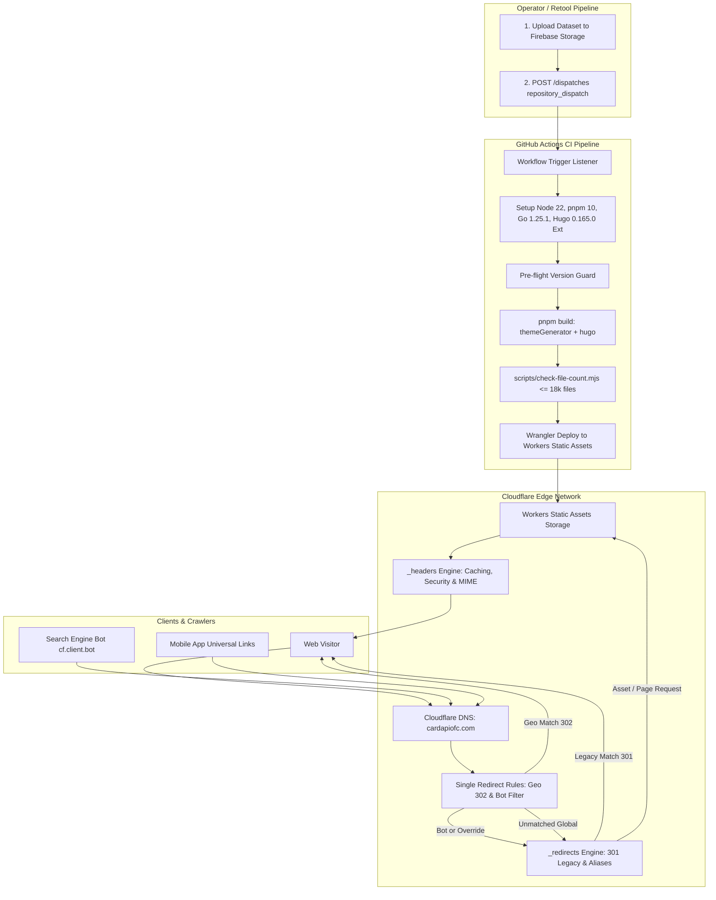
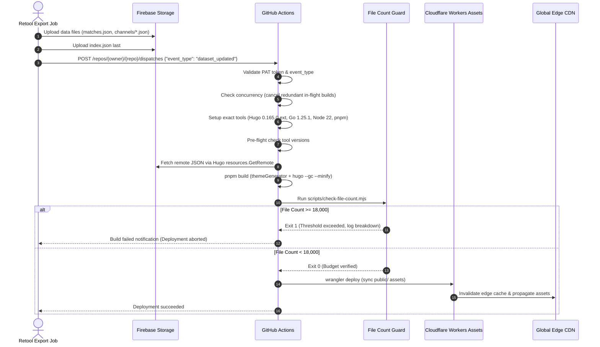
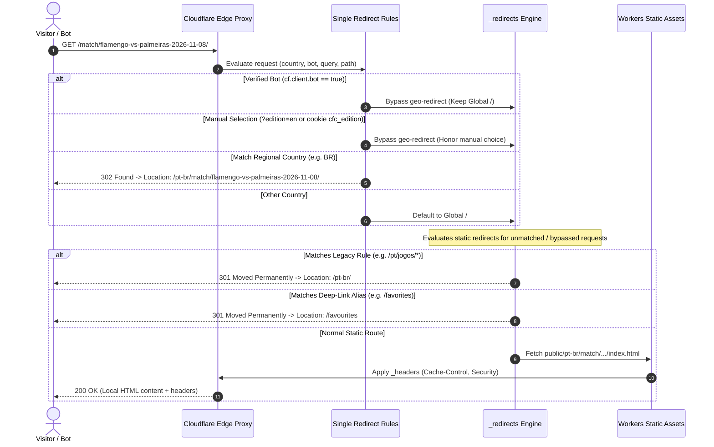

# Design Document: edge-delivery

## Overview

**Purpose**: This feature provides free, automated, and globally distributed static delivery for CardápioFC using Cloudflare Workers Static Assets. It establishes a reproducible continuous deployment pipeline via GitHub Actions pinned to exact Hugo 0.165.0 extended with pnpm, automated rebuild triggers for Retool via `repository_dispatch`, edge-based country geo-routing via Cloudflare Single Redirect Rules, legacy URL and deep-link alias preservation via `_redirects`, security and `.well-known` JSON headers via `_headers`, an automated file-count budget guard (≤ 20,000 files limit, failing at 18,000), and a zero-downtime cutover plan from Firebase Hosting.

**Users**: 
- **Site Visitors**: Experience ultra-fast global static delivery, seamless country geo-routing to domestic editions, and preserved legacy bookmarks.
- **Search Engine Crawlers**: Crawl all editions without being trapped in geo-redirect loops through verified bot exemptions.
- **Site Operator**: Triggers automated rebuilds from Retool with instant edge cache refreshment and monitors deployment budgets without incurring hosting fees.
- **Developers**: Enjoy a clean, unified CI/CD workflow with pinned tool versions and no redundant deployment configurations.

**Impact**: Retires legacy deployment files (`amplify.yml`, `.gitlab-ci.yml`, `vercel.json`), establishes a single authoritative version pin for Hugo and Go, replaces Firebase Hosting with Cloudflare Workers Static Assets, and configures edge routing and response headers declaratively.

### Goals
- Host the complete multi-edition site on Cloudflare Workers Static Assets with €0 recurring infrastructure cost.
- Automatically rebuild and deploy in < 60 seconds when triggered by Retool via `repository_dispatch`, a push to `main`, or manual dispatch.
- Enforce an exact Hugo 0.165.0 extended, Go 1.25.1, Node 22, and pnpm environment in CI.
- Protect against platform deployment rejections by halting CI if output file count reaches or exceeds 18,000 files.
- Route visitors from GB, IE, BR, PT, and AR to their respective editions using zero-worker Cloudflare Single Redirect Rules, while bypassing verified bots (`cf.client.bot`) and honoring manual edition overrides (`?edition=` and `cfc_edition` cookie).
- Preserve search engine rankings and app deep links by issuing HTTP 301 redirects for legacy paths and aliases (`/favorites`, `/reminder`).
- Serve `.well-known/apple-app-site-association` and `.well-known/assetlinks.json` with `Content-Type: application/json` and enforce strong security headers.

### Non-Goals
- Generating Hugo templates, content adapters, or view-models (owned by `data-pages` and `site-foundation`).
- Running custom compute logic or JavaScript workers on the request path.
- Client-side consent management or analytics beacons (owned by `analytics-consent`). No advertisements are served.
- Generating sitemaps, robots.txt, or Open Graph tags (owned by `seo-social`).
- Modifying the mobile app code, custom schemes (`cardapiofc://`, `cfc://`), or store entitlements (owned by `app-deeplinks`).

## Boundary Commitments

### This Spec Owns
- Cloudflare Workers Static Assets deployment configuration (`wrangler.jsonc`).
- GitHub Actions CI/CD workflow (`.github/workflows/deploy.yml`) including triggers (`repository_dispatch`, `push`, `workflow_dispatch`, `schedule`), concurrency management, toolchain setup, build commands, and Wrangler deployment.
- Pre-deploy output file-count guard (`scripts/check-file-count.mjs`) enforcing the ≤ 18,000 file threshold with edition-level diagnostics.
- Declarative Cloudflare Single Redirect Rules for edge geo-routing (`cloudflare/redirect-rules.json` and `cloudflare/redirect-rules.tf`).
- Edge legacy redirects and alias mappings (`static/_redirects`).
- Edge response headers and caching configuration (`static/_headers`).
- Version single source of truth (`.tool-versions` and `config/build.json`) and retirement of obsolete deployment configs (`amplify.yml`, `.gitlab-ci.yml`, `vercel.json`).
- Operational cutover, DNS transition, rollback procedure, and Retool webhook integration runbook (`docs/operations/edge-delivery-runbook.md`).

### Out of Boundary
- Content generation, layout templates, partials, or styles (owned by `site-foundation` and `data-pages`).
- Dataset generation and upload to Firebase Storage (owned by the site operator and Retool pipeline).
- Content of `.well-known` association files (owned by `app-deeplinks`).
- Tracking tags, consent banners, and Cloudflare Web Analytics token insertion (owned by `analytics-consent`).
- Managing paid Cloudflare plans, enterprise routing, or WAF custom rule creation.

### Allowed Dependencies
- `site-foundation`: Build command (`pnpm build`), edition registry prefixes (`/en-gb/`, `/en-ie/`, `/pt-br/`, `/pt-pt/`, `/es-ar/`), and manual switcher parameter (`?edition=en`).
- `data-pages`: Output paths (`/match/{slug}/`, `/match/{slug}/lineup/`, `/team/{teamSlug}/`, `/league/{leagueSlug}/`, `/league/`), trailing slash convention, and file budget estimates.
- `app-deeplinks`: Route aliases (`/favorites` -> `/favourites`, `/reminder` -> `/my_agenda`) and static well-known files (`static/.well-known/*`).
- Hugo 0.165.0 extended, Go 1.25.1, Node >= 20, pnpm 10.x.
- Cloudflare Workers Static Assets platform and Ruleset Engine API.
- GitHub Actions standard runners (`ubuntu-latest`).

### Revalidation Triggers
- Addition or removal of an edition in the edition registry (`languages.toml`) -> requires updating Cloudflare Single Redirect Rules.
- Addition of new core top-level routes or aliases -> requires updating Single Redirect Rules and `static/_redirects`.
- Hugo version upgrade or change in `packageManager` -> requires updating `.tool-versions`, `config/build.json`, CI workflow, and AGENTS.md.
- Modification of Cloudflare free-tier quotas (e.g. file limits, rule limits) -> requires adjusting the file-count guard threshold or rule count.

## Architecture

### Existing Architecture Analysis
Currently, CardápioFC deploys to Firebase Hosting behind Cloudflare DNS using uncoordinated CI configurations (`amplify.yml`, `.gitlab-ci.yml`, `vercel.json`, `netlify.toml`). The project contains:
- Inconsistent Go and Hugo versions across different deploy manifests.
- An orphan `_redirects` file in the repository root that is not copied to the build output.
- No automated webhook trigger allowing Retool to initiate a production deployment upon dataset upload.
- No edge geo-routing, resulting in all visitors arriving on the Global edition regardless of locale.
- No declarative response headers configuration for Apple App Site Association or Android Assetlinks JSON MIME types.

### Architecture Pattern & Boundary Map
Selected pattern: **Static Assets Edge Delivery with Declarative Edge Rules**. All pages are compiled statically at build time by Hugo in GitHub Actions and published directly to Cloudflare's global edge network via Workers Static Assets. Routing decisions (geo-redirection, bot exclusion, legacy redirects) and header transformations are executed entirely by Cloudflare's edge proxy infrastructure before requests reach static assets, requiring **zero worker script compute** on the hot path.



**Architecture Integration**:
- **Hosting Model**: Single Cloudflare project using Workers Static Assets configured via `wrangler.jsonc`.
- **Zero Compute Cost**: Assets are served directly from Cloudflare's key-value edge cache. No CPU time or Worker request limits are consumed.
- **Edge Rule Separation**:
  - *Single Redirect Rules* handle request-time dynamic routing based on request IP country (`ip.src.country`), crawler status (`cf.client.bot`), and query parameters (`?edition=`).
  - *`_redirects`* handles static URL normalization, deep-link aliases, and legacy URL mapping (301 Moved Permanently).
  - *`_headers`* handles response-time headers, MIME overrides, and cache control directives.
- **Resilience**: The Build Guard ensures deployments fail gracefully in CI with diagnostic reporting before touching Cloudflare if the 18,000-file threshold is breached.

### Technology Stack

| Layer | Choice / Version | Role in Feature | Notes |
|---|---|---|---|
| Hosting Platform | Cloudflare Workers Static Assets | Global CDN delivery of static site | Free tier: 20k files, 25 MiB/file, €0 cost |
| CLI / Deployment | Wrangler v3 / `@cloudflare/wrangler` | Upload and asset manifest synchronization | Invoked via GitHub Action / `npx wrangler deploy` |
| CI / Automation | GitHub Actions (`ubuntu-latest`) | Automated build, test, and deploy pipeline | Triggered on dispatch, push, schedule |
| Site Generator | Hugo 0.165.0 extended | Static HTML and asset compilation | Verified strictly via pre-flight check |
| Runtime & Tooling | Node 22 LTS, Go 1.25.1, pnpm 10.x | Tooling scripts, theme generation, Hugo helper | Pinned in `.tool-versions` & workflow |
| Routing & Rules | Cloudflare Ruleset Engine | Single Redirect Rules for geo-routing | Max 10 rules on free plan (5 used) |
| Configuration | `wrangler.jsonc`, `_redirects`, `_headers` | Declarative edge behavior | Committed to version control |

## File Structure Plan

### Directory Structure
```
.github/
└── workflows/
    └── deploy.yml                      # CREATE: GitHub Actions workflow for build and deploy
cloudflare/
├── redirect-rules.json                 # CREATE: Declarative JSON export of Single Redirect Rules
└── redirect-rules.tf                   # CREATE: Terraform HCL definition of Single Redirect Rules
config/
└── build.json                          # CREATE: Authoritative tool version definitions (Hugo, Go, Node, pnpm)
.tool-versions                          # CREATE: Pinned versions for mise / asdf / CI tooling
static/
├── _redirects                          # CREATE: 301 redirects for legacy URLs and aliases
└── _headers                            # CREATE: Security, caching, and MIME type headers
scripts/
├── check-file-count.mjs                # CREATE: Output file count budget guard (fails >= 18,000 files)
└── verify-deployment.mjs               # CREATE: Post-deploy smoke test for HTTP status, redirects, headers
docs/
└── operations/
    └── edge-delivery-runbook.md        # CREATE: Retool webhook, secrets, cutover & rollback procedures
wrangler.jsonc                          # CREATE: Cloudflare Workers Static Assets configuration
_redirects                              # DELETE: Obsolete root file (migrated to static/_redirects)
amplify.yml                             # DELETE: Obsolete AWS Amplify CI config
.gitlab-ci.yml                          # DELETE: Obsolete GitLab CI config
vercel.json                             # DELETE: Obsolete Vercel deployment config
netlify.toml                            # MODIFY: Retained temporarily or updated with deprecation comment
AGENTS.md                               # MODIFY: Update HUGO_VERSION source of truth reference
```

### File Responsibilities
- `.github/workflows/deploy.yml`: Orchestrates CI/CD; listens for `repository_dispatch` (`dataset_updated`), `push` to `main`, `workflow_dispatch`, and daily `schedule`; sets up pinned tooling; verifies versions; executes `pnpm build`; runs `check-file-count.mjs`; and runs `wrangler deploy`.
- `wrangler.jsonc`: Defines Workers Static Assets binding, root asset directory (`./public`), trailing slash handling (`auto-trailing-slash`), and custom 404 handling (`404-page`).
- `static/_redirects`: Contains all static HTTP 301 redirect rules (legacy Brazilian routes, legacy English routes, retired languages, and deep-link aliases). Copied automatically to `public/_redirects` by Hugo.
- `static/_headers`: Contains path-based HTTP response headers (JSON MIME type for `.well-known/*`, cache control policies, HSTS, security headers). Copied automatically to `public/_headers` by Hugo.
- `scripts/check-file-count.mjs`: Node.js script executed immediately after `pnpm build`. Recursively counts files in `public/`; groups counts by edition and type; logs summary; exits with code 1 if total files >= 18,000.
- `scripts/verify-deployment.mjs`: Operational verification script to test live edge endpoints, 301 redirects, 302 geo-routing headers, and `.well-known` MIME types against a live or preview domain.
- `cloudflare/redirect-rules.json` & `redirect-rules.tf`: Version-controlled declarations of Cloudflare Single Redirect Rules for automated API deployment or manual dashboard setup.
- `.tool-versions` & `config/build.json`: Canonical version references replacing fragmented config files.
- `docs/operations/edge-delivery-runbook.md`: Detailed operations manual for DNS cutover from Firebase, secret management, Retool webhook configuration, and disaster recovery rollback.

## System Flows

### Flow 1: Retool Automated Build and Deployment Flow


### Flow 2: Edge Request Resolution Flow (Geo-Routing & Redirects)


## Requirements Traceability

| Requirement | Summary | Components | Interfaces / Manifests | Flows |
|---|---|---|---|---|
| 1.1 | Serve static assets without custom compute | WranglerConfig | `wrangler.jsonc` | Flow 2 |
| 1.2 | Normalization to canonical trailing slash | WranglerConfig | `wrangler.jsonc` (`html_handling: "auto-trailing-slash"`) | Flow 2 |
| 1.3 | HTTP 404 for nonexistent paths | WranglerConfig | `wrangler.jsonc` (`not_found_handling: "404-page"`) | Flow 2 |
| 1.4 | File size limit compliance (<= 25 MiB) | FileCountGuard | `scripts/check-file-count.mjs` | Flow 1 |
| 2.1 | Automatic deployment on push to main | GitHubActionsPipeline | `.github/workflows/deploy.yml` (`on: push`) | Flow 1 |
| 2.2 | Manual workflow dispatch | GitHubActionsPipeline | `.github/workflows/deploy.yml` (`on: workflow_dispatch`) | Flow 1 |
| 2.3 | Environment tooling pins (Hugo 0.165.0 ext, Go, Node, pnpm) | GitHubActionsPipeline, VersionConfigManager | `.tool-versions`, `config/build.json`, `.github/workflows/deploy.yml` | Flow 1 |
| 2.4 | Strict pre-flight version validation | GitHubActionsPipeline | `.github/workflows/deploy.yml` (`run: hugo version`) | Flow 1 |
| 2.5 | Production build flags (`--gc --minify`) | GitHubActionsPipeline | `package.json` (`pnpm build`) | Flow 1 |
| 2.6 | Prevention of stale remote resource caching in CI | GitHubActionsPipeline | `.github/workflows/deploy.yml` (`--cleanDestinationDir`) | Flow 1 |
| 3.1 | Webhook rebuild via `repository_dispatch` | GitHubActionsPipeline | `.github/workflows/deploy.yml` (`on: repository_dispatch`) | Flow 1 |
| 3.2 | Authentication of incoming webhook requests | GitHubActionsPipeline, OperationalRunbook | GitHub PAT / Actions API | Flow 1 |
| 3.3 | Filtering unrecognized dispatch event types | GitHubActionsPipeline | `.github/workflows/deploy.yml` (`types: [dataset_updated]`) | Flow 1 |
| 3.4 | Scheduled safety rebuild (cron) | GitHubActionsPipeline | `.github/workflows/deploy.yml` (`on: schedule`) | Flow 1 |
| 4.1 | Pre-deploy file counting | FileCountGuard | `scripts/check-file-count.mjs` | Flow 1 |
| 4.2 | CI failure and diagnostics at >= 18,000 files | FileCountGuard | `scripts/check-file-count.mjs` (exit code 1) | Flow 1 |
| 4.3 | Deployment allowance below 18,000 files | FileCountGuard | `scripts/check-file-count.mjs` (exit code 0) | Flow 1 |
| 4.4 | Partitioning and upgrade documentation | OperationalRunbook | `docs/operations/edge-delivery-runbook.md` | — |
| 5.1 | GB geo-routing to `/en-gb/` (302) | CloudflareSingleRedirectRules | `cloudflare/redirect-rules.json` (Rule 1) | Flow 2 |
| 5.2 | IE geo-routing to `/en-ie/` (302) | CloudflareSingleRedirectRules | `cloudflare/redirect-rules.json` (Rule 2) | Flow 2 |
| 5.3 | BR geo-routing to `/pt-br/` (302) | CloudflareSingleRedirectRules | `cloudflare/redirect-rules.json` (Rule 3) | Flow 2 |
| 5.4 | PT geo-routing to `/pt-pt/` (302) | CloudflareSingleRedirectRules | `cloudflare/redirect-rules.json` (Rule 4) | Flow 2 |
| 5.5 | AR geo-routing to `/es-ar/` (302) | CloudflareSingleRedirectRules | `cloudflare/redirect-rules.json` (Rule 5) | Flow 2 |
| 5.6 | Unprefixed Global serving for other countries | CloudflareSingleRedirectRules | `cloudflare/redirect-rules.json` (Default pass-through) | Flow 2 |
| 5.7 | Query parameter preservation across geo-redirects | CloudflareSingleRedirectRules | `cloudflare/redirect-rules.json` (`preserve_query_string: true`) | Flow 2 |
| 5.8 | Cloudflare Free limit compliance (<= 10 rules) | CloudflareSingleRedirectRules | `cloudflare/redirect-rules.json` (5 rules total) | Flow 2 |
| 6.1 | Exclude verified search engine bots (`cf.client.bot`) | CloudflareSingleRedirectRules | `cloudflare/redirect-rules.json` (`not cf.client.bot`) | Flow 2 |
| 6.2 | Respect manual query parameter `?edition=` | CloudflareSingleRedirectRules | `cloudflare/redirect-rules.json` (`not http.request.uri.query contains "edition="`) | Flow 2 |
| 6.3 | Respect manual selection cookie `cfc_edition` | CloudflareSingleRedirectRules | `cloudflare/redirect-rules.json` (`not http.cookie contains "cfc_edition="`) | Flow 2 |
| 6.4 | Switcher navigation to Global edition without loop | CloudflareSingleRedirectRules | `cloudflare/redirect-rules.json` (`?edition=en` override) | Flow 2 |
| 7.1 | Legacy Brazilian match redirects to `/pt-br/` (301) | StaticRedirectMap | `static/_redirects` | Flow 2 |
| 7.2 | Legacy Brazilian team & league redirects (301) | StaticRedirectMap | `static/_redirects` | Flow 2 |
| 7.3 | Legacy English redirects to `/` or `/league/` (301) | StaticRedirectMap | `static/_redirects` | Flow 2 |
| 7.4 | Retired language redirects to `/` (301) | StaticRedirectMap | `static/_redirects` | Flow 2 |
| 7.5 | Legacy Spanish redirects to `/es-ar/` (301) | StaticRedirectMap | `static/_redirects` | Flow 2 |
| 7.6 | `/favorites` alias redirect to `/favourites` (301) | StaticRedirectMap | `static/_redirects` | Flow 2 |
| 7.7 | `/reminder` alias redirect to `/my_agenda` (301) | StaticRedirectMap | `static/_redirects` | Flow 2 |
| 7.8 | Query preservation across 301 redirects | StaticRedirectMap | `static/_redirects` | Flow 2 |
| 8.1 | JSON MIME type for `.well-known` files | StaticHeaderMap | `static/_headers` (`Content-Type: application/json`) | Flow 2 |
| 8.2 | Revalidation cache headers for HTML documents | StaticHeaderMap | `static/_headers` (`Cache-Control: public, max-age=0, must-revalidate`) | Flow 2 |
| 8.3 | Immutable cache headers for fingerprinted assets | StaticHeaderMap | `static/_headers` (`Cache-Control: public, max-age=31536000, immutable`) | Flow 2 |
| 8.4 | Standard security headers (nosniff, SAMEORIGIN, HSTS) | StaticHeaderMap | `static/_headers` | Flow 2 |
| 8.5 | Permissive security policy for scripts & beacons | StaticHeaderMap | `static/_headers` (CSP baseline) | Flow 2 |
| 9.1 | Remove obsolete CI configs (amplify, gitlab, vercel) | VersionConfigManager | Repository root cleanup | — |
| 9.2 | Establish single source of truth for version pins | VersionConfigManager | `.tool-versions`, `config/build.json` | Flow 1 |
| 9.3 | Update documentation & AGENTS.md references | VersionConfigManager | `AGENTS.md` | — |
| 9.4 | Place redirect & header definitions in repo | StaticRedirectMap, StaticHeaderMap | `static/_redirects`, `static/_headers` | Flow 2 |
| 10.1 | Cloudflare DNS CNAME & apex configuration | OperationalRunbook | `docs/operations/edge-delivery-runbook.md` | — |
| 10.2 | Specify required GitHub repository secrets | OperationalRunbook | `docs/operations/edge-delivery-runbook.md` | Flow 1 |
| 10.3 | Rollback procedure to Firebase Hosting | OperationalRunbook | `docs/operations/edge-delivery-runbook.md` | — |
| 10.4 | Retool webhook configuration and payload contract | OperationalRunbook | `docs/operations/edge-delivery-runbook.md` | Flow 1 |

## Components and Interfaces

### Component Summary Table

| Component | Layer / Domain | Intent | Req Coverage | Key Dependencies (P0/P1) | Contracts |
|---|---|---|---|---|---|
| `WranglerConfig` | Infrastructure | Configures Workers Static Assets | 1.1, 1.2, 1.3 | Cloudflare Workers Runtime (P0) | State |
| `GitHubActionsPipeline` | CI/CD | Automates build, test, and deployment | 2.1–2.6, 3.1–3.4 | GitHub Actions Runner, Hugo (P0) | Batch |
| `FileCountGuard` | Tooling | Enforces the 18,000 file output budget | 1.4, 4.1, 4.2, 4.3 | Node.js runtime, File System (P0) | Service |
| `CloudflareSingleRedirectRules` | Edge Routing | Geo-routes traffic without worker compute | 5.1–5.8, 6.1–6.4 | Cloudflare Ruleset Engine (P0) | API, State |
| `StaticRedirectMap` | Edge Routing | 301 legacy redirects and alias normalization | 7.1–7.8, 9.4 | Cloudflare Static Assets Engine (P0) | State |
| `StaticHeaderMap` | Edge Delivery | MIME types, caching, and security headers | 8.1–8.5, 9.4 | Cloudflare Static Assets Engine (P0) | State |
| `VersionConfigManager` | Governance | Version single source of truth and cleanup | 9.1, 9.2, 9.3 | `mise`/`asdf`, `AGENTS.md` (P0) | State |
| `OperationalRunbook` | Operations | DNS cutover, rollback, and Retool docs | 4.4, 10.1–10.4 | Cloudflare DNS, Firebase Hosting (P0) | State |

---

### Component Details

#### 1. WranglerConfig (`wrangler.jsonc`)

| Field | Detail |
|---|---|
| Intent | Configures Cloudflare Workers Static Assets binding and static serving behavior |
| Requirements | 1.1, 1.2, 1.3 |

**Responsibilities & Constraints**:
- Directs Cloudflare to serve static assets from `./public`.
- Configures `html_handling: "auto-trailing-slash"` to match Hugo's trailing-slash permalinks (`/match/{slug}/`).
- Configures `not_found_handling: "404-page"` to serve `./public/404.html` on missing assets.
- Declares no worker script entrypoint on the request path, guaranteeing €0 compute billing.

**Configuration Schema**:
```jsonc
{
  "$schema": "node_modules/wrangler/config-schema.json",
  "name": "cardapiofc",
  "compatibility_date": "2026-02-01",
  "assets": {
    "directory": "./public",
    "binding": "ASSETS",
    "html_handling": "auto-trailing-slash",
    "not_found_handling": "404-page"
  }
}
```

---

#### 2. GitHubActionsPipeline (`.github/workflows/deploy.yml`)

| Field | Detail |
|---|---|
| Intent | Automated CI/CD pipeline triggered by git pushes, Retool webhooks, manual runs, and schedule |
| Requirements | 2.1–2.6, 3.1–3.4 |

**Responsibilities & Constraints**:
- Concurrency group `deploy-production` with `cancel-in-progress: true` to prevent stampeding rebuilds during batch dataset uploads.
- Strictly validates that installed Hugo extended equals version `0.165.0`.
- Executes `pnpm install --frozen-lockfile`.
- Runs `pnpm build` with `--gc --minify --cleanDestinationDir` to guarantee that no stale JSON remains cached.
- Runs `node scripts/check-file-count.mjs` before invoking Wrangler.
- Executes `cloudflare/wrangler-action@v3` authenticated by secrets `CLOUDFLARE_API_TOKEN` and `CLOUDFLARE_ACCOUNT_ID`.

**Workflow Trigger Specification**:
```yaml
name: Deploy CardápioFC Production

on:
  push:
    branches: [main]
  repository_dispatch:
    types: [dataset_updated]
  workflow_dispatch:
  schedule:
    # Daily safety rebuild at 05:00 UTC
    - cron: '0 5 * * *'

concurrency:
  group: deploy-production
  cancel-in-progress: true
```

---

#### 3. FileCountGuard (`scripts/check-file-count.mjs`)

| Field | Detail |
|---|---|
| Intent | Enforces the 18,000 file output budget in CI before deployment to prevent Cloudflare rejection |
| Requirements | 1.4, 4.1, 4.2, 4.3 |

**Responsibilities & Constraints**:
- Recursively counts all files in `public/` (ignoring `.DS_Store`).
- Categorizes files by edition (`/en-gb/`, `/en-ie/`, `/pt-br/`, `/pt-pt/`, `/es-ar/`, and root Global) and by entity type (`/match/`, `/team/`, `/league/`, `/assets/`).
- Emits formatted console output summarizing total files and per-edition distribution.
- Exits with `code 0` if `totalFiles < 18000`.
- Exits with `code 1` if `totalFiles >= 18000` with actionable error diagnostics.

**Interface**:
```typescript
interface FileCountSummary {
  totalFiles: number;
  threshold: number; // 18,000
  hardLimit: number; // 20,000
  passed: boolean;
  byEdition: Record<string, number>;
  byKind: Record<string, number>;
}

export function auditOutputDirectory(outputDir: string): FileCountSummary;
```

---

#### 4. CloudflareSingleRedirectRules (`cloudflare/redirect-rules.json`)

| Field | Detail |
|---|---|
| Intent | Edge geo-routing of unprefixed routes to localized editions without worker compute |
| Requirements | 5.1–5.8, 6.1–6.4 |

**Responsibilities & Constraints**:
- Uses Cloudflare Single Redirect Rules (max 10 on Free Plan; exactly 5 rules used).
- Base match condition applied to all 5 rules:
  1. Request IP country matches target edition country (`GB`, `IE`, `BR`, `PT`, `AR`).
  2. Not a verified bot: `not cf.client.bot`.
  3. No manual query override: `not http.request.uri.query contains "edition="`.
  4. No manual cookie override: `not http.cookie contains "cfc_edition="`.
  5. Request is for an unprefixed root or entity path:
     `http.request.uri.path eq "/" or starts_with(http.request.uri.path, "/match/") or starts_with(http.request.uri.path, "/team/") or starts_with(http.request.uri.path, "/league/") or http.request.uri.path in {"/search", "/favourites", "/favorites", "/my_agenda", "/reminder", "/settings"}`.
- Action: Dynamic redirect with HTTP status `302 Found`. Query parameters are preserved with `cfc_geo=<COUNTRY>` appended so downstream `analytics-consent` can track `geo_landing` events without impacting canonical URLs (the analytics bootstrap strips `cfc_geo` via `history.replaceState`).
- Target Expression: `concat("/<edition-prefix>", http.request.uri.path, if(http.request.uri.query ne "", concat("?", http.request.uri.query, "&cfc_geo=<COUNTRY>"), "?cfc_geo=<COUNTRY>"))` (with `preserve_query_string: false`).

**Rule Declarations**:
1. **Rule 1 (United Kingdom - GB)**:
   - Filter: `ip.src.country eq "GB" and not cf.client.bot and not http.request.uri.query contains "edition=" and not http.cookie contains "cfc_edition=" and (...)`
   - Target: `concat("/en-gb", http.request.uri.path, if(http.request.uri.query ne "", concat("?", http.request.uri.query, "&cfc_geo=GB"), "?cfc_geo=GB"))` (302)
2. **Rule 2 (Ireland - IE)**:
   - Filter: `ip.src.country eq "IE" and not cf.client.bot and not http.request.uri.query contains "edition=" and not http.cookie contains "cfc_edition=" and (...)`
   - Target: `concat("/en-ie", http.request.uri.path, if(http.request.uri.query ne "", concat("?", http.request.uri.query, "&cfc_geo=IE"), "?cfc_geo=IE"))` (302)
3. **Rule 3 (Brazil - BR)**:
   - Filter: `ip.src.country eq "BR" and not cf.client.bot and not http.request.uri.query contains "edition=" and not http.cookie contains "cfc_edition=" and (...)`
   - Target: `concat("/pt-br", http.request.uri.path, if(http.request.uri.query ne "", concat("?", http.request.uri.query, "&cfc_geo=BR"), "?cfc_geo=BR"))` (302)
4. **Rule 4 (Portugal - PT)**:
   - Filter: `ip.src.country eq "PT" and not cf.client.bot and not http.request.uri.query contains "edition=" and not http.cookie contains "cfc_edition=" and (...)`
   - Target: `concat("/pt-pt", http.request.uri.path, if(http.request.uri.query ne "", concat("?", http.request.uri.query, "&cfc_geo=PT"), "?cfc_geo=PT"))` (302)
5. **Rule 5 (Argentina - AR)**:
   - Filter: `ip.src.country eq "AR" and not cf.client.bot and not http.request.uri.query contains "edition=" and not http.cookie contains "cfc_edition=" and (...)`
   - Target: `concat("/es-ar", http.request.uri.path, if(http.request.uri.query ne "", concat("?", http.request.uri.query, "&cfc_geo=AR"), "?cfc_geo=AR"))` (302)
4. **Rule 4 (Portugal - PT)**:
   - Filter: `ip.src.country eq "PT" and not cf.client.bot and not http.request.uri.query contains "edition=" and not http.cookie contains "cfc_edition=" and (...)`
   - Target: `concat("/pt-pt", http.request.uri.path)` (302)
5. **Rule 5 (Argentina - AR)**:
   - Filter: `ip.src.country eq "AR" and not cf.client.bot and not http.request.uri.query contains "edition=" and not http.cookie contains "cfc_edition=" and (...)`
   - Target: `concat("/es-ar", http.request.uri.path)` (302)

---

#### 5. StaticRedirectMap (`static/_redirects`)

| Field | Detail |
|---|---|
| Intent | HTTP 301 permanent redirects for legacy URLs and deep-link aliases |
| Requirements | 7.1–7.8, 9.4 |

**Responsibilities & Constraints**:
- Lives in `static/_redirects` so Hugo automatically outputs it to `public/_redirects`.
- Evaluated by Cloudflare Static Assets engine for unmatched requests.
- Preserves deep-link query parameters (`?l=...`, `?q=...`) across redirects.

**Rules Content**:
```text
# Deep-Link Aliases (Unprefixed & Prefixed)
/favorites                /favourites             301
/reminder                 /my_agenda              301
/en-gb/favorites          /en-gb/favourites       301
/en-gb/reminder           /en-gb/my_agenda        301
/en-ie/favorites          /en-ie/favourites       301
/en-ie/reminder           /en-ie/my_agenda        301
/pt-br/favorites          /pt-br/favourites       301
/pt-br/reminder           /pt-br/my_agenda        301
/pt-pt/favorites          /pt-pt/favourites       301
/pt-pt/reminder           /pt-pt/my_agenda        301
/es-ar/favorites          /es-ar/favourites       301
/es-ar/reminder           /es-ar/my_agenda        301

# Legacy Brazilian Portuguese Routes
/pt/jogos/onde_assistir_* /pt-br/                 301
/pt/jogos/*               /pt-br/                 301
/pt/times/*               /pt-br/                 301
/pt/campeonatos/*         /pt-br/league/          301
/pt/*                     /pt-br/                 301

# Legacy English Routes
/en/matches/where_to_watch_* /                    301
/en/matches/*             /                       301
/en/teams/*               /                       301
/en/leagues/*             /league/                301
/en/*                     /                       301

# Legacy Spanish & Other Retired Language Trees
/es/*                     /es-ar/                 301
/fr/*                     /                       301
/zh/*                     /                       301
/hi/*                     /                       301
/ar/*                     /                       301
```

---

#### 6. StaticHeaderMap (`static/_headers`)

| Field | Detail |
|---|---|
| Intent | Custom HTTP response headers for MIME types, caching, and security |
| Requirements | 8.1–8.5, 9.4 |

**Responsibilities & Constraints**:
- Lives in `static/_headers` and copied to `public/_headers`.
- Sets `Content-Type: application/json` on mobile association files.
- Sets `Cache-Control: public, max-age=0, must-revalidate` on HTML files to ensure instant edge deployments.
- Sets `Cache-Control: public, max-age=31536000, immutable` on hashed assets in `/assets/`, `/js/`, `/css/`.
- Sets global security headers: `X-Content-Type-Options: nosniff`, `X-Frame-Options: SAMEORIGIN`, `Referrer-Policy: strict-origin-when-cross-origin`, and `Strict-Transport-Security`.

**Headers Content**:
```text
# Apple App Site Association & Android Assetlinks JSON MIME
/.well-known/apple-app-site-association
  Content-Type: application/json
  Cache-Control: public, max-age=3600, stale-while-revalidate=86400

/.well-known/assetlinks.json
  Content-Type: application/json
  Cache-Control: public, max-age=3600, stale-while-revalidate=86400

# HTML Documents: instant freshness on deployment
/*.html
  Cache-Control: public, max-age=0, must-revalidate

/
  Cache-Control: public, max-age=0, must-revalidate

# Global Security & Caching Defaults
/*
  X-Content-Type-Options: nosniff
  X-Frame-Options: SAMEORIGIN
  Referrer-Policy: strict-origin-when-cross-origin
  Strict-Transport-Security: max-age=31536000; includeSubDomains; preload
  Permissions-Policy: camera=(), microphone=(), geolocation=(), payment=()

# Fingerprinted Static Assets: Immutable 1-Year Cache
/assets/*
  Cache-Control: public, max-age=31536000, immutable

/js/*
  Cache-Control: public, max-age=31536000, immutable

/css/*
  Cache-Control: public, max-age=31536000, immutable
```

---

#### 7. VersionConfigManager (`.tool-versions` & `config/build.json`)

| Field | Detail |
|---|---|
| Intent | Establishes the authoritative single source of truth for tool versions and cleans up obsolete configs |
| Requirements | 9.1, 9.2, 9.3 |

**Responsibilities & Constraints**:
- Pinned toolchain versions:
  - Hugo Extended: `0.165.0`
  - Go: `1.25.1`
  - Node: `22.14.0`
  - pnpm: `10.5.2`
- Files removed: `amplify.yml`, `.gitlab-ci.yml`, `vercel.json`, root `_redirects`.
- `AGENTS.md` and repository pre-flight scripts updated to reference `config/build.json` / `.tool-versions`.

---

#### 8. OperationalRunbook (`docs/operations/edge-delivery-runbook.md`)

| Field | Detail |
|---|---|
| Intent | Operator guide for Retool webhook setup, GitHub secrets, DNS cutover, and disaster recovery rollback |
| Requirements | 4.4, 10.1–10.4 |

**Responsibilities & Constraints**:
- Documents the Retool `repository_dispatch` webhook contract:
  - URL: `https://api.github.com/repos/:owner/:repo/dispatches`
  - Method: `POST`
  - Headers: `Authorization: Bearer <GITHUB_PAT>`, `Accept: application/vnd.github.v3+json`
  - Body: `{"event_type": "dataset_updated", "client_payload": {"generatedAt": "<timestamp>", "version": "1.0.0"}}`
- Documents GitHub Repository Secrets required:
  - `CLOUDFLARE_API_TOKEN`: Cloudflare API token with `Workers Routes:Edit`, `Workers Scripts:Edit`, `Account Settings:Read`.
  - `CLOUDFLARE_ACCOUNT_ID`: Target Cloudflare Account ID.
- Details the DNS cutover steps: adding custom domain in Cloudflare dashboard, verifying SSL certificate issuance.
- Details rollback procedure to Firebase Hosting if needed: deleting the custom domain in Workers and repointing DNS records to Firebase Hosting.
- Documents budget escalation procedures (Workers Paid plan at $5/mo for 100k files or per-edition Workers project splitting).

## Data Models and Schemas

### Retool Repository Dispatch Payload
```typescript
interface RetoolDispatchPayload {
  event_type: "dataset_updated";
  client_payload?: {
    generatedAt: string; // RFC 3339 timestamp
    version: string;     // Dataset contract schema version (e.g. "1.0.0")
    filesUpdated?: string[];
  };
}
```

### Cloudflare Ruleset Definition (Single Redirect Rules Export)
```typescript
interface CloudflareRedirectRule {
  id?: string;
  description: string;
  enabled: boolean;
  expression: string;
  action: "redirect";
  action_parameters: {
    from_value: {
      status_code: 302;
      target_url: {
        expression: string; // e.g. concat("/pt-br", http.request.uri.path)
      };
      preserve_query_string: boolean; // true
    };
  };
}
```

### Build Version Configuration (`config/build.json`)
```json
{
  "hugo": "0.165.0",
  "hugoExtended": true,
  "go": "1.25.1",
  "node": "22.14.0",
  "pnpm": "10.5.2"
}
```

## Testing and Verification Strategy

### Automated CI / Build Verification
1. **Pre-flight Tooling Verification**:
   - `deploy.yml` checks that `hugo version` outputs `v0.165.0` and contains `extended`.
   - Checks that Node is version >= 20 and pnpm matches lockfile.
2. **Build Execution Verification**:
   - Runs `pnpm build` cleanly without warnings or missing module errors.
   - Verifies that `public/` directory contains `index.html`, `404.html`, `_redirects`, and `_headers`.
3. **File Count Budget Guard**:
   - Executes `node scripts/check-file-count.mjs`.
   - Verifies total files < 18,000. Fails with diagnostic report if threshold is reached.
4. **Static Manifest Verification**:
   - Verifies `public/_headers` contains `.well-known` JSON Content-Type and Cache-Control headers.
   - Verifies `public/_redirects` contains deep-link aliases and legacy URL patterns.

### Live Deployment Verification Script (`scripts/verify-deployment.mjs`)
A Node.js test script using native `fetch` with `redirect: "manual"` to verify the edge behavior against a preview or live domain:
- **Test 1: Trailing Slash Normalization**: Request `/match/sample-match` -> returns 200 or 308 to `/match/sample-match/`.
- **Test 2: Nonexistent Path 404**: Request `/nonexistent-slug-xyz` -> returns HTTP 404 and serves custom 404 page.
- **Test 3: Deep-Link Aliases**:
  - Request `/favorites` -> returns HTTP 301 to `/favourites`.
  - Request `/reminder` -> returns HTTP 301 to `/my_agenda`.
  - Request `/pt-br/favorites` -> returns HTTP 301 to `/pt-br/favourites`.
- **Test 4: Legacy Brazilian Routes**: Request `/pt/jogos/onde_assistir_sample` -> returns HTTP 301 to `/pt-br/`.
- **Test 5: Legacy English Routes**: Request `/en/matches/sample` -> returns HTTP 301 to `/`.
- **Test 6: Mobile Association MIME Types**:
  - Request `/.well-known/apple-app-site-association` -> returns `Content-Type: application/json`.
  - Request `/.well-known/assetlinks.json` -> returns `Content-Type: application/json`.
- **Test 7: Cache Headers**:
  - HTML request -> returns `Cache-Control: public, max-age=0, must-revalidate`.
  - Hashed asset request under `/assets/` -> returns `Cache-Control: public, max-age=31536000, immutable`.
- **Test 8: Geo-Routing Rules** (simulated via headers or Cloudflare rule preview):
  - Request with `cf.client.bot: true` -> not redirected.
  - Request with `?edition=en` -> not redirected.
  - Request from `BR` without bot or query -> returns HTTP 302 to `/pt-br/...`.
