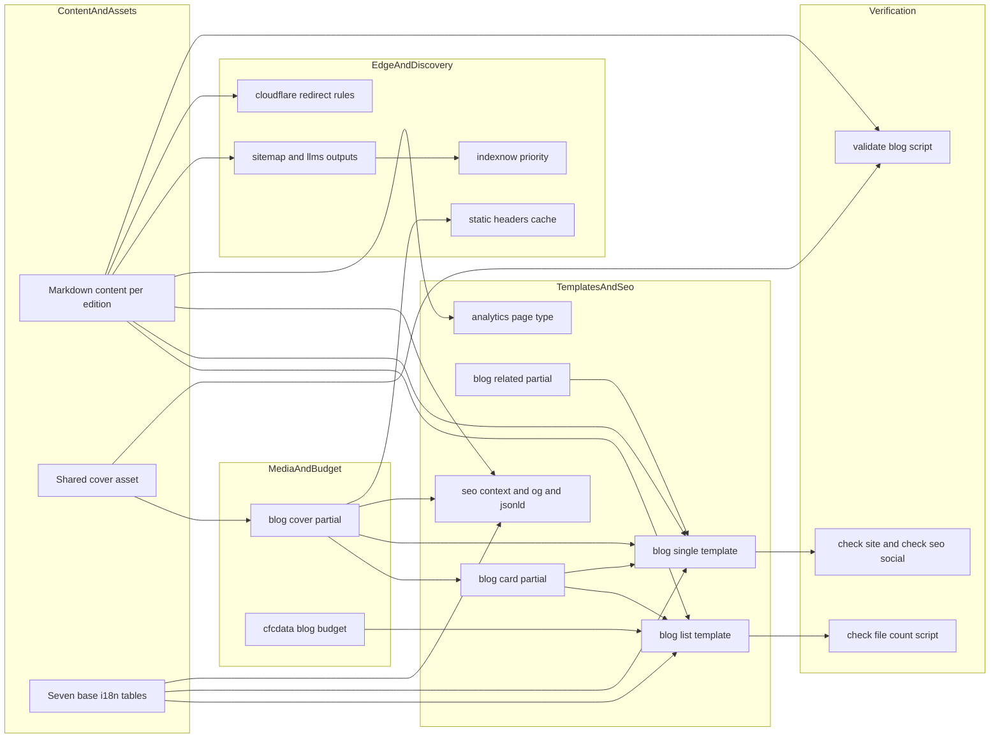

# Technical Design: editorial-blog

## Overview
The `editorial-blog` feature introduces a native Markdown editorial blog across all nine active CardápioFC editions (`en` Global, `en-gb`, `en-ie`, `en-us`, `pt-br`, `pt-pt`, `es-ar`, `zh-cn`, `ja`). It overrides `themes/hugoplate`'s stock blog templates exclusively from root `layouts/` and `assets/` using CardápioFC's sharp-corner `cfc-*` design system and `@tailwindcss/typography`, pairs each multi-edition post with one shared cover illustration processed via Hugo Pipes (WebP web variants + `1200x630` JPEG `q80` `<= 300,000` bytes OG image), integrates full SEO/GEO/Open Graph/analytics/menu/i18n/IndexNow/geo-routing hooks, restores the 0-byte `scripts/check-file-count.mjs` Cloudflare deployment guard, adds a 9-edition blog contract validator, and ships 1 verified launch seed post across all 9 editions.

### Goals
- Capture non-fixture organic search and AI answer-engine intent (streaming rights changes, football watch guides, app feature guides, broadcasting market analysis) to drive CardápioFC iOS/Android app installs.
- Establish a deterministic, version-controlled Markdown, frontmatter, and single-image contract that downstream `blog-automation` can populate safely at ~1 post/week (~520–624 files/year across 9 editions) without exceeding Cloudflare's 20,000-file static asset limit.
- Keep `themes/hugoplate/*`, `_vendor/*`, `layouts/_partials/cfcdata/budget.html`, and `i18n/pt-br.yaml -> pt.yaml` untouched/intact.
- Eliminate FontAwesome icon dependencies and disabled taxonomy/author links (`/categories/`, `/tags/`, `/authors/`) while preserving strict `check-site.mjs`, `check-seo-social.mjs`, and `check-file-count.mjs` invariants.

### Non-Goals
- Enabling Hugo taxonomies, tag/category/author archive pages, or RSS feeds (`disableKinds = ["taxonomy", "term", "RSS"]` stays unchanged in `hugo.toml`).
- Adding reader comments, newsletter/email capture, user-generated content, or any advertisements/sponsorships.
- Building automated topic ideation, web research, AI writing/translation, AI illustration generation, cron scheduling, or git auto-push (owned by downstream `blog-automation`).
- Modifying Data Contract v1 or `layouts/_partials/cfcdata/budget.html`'s existing `data-pages` formula.

---

## Boundary Commitments

### This Spec Owns
- **Blog Content & Frontmatter Contract (`BlogContentContract`)**: Directory convention (`content/<ed>/blog/_index.md` and `content/<ed>/blog/{slug}.md` across all 9 editions), frontmatter schema (`title`, `description`, `date`, `lastmod`, `translationKey`, `pillar`, `image`, `image_alt`, optional `faq`, `draft`), 4-pillar vocabulary (`rights-changes`, `watch-guides`, `app-guides`, `market-analysis`), shared ASCII slug + `translationKey` invariant, and the 9-edition launch seed post + shared cover image.
- **Hugo Pipes Media & OG Pipeline (`BlogMediaPipeline`)**: Shared single-source image processing (`layouts/_partials/blog/cover.html`) converting `assets/images/blog/{slug}.{png,jpg,webp}` into fingerprinted WebP hero/card variants and a `1200x630` JPEG `q80` (`<= 300,000` bytes) OG image, plus `/images/blog/*` immutable cache headers in `static/_headers`.
- **`cfc-*` Blog Presentation (`BlogPresentation`)**: Root template overrides (`layouts/blog/list.html`, `layouts/blog/single.html`), blog card (`layouts/_partials/blog/card.html`), deterministic related-posts selector (`layouts/_partials/blog/related.html`), and sharp-corner light/dark styles (`assets/css/cfc/components/blog.css` imported by `assets/css/custom.css`).
- **Navigation & 7-Table Localization (`BlogNavigationAndI18n`)**: Primary and footer menu links in `config/_default/menus.toml`, blog-hub fallback on `layouts/_partials/cfc/edition-switcher.html` when switching from an article page without a target-edition translation, full blog UI/pillar/SEO keys across all 7 base `i18n/*.yaml` tables (`en`, `pt`, `pt-pt`, `es`, `es-ar`, `zh-cn`, `ja`) preserving `i18n/pt-br.yaml -> pt.yaml`, plus regional English overrides (`en-gb`, `en-ie`, `en-us`).
- **SEO, Structured Data, & Analytics Seams (`BlogSeoHead`, `BlogSeoJsonLd`, `BlogAnalytics`)**: Section-only hub override guard (`$p.IsSection`) in `seo/context.html`, 3-level blog breadcrumb in `seo/jsonld-breadcrumb.html`, blog OG image branch in `seo/og-image.html`, `og:type="article"` + `article:*` timestamps in `seo/opengraph.html`, `Blog` and `BlogPosting` JSON-LD builders (`seo/jsonld-blog.html`, `seo/jsonld-blog-posting.html`) wired in `seo/jsonld.html` alongside optional `seo/jsonld-faq.html`, and `blog` / `article` page-type classification in `analytics/page-type.html`.
- **Edge Geo-Routing & IndexNow Priority (`BlogEdgeAndDiscovery`)**: `/blog`, `/blog/`, and `/blog/*` rules in `cloudflare/redirect-rules.json` and `blog` hub (`0`) / post (`2`) priorities in `scripts/indexnow.mjs`.
- **File-Budget Guards & Validation (`BlogBudgetAndValidation`)**: Additive build-time budget guard (`layouts/_partials/cfcdata/blog-budget.html`), restored `scripts/check-file-count.mjs` (18k soft / 20k hard limit), blog contract validator (`scripts/validate-blog.mjs`), updated `scripts/check-site.mjs`, `scripts/check-seo-social.mjs`, and `scripts/test-indexnow.mjs`, plus `scripts/test-editorial-blog.mjs`.

### Out of Boundary
- Automated content authoring, web research, AI image generation, cron automation, and git pushing (owned by `blog-automation`).
- Vendored theme/module files (`themes/hugoplate/*`, `_vendor/*`).
- Modifying `layouts/_partials/cfcdata/budget.html` or `data/cfc/settings.yaml`.
- App deep-link manifests (`static/.well-known/*`, `layouts/_partials/cfcapp/*`) — blog URLs are web-only routes.
- Match-list channel badges (`cfc-channel-badge`, `cfc-match-card__channels`).

### Allowed Dependencies
- **Upstream `site-foundation`**: Nine-edition configuration (`config/_default/languages.toml`), `edition/current.html`, `edition/all.html`, `layouts/baseof.html`, `cfc/breadcrumb.html`, `cfc/page-hero.html`, `cfc/section-head.html`, `cfc/empty-state.html`, `cfc/app-download.html`, `cfc/icon.html`, `time/format.html`, `assets/css/main.css` (`@tailwindcss/typography`), and `i18n/*.yaml`.
- **Upstream `seo-social`**: `hooks/head-seo.html`, `seo/context.html`, `seo/meta.html`, `seo/canonical.html`, `seo/hreflang.html`, `seo/opengraph.html`, `seo/twitter.html`, `seo/og-image.html`, `seo/jsonld.html`, `seo/jsonld-faq.html`, `seo/jsonld-breadcrumb.html`, `seo/jsonld-organization.html`, `seo/jsonld-render.html`, `layouts/sitemap.xml`, `llms-txt` module, and `scripts/check-seo-social.mjs`.
- **Upstream `edge-delivery`**: `.github/workflows/deploy.yml`, `static/_headers`, `cloudflare/redirect-rules.json`, `scripts/indexnow.mjs`, and `scripts/check-file-count.mjs`.
- **Upstream `analytics-consent`**: `layouts/_partials/analytics/page-type.html`.
- **Upstream `data-pages` / `broadcaster-directory`**: `layouts/_partials/cfcdata/broadcaster-budget.html` (additive budget baseline).

### Revalidation Triggers
Downstream re-verification or design adjustment is required if:
1. A future edition is added to `config/_default/languages.toml` (requires a matching `content/<ed>/blog/` directory and i18n keys).
2. `check-seo-social.mjs` changes `OG_MAX` (300,000 bytes) or `SampledPage` requirements.
3. Cloudflare Workers Static Assets changes its 20,000-file deployment limit or `static/_headers` matching rules.
4. `llms-full.txt` grows large enough to impact crawl/CDN budgets as blog volume scales beyond ~100 posts.

---

## Architecture

### Existing Architecture Analysis
CardápioFC runs Hugo Extended `0.169.0` with Tailwind CSS v4 CSS-first (`assets/css/main.css` loads `@plugin "@tailwindcss/typography"` and scans `hugo_stats.json`). Nine editions are configured in `config/_default/languages.toml`, each with its own `contentDir` (`content/<ed>`). Root `layouts/` and `assets/` shadow `themes/hugoplate/`. Head SEO tags and JSON-LD `@graph` emit through `hooks/head-seo.html` → `seo/context.html` → `seo/{meta,canonical,hreflang,opengraph,twitter,jsonld}.html`.

### Architecture Pattern & Boundary Map
Dependency direction flows strictly left-to-right from authored content/media through shared Hugo partials and head/edge seams to build-time and post-build verification gates:

`Content & Media Assets` → `Media & Budget Partials` → `Blog Templates & SEO/Analytics Seams` → `Edge & Discovery` → `Build & Contract Verification`

**Key Decisions (not repeated from diagram):**
- **Section-only SEO hub guard**: Restricting `seo/context.html`'s `seo_<hubKey>_title` / `seo_<hubKey>_desc` lookup with `$p.IsSection` ensures `/blog/` hubs use localized `seo_blog_*` keys while individual posts retain their own frontmatter `title` (`"%s · %s" $p.Title $ed.title`) and `description`.
- **Single-source cover & OG reuse**: `blog/cover.html` caches only the Hugo Pipes image processing (keyed on `$normPath`) via `partialCached` into 5 fingerprinted files (`480x270` & `800x450` card WebPs, `640x360` & `1200x675` hero WebPs, and `1200x630` JPEG `q80` OG), while attaching edition-specific `alt` text per call outside `partialCached`, avoiding per-edition asset duplication (`5` output image files per post total across all 9 editions) and preventing `alt` leakage across editions.
- **Additive budget guard**: Leaving `cfcdata/budget.html` unmodified preserves `scripts/test-cfc-dataset-budget.mjs`; `cfcdata/blog-budget.html` layers blog counts onto `broadcaster-budget.html`, while restored `scripts/check-file-count.mjs` enforces the exact file count on `public/`.

### Technology Stack
No new external npm packages or Hugo modules are required.

| Layer | Technology & Version | Role in This Feature |
| --- | --- | --- |
| Static Generator | Hugo Extended `0.169.0` | Native Markdown multilingual pages, `.ReadingTime`, Hugo Pipes `.Fill`/`.Resize`/`fingerprint`, `.AllTranslations`, `sitemap.xml` |
| Styling | Tailwind CSS v4 (`@tailwindcss/typography`) + `assets/css/cfc/components/blog.css` | Sharp-corner card/article layouts, `.prose` article typography, dark mode tokens |
| Structured Data & SEO | Schema.org JSON-LD (`Blog`, `BlogPosting`, `BreadcrumbList`, `FAQPage`), Open Graph `article:*`, BCP 47 `hreflang` | Organic search & AI engine indexing |
| Edge & Indexing | `static/_headers`, `cloudflare/redirect-rules.json`, `scripts/indexnow.mjs` | Immutable `/images/blog/*` caching, `/blog/*` geo-routing, IndexNow prioritization |
| Verification | Node.js ESM (`scripts/validate-blog.mjs`, `scripts/check-file-count.mjs`, `scripts/check-site.mjs`, `scripts/check-seo-social.mjs`, `scripts/test-editorial-blog.mjs`) | 9-edition contract checks, 18k/20k file limits, SEO/FAQ parity, and build assertions |

---

## File Structure Plan

### Created Files
| File Path | Responsibility | Component |
| --- | --- | --- |
| `content/{en,en-gb,en-ie,en-us,pt-br,pt-pt,es-ar,zh-cn,ja}/blog/_index.md` | Nine edition blog hub branch bundles (`title`, `description`, `translationKey: "blog-hub"`) | `BlogContentContract` |
| `content/{en,en-gb,en-ie,en-us,pt-br,pt-pt,es-ar,zh-cn,ja}/blog/where-to-watch-live-football-official-channels-guide.md` | Nine-edition launch seed article adhering to the full metadata, pillar, official-broadcaster, and FAQ contract | `BlogContentContract` |
| `assets/images/blog/where-to-watch-live-football-official-channels-guide.png` | Single shared editorial cover illustration for the launch seed article | `BlogContentContract` |
| `layouts/_partials/blog/cover.html` | Cached Hugo Pipes image processor returning card WebP, hero WebP, and `1200x630` JPEG `q80` (`<= 300 KB`) OG metadata | `BlogMediaPipeline` |
| `layouts/blog/list.html` | Root blog hub template overriding `themes/hugoplate`: breadcrumb, page hero, newest-first card grid or empty state, app CTA, blog budget call | `BlogPresentation` |
| `layouts/blog/single.html` | Root article template overriding `themes/hugoplate`: 3-level breadcrumb, pillar badge, dates, reading time, hero image, `.prose` content, optional `.cfc-faq`, related posts, app CTA, back link | `BlogPresentation` |
| `layouts/_partials/blog/card.html` | Sharp-corner blog summary card using WebP cover with numeric `width`/`height`, pillar label, date, reading time, and zero `fa-*` icons | `BlogPresentation` |
| `layouts/_partials/blog/related.html` | Deterministic up-to-3 related posts selector within current edition (same `pillar` prioritized, newest-first) | `BlogPresentation` |
| `assets/css/cfc/components/blog.css` | Sharp-corner `.cfc-blog-*` grid, card, hero, meta strip, prose, and back-link styles using `--cfc-*` tokens | `BlogPresentation` |
| `layouts/_partials/seo/jsonld-blog.html` | Schema.org `Blog` JSON-LD node with `blogPost` items and `Organization` publisher | `BlogSeoJsonLd` |
| `layouts/_partials/seo/jsonld-blog-posting.html` | Schema.org `BlogPosting` JSON-LD node with `headline`, `description`, `image`, timestamps, `inLanguage`, and `Organization` author/publisher | `BlogSeoJsonLd` |
| `layouts/_partials/cfcdata/blog-budget.html` | Additive build-time budget estimator layering blog hubs, posts, and processed images onto `broadcaster-budget.html` | `BlogBudgetAndValidation` |
| `scripts/validate-blog.mjs` | Zero-dep pre-build CLI validator checking 9-edition slug/`translationKey` parity, required frontmatter, pillar enum, body presence, cover image existence/readability/source dimensions (`>= 1200x630`), and banned syntax | `BlogBudgetAndValidation` |
| `scripts/test-editorial-blog.mjs` | Automated test suite covering `validate-blog.mjs`, `check-file-count.mjs` warning/failure thresholds, and built `public/**/blog/**` SEO/layout/media invariants | `BlogBudgetAndValidation` |

### Modified Files
| File Path | Responsibility | Component |
| --- | --- | --- |
| `static/_headers` | Add `/images/blog/*` `Cache-Control: public, max-age=31536000, immutable` rule for fingerprinted blog images | `BlogMediaPipeline` |
| `assets/css/custom.css` | Import `./cfc/components/blog.css` | `BlogPresentation` |
| `config/_default/menus.toml` | Add `blog` entry (`url = "/blog/"`, `weight = 6`) to `[[main]]` and `[[footer]]`, shifting `faq` (`7`), `about` (`8`), and `[[footer]].updates` (`9`) | `BlogNavigationAndI18n` |
| `layouts/_partials/cfc/edition-switcher.html` | Default non-current edition targets on blog articles to `{prefix}blog/` before `.AllTranslations` resolves translated article URLs | `BlogNavigationAndI18n` |
| `i18n/{en,pt,pt-pt,es,es-ar,zh-cn,ja}.yaml` + `i18n/{en-gb,en-ie,en-us}.yaml` | Add all blog UI, pillar, reading-time, empty-state, CTA, and hub SEO strings with 7-table parity (preserving `pt-br.yaml -> pt.yaml`) + regional English variants | `BlogNavigationAndI18n` |
| `layouts/_partials/seo/context.html` | Add `$p.IsSection` guard on hub-key SEO override so article titles/descriptions are preserved | `BlogSeoHead` |
| `layouts/_partials/seo/jsonld-breadcrumb.html` | Support 3-level `Home > Blog > Post Title` breadcrumb on blog single pages and 2-level `Home > Blog` on hubs | `BlogSeoHead` |
| `layouts/_partials/seo/jsonld.html` | Wire `jsonld-blog.html` on blog hub and `jsonld-blog-posting.html` + optional `jsonld-faq.html` on blog single pages | `BlogSeoJsonLd` |
| `layouts/_partials/seo/og-image.html` | Resolve blog post `1200x630` JPEG OG image via `blog/cover.html` with `<= 300,000`-byte guard and edition card fallback | `BlogSeoHead` |
| `layouts/_partials/seo/opengraph.html` | Emit `og:type="article"`, `article:published_time`, `article:modified_time`, and `article:section` for blog single pages | `BlogSeoHead` |
| `layouts/_partials/analytics/page-type.html` | Add `"blog"` and `"article"` to `$valid` and classify blog hub vs article pages | `BlogAnalytics` |
| `cloudflare/redirect-rules.json` | Geo-route `/blog`, `/blog/`, and `/blog/*` across all 8 country rules with bot/cookie/query exclusions | `BlogEdgeAndDiscovery` |
| `scripts/indexnow.mjs` | Classify `"blog"` hubs as priority `0` and blog articles as priority `2` | `BlogEdgeAndDiscovery` |
| `scripts/check-file-count.mjs` | Restore from 0 bytes: count all files in `public/`, warn `> 18,000`, fail `> 20,000`, report directory breakdown & `llms-full.txt` size | `BlogBudgetAndValidation` |
| `scripts/check-site.mjs` | Remove `'public/blog'` from `forbiddenPaths` while preserving all taxonomy/author/RSS/demo bans | `BlogBudgetAndValidation` |
| `scripts/check-seo-social.mjs` | Add `blog-hub` and `blog-post` buckets verifying canonicals, 9-edition `hreflang` + `x-default`, `Blog`/`BlogPosting`/`BreadcrumbList`/`FAQPage` parity, `article:*` OG tags, `1200x630` `<= 300 KB` OG images, and sitemaps | `BlogBudgetAndValidation` |
| `scripts/test-indexnow.mjs` | Add unit assertions for `/blog/`, `/pt-br/blog/`, `/blog/seed/`, `/pt-br/blog/seed/` | `BlogBudgetAndValidation` |
| `package.json` | Add `"validate:blog"` and `"test:blog"` script aliases | `BlogBudgetAndValidation` |

---

## Components & Interfaces

### Component Summary

| Component | Domain | Intent | Requirements | Dependencies (Inbound / Outbound / External) | Contracts |
| --- | --- | --- | --- | --- | --- |
| `BlogContentContract` | Content | Define 9-edition Markdown directory, frontmatter schema, pillars, and seed post | 1.1, 1.2, 1.3, 1.4, 1.5, 4.3, 6.4 | Out: `BlogMediaPipeline`, `BlogPresentation`, `BlogSeoHead`, `BlogSeoJsonLd` | Schema |
| `BlogMediaPipeline` | Media | Process shared cover asset into 5 fingerprinted files (4 WebP variants + `<= 300 KB` `1200x630` JPEG OG) | 3.1, 3.2, 3.3, 3.4 | In: `BlogContentContract`; Out: `BlogPresentation`, `BlogSeoHead`, `static/_headers` (P0) | Service |
| `BlogPresentation` | UI | Render `cfc-*` blog hub, article view, cards, reading time, related posts, FAQs, and CTAs | 2.1, 2.2, 2.3, 2.4, 2.5, 2.6 | In: `BlogContentContract`, `BlogMediaPipeline`, `site-foundation` (P0) | UI |
| `BlogNavigationAndI18n` | Navigation/i18n | Wire `/blog/` into header/footer menus, edition-switcher blog-hub fallback, and 7-table localized strings | 5.1, 5.4 | Out: `BlogPresentation`, `BlogSeoHead` (P0) | State |
| `BlogSeoHead` | SEO Head | Guard `seo/context.html`, emit 3-level blog breadcrumbs, blog OG image, and `article:*` OG tags | 3.3, 4.1, 4.2, 4.3 | In: `BlogContentContract`, `BlogMediaPipeline`; Out: `seo-social` (P0) | Service |
| `BlogSeoJsonLd` | Structured Data | Emit `Blog` / `BlogPosting` / optional `FAQPage` JSON-LD `@graph` nodes | 4.4 | In: `BlogContentContract`, `BlogSeoHead`; Out: `seo-social` (P0) | Service |
| `BlogAnalytics` | Analytics | Classify `blog` and `article` page types cleanly | 5.3 | Out: `analytics-consent` (P1) | Config |
| `BlogEdgeAndDiscovery` | Edge/Indexing | Add `/blog` geo-routing rules and IndexNow blog hub/post priorities | 4.5, 5.2 | In: `edge-delivery` (P1) | Config |
| `BlogBudgetAndValidation` | Verification | Enforce 18k/20k file limits, blog contract validation, and SEO/site checks | 6.1, 6.2, 6.3, 6.4 | In: `BlogContentContract`, built `public/` (P0) | Batch/CLI |

---

### 1. `BlogContentContract`
- **Boundary**: Owns `content/<ed>/blog/_index.md`, `content/<ed>/blog/{slug}.md`, and `assets/images/blog/{slug}.{png,jpg,webp}`. Does not own automated generation or scheduling (`blog-automation`).
- **Hub Frontmatter (`content/<ed>/blog/_index.md`)**:
  - `title`: localized hub title
  - `description`: localized hub meta description
  - `translationKey: "blog-hub"`
- **Article Frontmatter (`content/<ed>/blog/{slug}.md`)**:
  - `slug` (derived from filename `{slug}.md`): lowercase ASCII `^[a-z0-9]+(?:-[a-z0-9]+)*$`, identical across all 9 editions
  - `title`: non-empty string
  - `description`: non-empty concise summary string (recommended 120–160 chars)
  - `date`: RFC 3339 / ISO 8601 UTC timestamp
  - `lastmod`: RFC 3339 / ISO 8601 UTC timestamp (`>= date`)
  - `translationKey`: non-empty ASCII string identical across all 9 editions (convention: `blog-{slug}`)
  - `pillar`: enum `"rights-changes" | "watch-guides" | "app-guides" | "market-analysis"`
  - `image`: shared asset path `"images/blog/{slug}.{png|jpg|webp}"` (leading `/` optional, normalized at read time)
  - `image_alt`: non-empty localized descriptive alt text
  - `faq`: optional slice of `{ q: string, a: string }` plain-text items (rendered in visible `.cfc-faq` and `FAQPage` JSON-LD)
  - `draft`: boolean (`false` for published posts; `true` excluded from Hugo builds, sitemaps, and `validate-blog.mjs` parity checks unless flagged)
- **Editorial Constraints**: Zero ads, zero sponsorships, 100% official licensed broadcasters only, zero `/categories/`, `/tags/`, or `/authors/` links.

---

### 2. `BlogMediaPipeline` (`layouts/_partials/blog/cover.html` & `static/_headers`)
- **Interface**:
  - Input: `dict "image" $path "alt" $alt` (or `Page` context)
  - Output (`dict`):
    - `hasImage` (`bool`)
    - `card` (`dict "src" string "srcset" string "width" int "height" int "alt" string`) — WebP `480x270` (`1x`) & `800x450` (`2x`) `Center webp q80`, fingerprinted, `src = .RelPermalink` (and `.RelPermalink` in `srcset`), numeric `width=800 height=450`
    - `hero` (`dict "src" string "srcset" string "width" int "height" int "alt" string`) — WebP `640x360` & `1200x675` `Center webp q80`, fingerprinted, `src = .RelPermalink` (and `.RelPermalink` in `srcset`), numeric `width=1200 height=675`
    - `og` (`dict "url" string "width" int "height" int "bytes" int "valid" bool`) — JPEG `1200x630 Center jpeg q80` fingerprinted, `url = .Permalink` (absolute URL); `valid` is `true` iff processed byte length `<= 300000`
- **Processing & Fallback Rules**:
  - Normalize `image` via `strings.TrimPrefix "/" $imgPath`; resolve via `resources.Get`.
  - Cache only the Hugo Pipes processed image dict (`hasImage`, `card` and `hero` with `src = .RelPermalink` / `srcset`, and `og` with `og.url = .Permalink` — without `alt`) via `partialCached` keyed strictly by `$normPath` so all 9 editions share the exact same processed output files in `public/images/blog/`, then attach `$alt` to `card` and `hero` per-call outside `partialCached` so edition-specific `alt` text never leaks across editions.
  - If source resource is missing or `og.bytes > 300000`, `og.valid` returns `false` so `seo/og-image.html` safely falls back to `og/editions/og-{ed}.png` without breaking Hugo rendering, while pre-build `validate-blog.mjs` fails on missing/unreadable/undersized (`< 1200x630`) source cover assets and post-build `pnpm check:seo` (`scripts/check-seo-social.mjs`, `OG_MAX = 300000`) fails CI on processed `1200x630` JPEG OG images exceeding `300,000` bytes.
- **`static/_headers`**:
  - Add `/images/blog/*` → `Cache-Control: public, max-age=31536000, immutable` (safe because all Hugo Pipes outputs are fingerprinted).

---

### 3. `BlogPresentation` (`layouts/blog/{list,single}.html`, `layouts/_partials/blog/{card,related}.html`, `assets/css/cfc/components/blog.css`)
- **Hub (`layouts/blog/list.html`)**:
  - Emits 2-level `cfc/breadcrumb.html` (`Home > Blog`), `cfc/page-hero.html` (`blog_badge`, `blog_title`, `blog_intro`), invokes `partialCached "cfcdata/blog-budget.html" . "blog-budget"`.
  - Lists `.Pages.ByDate.Reverse` inside `.cfc-blog-grid` using `blog/card.html` (which resolves the pillar label via `i18n (printf "blog_pillar_%s" (replace $pillar "-" "_"))`, or `cfc/empty-state.html` with `blog_empty` when 0 posts exist), followed by `cfc/app-download.html`.
- **Article (`layouts/blog/single.html`)**:
  - Emits 3-level `cfc/breadcrumb.html` (`Home > Blog > Title`), `.cfc-blog-article` header with pillar pill (`i18n (printf "blog_pillar_%s" (replace $pillar "-" "_"))` so `"rights-changes"` resolves `blog_pillar_rights_changes`), `<h1>`, localized published date (`time/format.html`), optional updated date when `lastmod > date`, and reading time (`i18n "blog_reading_time" (dict "Minutes" .ReadingTime)` using `cfc/icon.html` `clock`).
  - Renders hero cover `` from `blog/cover.html`.
  - Renders `.Content` inside `.cfc-blog-prose prose dark:prose-invert max-w-none`.
  - If `.Params.faq` is non-empty, renders `<section class="cfc-section--tight cfc-faq-section">` with `
` and `.cfc-faq__item` / `<h2 class="cfc-faq__q">{{ .q }}</h2>` / `
{{ .a }}
` (matching `FAQPage` JSON-LD verbatim 1:1).
  - Renders `blog/related.html` (up to 3 posts in current `site.RegularPages` where `Section == "blog"`, excluding `.Permalink`, prioritizing matching `pillar`, sorted newest-first), `cfc/app-download.html`, and a back-to-blog link (`i18n "blog_back_to_list"`).
- **CSS (`assets/css/cfc/components/blog.css`)**:
  - Uses `--cfc-*` border, surface, ink, muted, and zero-radius tokens (`--cfc-radius-*: 0`); zero `fa-*` icons and zero `cfc-channel-badge` classes; light/dark mode contrast compliant.

---

### 4. `BlogNavigationAndI18n` (`config/_default/menus.toml`, `i18n/*.yaml`)
- **`config/_default/menus.toml`**: Add `{ identifier = "blog", name = "Blog", url = "/blog/", weight = 6 }` to both `[[main]]` and `[[footer]]`, setting `[[main]]` weights to `blog = 6`, `faq = 7`, `about = 8`, and `[[footer]]` weights to `blog = 6`, `faq = 7`, `about = 8`, `updates = 9` (avoiding collision with `updates` currently at `weight = 8` in `config/_default/menus.toml`).
- **7 Base i18n Tables** (`en.yaml`, `pt.yaml`, `pt-pt.yaml`, `es.yaml`, `es-ar.yaml`, `zh-cn.yaml`, `ja.yaml`, keeping `pt-br.yaml -> pt.yaml` symlink):
  - Navigation & Section: `menu_blog`, `blog`
  - Hub & SEO: `blog_badge`, `blog_title`, `blog_intro`, `blog_empty`, `seo_blog_title`, `seo_blog_desc`
  - Article UI: `blog_reading_time` (`{{ .Minutes }} min read`), `blog_published`, `blog_updated`, `blog_related_heading`, `blog_faq_heading`, `blog_back_to_list`, `blog_app_title`, `blog_app_subtitle`
  - Pillars: `blog_pillar_rights_changes`, `blog_pillar_watch_guides`, `blog_pillar_app_guides`, `blog_pillar_market_analysis`
- **Regional Overrides** (`en-gb.yaml`, `en-ie.yaml`, `en-us.yaml`): localize `en-us.yaml` copy (`Soccer` phrasing where applicable).
- **Edition Switcher (`layouts/_partials/cfc/edition-switcher.html`)**: Because all 9 editions share identical `translationKey` and path on `blog/_index.md` and `blog/{slug}.md`, `.AllTranslations` resolves translated article URLs directly; in addition, when `$p.Section == "blog"` and `$p.IsPage`, `edition-switcher.html` sets the default non-current `$targetUrl` to `printf "%sblog/" $ed.prefix` before the `.AllTranslations` loop so any future untranslated article falls back cleanly to the target edition's `/blog/` hub instead of the site root.

---

### 5. `BlogSeoHead`, `BlogSeoJsonLd`, & `BlogAnalytics` (`layouts/_partials/seo/*` & `analytics/page-type.html`)
- **`BlogSeoHead` (`seo/context.html`, `seo/jsonld-breadcrumb.html`, `seo/og-image.html`, `seo/opengraph.html`)**:
  - `seo/context.html`: Guard line 52 with `{{ else if and (not $p.IsHome) $p.IsSection }}` so `seo_blog_title` / `seo_blog_desc` applies strictly to `/blog/` hubs and never overwrites single post titles (`"%s · %s" $p.Title $ed.title`) or descriptions.
  - `seo/jsonld-breadcrumb.html`: When `and (eq .page.Section "blog") .page.IsPage`, append `{ name: i18n "blog" | default "Blog", url: (("blog/" | relLangURL) | absURL) }` as item 2 and set `$lastName = .page.Title` (bypassing line 14's section-name overwrite) to emit 3-level `Home > Blog > Post Title`. When `and (eq .page.Section "blog") .page.IsSection`, emit 2-level `Home > Blog`.
  - `seo/og-image.html`: Before edition fallback, when `and $p.IsPage (eq $p.Section "blog") $p.Params.image`, call `blog/cover.html`; if `.og.valid`, return `url: .og.url`, `width: 1200`, `height: 630`, `alt: $p.Params.image_alt | default $ctx.title`.
  - `seo/opengraph.html`: Include `and (eq $p.Section "blog") $p.IsPage` in `og:type = "article"`, and emit `<meta property="article:published_time" content="{{ $p.Date.Format "2006-01-02T15:04:05Z07:00" }}" />`, `<meta property="article:modified_time" content="{{ ($p.Lastmod | default $p.Date).Format "2006-01-02T15:04:05Z07:00" }}" />`, and `<meta property="article:section" content="{{ $pillarLabel }}" />` where `$pillarLabel` is resolved via `i18n (printf "blog_pillar_%s" (replace $pillar "-" "_"))`.
- **`BlogSeoJsonLd` (`seo/jsonld-blog.html`, `seo/jsonld-blog-posting.html`, `seo/jsonld.html`)**:
  - Hub (`and (eq .page.Section "blog") .page.IsSection`): `@type: "Blog"`, `@id: "{Permalink}#blog"`, `name`, `description`, `url`, `inLanguage`, `publisher` (`@id: "https://cardapiofc.com/#organization"`), `blogPost` array of `{ "@type": "BlogPosting", "headline", "url", "datePublished" }`.
  - Post (`and (eq .page.Section "blog") .page.IsPage`): `@type: "BlogPosting"`, `@id: "{Permalink}#article"`, `headline`, `description`, `image` (from `seo/og-image.html`), `datePublished`, `dateModified`, `inLanguage`, `articleSection` (localized pillar label resolved via `i18n (printf "blog_pillar_%s" (replace $pillar "-" "_"))`), `mainEntityOfPage` (`@type: "WebPage"`, `@id: .page.Permalink`), `author` & `publisher` (`@type: "Organization"`, `@id: "https://cardapiofc.com/#organization"`, `name: "CardápioFC"`). If `.page.Params.faq` is non-empty slice of `{q, a}`, also append `partial "seo/jsonld-faq.html" $faqItems`.
- **`BlogAnalytics` (`analytics/page-type.html`)**:
  - Add `"blog"` and `"article"` to `$valid`. When `eq .Section "blog"`, return `(cond .IsPage "article" "blog")`.

---

### 6. `BlogEdgeAndDiscovery` (`cloudflare/redirect-rules.json` & `scripts/indexnow.mjs`)
- **`cloudflare/redirect-rules.json`**: Append `or http.request.uri.path eq "/blog" or http.request.uri.path eq "/blog/" or starts_with(http.request.uri.path, "/blog/")` to the path condition of all 8 regional geo-routing rules (`GB`, `IE`, `BR`, `PT`, `AR`, `US`, `CN`, `JP`), keeping bot UA exclusions, `edition=` query opt-out, and `cfc_edition=` cookie check intact.
- **`scripts/indexnow.mjs`**: Add `"blog"` to `HUB_SEGMENTS` (priority `0`) and add `if (section === "blog") return tailLen > 1 ? 2 : 0;` inside `urlPriority(relPath)`.

---

### 7. `BlogBudgetAndValidation` (`cfcdata/blog-budget.html`, `check-file-count.mjs`, `validate-blog.mjs`, `check-site.mjs`, `check-seo-social.mjs`, `test-editorial-blog.mjs`)
- **`layouts/_partials/cfcdata/blog-budget.html`**: Calls `partialCached "cfcdata/broadcaster-budget.html" . "broadcaster-budget"`, counts blog hubs (`len hugo.Sites`), published blog pages across `hugo.Sites`, and unique shared blog image outputs (`5 * uniqueImageCount`: 2 card WebPs + 2 hero WebPs + 1 JPEG OG), and logs `warnf "editorial-blog: estimated total files %d/%d (...)"`. Aligns with `check-file-count.mjs` (`--soft=18000 --hard=20000`) so the `18,001–20,000` warning band is reachable during normal builds: under the normal default budget (`$budget = 18000` when `HUGO_CFC_FILE_BUDGET` is unset), emits `warnf` when `combined > 18000 && combined <= 20000` and halts with `errorf` when `combined > 20000`; when `HUGO_CFC_FILE_BUDGET` is explicitly set (e.g., synthetic failure tests), still halts with `errorf` if `combined > $budget` so synthetic tests remain deterministic. Leaves `cfcdata/budget.html` untouched.
- **`scripts/check-file-count.mjs`** (CLI contract):
  - Flags: `--dir=<path>` (default `public`), `--soft=<int>` (default `data/cfc/settings.yaml` `fileBudget` or `18000`), `--hard=<int>` (default `20000`).
  - Recursively counts all files in target dir, logs per-top-level-bucket summary and `llms-full.txt` byte size, emits `::warning::` / console warning when `total > soft`, exits `1` when `total > hard` (or target dir missing).
- **`scripts/validate-blog.mjs`** (CLI contract):
  - Zero-dep pre-build validator scanning `content/<ed>/blog/` across all 9 editions from `config/_default/languages.toml`.
  - Enforces: all 9 `_index.md` exist; every non-draft `{slug}.md` exists in all 9 editions; `slug` matches `^[a-z0-9]+(?:-[a-z0-9]+)*$`; identical `translationKey` across all 9 editions; required fields (`title`, `description`, `date`, `lastmod`, `translationKey`, `pillar`, `image`, `image_alt`, `draft`) present and valid (`lastmod >= date`, `pillar` in 4-value enum); non-empty Markdown body; zero links to `/categories/`, `/tags/`, `/authors/` or `fa-` icon classes; `assets/{image}` exists on disk, is readable, and has source header dimensions `>= 1200x630` (the processed `1200x630` JPEG byte cap `<= 300,000` bytes is enforced post-build by `pnpm check:seo`); `faq` items if present have non-empty `q` and `a` strings. Exits `0` on pass, `1` with actionable error list on failure.
- **`scripts/check-site.mjs`**: Remove `'public/blog'` from `forbiddenPaths` while keeping `'public/tags'`, `'public/categories'`, `'public/authors'`, `'public/index.xml'`, `'public/en/index.html'`, `'public/elements'`, `'public/styleguide'`.
- **`scripts/check-seo-social.mjs`**: Extend `bucket(rel)` with `blog-hub` (`${key}|blog-hub`) and `blog-post` (`${key}|blog-post`); verify all 9 `/blog/` hubs exist; assert `Blog` + `BreadcrumbList` on hubs, `BlogPosting` + `BreadcrumbList` + optional `FAQPage` parity (`verifyFaqParity`) + `article:published_time` / `article:modified_time` + processed `1200x630` JPEG `og:image` within `OG_MAX = 300000` (`<= 300,000` bytes) + 9-edition reciprocal `hreflang` & `x-default` on both HTML and XML sitemaps.

---

## Testing Strategy
Derived directly from acceptance criteria:
1. **Contract & Media Validation (`pnpm validate:blog`)**: Zero-dep pre-build check verifying 9-edition `_index.md` and `{slug}.md` parity, frontmatter fields, 4-pillar enum, shared `assets/images/blog/*` existence/readability/source header dimensions (`>= 1200x630`), and zero banned taxonomy/icon patterns (Req `1.1`–`1.5`, `3.1`, `6.2`, `6.4`).
2. **Post-Build File-Count Guard (`pnpm check-file-count` + `scripts/test-editorial-blog.mjs`)**: Tests clean pass under `18,000`, warning emission between `18,001`–`20,000`, and exit `1` above `20,000` in isolated temp fixtures, plus real `public/` count (Req `6.1`).
3. **SEO, Open Graph, Breadcrumb, & FAQ Parity (`pnpm check:seo`)**: Verifies all 9 `/blog/` hubs and sampled articles for canonicals, reciprocal 9-edition `hreflang` + `x-default`, `1200x630` `<= 300,000` byte OG images, `article:*` tags, `Blog`/`BlogPosting`/`BreadcrumbList`/`FAQPage` JSON-LD, XML sitemaps, and `llms.txt`/`llms-full.txt` (Req `3.3`, `4.1`–`4.5`, `6.3`).
4. **Site, Component, Analytics, & IndexNow Gates (`pnpm check`, `pnpm check:components`, `pnpm check:analytics`, `pnpm test:indexnow`, `pnpm test:failures`)**: Verifies zero fontawesome/taxonomy leaks, numeric `width`/`height` on blog `` elements, Home gzip `<= 100 KB`, 7-table i18n parity, `blog`/`article` page types, `cfcdata/budget.html` non-regression, and IndexNow priority ordering (Req `2.1`–`2.6`, `3.2`, `5.1`–`5.4`, `6.1`, `6.3`, `6.4`).
5. **End-to-End Blog Suite (`pnpm test:blog`)**: Verifies built HTML in `public/**/blog/**` (seed post across all 9 editions, WebP ``, reading time, related/CTA blocks, 3-level breadcrumbs, `cloudflare/redirect-rules.json` `/blog` rules, `static/_headers` `/images/blog/*` rule) and executes synthetic threshold tests for `check-file-count.mjs` and `blog-budget.html`.

---

## Requirements Traceability

| Requirement | Summary | Components | Interfaces | Flows |
| --- | --- | --- | --- | --- |
| 1.1 | 9-edition `/blog/` hub and `/blog/{slug}/` routes | `BlogContentContract`, `BlogPresentation` | `content/<ed>/blog/{_index,slug}.md`, `layouts/blog/{list,single}.html` | Content → Hugo multilingual build |
| 1.2 | Shared lowercase ASCII slug and `translationKey` across 9 editions | `BlogContentContract`, `BlogBudgetAndValidation` | Frontmatter `translationKey`, `scripts/validate-blog.mjs` | Content → Contract Validator |
| 1.3 | Required frontmatter fields, 4-pillar enum, optional `faq` | `BlogContentContract`, `BlogBudgetAndValidation` | Article Frontmatter Schema, `validate-blog.mjs` | Content → Contract Validator |
| 1.4 | Draft exclusion from hubs, routes, sitemaps, IndexNow | `BlogContentContract`, `BlogBudgetAndValidation` | Hugo `draft: true`, `validate-blog.mjs` | Hugo build → Sitemap/IndexNow |
| 1.5 | Zero taxonomies/RSS, zero ads, official broadcasters only | `BlogContentContract`, `BlogPresentation`, `BlogBudgetAndValidation` | `hugo.toml`, `layouts/blog/*`, `check-site.mjs`, `validate-blog.mjs` | Content → Site Check |
| 2.1 | Blog hub newest-first cards with cover, pillar, date, reading time | `BlogPresentation`, `BlogMediaPipeline` | `layouts/blog/list.html`, `blog/card.html`, `blog/cover.html` | Hub template render |
| 2.2 | Localized empty state when 0 posts exist | `BlogPresentation`, `BlogNavigationAndI18n` | `layouts/blog/list.html`, `cfc/empty-state.html`, `i18n/*.yaml` | Hub template render |
| 2.3 | Article view: 3-level breadcrumb, dates, reading time, hero, prose, back link | `BlogPresentation`, `BlogMediaPipeline` | `layouts/blog/single.html`, `cfc/breadcrumb.html`, `blog/cover.html` | Article template render |
| 2.4 | Visible article FAQ section matching `FAQPage` JSON-LD verbatim | `BlogPresentation`, `BlogSeoJsonLd` | `layouts/blog/single.html`, `seo/jsonld.html`, `seo/jsonld-faq.html` | Article render + `check-seo-social.mjs` |
| 2.5 | Up to 3 related posts (same pillar first) + app-download CTA | `BlogPresentation` | `blog/related.html`, `cfc/app-download.html` | Article template render |
| 2.6 | Sharp-corner `cfc-*` styling, light/dark contrast, zero `fa-*`/channel badges | `BlogPresentation`, `BlogBudgetAndValidation` | `assets/css/cfc/components/blog.css`, `check-site.mjs` | CSS build → `check-site.mjs` |
| 3.1 | Single shared source cover illustration per slug | `BlogContentContract`, `BlogMediaPipeline` | `assets/images/blog/{slug}.*`, `blog/cover.html` | Asset → Hugo Pipes |
| 3.2 | Compressed responsive WebP variants + explicit numeric `width`/`height` | `BlogMediaPipeline`, `BlogPresentation` | `blog/cover.html`, `blog/card.html`, `blog/single.html` | Hugo Pipes → `check-site.mjs --components` |
| 3.3 | `1200x630` JPEG `<= 300 KB` OG image + edition card fallback | `BlogMediaPipeline`, `BlogSeoHead` | `blog/cover.html`, `seo/og-image.html` | Hugo Pipes → `check-seo-social.mjs` |
| 3.4 | Immutable caching for `/images/blog/*` | `BlogMediaPipeline`, `BlogEdgeAndDiscovery` | `static/_headers` | Edge response headers |
| 4.1 | Unique title/desc/canonical; `$p.IsSection` guard on hub overrides | `BlogSeoHead` | `seo/context.html`, `seo/meta.html`, `seo/canonical.html` | Head SEO pipeline |
| 4.2 | `og:type="article"` + `article:*` timestamps; `website` on hub; Twitter cards | `BlogSeoHead` | `seo/opengraph.html`, `seo/twitter.html` | Head SEO pipeline |
| 4.3 | Bidirectional 9-edition `hreflang` + `x-default` in HTML & XML sitemaps | `BlogContentContract`, `BlogSeoHead` | `seo/hreflang.html`, `layouts/sitemap.xml` | Multilingual build → `check-seo-social.mjs` |
| 4.4 | `Blog` + 2-level breadcrumb on hub; `BlogPosting` + 3-level breadcrumb + `FAQPage` on post | `BlogSeoHead`, `BlogSeoJsonLd` | `seo/jsonld.html`, `seo/jsonld-blog.html`, `seo/jsonld-blog-posting.html`, `seo/jsonld-breadcrumb.html` | Head JSON-LD `@graph` |
| 4.5 | `llms.txt` / `llms-full.txt` compatibility + size monitoring; IndexNow priority | `BlogEdgeAndDiscovery`, `BlogBudgetAndValidation` | `params.toml [llms]`, `scripts/indexnow.mjs`, `scripts/check-file-count.mjs` | Build → IndexNow / File Check |
| 5.1 | Primary/footer `/blog/` menus + edition-switcher translation links & blog-hub fallback | `BlogNavigationAndI18n` | `config/_default/menus.toml`, `cfc/menu.html`, `cfc/edition-switcher.html` | Navigation render |
| 5.2 | `/blog`, `/blog/`, `/blog/*` geo-routing excluding crawlers & opt-outs | `BlogEdgeAndDiscovery` | `cloudflare/redirect-rules.json` | Edge geo-routing |
| 5.3 | Distinct `blog` and `article` analytics page types | `BlogAnalytics` | `analytics/page-type.html` | Analytics runtime config |
| 5.4 | 100% i18n key parity across 7 base tables + regional English variants | `BlogNavigationAndI18n`, `BlogBudgetAndValidation` | `i18n/*.yaml`, `scripts/check-site.mjs` | i18n parity check |
| 6.1 | Restored `check-file-count.mjs` (18k/20k) + additive `cfcdata/blog-budget.html` | `BlogBudgetAndValidation` | `scripts/check-file-count.mjs`, `cfcdata/blog-budget.html` | Build & post-build budget gates |
| 6.2 | 9-edition blog contract validator CLI | `BlogBudgetAndValidation` | `scripts/validate-blog.mjs` | Pre-push / CI validation |
| 6.3 | Updated `check-site.mjs`, `check-seo-social.mjs`, `test-indexnow.mjs` | `BlogBudgetAndValidation` | `scripts/check-{site,seo-social}.mjs`, `scripts/test-indexnow.mjs` | Post-build verification |
| 6.4 | 1 verified seed post across all 9 editions passing full test suite | `BlogContentContract`, `BlogBudgetAndValidation` | Seed post + shared cover image + `scripts/test-editorial-blog.mjs` | Full release verification |
