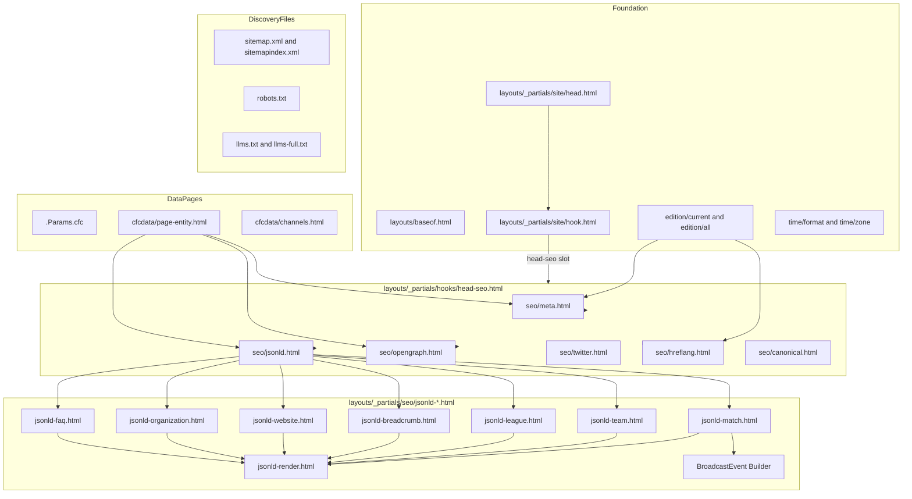
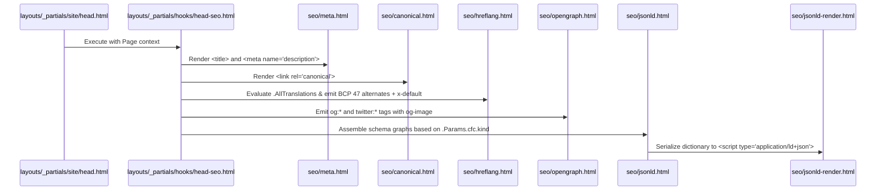

# Design Document: seo-social

## Overview
**Purpose**: This feature delivers an automated, valid, and search-optimized metadata and structured data layer for CardápioFC across all six launch editions (Global, UK, Ireland, Brazil, Portugal, Argentina). It equips every page with single-encoded Schema.org JSON-LD (SportsEvent, BroadcastEvent, SportsTeam, SportsLeague, BreadcrumbList, WebSite with working SearchAction, Organization with MobileApplication links, and FAQPage), bidirectional BCP 47 hreflang alternates with Global x-default, self-referencing canonicals, localised data-driven titles and descriptions, WhatsApp-friendly social preview images (≤ 300 KB, 1200×630), multilingual XML sitemaps, robots.txt, llms.txt, and answer-first FAQ content for Generative Engine Optimization (GEO).

**Users**: 
- **Search Engine Crawlers** (Google, Bing) index live match schedules, broadcasters, and breadcrumbs without parsing errors.
- **AI Answer Engines** (ChatGPT, Perplexity, Claude, Google AI Overviews) extract direct, authoritative answers regarding match kickoff times and TV/streaming availability.
- **Messaging & Social Users** (WhatsApp, Telegram, Twitter/X, iMessage) receive rich, instantaneous previews with correct local times and channels.
- **Site Operator & CI** run automated assertions ensuring zero regressions in JSON-LD syntax, hreflang reciprocity, or image budgets.

**Impact**: Eliminates the broken double-encoded JSON-LD string on the live site, overrides the vendored `basic-seo` module with root-level templates, fixes the 404 SearchAction target, standardizes international hreflang targeting, guarantees WhatsApp image compatibility, and enables rich search results without modifying `themes/` or `_vendor/`.

### Goals
- 100% valid Schema.org JSON-LD emitted as native JSON objects; 0% double-encoded string literals.
- Match pages emit `SportsEvent` with local timezone offsets and `BroadcastEvent` list per edition channel.
- Bidirectional `hreflang` on all translated pages formatted in BCP 47 (`en`, `en-GB`, `en-IE`, `pt-BR`, `pt-PT`, `es-AR`), with `x-default` pointing to Global unprefixed URL.
- Every indexable page carries a self-referencing canonical tag.
- Social share preview images conform to 1200×630 pixels and ≤ 300 KB file size for WhatsApp compatibility.
- Zero build-time inflation (< 10 s target) and zero file-budget inflation (< 20,000 files Cloudflare cap).
- Automated CI verification script (`check-seo-social.mjs`) guarding all SEO, schema, and image rules.

### Non-Goals
- Analytics tracking, cookies, and Consent Mode v2 (owned by `analytics-consent`). No ads exist on the site.
- Search route implementation and client-side search UI (owned by `app-deeplinks`).
- Apple App Site Association and Android Asset Links (owned by `app-deeplinks`).
- Edge geo-redirect rules and legacy URL 301 mappings (owned by `edge-delivery`).
- Generating dynamic raster images per match at build time (violates file count and build duration budgets).

## Boundary Commitments

### This Spec Owns
- The `<head>` SEO hook implementation: `layouts/_partials/hooks/head-seo.html` (the sole slot owner for `head-seo` defined in `site-foundation`).
- The root-level override `layouts/_partials/basic-seo.html` (rendering no-op / redirecting to head-seo, disabling the vendored module).
- Metadata partials: `layouts/_partials/seo/{meta,canonical,hreflang,opengraph,twitter,og-image}.html`.
- Structured data partials: `layouts/_partials/seo/{jsonld,jsonld-render,jsonld-match,jsonld-team,jsonld-league,jsonld-breadcrumb,jsonld-website,jsonld-organization,jsonld-faq}.html`.
- Answer-first FAQ presentation and partial: `layouts/_partials/cfcpage/faq-section.html`.
- Custom sitemap templates: `layouts/_default/sitemap.xml` and `layouts/sitemapindex.xml`.
- Crawler guidance: `layouts/robots.txt`, `layouts/home.llms.txt`, and `layouts/home.llmsfull.txt`.
- Static social share preview assets: `assets/images/og/og-{edition}.png`.
- Automated test and verification suite: `scripts/check-seo-social.mjs`.
- Appended i18n keys for SEO titles, descriptions, and FAQ blocks.

### Out of Boundary
- Any file under `layouts/_partials/hooks/` other than `head-seo.html`.
- Core site chrome (`baseof.html`, `site/head.html`, `site/header.html`, `site/footer.html`, `site/hook.html`).
- Data pipeline, content adapters, and entity view-models (`cfcdata/*`).
- Analytics scripts, GTM, gtag, consent banners (`layouts/_partials/hooks/head-analytics.html`, `footer-consent.html`).
- Mobile app deep links (`apple-app-site-association`, `assetlinks.json`).
- Hosting configuration, Cloudflare workers, and redirects (`edge-delivery`).

### Allowed Dependencies
- `site-foundation` contracts: `edition/current.html`, `edition/all.html`, `time/*` partials, `site/hook.html` slot `head-seo`.
- `data-pages` contracts: `.Params.cfc`, `cfcdata/page-entity.html` (`PageEntity`), `cfcdata/channels.html` (`ChannelGroup[]`), `MatchStatus` enum.
- Hugo 0.165.0 extended built-ins: `jsonify`, `safeJS`, `safeHTML`, `time.Format`, `urls.AbsURL`, `resources.Get`, `hugo.IsProduction`.
- Node.js ≥ 20 built-ins for `scripts/check-seo-social.mjs`.

### Revalidation Triggers
- Any change to `site-foundation` `Edition` properties (especially `hreflang`, `locale`, or `prefix`).
- Any change to `data-pages` `PageEntity` or `MatchVM` fields (kickoff format, status enum, channels structure).
- Any change to the search route URL pattern (`app-deeplinks`).

## Architecture

### Existing Architecture Analysis
- Project uses project-setup mode with Hugo 0.165.0 extended.
- Vendored `basic-seo` module (`_vendor/.../basic-seo.html`) is currently invoked by the stock theme; it incorrectly emits `.Lang` (e.g. `en-gb`) in `hreflang`, sets `x-default` to the current page, and lacks all Schema.org structured data.
- `site-foundation` refactors `<head>` in `layouts/_partials/site/head.html` to dispatch `head-seo` via `site/hook.html`.
- By creating `layouts/_partials/hooks/head-seo.html` and providing a root shadow `layouts/_partials/basic-seo.html`, the vendored basic-seo code is completely bypassed cleanly without modifying `_vendor/`.

### Architecture Pattern & Boundary Map
Selected pattern: **Modular Head Hook with Dedicated Schema Graph Builders**.



### Technology Stack

| Layer | Choice / Version | Role in Feature | Notes |
|-------|------------------|-----------------|-------|
| Generator | Hugo 0.165.0 extended | Template rendering, JSON-LD serialization, sitemaps | Pinned in netlify.toml |
| Schema | Schema.org 2026 vocabulary | `SportsEvent`, `BroadcastEvent`, `SportsTeam`, `SportsLeague`, `BreadcrumbList`, `WebSite`, `Organization`, `FAQPage` | Google Rich Results compliant |
| Metadata | Open Graph + Twitter Card + BCP 47 | Social preview metadata & international hreflang | WhatsApp ≤ 300 KB verified |
| Verification | Node.js ≥ 20 built-in scripts | `scripts/check-seo-social.mjs` | Automated CI quality gate |

## File Structure Plan

### Directory Structure
```
layouts/
├── robots.txt                                  # CREATE: crawler directives and sitemap reference
├── sitemapindex.xml                            # CREATE: multilingual sitemap index
├── home.llms.txt                               # CREATE: LLM discovery brief (plain markdown)
├── home.llmsfull.txt                           # CREATE: comprehensive LLM context
├── _default/
│   └── sitemap.xml                             # CREATE: per-language sitemap filtering indexable pages
└── _partials/
    ├── basic-seo.html                          # CREATE: root override no-op neutralizing vendored basic-seo
    ├── hooks/
    │   └── head-seo.html                       # CREATE: head-seo slot implementation
    ├── cfcpage/
    │   └── faq-section.html                    # CREATE: answer-first FAQ component for match pages
    └── seo/
        ├── meta.html                           # CREATE: <title>, meta description, robots, keywords
        ├── canonical.html                      # CREATE: self-referencing canonical
        ├── hreflang.html                       # CREATE: BCP 47 alternates + Global x-default
        ├── opengraph.html                      # CREATE: og:* tags and alternate locales
        ├── twitter.html                        # CREATE: twitter:* card tags
        ├── og-image.html                       # CREATE: resolves 1200x630 image URL (≤300KB)
        ├── jsonld.html                         # CREATE: root JSON-LD coordinator
        ├── jsonld-render.html                  # CREATE: jsonify | safeJS wrapper
        ├── jsonld-match.html                   # CREATE: SportsEvent + BroadcastEvent builder
        ├── jsonld-team.html                    # CREATE: SportsTeam builder
        ├── jsonld-league.html                  # CREATE: SportsLeague builder
        ├── jsonld-breadcrumb.html              # CREATE: BreadcrumbList builder
        ├── jsonld-website.html                 # CREATE: WebSite + SearchAction builder
        ├── jsonld-organization.html            # CREATE: Organization + MobileApplication builder
        └── jsonld-faq.html                     # CREATE: FAQPage builder
assets/
└── images/
    └── og/
        ├── og-global.png                       # CREATE: 1200x630 Global social card (<80KB)
        ├── og-en-gb.png                        # CREATE: 1200x630 UK social card (<80KB)
        ├── og-en-ie.png                        # CREATE: 1200x630 Ireland social card (<80KB)
        ├── og-pt-br.png                        # CREATE: 1200x630 Brazil social card (<80KB)
        ├── og-pt-pt.png                        # CREATE: 1200x630 Portugal social card (<80KB)
        └── og-es-ar.png                        # CREATE: 1200x630 Argentina social card (<80KB)
i18n/
├── en.yaml, pt.yaml, es.yaml                   # MODIFY (append): SEO title templates and FAQ strings
└── en-gb.yaml, en-ie.yaml, pt-pt.yaml, es-ar.yaml # MODIFY (append): regional overrides
scripts/
└── check-seo-social.mjs                        # CREATE: post-build SEO, schema, hreflang, and image checker
```

### Modified Files
- `i18n/*.yaml`: Append keys for SEO titles, meta descriptions, FAQ questions, and answer templates under `# seo-social` section.
- `config/_default/params.toml`: Remove or comment out legacy metadata image references; keep verification codes.

## System Flows

### Head SEO Hook Execution Flow


### JSON-LD Graph Assembly Flow
```mermaid
graph TD
    Start[seo/jsonld.html] --> Detect{Check .Params.cfc.kind}
    Detect -->|match| MatchFlow[Build SportsEvent + BroadcastEvents]
    Detect -->|lineup| LineupFlow[Build SportsEvent subEvent + Breadcrumbs]
    Detect -->|team| TeamFlow[Build SportsTeam + Breadcrumbs]
    Detect -->|league| LeagueFlow[Build SportsLeague + Breadcrumbs]
    Detect -->|leagues| DirectoryFlow[Build CollectionPage + Breadcrumbs]
    Detect -->|nil / home| HomeFlow[Build WebSite + SearchAction + Organization + MobileApp]

    MatchFlow --> AddBreadcrumbs[Add BreadcrumbList]
    AddBreadcrumbs --> HasFAQ{Has FAQ section?}
    HasFAQ -->|yes| AddFAQ[Add FAQPage schema]
    HasFAQ -->|no| Graph[Combine into @graph array]
    AddFAQ --> Graph
    TeamFlow --> Graph
    LeagueFlow --> Graph
    DirectoryFlow --> Graph
    HomeFlow --> Graph
    LineupFlow --> Graph

    Graph --> Serializer[seo/jsonld-render.html: jsonify | safeJS]
```

## Requirements Traceability

| Requirement | Summary | Components | Interfaces | Flows |
|-------------|---------|------------|------------|-------|
| 1.1 | Native JSON objects, no double-encoding | `seo/jsonld-render.html` | `safeJS`, `jsonify` | JSON-LD Graph Assembly |
| 1.2–1.5 | `SportsEvent`, `Place`, `League`, `BroadcastEvent` | `seo/jsonld-match.html` | `PageEntity.match`, `ChannelGroup[]` | JSON-LD Graph Assembly |
| 1.6 | `SportsTeam` schema | `seo/jsonld-team.html` | `PageEntity.team` | JSON-LD Graph Assembly |
| 1.7 | `SportsLeague` schema | `seo/jsonld-league.html` | `PageEntity.league` | JSON-LD Graph Assembly |
| 1.8 | `BreadcrumbList` schema | `seo/jsonld-breadcrumb.html` | Breadcrumb items | JSON-LD Graph Assembly |
| 1.9 | `WebSite` + `SearchAction`, `Organization` + `MobileApplication` | `seo/jsonld-website.html`, `seo/jsonld-organization.html` | Site metadata, app URLs | JSON-LD Graph Assembly |
| 1.10 | `FAQPage` schema | `seo/jsonld-faq.html` | FAQ items dictionary | JSON-LD Graph Assembly |
| 2.1 | Self-referencing canonical | `seo/canonical.html` | `.Permalink` | Head SEO Hook |
| 2.2–2.5 | BCP 47 hreflang, Global x-default, reciprocal | `seo/hreflang.html` | `.AllTranslations`, `Edition.hreflang` | Head SEO Hook |
| 2.6 | Robots noindex on 404 / errors | `seo/meta.html` | `.Params.noindex`, `.Kind` | Head SEO Hook |
| 3.1–3.4 | Localised match & lineup title/description | `seo/meta.html` | `PageEntity.match`, `time/*` | Head SEO Hook |
| 3.5–3.6 | Team & league title/description | `seo/meta.html` | `PageEntity.team`, `PageEntity.league` | Head SEO Hook |
| 3.7–3.8 | Home & unique metadata | `seo/meta.html` | `Edition.title`, `Edition.description` | Head SEO Hook |
| 4.1–4.4 | Open Graph & Twitter Cards | `seo/opengraph.html`, `seo/twitter.html` | `.Permalink`, Open Graph spec | Head SEO Hook |
| 4.5–4.7 | 1200×630, ≤ 300 KB WhatsApp preview images | `seo/og-image.html`, `assets/images/og/*` | Static pre-optimized cards | Head SEO Hook |
| 5.1–5.3 | Multilingual XML sitemaps with alternate links | `layouts/_default/sitemap.xml`, `sitemapindex.xml` | `.Site.RegularPages`, `hreflang` | Sitemaps & Directives |
| 5.4 | Robots.txt directives | `layouts/robots.txt` | Sitemap absolute URL | Sitemaps & Directives |
| 5.5 | llms.txt and llms-full.txt | `layouts/home.llms.txt`, `home.llmsfull.txt` | LLM content format | Sitemaps & Directives |
| 6.1–6.5 | Answer-first FAQ copy and GEO integration | `cfcpage/faq-section.html`, `seo/jsonld-faq.html` | Match & channel data, i18n | Page Rendering |
| 7.1–7.5 | Clean hook isolation & vendored override | `hooks/head-seo.html`, `basic-seo.html` | Foundation hook dispatcher | Head SEO Hook |
| 8.1–8.3 | Automated post-build verification script | `scripts/check-seo-social.mjs` | Node.js file inspection | CI Quality Gate |

## Components and Interfaces

### SEO & Social Component Summary

| Component | Domain/Layer | Intent | Req Coverage | Key Dependencies | Contracts |
|-----------|--------------|--------|--------------|------------------|-----------|
| HeadSeoHook | Hook | Primary entry point for `<head>` SEO tags | 7.1, 7.2 | `site/hook.html` (P0) | Service |
| BasicSeoOverride | Hook | No-op root override neutralizing vendored module | 7.3 | Hugo partial resolver (P0) | State |
| MetaRenderer | Metadata | Emits `<title>`, description, robots, keywords | 2.6, 3.1–3.8 | `cfcdata/page-entity`, `time/*` (P0) | Service |
| CanonicalRenderer | Metadata | Emits self-referencing canonical URL | 2.1 | `.Permalink` (P0) | Service |
| HreflangRenderer | Metadata | Emits BCP 47 alternates and Global x-default | 2.2–2.5 | `edition/all`, `.AllTranslations` (P0) | Service |
| OpenGraphRenderer | Social | Emits `og:*` tags and alternate locales | 4.1, 4.2, 4.4 | OgImageResolver (P0) | Service |
| TwitterCardRenderer | Social | Emits `twitter:*` tags | 4.3 | OgImageResolver (P0) | Service |
| OgImageResolver | Social | Resolves 1200×630 image (≤300KB) | 4.5–4.7 | Static assets (P0) | Service |
| JsonLdCoordinator | Structured Data | Selects and coordinates JSON-LD graphs | 1.1–1.10 | Schema builders, JsonLdRender (P0) | Service |
| JsonLdRender | Structured Data | Serializes Go dictionary to valid JSON script | 1.1 | `jsonify`, `safeJS` (P0) | Service |
| MatchSchemaBuilder | Structured Data | Builds `SportsEvent` + `BroadcastEvent` | 1.2–1.5 | `PageEntity.match`, `channels.html` (P0) | Service |
| TeamSchemaBuilder | Structured Data | Builds `SportsTeam` schema | 1.6 | `PageEntity.team` (P0) | Service |
| LeagueSchemaBuilder | Structured Data | Builds `SportsLeague` schema | 1.7 | `PageEntity.league` (P0) | Service |
| BreadcrumbBuilder | Structured Data | Builds `BreadcrumbList` schema | 1.8 | Navigation hierarchy (P0) | Service |
| SiteOrgSchemaBuilder | Structured Data | Builds `WebSite`, `Organization`, `MobileApp` | 1.9 | App identifiers, site params (P0) | Service |
| FaqSchemaBuilder | Structured Data | Builds `FAQPage` schema | 1.10, 6.4 | FAQ data structure (P0) | Service |
| FaqSectionComponent | UI | Visible answer-first FAQ section on match pages | 6.1–6.3, 6.5 | i18n, match data (P0) | Service |
| SitemapGenerator | Crawlers | Emits filtered XML sitemaps with alternate links | 5.1–5.3 | `.Site.RegularPages` (P0) | Batch |
| RobotsGenerator | Crawlers | Emits `robots.txt` with sitemap reference | 5.4 | Sitemap URL (P0) | Batch |
| LlmsGenerator | Crawlers | Emits `llms.txt` and `llms-full.txt` | 5.5 | Edition data (P0) | Batch |
| CheckSeoScript | Tooling | Post-build validator script | 8.1–8.3 | Node built-ins (P0) | Batch |

### Component Contracts (Go Template Interfaces)

#### 1. HeadSeoHook (`layouts/_partials/hooks/head-seo.html`)
- Invoked by: `site/hook.html` with `.Page` context.
- Responsibilities: Calls `seo/meta.html`, `seo/canonical.html`, `seo/hreflang.html`, `seo/opengraph.html`, `seo/twitter.html`, and `seo/jsonld.html`.

#### 2. HreflangRenderer (`layouts/_partials/seo/hreflang.html`)
```typescript
interface HreflangAlternate {
  code: string;       // BCP 47 code: "en", "en-GB", "en-IE", "pt-BR", "pt-PT", "es-AR"
  url: string;        // Absolute permalink
  isGlobal: boolean;  // true for Global edition
}
```
Algorithm:
1. Iterate over `.AllTranslations`.
2. Find corresponding edition in `edition/all.html` matching translation `.Language.Lang`.
3. Format `<link rel="alternate" hreflang="{{ $edition.hreflang }}" href="{{ .Permalink }}" />`.
4. If `$edition.isGlobal` is true, save its permalink as `$xDefaultUrl`.
5. If `$xDefaultUrl` is found, emit `<link rel="alternate" hreflang="x-default" href="{{ $xDefaultUrl }}" />`.
6. Postcondition: Every alternate link is reciprocal.

#### 3. MatchSchemaBuilder (`layouts/_partials/seo/jsonld-match.html`)
```typescript
interface SchemaSportsEvent {
  "@type": "SportsEvent";
  "name": string;                     // "Home vs Away"
  "sport": "Soccer";
  "startDate": string;                 // ISO 8601 with timezone offset, e.g. "2026-11-08T19:45:00+00:00"
  "eventStatus": string;               // "https://schema.org/EventScheduled" | "EventLive" | "EventPostponed" | "EventCancelled"
  "homeTeam": SchemaSportsTeam;
  "awayTeam": SchemaSportsTeam;
  "location"?: SchemaPlace;
  "superEvent"?: SchemaSportsLeague;
  "publication"?: SchemaBroadcastEvent[];
}

interface SchemaBroadcastEvent {
  "@type": "BroadcastEvent";
  "name": string;                     // Broadcaster name
  "isLiveBroadcast": true;
  "startDate": string;
  "publishedOn": {
    "@type": "BroadcastService";
    "name": string;
    "broadcaster": { "@type": "Organization"; "name": string };
    "url"?: string;
  };
}
```

#### 4. BreadcrumbBuilder (`layouts/_partials/seo/jsonld-breadcrumb.html`)
```typescript
interface SchemaBreadcrumbList {
  "@type": "BreadcrumbList";
  "itemListElement": {
    "@type": "ListItem";
    "position": number;
    "name": string;
    "item": string;                   // Absolute URL
  }[];
}
```
- Match page breadcrumb:
  1. Position 1: Home (`Home.Permalink`)
  2. Position 2: League (`MatchVM.league.url`)
  3. Position 3: Match (`MatchVM.url`)
- Lineup page breadcrumb:
  1. Position 1: Home
  2. Position 2: League
  3. Position 3: Match
  4. Position 4: Lineup (`LineupVM.url`)

#### 5. SiteOrgSchemaBuilder (`layouts/_partials/seo/jsonld-website.html` and `jsonld-organization.html`)
```typescript
interface SchemaWebSite {
  "@type": "WebSite";
  "name": "CardápioFC";
  "url": "https://cardapiofc.com/";
  "potentialAction": {
    "@type": "SearchAction";
    "target": {
      "@type": "EntryPoint";
      "urlTemplate": "https://cardapiofc.com/search?q={search_term_string}";
    };
    "query-input": "required name=search_term_string";
  };
}

interface SchemaOrganization {
  "@type": "Organization";
  "name": "CardápioFC";
  "url": "https://cardapiofc.com/";
  "logo": "https://cardapiofc.com/images/logo.png";
  "description": string;
  "sameAs": string[];
  "subjectOf": SchemaMobileApp[];
}

interface SchemaMobileApp {
  "@type": "MobileApplication";
  "name": "CardápioFC";
  "operatingSystem": "iOS" | "Android";
  "applicationCategory": "SportsApplication";
  "installUrl": string;
}
```

#### 6. FaqSchemaBuilder (`layouts/_partials/seo/jsonld-faq.html`)
```typescript
interface SchemaFAQPage {
  "@type": "FAQPage";
  "mainEntity": {
    "@type": "Question";
    "name": string;
    "acceptedAnswer": {
      "@type": "Answer";
      "text": string;
    };
  }[];
}
```

#### 7. OgImageResolver (`layouts/_partials/seo/og-image.html`)
- Logic cascade:
  1. If `.Params.cfc.og_image` exists, use it.
  2. Else if match page: use edition-specific match card template `assets/images/og/og-{edition}.png`.
  3. Else if league page and custom league card exists: use `assets/images/og/og-league-{slug}.png`.
  4. Else fallback to edition card `assets/images/og/og-{edition}.png`.
  5. Default fallback: `assets/images/og/og-global.png`.
- Output: Absolute URL to the 1200×630 image (guaranteed ≤ 300 KB).

## Data Models

### Open Graph & Social Data Model
```typescript
interface SocialMetaGraph {
  siteName: "CardápioFC";
  title: string;
  description: string;
  url: string;
  type: "website";
  locale: string;                     // e.g. "en_GB", "pt_BR"
  alternateLocales: string[];         // e.g. ["en_US", "en_IE", "pt_PT", "es_AR"]
  image: {
    url: string;
    width: 1200;
    height: 630;
    alt: string;
    type: "image/png" | "image/jpeg";
  };
  twitterCard: "summary_large_image";
}
```

### Multilingual Sitemap Entry Model
```xml
<url>
  <loc>https://cardapiofc.com/en-gb/match/fiorentina-vs-juventus-2026-11-08/</loc>
  <lastmod>2026-11-05T08:00:00Z</lastmod>
  <changefreq>daily</changefreq>
  <priority>0.8</priority>
  <xhtml:link rel="alternate" hreflang="en" href="https://cardapiofc.com/match/fiorentina-vs-juventus-2026-11-08/"/>
  <xhtml:link rel="alternate" hreflang="en-GB" href="https://cardapiofc.com/en-gb/match/fiorentina-vs-juventus-2026-11-08/"/>
  <xhtml:link rel="alternate" hreflang="en-IE" href="https://cardapiofc.com/en-ie/match/fiorentina-vs-juventus-2026-11-08/"/>
  <xhtml:link rel="alternate" hreflang="pt-BR" href="https://cardapiofc.com/pt-br/match/fiorentina-vs-juventus-2026-11-08/"/>
  <xhtml:link rel="alternate" hreflang="pt-PT" href="https://cardapiofc.com/pt-pt/match/fiorentina-vs-juventus-2026-11-08/"/>
  <xhtml:link rel="alternate" hreflang="es-AR" href="https://cardapiofc.com/es-ar/match/fiorentina-vs-juventus-2026-11-08/"/>
  <xhtml:link rel="alternate" hreflang="x-default" href="https://cardapiofc.com/match/fiorentina-vs-juventus-2026-11-08/"/>
</url>
```

### Sitemap Index Model
```xml
<sitemapindex xmlns="http://www.sitemaps.org/schemas/sitemap/0.9">
  <sitemap>
    <loc>https://cardapiofc.com/sitemap.xml</loc>
  </sitemap>
  <sitemap>
    <loc>https://cardapiofc.com/en-gb/sitemap.xml</loc>
  </sitemap>
  <sitemap>
    <loc>https://cardapiofc.com/en-ie/sitemap.xml</loc>
  </sitemap>
  <sitemap>
    <loc>https://cardapiofc.com/pt-br/sitemap.xml</loc>
  </sitemap>
  <sitemap>
    <loc>https://cardapiofc.com/pt-pt/sitemap.xml</loc>
  </sitemap>
  <sitemap>
    <loc>https://cardapiofc.com/es-ar/sitemap.xml</loc>
  </sitemap>
</sitemapindex>
```

## Error Handling

### Error Strategy
Fail fast at build time on schema serialization errors; fall back cleanly during rendering if optional fields are missing; exit with clear error reports in CI checks.

| Category | Condition | Response |
|---|---|---|
| JSON-LD syntax | Malformed dictionary or unclosed tag | Build fails via Hugo template syntax error; verification script catches any syntax failure with `JSON.parse` |
| Missing translation | Page does not exist in an edition | Hreflang loop checks existence before emitting; omitted from alternates; never emits broken link |
| Missing venue/crest | Match lacks venue or team crest | Schema builder omits `location` / `image` properties cleanly without emitting null or empty string |
| Missing channels | Match has no channels in edition | BroadcastEvent slice is empty; meta description uses pending/app fallback text |
| Image size overflow | Share image > 300 KB | Verification script `check-seo-social.mjs` fails build with explicit file size and path |
| Canonical mismatch | RelPermalink does not equal canonical href | Verification script fails CI with offending URL |

## Testing Strategy

### Build-Time Assertions (`node scripts/check-seo-social.mjs`)
1. **JSON-LD Schema Verification**:
   - Parses generated HTML from sample pages across all editions (Home, Match, Lineup, Team, League, League Directory).
   - Validates every `<script type="application/ld+json">` with `JSON.parse()`.
   - Confirms `SportsEvent` contains valid `startDate`, `homeTeam`, `awayTeam`, `eventStatus`.
   - Confirms `BroadcastEvent` exists on match pages with channels.
   - Confirms `BreadcrumbList` has valid `itemListElement` ordering.
   - Confirms `WebSite` has working `SearchAction` target without 404 URL.
   - Confirms `Organization` contains `MobileApplication` references.
2. **Canonical & hreflang Audit**:
   - Asserts self-referencing canonical matches page permalink.
   - Asserts hreflang codes match BCP 47 (`en`, `en-GB`, `en-IE`, `pt-BR`, `pt-PT`, `es-AR`).
   - Asserts `x-default` points to the unprefixed Global URL.
   - Asserts reciprocity across editions for all translated entities.
3. **Meta & Title Differentiation**:
   - Asserts no two distinct matches or teams share identical meta descriptions.
   - Asserts title contains match teams and timezone-formatted kickoff.
4. **WhatsApp Image Compliance**:
   - Inspects `og:image` tags, resolves file paths in `public/`.
   - Asserts all share images exist and are ≤ 300,000 bytes (300 KB).
5. **Discovery Files Check**:
   - Asserts `/sitemap.xml`, `/robots.txt`, and `/llms.txt` exist and contain valid XML/text.
   - Asserts non-rendered sections (`/match/`, `/team/`) are excluded from sitemaps.

### Performance & Scalability
- Zero runtime overhead: all metadata, JSON-LD, sitemaps, and images are static assets generated at build time.
- JSON-LD dict construction uses shallow lookups from already cached view-models (`PageEntity`).
- Static image strategy creates only 6 edition template cards (~360 KB total disk space), keeping file count well under the 20,000 limit.

## Security Considerations
- All dynamic text values (team names, match titles, venues) inserted into JSON-LD pass through `jsonify`, which escapes special characters (quotes, backslashes, control characters) securely.
- No `innerHTML` or raw unescaped user input: all values come from the verified Retool/Firebase dataset contract.
- Links to external broadcaster websites inherit `rel="noopener nofollow"`.
