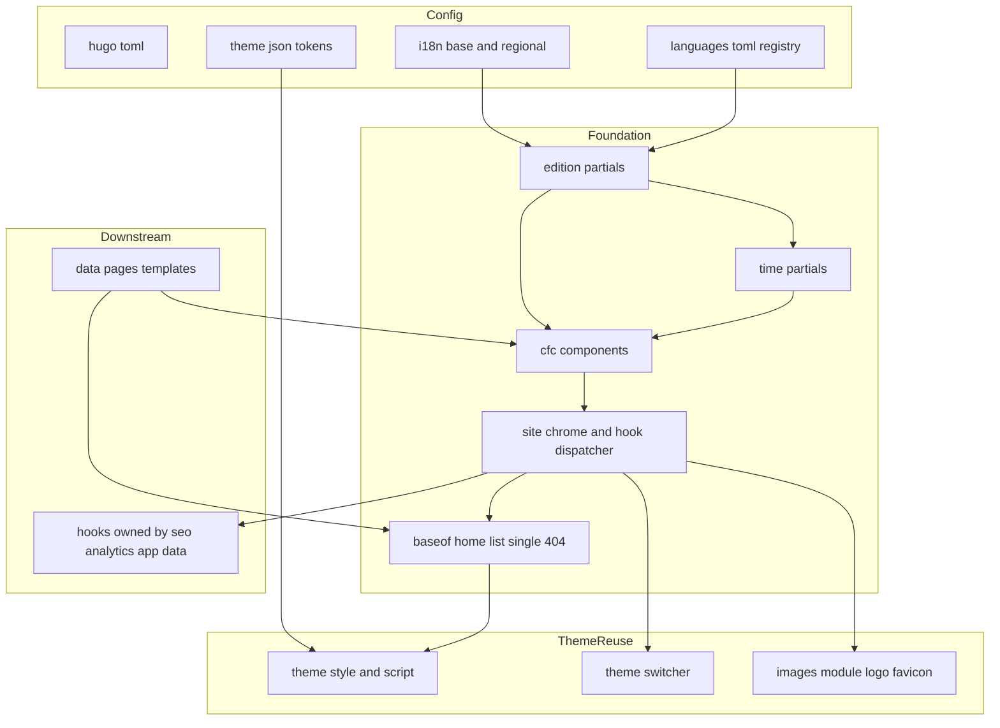
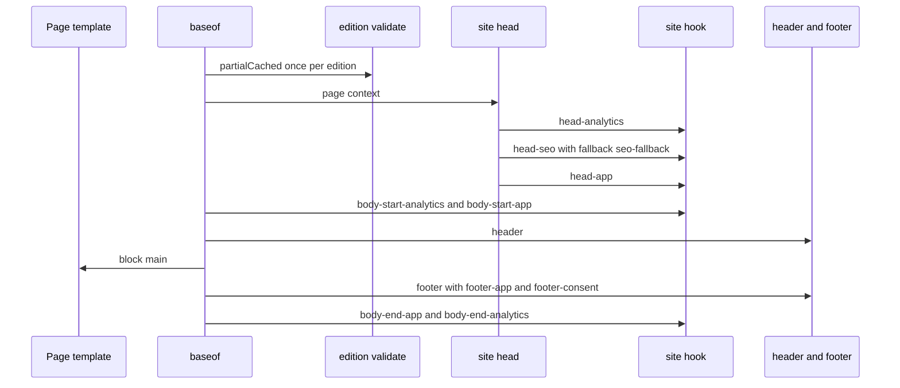
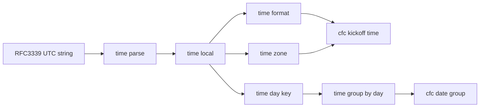
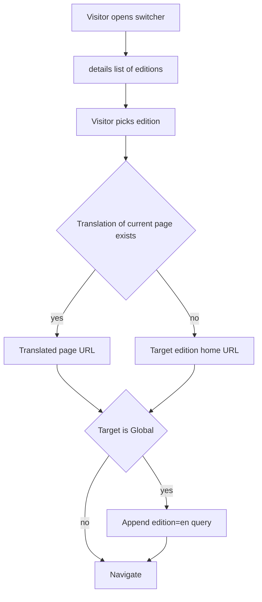
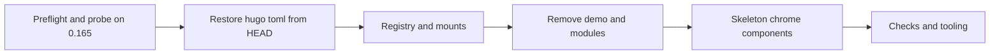

# Design Document: site-foundation

## Overview
**Purpose**: This feature delivers a repaired, upgrade-safe Hugo configuration, a single six-edition registry, localised strings and time formatting, a redesigned mobile-first visual system and a set of stable template contracts (edition, time, components, extension slots) that every other CardápioFC spec builds on.

**Users**: Visitors read the site in their edition (Global, UK, Ireland, Brazil, Portugal, Argentina). The site operator configures editions and runs `pnpm dev` / `pnpm build` / `pnpm check`. Downstream spec implementers (data-pages, app-deeplinks, seo-social, edge-delivery, analytics-consent) consume the contracts defined in [Shared Contracts](#shared-contracts-consumed-by-downstream-specs).

**Impact**: Replaces the broken working-tree `hugo.toml`, the wrong-locale `languages.toml`, the stock theme presentation and the demo content tree with root-level overrides only. `themes/hugoplate/` and `_vendor/` stay untouched (except `generated-theme.css`, regenerated by `scripts/themeGenerator.js`).

### Goals
- `pnpm build` succeeds for six editions; `pnpm update-theme` + `pnpm build` still succeeds.
- Adding an edition = configuration only (plus one i18n file for a new language).
- Every displayed time is in the edition time zone with an explicit zone label and offset.
- Downstream specs never edit a foundation-owned file to add head/body/footer output or menu entries.
- Shell pages ≤ 100 KB compressed (HTML + CSS + JS), match card ≤ 2 KB HTML, ≤ 10 KB first-party JS.

### Non-Goals
- Fetching remote data, content adapters, entity templates (data-pages).
- Canonical, hreflang, Open Graph, JSON-LD, sitemap, robots, llms.txt content (seo-social).
- Analytics, consent banner, privacy policy text (analytics-consent); advertisements / AdSense (explicit non-goal; zero ads on site).
- Search, app landing pages, smart banner, well-known files (app-deeplinks).
- Hosting, deploy workflow, geo/legacy redirects, retiring `netlify.toml` (edge-delivery).

## Boundary Commitments

### This Spec Owns
- Root site configuration: `hugo.toml`, `config/_default/{languages,menus,module,params}.toml`, `config/production/hugo.toml`.
- The **edition registry** (data in `languages.toml`) and its read contract (`edition/*` partials) including build-time validation.
- Interface strings `i18n/*.yaml` (base + regional) and the i18n mount chain.
- The **time contract** (`time/*` partials) and localised date/time layouts.
- Document skeleton `layouts/baseof.html`, generic page templates `home.html`, `list.html`, `single.html`, `404.html`, `styleguide.html`.
- Site chrome partials `site/*` (head, header, footer, hook dispatcher, SEO fallback).
- UI components `cfc/*` (match card, team crest, channel badge, date group, kick-off time, edition switcher, page header, breadcrumb, empty state, icon, menu).
- Design tokens (`data/theme.json`, `assets/css/custom.css`, `assets/css/cfc/*`), `assets/js/main.js` override and lazy placeholders.
- Per-edition content homes `content/<code>/_index.md`, styleguide fixtures, demo removal.
- `scripts/check-site.mjs` and `package.json` scripts/`packageManager`; version alignment in retained tool configs; removal of unused deploy configs and the npm lock file.

### Out of Boundary
- Any file under `layouts/_partials/hooks/` (each is created and owned by exactly one downstream spec; see Hook Slot Contract).
- Entity templates (`layouts/match/`, `team/`, `league/` …), content adapters, JSON contract (data-pages).
- `params.google_tag_manager`, `params.google_adsense`, `params.cookies`, `services.googleAnalytics.ID` values (analytics-consent); `params.metadata`, `params.site_verification`, llms settings (seo-social). Foundation restores/keeps these keys but does not change their values or render them.
- `netlify.toml` retirement, Cloudflare config, `_redirects`, `_headers` (edge-delivery).
- `themes/hugoplate/**`, `_vendor/**`, `go.mod`/`go.sum` module versions.

### Allowed Dependencies
- Hugo 0.165.0 extended built-ins (`time.*`, `T`, `hugo.Sites`, `templates.Exists`, `partial`/`return`, `css.TailwindCSS`).
- Theme hugoplate (read-only reuse): `_partials/essentials/style.html`, `_partials/essentials/script.html`, `_partials/components/theme-switcher.html`, `assets/css/main.css` and its imports.
- Vendored modules (read-only reuse): images (`logo`, `favicon`), pwa (`manifest`, `pwa`).
- Node ≥ 20 built-ins only for `scripts/check-site.mjs`. No new npm dependencies.
- Dependency direction (enforced): **Config → `edition/*` → `time/*` → `cfc/*` components → `site/*` chrome → page templates (`baseof`, `home`, `list`, `single`, `404`, `styleguide`)**. A layer may call only layers to its left. `cfc/*` must not call `site/*`; nothing in foundation calls `hooks/*` except `site/hook.html`.

### Revalidation Triggers
- Any change to the Edition view-model keys, registry param names, or the list of editions → data-pages, seo-social, edge-delivery, analytics-consent.
- Changes to component parameter shapes, `data-cfc-*` attribute names or the match status enum → data-pages, analytics-consent.
- Adding/removing/renaming a hook slot → owner spec of that slot.
- Changes to `outputs`, removed module imports (notably `search`) → app-deeplinks, seo-social.
- Changing the edition-choice marker (`?edition=`) → edge-delivery.
- Changing the Hugo/Go version source of truth (`netlify.toml`) → edge-delivery, AGENTS.md.
- Theme update that alters `essentials/style.html` or `essentials/script.html` → foundation re-runs `pnpm check`.
- Introducing a Content-Security-Policy without `unsafe-inline`/hashes (crest `onerror`, theme-switcher inline script) → foundation.

## Architecture

### Existing Architecture Analysis
- Project-setup mode: site at root, theme in `themes/hugoplate/`, modules vendored in `_vendor/`. New template system (`layouts/_partials/`, `home.html`, top-level `baseof.html`).
- Theme pipeline: `assets/css/main.css` (theme) → Tailwind v4 with `inlineImports`; imports `generated-theme.css` and `custom.css` (root `assets/css/custom.css` shadows the theme file). Build stats (`hugo_stats.json`) feed Tailwind `@source`.
- `essentials/style.html` and `essentials/script.html` are `partialCached` by the theme and build bundles from `params.plugins.css|js`; `resources.Concat` fails on an empty lazy list.
- Technical debt addressed: broken `hugo.toml`; wrong locales and shared `content/english`; `.Site.Sites` deprecation (use `hugo.Sites`); GA/GTM misconfiguration rendered from theme head (removed from rendering, left to analytics-consent).

### Architecture Pattern & Boundary Map
Selected pattern: **layered template architecture with a foundation-owned skeleton and named extension slots** (Option B in `research.md`).



**Architecture Integration**:
- Domain boundaries: Config/registry, i18n + time, design system (tokens + components), chrome + shells, tooling/check. Each maps to a disjoint directory set (see File Structure Plan) so tasks can run in parallel after configuration lands.
- Existing patterns preserved: theme generator, theme style/script bundling, theme-switcher, images module, `pnpm` scripts.
- New components rationale: hook dispatcher (conflict-free head/body composition), edition/time contracts (single source for six editions), `cfc/*` components (data-pages needs them; prevents 1.3 MB pages), check script (verifiable requirements).

### Technology Stack

| Layer | Choice / Version | Role in Feature | Notes |
|-------|------------------|-----------------|-------|
| Site generator | Hugo 0.165.0 extended (pinned in `netlify.toml`) | Multilingual build, templates, i18n, time functions | New template system paths |
| Theme | hugoplate (vendored, read-only) | Style/script bundling, theme-switcher | Never edited |
| Styling | Tailwind CSS v4 (`@tailwindcss/cli` ^4.3) via `data/theme.json` → `generated-theme.css` + root `custom.css` `@theme` | Tokens and component styles | No `tailwind.config.js` |
| Scripts | Vanilla JS (`assets/js/main.js`, theme-switcher inline) | Switcher progressive enhancement only | ≤ 10 KB gzip |
| Tooling | Node ≥ 20 built-ins, pnpm 10.x (`packageManager`) | `check-site.mjs`, scripts | No new dependencies |
| CI / dev | `netlify.toml` (source of truth until edge-delivery), `.devcontainer/Dockerfile` | Version pins | Go 1.25.1 everywhere |

## File Structure Plan

### Directory Structure
```
hugo.toml                               # MODIFY: restore HEAD config + cleanup (baseURL, theme, langs, kinds, outputs, mounts incl. i18n chain, plugins)
config/
├── _default/
│   ├── languages.toml                  # MODIFY: edition registry (6 editions)
│   ├── menus.toml                      # CREATE (replaces menus.en.toml): site-wide menus with identifiers
│   ├── menus.en.toml                   # DELETE
│   ├── module.toml                     # MODIFY: drop unused imports
│   ├── params.toml                     # MODIFY: drop demo params (mainSections, search, navigation_button, widgets, google_map, subscription, open_remark, announcement, preloader, mermaid); keep analytics/SEO keys untouched
│   └── security.toml                   # unchanged
└── production/
    └── hugo.toml                       # CREATE: ignoreFiles for styleguide pages
content/
├── english/                            # DELETE (demo)
├── en/_index.md                        # CREATE: Global home front matter (heading, intro)
├── en/styleguide.md                    # CREATE: component reference page (dev only)
├── en-gb/_index.md, en-gb/styleguide.md
├── en-ie/_index.md
├── pt-br/_index.md, pt-br/styleguide.md
├── pt-pt/_index.md, pt-pt/styleguide.md
└── es-ar/_index.md
data/
├── theme.json                          # MODIFY: semantic colour tokens (light/dark), fonts, scale
└── styleguide.yaml                     # CREATE: fixture matches/teams/channels for styleguide + checks
i18n/
├── en.yaml, pt.yaml, es.yaml           # CREATE/MODIFY: complete base tables (incl. i18n_base, layouts, statuses)
└── en-gb.yaml, en-ie.yaml, pt-pt.yaml, es-ar.yaml   # CREATE: regional overrides only
layouts/
├── baseof.html                         # CREATE: document skeleton + hook slots + validation
├── home.html                           # CREATE: home shell (home-main slot, empty state)
├── list.html                           # CREATE: list shell
├── single.html                         # CREATE: detail shell
├── 404.html                            # CREATE: per-edition not-found page
├── styleguide.html                     # CREATE: component reference layout (dev only); only includes styleguide section partials
└── _partials/
    ├── styleguide/                     # dev-only section partials, one per contract (base, edition, i18n, time, crest-kickoff, channel-icon, match-card, date-group, switcher-menu, page-header, chrome)
    ├── edition/
    │   ├── current.html                # Edition view-model for current site (returning partial)
    │   ├── all.html                    # Edition[] for all sites ordered by weight
    │   └── validate.html               # build-time registry/i18n/time-zone assertions
    ├── time/
    │   ├── parse.html                  # RFC 3339 string → time.Time (UTC), errorf otherwise
    │   ├── local.html                  # time.Time → edition time zone
    │   ├── format.html                 # localised string by style
    │   ├── zone.html                   # {label, offset, iana}
    │   ├── day-key.html                # "YYYY-MM-DD" in edition zone
    │   └── group-by-day.html           # items → ordered day groups
    ├── cfc/
    │   ├── kickoff-time.html           # <time> + zone indicator
    │   ├── team-crest.html
    │   ├── channel-badge.html
    │   ├── match-card.html
    │   ├── date-group.html
    │   ├── edition-switcher.html
    │   ├── menu.html                   # main/footer menu renderer (identifier labels)
    │   ├── page-header.html            # h1 + intro + breadcrumb
    │   ├── breadcrumb.html             # visual breadcrumb (no JSON-LD)
    │   ├── empty-state.html
    │   └── icon.html                   # inline SVG icon set
    └── site/
        ├── head.html                   # meta, head slots, favicon, manifest, theme-color
        ├── seo-fallback.html           # <title> + meta description when head-seo slot absent
        ├── header.html                 # logo, menu, switcher, theme-switcher
        ├── footer.html                 # copyright, footer menu, edition links, footer slots
        └── hook.html                   # slot dispatcher (whitelist + fallback)
assets/
├── css/
│   ├── custom.css                      # MODIFY: entry; @theme extras + imports cfc/*.css and every cfc/components/*.css
│   ├── cfc/base.css                    # typography, focus ring, reduced motion, skip link
│   ├── cfc/layout.css                  # container, header, footer, shells
│   ├── cfc/components/                 # one file per component (parallel-safe ownership)
│   │   ├── kickoff-time.css, team-crest.css, channel-badge.css, match-card.css, date-group.css
│   │   └── edition-switcher.css, menu.css, page-header.css, empty-state.css
│   └── cfc/lazy.css                    # print styles (keeps lazy CSS bundle non-empty)
├── js/
│   ├── main.js                         # CREATE (overrides theme main.js): switcher enhancement
│   └── cfc-lazy.js                     # CREATE: crest error listener fallback (keeps lazy JS bundle non-empty)
└── images/                             # DELETE demo images (avatar*, banner, call-to-action, service-*, gallery/, no-search-found, image-placeholder); keep favicon, logos/, og-image
scripts/
└── check-site.mjs                      # CREATE: Site Build check
package.json                            # MODIFY: name, packageManager, check scripts
.devcontainer/Dockerfile                # MODIFY: GO_VERSION 1.25.1
netlify.toml                            # unchanged (HUGO 0.165.0, GO 1.25.1, pnpm) — source of truth
package-lock.json                       # DELETE (on disk)
vercel.json, vercel-build.sh, amplify.yml, .gitlab-ci.yml, .sitepins/   # DELETE
```

### Modified Files (detail)
- `hugo.toml` — restored from `HEAD` then: `baseURL = "https://cardapiofc.com/"`, `title = "CardápioFC"`, `theme = "hugoplate"` (kept on its own line near the top for `themeGenerator.js`), `timeZone = "UTC"`, `defaultContentLanguage = "en"`, `defaultContentLanguageInSubdir = false`, `disableDefaultLanguageRedirect = true`, `disableKinds = ["taxonomy","term","rss"]`, `[outputs] home = ["HTML","WebAppManifest","llms","llmsfull"]`, `page = ["HTML"]`, `section = ["HTML"]`; SearchIndex output format removed; mounts per [i18n Mount Chain](#i18n-mount-chain); `[[params.plugins.css]]` = only `css/cfc/lazy.css` (lazy) and `[[params.plugins.js]]` = only `js/cfc-lazy.js` (lazy); `[services.googleAnalytics] ID = "G-MEASUREMENT_ID"` kept as placeholder.
- `config/_default/module.toml` — keep imports: llms-txt, pwa, images, gzip-caching, cookie-consent, custom-script, render-link, basic-seo, site-verifications, google-tag-manager. Remove: adsense (the site has zero ads), search, videos, font-awesome, accordion, table-of-contents, tab, modal, gallery-slider, preloader, social-share, announcement, button, notice, mermaid, open-remark.

> Shared-config seam: downstream specs may **append** entries to `[outputs]`, `[outputFormats]`, `[security.http]`, `[caches]` and module imports; they must not remove or rename foundation entries. Foundation tasks never touch downstream-appended entries.

## System Flows

### Page render composition

- Validation runs via `partialCached "edition/validate.html" . site.Language.Lang` so it executes once per edition and fails the build with `errorf`.
- Theme `essentials/style.html` is called in `<head>` after the head slots; theme `essentials/script.html` is called before the body-end slots.

### Time pipeline

- `parse` rejects strings without `Z` or `±hh:mm` (5.7). `local` uses the registry zone (`params.edition.timeZone`). `zone.offset` is computed per instant, so DST transitions are correct (5.5).

### Edition switching


## Requirements Traceability

| Requirement | Summary | Components | Interfaces | Flows |
|-------------|---------|------------|------------|-------|
| 1.1 | Build succeeds, 6 editions | SiteConfig, CheckScript | `pnpm build`, `pnpm check` | — |
| 1.2 | Restored settings | SiteConfig | `hugo.toml` | — |
| 1.3 | Theme generator works | SiteConfig, DesignTokens | `theme =` line, `data/theme.json` | — |
| 1.4 | Vendored dirs untouched | CheckScript | git diff assertion | — |
| 1.5 | Survives update-theme | Baseof, SiteChrome, CheckScript | theme reuse list | Page render |
| 1.6 | Multilang kept | EditionRegistry | `languages.toml` | — |
| 2.1–2.3 | Six editions, fields, prefixes | EditionRegistry, EditionContract | Edition view-model | — |
| 2.4 | Document language | Baseof | `lang`, `dir` | Page render |
| 2.5 | Validation | EditionValidator | `edition/validate.html` | Page render |
| 2.6–2.7 | Config-only editions | EditionRegistry, I18nTables, SiteMenus | registry + mount chain | — |
| 2.8 | Derived outputs | EditionContract | `edition/current.html`, `edition/all.html` | — |
| 3.1–3.2 | Content folders, homes | EditionContent, HomeShell | `content/<code>/_index.md` | — |
| 3.3 | No demo | ContentCleanup, CheckScript | — | — |
| 3.4–3.5 | Kinds/outputs, no /en/ alias | SiteConfig, CheckScript | `disableKinds`, `disableDefaultLanguageRedirect` | — |
| 3.6 | No stock features | Baseof, ModuleConfig | module imports | — |
| 4.1–4.3 | Strings, regional, fallback | I18nTables | mount chain | — |
| 4.4 | Missing key check | CheckScript | i18n parity | — |
| 4.5 | No hard-coded text | all `cfc/*`, `site/*`, pages | `T` keys | — |
| 5.1–5.6 | Zone, label, locale, ISO, DST, Global | TimeContract, KickoffTime | `time/*` | Time pipeline |
| 5.7 | Reject offset-less | TimeContract | `time/parse.html` | Time pipeline |
| 5.8 | Day grouping | TimeContract, DateGroup | `time/group-by-day.html` | Time pipeline |
| 6.1 | Header | SiteChrome | `site/header.html` | Page render |
| 6.2–6.4 | Switcher | EditionSwitcher | `cfc/edition-switcher.html` | Edition switching |
| 6.5–6.7 | Menus | SiteMenus, MenuRenderer | `menus.toml`, front matter `menus` | — |
| 6.8 | Footer | SiteChrome | `site/footer.html` | Page render |
| 7.1 | Tokens | DesignTokens | `data/theme.json` | — |
| 7.2 | Colour modes | SiteChrome (theme-switcher reuse) | — | — |
| 7.3–7.6 | Responsive, contrast, targets, motion | DesignTokens, ComponentStyles, CheckScript | `cfc/*.css` | — |
| 8.1–8.4 | Match card | MatchCard | `MatchCardParams` | — |
| 8.5–8.7 | Crest, layout stability | TeamCrest, ChannelBadge | `TeamCrestParams` | — |
| 8.8–8.9 | Channel badge | ChannelBadge | `ChannelBadgeParams` | — |
| 8.10 | Date group | DateGroup | `DateGroupParams` | Time pipeline |
| 8.11 | Data attributes | MatchCard, ChannelBadge, EditionSwitcher | `data-cfc-*` | — |
| 8.12 | Optional inputs | all `cfc/*` | — | — |
| 9.1–9.2 | Home shell, empty state | HomeShell, HookDispatcher, EmptyState | `home-main` slot | Page render |
| 9.3 | List/detail shells | ListShell, DetailShell, PageHeader, Breadcrumb | `PageHeaderParams` | — |
| 9.4 | 404 per edition | NotFoundPage | `layouts/404.html` | — |
| 9.5 | Skip link, h1, landmarks | Baseof, PageHeader | — | Page render |
| 10.1–10.3, 10.6 | Slots | HookDispatcher | Hook Slot Contract | Page render |
| 10.4 | Title/description fallback | SeoFallback | `site/seo-fallback.html` | Page render |
| 10.5 | No tracking scripts | SiteHead, Baseof, CheckScript | — | — |
| 11.1–11.5 | Budgets | ClientScript, ComponentStyles, CheckScript | budgets in check | — |
| 12.1–12.4 | Tool consistency | ToolingConfig, CheckScript | version pins | — |

## Components and Interfaces

| Component | Domain/Layer | Intent | Req Coverage | Key Dependencies | Contracts |
|-----------|--------------|--------|--------------|------------------|-----------|
| SiteConfig | Config | Valid site config, kinds, outputs, mounts, plugins | 1.1–1.3, 3.4, 3.5 | Hugo (P0) | State |
| ModuleConfig | Config | Module imports trimmed | 3.6 | vendored modules (P1) | State |
| EditionRegistry | Config | Six editions data | 1.6, 2.1–2.3, 2.6, 2.7 | Hugo languages (P0) | State |
| SiteMenus | Config | Site-wide menus with identifiers | 6.5–6.7 | i18n (P1) | State |
| EditionContent | Content | Per-edition homes, styleguide pages | 3.1, 3.2 | registry (P0) | — |
| ContentCleanup | Content | Remove demo content/assets/configs | 3.3 | — | — |
| I18nTables | i18n | Base + regional strings, mount chain | 4.1–4.3, 2.7 | SiteConfig mounts (P0) | State |
| EditionContract | Edition | Edition view-model partials | 2.2, 2.8 | registry (P0) | Service |
| EditionValidator | Edition | Build-time assertions | 2.5, 2.6 | registry, i18n (P0) | Service |
| TimeContract | Time | Parse, convert, format, zone, group | 5.1–5.8 | EditionContract (P0) | Service |
| DesignTokens | Design | Colours, fonts, radii, shadows | 1.3, 7.1, 7.4 | themeGenerator (P0) | State |
| ComponentStyles | Design | Base/layout/component CSS | 7.3–7.6, 11.2, 11.5 | DesignTokens (P0) | — |
| KickoffTime | UI | `<time>` + zone indicator | 5.2, 5.4, 5.6 | TimeContract (P0) | Service |
| TeamCrest | UI | Crest with fallback | 8.5–8.7 | — | Service |
| ChannelBadge | UI | Broadcaster badge | 8.7–8.9, 8.11 | icon (P2) | Service |
| MatchCard | UI | Match summary card | 8.1–8.4, 8.11, 8.12, 11.3 | TeamCrest, KickoffTime, ChannelBadge (P0) | Service |
| DateGroup | UI | Day heading + cards | 5.8, 8.10 | TimeContract, MatchCard (P0) | Service |
| EditionSwitcher | UI | Edition picker | 6.2–6.4, 8.11 | EditionContract (P0) | Service |
| MenuRenderer | UI | Main/footer menus | 6.5–6.7 | SiteMenus (P0) | Service |
| PageHeader / Breadcrumb / EmptyState / Icon | UI | Shell building blocks | 9.1–9.3, 9.5 | — | Service |
| HookDispatcher | Chrome | Named slot rendering | 10.1–10.3, 10.6 | `templates.Exists` (P0) | Service |
| SeoFallback | Chrome | Title + description fallback | 10.4 | EditionContract (P0) | — |
| SiteHead / SiteHeader / SiteFooter | Chrome | Head, header, footer | 6.1, 6.8, 7.2, 10.5 | components, theme-switcher, images (P0) | — |
| ClientScript | Chrome | `main.js`, lazy placeholders | 6.4, 11.1 | theme `script.html` (P0) | — |
| Baseof | Pages | Skeleton, slots, validation | 1.5, 2.4, 3.6, 9.5, 10.1, 10.5 | site/*, theme style/script (P0) | — |
| HomeShell / ListShell / DetailShell / NotFoundPage / Styleguide | Pages | Page templates | 3.2, 9.1–9.4 | components (P0) | — |
| CheckScript | Tooling | Automated verification | 1.1, 1.4, 3.3–3.5, 4.4, 7.4, 10.5, 11.x, 12.4 | Node built-ins (P0) | Batch |
| ToolingConfig | Tooling | Version pins, package manager, removed deploy configs | 12.1–12.3 | — | State |

### Shared Contracts Consumed by Downstream Specs

The contracts below are expressed as TypeScript-style interfaces for precision; in templates they are Go-template `dict`/`slice` values passed to partials. Returning partials use Hugo's `return`.

#### Edition Registry (configuration schema)

| Key (in `config/_default/languages.toml`) | Type | Example (`en-gb`) | Required | Notes |
|---|---|---|---|---|
| table name `[<code>]` | lowercase string | `en-gb` | yes | Edition code = Hugo language key = URL prefix segment |
| `label` | string | `"UK (English)"` | yes | Localised edition name shown in switcher |
| `locale` | BCP 47 string | `"en-GB"` | yes | Must case-insensitively equal the code (Global: `en`) |
| `direction` | `"ltr" \| "rtl"` | `"ltr"` | yes | |
| `contentDir` | string | `"content/en-gb"` | yes | `content/<code>` |
| `weight` | int | `2` | yes | Switcher/footer order; Global = 1 |
| `title` | string | `"CardápioFC UK"` | yes | Site title |
| `timeZone` | IANA string | `"Europe/London"` | yes | Parsing zone; must equal `params.edition.timeZone` |
| `params.description` | string | `"Live football on TV in the UK…"` | yes | Fallback meta description |
| `params.copyright` | string | `"© 2026 CardápioFC. All rights reserved."` | yes | Footer |
| `params.edition.country` | ISO 3166-1 alpha-2 | `"GB"` | regional: yes; Global: `""` | Channel country for data-pages |
| `params.edition.hreflang` | BCP 47 string | `"en-GB"` | yes | seo-social hreflang value (Global `en`; x-default decided by seo-social) |
| `params.edition.i18nBase` | `"en" \| "pt" \| "es" \| …` | `"en"` | yes | Base i18n table mounted for this edition |
| `params.edition.timeZone` | IANA string | `"Europe/London"` | yes | Display zone |
| `params.edition.zoneLabel` | string | `"UK time"` | yes | Visible zone label (Global `"UTC"`) |
| `params.edition.isGlobal` | bool | `false` | yes | Exactly one edition `true` (`en`) |

Launch values:

| Code | Prefix | Locale | Country | Time zone | Zone label | i18n base | Label |
|---|---|---|---|---|---|---|---|
| `en` | `/` | `en` | — | `UTC` | `UTC` | `en` | Global (English) |
| `en-gb` | `/en-gb/` | `en-GB` | GB | `Europe/London` | UK time | `en` | UK (English) |
| `en-ie` | `/en-ie/` | `en-IE` | IE | `Europe/Dublin` | Irish time | `en` | Ireland (English) |
| `pt-br` | `/pt-br/` | `pt-BR` | BR | `America/Sao_Paulo` | horário de Brasília | `pt` | Brasil (Português) |
| `pt-pt` | `/pt-pt/` | `pt-PT` | PT | `Europe/Lisbon` | hora de Portugal | `pt` | Portugal (Português) |
| `es-ar` | `/es-ar/` | `es-AR` | AR | `America/Argentina/Buenos_Aires` | hora de Argentina | `es` | Argentina (Español) |

Titles/descriptions are taken from the current working-tree `hugo.toml` edition tables (moved, not rewritten).

#### Edition Contract (`edition/current.html`, `edition/all.html`)
```typescript
interface Edition {
  code: string;          // site.Language.Lang, e.g. "pt-br"
  locale: string;        // site.Language.Locale, e.g. "pt-BR"
  label: string;         // site.Language.Label
  direction: "ltr" | "rtl";
  country: string;       // "" for Global
  timeZone: string;      // IANA, from params.edition.timeZone
  zoneLabel: string;
  hreflang: string;
  i18nBase: string;
  isGlobal: boolean;
  prefix: string;        // "/" or "/pt-br/" (from Home.RelPermalink)
  homeURL: string;       // absolute Home.Permalink
  title: string;
  description: string;
  weight: number;
}
// partial "edition/current.html" .            -> Edition   (any context; uses site)
// partial "edition/all.html" .                -> Edition[] (hugo.Sites, ascending weight)
```
- Preconditions: registry validated. Postconditions: values are plain strings/bools (safe to `jsonify`). Invariant: exactly one `isGlobal`.
- Consumers must never read `site.Params.edition.*` directly; this keeps the registry shape changeable behind the contract.

#### Edition Validator (`edition/validate.html`)
- Called once per edition from `baseof` via `partialCached`. Fails (`errorf`) with `site-foundation: edition "<code>": <field> <problem>` when: any required key missing/empty; `locale` ≠ code (case-insensitive); `params.edition.timeZone` ≠ `(time.AsTime "2000-01-01T00:00:00").Location.String`; `time.LoadLocation` fails; `country` not `^[A-Z]{2}$` on regional or non-empty on Global; count of `isGlobal` across `hugo.Sites` ≠ 1; `T "i18n_base"` ≠ `params.edition.i18nBase` (missing or misordered mount).

#### Time Contract (`time/*`)
```typescript
type TimeInput = string /* RFC 3339 with Z or ±hh:mm */ | GoTime;
type TimeStyle = "time" | "dateShort" | "dayHeading" | "datetime" | "iso" | "isoDate";

// partial "time/parse.html" (input: TimeInput)              -> GoTime (UTC); errorf on offset-less string
// partial "time/local.html" (dict "t" TimeInput)            -> GoTime in current edition zone
// partial "time/format.html" (dict "t" TimeInput "style" TimeStyle) -> string (localised)
// partial "time/zone.html"  (dict "t" TimeInput)            -> ZoneInfo
// partial "time/day-key.html" (dict "t" TimeInput)          -> string "YYYY-MM-DD" (edition-local day)
// partial "time/group-by-day.html" (dict "items" Item[] "key" string /* field holding TimeInput, default "kickoff" */) -> DayGroup[]

interface ZoneInfo { label: string; offset: string /* "UTC+1", "UTC−3", "UTC+5:30"; "" for Global */; iana: string; }
interface DayGroup<Item> { day: string /* YYYY-MM-DD */; date: GoTime /* local midnight */; items: Item[] /* ascending by key */; }
```
- Style → layout source: `time` = `T "layout_time"` (`15:04` in all bases); `dateShort` = `T "layout_date_short"` (en `Mon 2 Jan`, pt `Mon, 2 Jan`, es `Mon 2 Jan`); `dayHeading` = `T "layout_day_heading"` (en `Monday 2 January`, pt `Monday, 2 de January`, es `Monday 2 de January`); `datetime` = `T "layout_datetime"`; `iso` = `2006-01-02T15:04:05-07:00`; `isoDate` = `2006-01-02`. Layouts are rendered with `time.Format` so weekday/month names are localised by edition locale; regional files may override layouts.
- Invariants: inputs are always converted from UTC; offsets are computed per instant (DST-correct); no function emits Go zone abbreviations.

#### Component Contracts (`cfc/*`)
```typescript
interface TeamRef { name: string; shortName?: string; url?: string; crest?: string /* absolute https URL */; }
interface Channel { name: string; id?: string; type?: "tv" | "streaming" | "free_tv"; url?: string; logo?: string; }
type MatchStatus = "scheduled" | "live" | "halftime" | "finished" | "postponed" | "cancelled" | "suspended";
interface Match {
  url: string;            // edition-relative permalink of the match page
  slug?: string;          // used in data-cfc-match
  kickoff: TimeInput;     // RFC 3339 UTC
  status: MatchStatus;    // unknown value -> rendered as "scheduled" + warnf
  home: TeamRef; away: TeamRef;
  score?: { home: number; away: number };
  league?: { name: string; url?: string };
  round?: string;
  channels?: Channel[];
}
// partial "cfc/kickoff-time.html"  (dict "t" TimeInput "style"? TimeStyle="time" "showZone"? boolean=true)
// partial "cfc/team-crest.html"    (dict "name" string "src"? string "size"? "sm"|"md"|"lg"="md" "loading"? "lazy"|"eager"="lazy" "decorative"? boolean=false)
// partial "cfc/channel-badge.html" (dict "channel" Channel "match"? string /* slug */ "size"? "sm"|"md"="sm")
// partial "cfc/match-card.html"    (dict "match" Match "showChannels"? boolean=false "showLeague"? boolean=true "headingLevel"? 2|3|4=3 "loading"? "lazy"|"eager"="lazy")
// partial "cfc/date-group.html"    (dict "day" string|GoTime "matches" Match[] "headingLevel"? 2|3=2 "card"? Partial<MatchCardOptions>)
// partial "cfc/edition-switcher.html" (dict "page" Page)
// partial "cfc/menu.html"          (dict "page" Page "menu" "main"|"footer")
// partial "cfc/page-header.html"   (dict "title" string "intro"? string "breadcrumbs"? {name: string; url?: string}[])
// partial "cfc/breadcrumb.html"    (dict "items" {name: string; url?: string}[])
// partial "cfc/empty-state.html"   (dict "message" string "action"? {label: string; url: string})
// partial "cfc/icon.html"          (dict "name" "tv"|"stream"|"globe"|"chevron-down"|"clock"|"calendar" "class"? string)
```
Rendering rules:
- **Crest sizes**: sm 24 px, md 40 px, lg 64 px; `` always has `width`/`height`, `decoding="async"`, `loading`; underlay shows initials (first letters of up to two words of `shortName|name`); `onerror="this.hidden=true"` reveals the underlay. `decorative=true` → `alt=""` + `aria-hidden="true"` (used inside match card where names are visible).
- **Match card**: whole card is one link (`<a href=url>` wrapping a heading of `headingLevel` with "Home vs Away" accessible name); kick-off via `cfc/kickoff-time`; status `scheduled` → time; `live`/`halftime` → live badge (`T "status_live"`) + score if present; `finished` → score + `T "status_finished"`; `postponed`/`cancelled`/`suspended` → status text instead of time; channels list only when `showChannels`; empty list → `T "no_broadcaster"`. Budget ≤ 2 KB HTML per card (no inline SVG beyond one icon, utility classes collapsed into `cfc-*` component classes).
- **Channel badge**: `<a>` when `url` (with `target="_blank" rel="noopener nofollow"`), else `<span>`; logo 20×20 reserved; type label `T "channel_type_<type>"` visually hidden when logo present.
- **Date group**: `<section aria-labelledby>` with heading `<time datetime=isoDate>` + `dayHeading`; matches sorted ascending by kickoff; empty `matches` → nothing rendered.
- All user-visible strings come from `T` keys listed in [i18n Key Set](#i18n-key-set).

#### Tracking Data Attribute Contract
| Element | Attributes |
|---|---|
| Match card link | `data-cfc-event="match_open"` `data-cfc-match="<slug>"` `data-cfc-edition="<code>"` |
| Channel badge link | `data-cfc-event="channel_click"` `data-cfc-channel="<id or urlized name>"` `data-cfc-channel-type="<type>"` `data-cfc-match="<slug>"` (when given) `data-cfc-edition="<code>"` |
| Switcher option link | `data-cfc-event="edition_switch"` `data-cfc-target-edition="<code>"` `data-cfc-edition="<code>"` |
- Attribute names are stable; downstream specs add new events using the same `data-cfc-event` convention on their own markup. Foundation ships no listener.

#### Hook Slot Contract
Rendered by `partial "site/hook.html" (dict "name" <slot> "page" . "fallback"? <partial name>)`. The dispatcher renders `_partials/hooks/<slot>.html` with the **Page** as context when it exists, otherwise the fallback (if any), otherwise nothing. Unknown slot names fail the build (`errorf`). Hooks must not be `partialCached` without a per-page variant.

| Slot (file under `layouts/_partials/hooks/`) | Position | Owner spec | Fallback |
|---|---|---|---|
| `head-analytics.html` | `<head>`, right after charset/viewport (before any other script) | analytics-consent | none |
| `head-seo.html` | `<head>`, after head-analytics | seo-social | `site/seo-fallback.html` |
| `head-app.html` | `<head>`, after head-seo | app-deeplinks | none |
| `body-start-analytics.html` | first element in `<body>` | analytics-consent | none |
| `body-start-app.html` | after skip link, before header | app-deeplinks | none |
| `home-main.html` | inside home shell `<main>` content region | data-pages | `cfc/empty-state.html` with `T "home_empty"` |
| `footer-app.html` | footer, above bottom bar | app-deeplinks | none |
| `footer-consent.html` | footer bottom bar, next to copyright | analytics-consent | none |
| `body-end-app.html` | after theme script bundle | app-deeplinks | none |
| `body-end-analytics.html` | last element in `<body>` | analytics-consent | none |

#### Menu Contract
- `config/_default/menus.toml` (applies to all editions): `[[main]] identifier = "home" url = "/" weight = 1`. Labels resolve as `T (printf "menu_%s" .Identifier) | default .Name`; URLs via `relLangURL`.
- Downstream pages join menus via front matter (`menus: { main: { identifier: "search", weight: 20 } }`) and provide `menu_<identifier>` strings in their own i18n keys appended to the base files (append-only seam; foundation keys not renamed).

#### Edition-Choice Marker & Persistence
- Switcher links whose target is the Global edition append `?edition=en`; no other link carries the marker.
- When an edition is selected in the switcher, the switcher client script (`assets/js/main.js`) sets `document.cookie = "cfc_edition=" + code + ";path=/;max-age=31536000;SameSite=Lax"`.
- `edge-delivery` uses both `?edition=` and `cfc_edition` cookie to skip geo-redirects for returning visitors who explicitly chose an edition.

### Edition & Time

#### EditionContract / EditionValidator
| Field | Detail |
|-------|--------|
| Intent | Single read path and build-time guard for the registry |
| Requirements | 2.2, 2.5, 2.6, 2.8 |

**Responsibilities & Constraints**: build the Edition view-model from Hugo language data; never cached across editions (`partialCached` keyed by `site.Language.Lang`); validator is the only place that may `errorf` on registry problems.
**Dependencies**: Inbound: all templates (P0). External: Hugo `hugo.Sites`, `time.LoadLocation` (P0).
**Contracts**: Service [x]
**Implementation Notes**: Integration — `all.html` sorts `hugo.Sites` by `.Language.Weight`. Validation — run under Hugo 0.165.0 with a deliberately broken copy of one registry field during development to see the message. Risks — `.Site.Sites` deprecation avoided.

#### TimeContract
| Field | Detail |
|-------|--------|
| Intent | UTC → edition-zone conversion, localised formatting, zone indicator, day grouping |
| Requirements | 5.1–5.8 |

**Responsibilities & Constraints**: all time display in foundation and downstream goes through these partials; stateless; returning partials only (no markup).
**Dependencies**: Inbound: KickoffTime, DateGroup, data-pages (P0). Outbound: EditionContract (P0). External: `time.AsTime`, `time.In`, `time.Format` (P0).
**Contracts**: Service [x]
**Implementation Notes**: Integration — `group-by-day` uses a dict keyed by day-key then sorts keys (no `where` scans). Validation — styleguide fixtures include a BST/GMT transition date (2026-10-25), a UTC 01:30 instant that falls on the previous day in `America/Sao_Paulo`, and an offset-less string (development-only negative fixture guarded behind a param so the normal build passes). Risks — layout strings must avoid Go reference tokens in literal text (`de` is safe; document in i18n file header).

### Design System & Components

#### DesignTokens / ComponentStyles (summary)
- `data/theme.json` `colors.default.theme_color` and `colors.darkmode.theme_color` gain semantic keys `surface`, `muted`, `accent`, `live`, `success`, `warning` (generated as `--color-*` / `--color-darkmode-*`); existing keys kept so theme CSS keeps working. Fonts: Inter (primary), Saira Condensed (secondary, headings and scores); base 16, scale 1.2.
- `assets/css/custom.css` adds a small `@theme` block (`--radius-card`, `--shadow-card`, `--container-max`) and imports `cfc/base.css`, `cfc/layout.css` and one file per component under `cfc/components/`. Component classes are prefixed `cfc-` and built with `@apply` of token utilities to keep per-card HTML small; each component's styles live only in its own file.
- `cfc/base.css`: visible focus ring (`:focus-visible` 2 px outline, offset 2 px, primary colour), skip link, `@media (prefers-reduced-motion: reduce)` disables transitions/animations, min target size 24 px for links/buttons in chrome and components, `font-display: swap` respected through the Google Fonts URL (`&display=swap`, already in theme style).
- Implementation Note: contrast pairs (text/body, text-light/body, primary/body, live/surface, both modes) are verified by CheckScript from `theme.json` (≥ 4.5:1 normal text, ≥ 3:1 large text/UI).

#### KickoffTime, TeamCrest, ChannelBadge, MatchCard, DateGroup, EditionSwitcher, MenuRenderer, PageHeader, Breadcrumb, EmptyState, Icon (summary-only)
Contracts and rendering rules are defined in [Component Contracts](#component-contracts-cfc). Implementation Notes:
- EditionSwitcher uses `<details class="cfc-switcher"><summary>` with `aria-label="{{ T "edition_switcher" }}"`; options are `<a hreflang lang>` links, current marked `aria-current="true"`; equivalent page from `.Page.AllTranslations` keyed by `.Language.Lang`, else target `Home`. `main.js` adds Escape/outside-click closing only.
- MenuRenderer omits the `<ul>` entirely when the menu has no entries (6.7) and marks the active entry with `aria-current="page"`.
- Icon set is a fixed inline-SVG map (≤ 6 icons, each ≤ 400 bytes) — replaces Font Awesome.

### Chrome & Pages

#### HookDispatcher
| Field | Detail |
|-------|--------|
| Intent | Conflict-free composition of downstream head/body/footer output |
| Requirements | 10.1–10.3, 10.6 |

**Responsibilities & Constraints**: whitelist of slot names (table above); renders hook with Page context; fallback support; no caching.
**Dependencies**: Inbound: Baseof, SiteHead, SiteFooter, HomeShell (P0). External: `templates.Exists` (P0).
**Contracts**: Service [x]
```typescript
// partial "site/hook.html" (dict "name" HookSlot "page" Page "fallback"? string /* partial path */ "fallbackArgs"? Record<string, unknown>) -> HTML
type HookSlot = "head-analytics" | "head-seo" | "head-app" | "body-start-analytics" | "body-start-app"
  | "home-main" | "footer-app" | "footer-consent" | "body-end-app" | "body-end-analytics";
```
- Preconditions: `name` in `HookSlot`. Postconditions: absent hook + no fallback → empty output.
**Implementation Notes**: Validation — styleguide build in development creates no hooks; CheckScript asserts the absence of `gtag(`, `googletagmanager.com`, `adsbygoogle` and `cookie` banners in production output while no hooks exist (10.5).

#### SiteHead, SeoFallback, SiteHeader, SiteFooter, ClientScript (summary-only)
- SiteHead order: `<meta charset>`, viewport, `head-analytics`, `head-seo` (fallback), `<meta name="theme-color">` (light/dark via `media`), favicon (images module `partialCached "favicon"`), manifest (pwa), `head-app`. No basic-seo, GA, GTM, custom-script or site-verification calls.
- SeoFallback: `<title>` = page title + " · " + edition title (home: edition title only); `<meta name="description">` = `.Description` → `.Params.description` → edition description.
- SiteHeader: logo (`partial "logo"`, falls back to `logo_text` while the light logo asset is missing), `cfc/menu` main, `cfc/edition-switcher`, theme `components/theme-switcher`. Sticky per `navbar_fixed`.
- SiteFooter: `footer-app` slot, footer `cfc/menu`, edition links from `edition/all.html` (each `<a hreflang>` to edition home, Global with `?edition=en`), bottom bar with `params.copyright` and `footer-consent` slot.
- ClientScript: `assets/js/main.js` (overrides theme file; switcher enhancement, ≤ 2 KB; created as an empty IIFE together with the plugin-list cleanup so the theme's Swiper initialisation never runs without Swiper) and `assets/js/cfc-lazy.js` / `assets/css/cfc/lazy.css` (single lazy entries so theme `resources.Concat` never receives an empty slice).

#### Baseof, HomeShell, ListShell, DetailShell, NotFoundPage, Styleguide (summary-only)
- Baseof: `<html lang="{{ site.Language.Locale }}" dir="{{ site.Language.Direction | default "ltr" }}">` without microdata; skip link `#main`; `<main id="main" tabindex="-1">`; slots per Hook Slot Contract; theme `essentials/style.html` in head and `essentials/script.html` before body-end slots; no preloader, announcement, search modal, GTM noscript, tw-size-indicator.
- HomeShell: `cfc/page-header` with `.Params.heading | default (T "home_heading")` and `.Params.intro`; `home-main` slot with empty-state fallback. Exactly one `<h1>`.
- ListShell: page header + `.Content` + `.Pages` list (simple links, paginated by existing `[pagination]`). DetailShell: page header + `.Content` in a `prose` container. Downstream entity templates define their own `main` block reusing `cfc/page-header` and components.
- NotFoundPage: `layouts/404.html`, strings `T "not_found_title"`, `T "not_found_text"`, link to edition home; Hugo emits `/<prefix>404.html` per edition.
- Styleguide: `layouts/styleguide.html` renders every component with `data/styleguide.yaml` fixtures for en, en-gb, pt-br and pt-pt; excluded from production by `config/production/hugo.toml` `ignoreFiles = ['styleguide\.md$']`. While the theme `baseof` is still active (before the root `baseof` lands), the styleguide renders inside it, so contracts can be verified incrementally.

### Tooling

#### CheckScript
| Field | Detail |
|-------|--------|
| Intent | Automated verification of build output and repository invariants |
| Requirements | 1.1, 1.4, 3.3, 3.4, 3.5, 4.4, 7.4, 8.7, 10.5, 11.1–11.3, 11.5, 12.4 |

**Contracts**: Batch [x]
- Trigger: `pnpm check` (after `pnpm build`, reads `public/`); `pnpm check:components` (runs `node scripts/themeGenerator.js && hugo --environment development --destination resources/_check --quiet`, then checks `resources/_check/` styleguide pages).
- Input / validation: `public/**`, `i18n/*.yaml` (flat or one-level nested YAML parsed by a minimal line parser; files must stay in that subset), `data/theme.json`, `netlify.toml`, `.devcontainer/Dockerfile`, `package.json`, repository root listing, `git status --porcelain themes _vendor`.
- Checks: (a) `index.html` and `404.html` exist for `/`, `/en-gb/`, `/en-ie/`, `/pt-br/`, `/pt-pt/`, `/es-ar/` with `<html lang>` = locale; (b) absence of `/en/index.html`, `tags/`, `categories/`, `index.xml`, `**/index.md`, `blog/`, `authors/`, `elements/`, `styleguide/`; (c) every key in any base i18n file exists in all base files; (d) WCAG contrast of token pairs; (e) no `gtag(`, `googletagmanager.com/gtm.js`, `adsbygoogle`, `cookie-box` in HTML; (f) gzip size of home HTML + linked first-party CSS/JS ≤ 100 KB and first-party JS ≤ 10 KB; (g) (components) each `.cfc-match-card` outerHTML ≤ 2048 bytes, every `` inside `cfc-` components has `width` and `height`; (h) HUGO_VERSION/GO_VERSION equal across `netlify.toml` and `.devcontainer/Dockerfile`, `package.json.packageManager` starts with `pnpm@`, no `package-lock.json`/`yarn.lock`/`bun.lock*`, no `vercel.json`/`amplify.yml`/`.gitlab-ci.yml`; (i) no uncommitted changes under `themes/` (except `generated-theme.css`) and `_vendor/`.
- Output: human-readable list of failures; exit code 1 on any failure.
- Idempotency: read-only; safe to rerun.

#### ToolingConfig (summary-only)
- `package.json`: `name: "cardapiofc"`, `packageManager: "pnpm@<installed 10.x>"`, scripts `check`, `check:components`; existing scripts unchanged. `.devcontainer/Dockerfile` `GO_VERSION=1.25.1`. Delete `package-lock.json`, `vercel.json`, `vercel-build.sh`, `amplify.yml`, `.gitlab-ci.yml`. `netlify.toml` untouched.

## Data Models

### Domain Model
- **Edition** (aggregate root: Hugo language). Invariants: unique code; exactly one Global; locale ↔ code; display zone = parsing zone; base i18n table mounted.
- **Match view-model** (value object supplied by data-pages, never persisted by foundation). Invariants: kickoff RFC 3339 with offset; status in enum; team names non-empty.
- **i18n table** (base + regional overlay). Invariant: base tables have identical key sets; regional tables contain a subset.

### i18n Key Set
Base tables (`en`, `pt`, `es`) define at least: `i18n_base`, `skip_to_content`, `menu_home`, `edition_switcher`, `current_edition`, `theme_switcher`, `home_heading`, `home_intro`, `home_empty`, `not_found_title`, `not_found_text`, `back_home`, `breadcrumb`, `kickoff`, `fixtures`, `team`, `vs`, `live`, `status_scheduled`, `status_live`, `status_halftime`, `status_finished`, `status_postponed`, `status_cancelled`, `status_suspended`, `no_broadcaster`, `channel_type_tv`, `channel_type_streaming`, `channel_type_free_tv`, `where_to_watch`, `all_editions`, `layout_time`, `layout_date_short`, `layout_day_heading`, `layout_datetime`, plus the theme keys still used by reused theme partials (`theme-switcher`, `menu-open`, `menu-close`). Regional overrides: `en-gb`/`en-ie` (`fixtures` "Fixtures", `kickoff` "Kick-off"), `pt-pt` (`team` "Equipa", `fixtures` "Jogos", `where_to_watch` "Onde ver", `no_broadcaster` wording, `layout_*` if needed), `es-ar` (voseo forms, e.g. "Encontrá").

### i18n Mount Chain
```toml
[[module.mounts]]
source = "assets"
target = "assets"
[[module.mounts]]
source = "hugo_stats.json"
target = "assets/notwatching/hugo_stats.json"
disableWatch = true
# Base table -> each edition using it (one line per non-base edition code)
[[module.mounts]]
source = "i18n/en.yaml"
target = "i18n/en-gb.yaml"
[[module.mounts]]
source = "i18n/en.yaml"
target = "i18n/en-ie.yaml"
[[module.mounts]]
source = "i18n/pt.yaml"
target = "i18n/pt-br.yaml"
[[module.mounts]]
source = "i18n/pt.yaml"
target = "i18n/pt-pt.yaml"
[[module.mounts]]
source = "i18n/es.yaml"
target = "i18n/es-ar.yaml"
# MUST stay last: project files (regional overrides) win per key
[[module.mounts]]
source = "i18n"
target = "i18n"
```

## Error Handling

### Error Strategy
Fail fast at build time for contract violations; degrade gracefully at render time for missing optional data.

| Category | Condition | Response |
|---|---|---|
| Registry | missing/invalid field, mount missing, zone mismatch | `errorf` naming edition + field (build fails) |
| Time input | offset-less string | `errorf` naming value and calling template |
| Component input | missing required param (`match.url`, team name) | `errorf` naming component + param |
| Component input | unknown status | `warnf`, render as scheduled |
| Hook | unknown slot name | `errorf` |
| Optional data | missing crest/logo/league/channels | omit element or show fallback (8.6, 8.12) |
| Runtime image failure | crest 404 | initials underlay revealed |

### Monitoring
Build logs (Hugo `ERROR`/`WARN` lines) and `pnpm check` exit status are the monitoring surface; edge-delivery's CI surfaces them.

## Testing Strategy

### Build-time assertions (unit-level)
- EditionValidator: temporarily set `pt-pt` `params.edition.timeZone = "Europe/Madrid"` → build fails with `edition "pt-pt": timeZone`; remove `i18n/pt.yaml→pt-pt` mount → fails with `i18n_base` (2.5, 4.3).
- `time/parse`: offset-less fixture enabled via development param → build fails naming value (5.7).
- `time/zone` + `time/format`: styleguide shows `19:45 UK time (UTC+0)` for 2026-11-08T19:45Z on en-gb and `16:45 horário de Brasília (UTC−3)` on pt-br; 2026-10-24T18:00Z shows `UTC+1` on en-gb (5.1, 5.2, 5.5).
- `time/group-by-day`: 2026-11-09T01:30Z appears under Sunday 8 November on pt-br and Monday 9 November on en (5.8).

### Integration (CheckScript on production output)
- Six edition homes and 404s with correct `lang` (1.1, 2.3, 2.4, 9.4).
- No demo/taxonomy/RSS/md/`/en/` outputs (3.3–3.5).
- i18n parity and regional wording: `pt-pt` home contains "Equipa"-based strings where used, `pt-br` "Time" (4.1–4.4).
- No tracking scripts without hooks (10.5); version pins and lock files (12.1–12.4).
- `pnpm update-theme && pnpm build && pnpm check` passes (1.5).

### Component/UI (CheckScript `--components` + manual)
- Match card ≤ 2 KB, images sized, empty channels message, postponed status replaces time (8.1–8.4, 8.7, 11.3).
- Crest fallback: fixture with broken URL shows initials; `decorative` crest has `alt=""` (8.5, 8.6).
- Switcher with JS disabled: keyboard Tab/Enter opens `<details>` and follows link; Global link has `?edition=en`; translated page vs home fallback (6.2–6.4).
- Lighthouse (mobile) on styleguide and home: accessibility ≥ 95, CLS ≤ 0.1; 320 px viewport has no horizontal scroll in both colour modes (7.2–7.6, 11.5).

### Performance
- Gzip budget for shell pages and JS (11.1, 11.2); fonts load with `display=swap` (11.4).

## Security Considerations
- External links in channel badges use `rel="noopener nofollow"`; crest/logo URLs are emitted as attributes via Hugo's contextual escaping (no `safeHTML` on data values).
- Inline code limited to the theme-switcher script and crest `onerror`; listed as a CSP revalidation trigger for edge-delivery.

## Performance & Scalability
- Budgets as in Goals; enforced by CheckScript. Removing Font Awesome, Swiper, GLightbox, search JS and preloader eliminates the largest stock payloads. Edition and day grouping use dict lookups; edition data via `partialCached` per language.

## Migration Strategy

- Rollback: the change is file-level in the repository; `git checkout` of the foundation files restores the previous state. Validation checkpoint after each phase: `pnpm build` green.

## Open Questions / Risks
- Light logo `assets/images/logos/cardapiofc_logo_light.svg` is referenced but missing; header falls back to `logo_text` until supplied.
- Zone label wording per edition (e.g. "Irish time", "hora de Portugal") is proposed and may be refined by the user without template changes.
